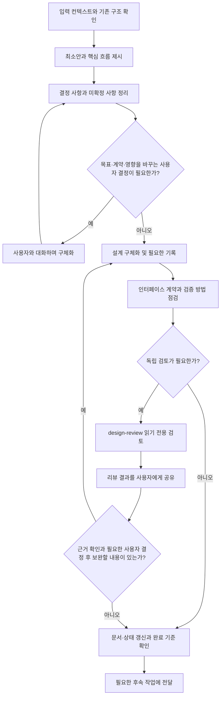
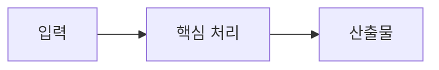

# 설계 작성

문서 또는 대화의 컨텍스트를 바탕으로 최소안을 제시하고, 대화하며 구현 가능한 설계로 구체화한다.

## 목적과 정의

설계를 별도 단계로 진행하기로 한 작업에서 활용하는 지침이다. 단순한 수정이나 기존 방식으로 충분한 작업에 Design 단계·산출물을 추가하도록 요구하지 않는다.

Design은 합의한 목적과 현재 프로젝트를 근거로 구현 가능한 책임·인터페이스·실패 경계를 정리하는 단계다. 방향에 대한 사용자 결정이 필요하면 최소안부터 제시하고 대화로 구체화한다. 이미 방향과 범위를 맡겼다면 필요한 설계 세부는 자율적으로 정리한다.

최소안은 논의를 시작할 구조와 방향을 담는다. 최종 설계는 후속 Task 분할과 구현에서 핵심 계약을 다시 추정하지 않아도 되는 수준을 목표로 한다. 설계 완료는 구현 완료나 검증 통과를 뜻하지 않는다.

## 입력과 사전 확인

- 문서로 전달된 컨텍스트: 요구사항, 목적, 제약, 기존 결정과 검증 자료
- 대화로 전달된 컨텍스트: 사용자 요청, 합의한 범위, 현재 작업 내역과 피드백

문서와 대화 중 하나만으로 목적과 변경 경계가 충분하면 진행한다. 특정 입력 문서나 파일명을 필수로 요구하지 않는다. 설계에 사용하는 컨텍스트의 범위를 밝히고, 필요한 관련 코드·설정·기존 인터페이스를 조사해 현재 동작과 중요한 근거를 확인한다. 확인한 사실, 가정, 제안과 사용자와 합의한 결정을 구분한다. 조사를 통해 모호함을 줄이고, 답에 따라 목표·계약·영향 범위가 실질적으로 달라질 때 사용자에게 문의한다.

문서와 상태를 기록할 작업 디렉터리는 사용자나 호출자가 지정한 위치를 확인한다. 위치가 불분명하면 임의로 선택하지 말고 확인한다.

## 진행 방식



### 1. 최소안 먼저 제시

사용자가 요구한 결과와 호출 방식부터 정하고, 합의한 목표를 달성할 핵심 구성과 데이터 흐름을 간결하게 제시한다. 구조·관계를 글만으로 파악하기 어려우면 Mermaid 등으로 표현한다. 기존 구현의 재사용, 필요한 신규·변경 범위와 중요한 미확정 사항을 정리한다.

최초 제안에서 모든 상세 계약을 완성할 필요는 없다. 사용자가 방향을 판단할 수 있는 정도로 제시하고, 논의할 세부 사항은 미확정으로 남긴다.

### 2. 대화하며 구체화

사용자 피드백에 따라 필요한 부분부터 설계를 발전시키고 문서에 반영한다. 제안한 내용을 사용자 답변 없이 합의된 결정으로 취급하지 않는다. 확인이 필요한 내용과 독립적인 설계는 계속 정리할 수 있다.

기존 작업 내역과 설계 의도를 존중하고, 목표를 충족할 수 있으면 기존 구현을 우선 재사용한다. 신규 구현이나 기존 동작 변경은 필요한 범위로 제한하며 이유와 영향을 설명한다. 입력 컨텍스트의 목적이나 가정이 달라지면 관련 문서 또는 대화의 합의 내용과 설계를 함께 갱신한다.

### 3. 인터페이스 수준으로 정리

해당 작업에 필요한 구성 요소의 책임과 연결 방식을 정의하고, 실제 적용되는 인터페이스마다 다음 내용을 구체화한다.

| 항목 | 정리할 내용 |
| --- | --- |
| 이름과 호출 방식 | 함수 시그니처, CLI 명령, API 경로 등 호출자가 사용할 계약 |
| 입력 | 형식, 타입, 필수 여부, 값의 의미와 제약 |
| 출력 | 반환값, 응답 또는 생성 문서·파일의 형식과 의미 |
| 오류 | 실패 조건과 호출자에게 전달하는 방식 |
| 부수 효과 | 변경되는 상태, 파일, 기존 동작 등 |

함수·CLI·API·문서 형식 중 해당 작업에 필요한 것만 작성한다. 현재 쓰임 없는 필드나 확장 계층을 추가하지 않는다. 구현 코드 작성 자체는 이 단계의 필수 산출물이 아니다.

## 구성과 경계 판단

구성과 경계 판단은 [코딩 지침](../guideline-coding/SKILL.md)과 연결한다. 해당 지침의 기존 동작 존중, 중복 확인, 재사용 적합성 확인, 필요한 범위만 변경하는 원칙을 설계에 적용한다.

- 프로젝트의 명시적 요구·기존 계약·코드와 호출 흐름을 근거로 구성 요소의 책임과 연결 방식을 정한다.
- 기존 기능 수정은 현재 구조 안에서 해결할 수 있는지 먼저 확인한다. 재사용할 기능의 입력 조건·결과·오류 처리·부수 효과가 요구사항에 맞는지 확인한다.
- 의미가 다른 책임을 무리하게 통합하거나, 확인되지 않은 확장을 위해 구조를 추가하지 않는다.
- 새 구조나 경계가 필요하면 실제 요구와 변경 영향을 근거로 이유를 설명하고, 중요한 선택을 설계 결정에 남긴다.
- 구조 선택이 결과에 큰 영향을 미칠 때만 실질적인 대안을 비교한다. 선택한 구조의 이유와 제약을 명시한다.

설계에는 후속 작업에서 다시 추정하지 않아야 할 책임·공개 계약·소유권·의존 관계·실패 범위만 해당 작업에 맞게 구체화한다. Task 분할에는 독립 구현 범위와 선행 계약·공유 파일 등 통합 지점을 전달하고, 구체 배정·실행 순서는 후속 단계에서 정한다. 구현 중 핵심 계약이 바뀌거나 동일한 우회·예외 처리가 반복되면 영향을 받는 설계와 작업을 함께 확인하고 갱신한다.

## 설계 표현과 검증

구조와 관계, 처리·호출 흐름은 이해에 도움이 되는 표현을 선택한다. 간단한 설계는 글이나 표로 충분하며, 복잡한 관계에는 Mermaid의 flowchart·sequenceDiagram 등을 활용할 수 있다.

입출력 형식과 오류 조건 등 다이어그램만으로 부족한 계약은 표·텍스트·코드 예시로 보완한다. 그림과 상세 계약이 서로 다른 내용을 설명하지 않도록 함께 갱신한다.

입력 컨텍스트에서 합의한 각 목표와 대응하는 설계 요소, 검증 방법을 연결한다. 검증 계획과 실제 확인 결과는 구분하고, 수행하지 않은 검증을 통과한 것으로 기록하지 않는다.

## 산출물과 기록

설계 산출물과 진행 상태는 [state-mgmt](../state-mgmt/SKILL.md)로 연결해 관리한다. 문서 또는 대화에서 정리한 설계를 해당 작업 디렉터리 하위의 `design.md`나 기존 설계 문서에 반영한다. 이 지침과 실제 작업의 설계 산출물을 구분한다.

기존 설계 문서가 있으면 내용을 확인한 뒤 갱신한다. 요구사항 요약, 관련 기존 구조, 제안 구조와 인터페이스, 선택 근거, 확인이 필요한 사항 중 해당 작업에 필요한 내용만 간결하게 기록하고 중복은 피한다. 주요 결정이나 변경 이유의 이력이 필요하면 [task-log](../task-log/SKILL.md)로 남긴다.

- 설계 작업이 없으면 `add`로 고유한 작업 ID를 등록하고, 기존 작업이 있으면 해당 ID를 사용한다.
- `set --document`로 작업 디렉터리 기준 설계 문서의 상대 경로를 연결하고, 실제 진행에 맞춰 `pending`, `progress`, `complete` 상태를 기록한다.
- 최소안 제시만으로 `complete` 처리하지 않는다. 해당 작업의 완료 기준을 충족했는지 확인한 뒤 완료 상태를 기록한다.
- 후속 작업에서 설계 보완이 필요해지면 문서와 상태를 함께 갱신한다. 실패나 중단 사유는 `--note`로 남기고, 재개할 때는 `show`로 상태와 연결 문서를 확인한다.

## design-review

핵심 계약·변경 영향의 불확실성을 줄일 필요가 있으면 독립 검토를 활용한다. 최소안 검토인지 구체화된 설계 검토인지와 검토 범위를 명시한다. 발견 사항의 근거를 확인하고 결과를 사용자에게 공유한 뒤, 필요한 결정과 보완 내용을 설계에 반영한다.

## 완료 기준

- 합의한 목적에 맞는 설계 방향이 있고, 필요한 사용자 결정과 받은 피드백이 반영되어 있다.
- 입력 컨텍스트의 목표에 대응하는 설계와 판단 근거, 검증 방법이 명확하다.
- 기존 구현의 재사용과 필요한 신규·변경 범위가 구분되어 있다.
- 필요한 인터페이스의 호출 방식, 입력·출력, 오류와 부수 효과가 정의되어 있다.
- 선택한 표현으로 구조와 흐름을 파악할 수 있다. 다이어그램이 있으면 상세 계약과 내용이 일치한다.
- 합의한 결정과 미확정 사항이 구분되어 있다. 구현을 좌우하는 질문이 미해결이면 완료로 보지 않는다.
- 구현 범위와 구성 요소의 경계가 드러나 Task 분할을 시작할 수 있다.
- 후속 작업에 필요한 책임·소유권·의존 관계·실패 범위와 선행 의존·통합 지점이 해당 작업에 맞게 정리되어 있다.
- 리뷰를 진행했다면 발견 사항의 처리와 중요한 미해결 내용을 확인할 수 있다. 별도 리뷰 수행이나 진행 여부 질문 자체를 일률적인 완료 조건으로 두지 않는다.
- 실제 Task 분할·구현·구현 결과 리뷰는 후속 단계에서 수행한다.

## 포맷 예시 — 템플릿

필요한 절만 활용한다. 방향 합의가 필요하면 최소안과 중요한 질문부터 작성하고 상세 내용을 보완한다. 아래 다이어그램은 표현 예시이며 작업에 도움이 될 때 실제 구성과 흐름으로 교체한다.

````markdown
# Design: 제목

## 입력과 확인한 현재 상태

<!-- 입력으로 사용한 문서 또는 대화의 컨텍스트 범위와 실제 확인한 기존 동작·구조·코드·설정, 사실·가정·미확인 사항을 기록한다. -->

## 목표와 설계 범위

<!-- 합의한 어떤 목표를 다루는지, 무엇을 재사용·변경·신규 작성하는지 정리한다. -->

## 최소 설계안과 핵심 흐름



## 아키텍처 구성과 분리 경계

<!-- 코딩 지침과 프로젝트 요구·기존 계약·코드를 근거로 책임·공개 경계·소유권·의존 관계·실패 범위를 정리한다. 구조 변경이 필요하면 이유와 영향을 기록한다. -->

## 구성 요소와 인터페이스 계약

<!-- 필요한 구성 요소의 책임, 이름·호출 방식·입력·출력·오류·부수 효과를 구체화한다. -->

## 구현 범위와 작업 간 경계

<!-- 독립 구현 범위, 선행 계약·구현 의존성, 공유 파일과 통합 검증 지점을 정리한다. 다른 작업과 공유하는 영역이 있으면 반영 순서를 확인한다. 구체적인 Task 순서는 Task 분할에서 정한다. -->

## 결정 사항과 근거

<!-- 확인한 사실·가정·제안과 사용자와 합의한 결정을 구분하고, 중요한 선택의 이유와 제약을 기록한다. 구조 선택이 결과에 큰 영향을 미칠 때만 실질적인 대안을 비교한다. -->

## 목표별 검증 방법

<!-- 합의한 목표와 설계 요소, 확인 방법을 연결한다. 계획과 수행 결과를 구분한다. -->

## 사용자 확인 질문과 미확정 사항

<!-- 피드백에 따라 해당 설계와 결정 사항을 갱신하고, 해결된 질문은 정리한다. -->
````
