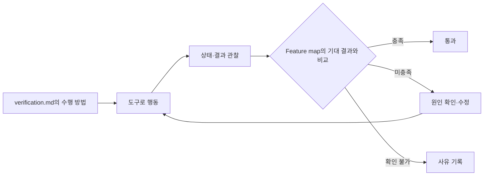

# 앱 수준 검증 도구·방법 구성 가이드

## 목적

에이전트가 실제 앱을 실행·조작하고 결과를 확인할 수 있도록 검증 도구와 검증 방법을 마련한다.
앱 수준 검증은 실행 중인 앱의 화면·API·CLI 등 실제 사용 경로를 통해 기능을 수행하고,
사용자에게 보이는 결과와 필요한 상태 변화를 확인하는 것이다. (추론)

이 가이드는 프로젝트에 맞는 도구를 선택·보완하고, 기능별 검증 과정과 구체적인 수행 방법을 정리할 때 사용한다.
다음 세 가지를 구성하여 에이전트가 앱을 직접 다루며 검증할 수 있게 한다. (추론)

| 구성 | 역할 |
| --- | --- |
| `docs/verification/tools/` | 공용 도구와 사용법: 앱 조작·상태·결과 관찰 수단 |
| `docs/verification/feature/` | 공용 Feature map: 도구와 무관한 기능별 검증 과정·기대 결과·확인 항목 |
| `<작업 디렉터리>/verification.md` | 해당 작업의 검증 범위·도구를 사용한 수행 방법·실제 결과 |

Feature map과 도구 사용 방법을 분리하는 것은 사용자가 지정한 문서 역할이다. (확인)

## 저장 구조

여러 작업에서 재사용하는 기능 정의와 도구는 `docs/verification/`에서 관리한다.
개별 작업의 검증 문서는 해당 작업 디렉터리 아래 `verification.md`로 작성한다. (확인)

```text
docs/
  verification/                  # 공용 검증 자산
    feature/
      auth.md                    # 인증 기능의 검증 과정·기대 결과
    tools/
      README.md                  # 도구 사용법
      ...                        # 필요한 스크립트·도구
  specs/
    auth/
      email-login/               # 개별 작업 디렉터리 예시
        verification.md          # 이 작업의 검증 방법·결과
```

`docs/specs/auth/email-login/`은 작업 디렉터리의 예시이며 실제 프로젝트의 작업 경로를 사용한다.
공용 자산은 작업별 문서에서 링크로 참조하고, 해당 작업의 입력·수행 내용·결과는 작업 디렉터리에 남긴다. (추론)

## 1. 앱 조작 도구

먼저 대상 앱의 주요 사용 경로를 실제로 조작할 수 있는지 확인한다.
웹 화면은 브라우저 조작 도구, API는 요청 도구 등 앱의 사용 방식에 맞는 기존 도구를 활용한다.
반복되는 조작이나 부족한 관찰 기능이 있으면 작은 CLI·스크립트로 보완한다. (추론)

도구는 아래 능력을 제공해야 한다. 하나의 전용 CLI로 모두 구현할 필요는 없으며,
여러 기존 도구를 조합하더라도 대상 앱에서 실제로 동작해야 한다. (추론)

| 구분 | 기능 예시 |
| --- | --- |
| 실행 | 앱 실행, 조작 세션 생성 |
| 상태 | `doctor`로 준비 상태 확인, `watch`로 상태 변화 관찰 |
| 제어 | `click`으로 클릭, `put`으로 값 입력 |
| 결과 확인 | `screenshot`으로 화면 캡처, `log`로 로그 확인 |
| 정리 | 이번 실행이 만든 앱·세션·임시 데이터 정리, 검증 근거 보존 |

공용 도구 문서에는 다음 내용을 포함한다. (추론)

- 실행: 저장소의 실제 실행 명령, 접속 정보, 인증·초기 데이터 준비 방법.
- 준비 상태: 프로세스 생존 외에 대상 버전·접속·인증·데이터가 검증 가능한 상태인지 확인하는 방법.
- 실행 격리: 포트·데이터·세션을 구분하는 방법. 분리가 불가능하면 제약을 명시하고 다른 실행과 동시에 조작하지 않는다.
- 조작·대기: 안정적인 요소 이름·역할 등을 사용하고, 고정 시간 대기보다 기대 상태가 나타나는지 한도 내에서 확인하는 방법.
- 정리: 이번 실행이 생성한 자원을 식별하여 제거하는 방법. 다른 실행의 자원은 건드리지 않고 근거 파일은 보존한다.

기능의 기대 결과에 응답·쿠키·저장 데이터 등이 포함되면 이를 조회할 수단도 준비한다.
화면 조작이 검증 대상이면 실제 화면 경로로 수행하고, 내부 상태를 직접 바꾸어 결과를 대신 만들지 않는다. (추론)

다음은 명령 구성 예시이며 실제 구현된 도구의 사용법은 아니다. (추측)

```sh
ctrl-app new
ctrl-app doctor
ctrl-app click login
ctrl-app put email <email>
ctrl-app put passwd <password>
ctrl-app click submit
ctrl-app screenshot /tmp/result.png
ctrl-app log
```

명령의 대상과 입력 방법, 출력·실패 신호를 설명한다.
도구와 공용 사용법은 `docs/verification/tools/`에 정리한다.
버튼 클릭 같은 명령 수행 여부와 기능의 기대 결과 충족 여부는 구분한다. (추론)

## 2. Feature map

Feature map은 기능 목록과 기능별 검증 절차의 모음이다.
각 기능의 접근 방식, 검증 순서, 기대 결과, 결과 확인 방법을 정리한다.
같은 기능이라도 웹·API처럼 접근 경로가 다르면 구분한다.
명령·스크립트·특정 도구의 사용법은 포함하지 않는다. (확인)

기능별 문서는 `docs/verification/feature/auth.md`처럼 공용 폴더에서 관리한다.
사용자 행동과 확인할 상태를 기준으로 작성하여 도구가 바뀌어도 검증 과정과 기대 결과를 유지한다. (추론)

기능별 사전 상태와 주의사항도 정리한다. 필요한 데이터나 계정을 준비할 수 없으면
기준을 완화하지 않고 작업별 검증 문서에 확인 불가 사유를 남긴다.
저장처럼 상태 변경이 필요한 기능은 완료 안내뿐 아니라 다시 조회한 결과도 확인 항목에 포함한다. (추론)

아래는 작성 예시다. 경로·인증 방식과 기대 결과는 실제 앱에 맞게 바꾼다. (추측)

````markdown
# Auth

## 기능 목록

- 이메일 로그인(Web)
- 이메일 로그인(API)
- Google 로그인

## 이메일 로그인(Web)

### 접근 방식

- Home → Login
- 사전 상태: 로그아웃 상태, 로그인 가능한 계정

### 검증 순서

1. 앱을 열고 로그인 화면으로 이동한다.
2. 이메일을 입력한다.
3. 비밀번호를 입력한다.
4. 로그인 버튼을 누른다.
5. 대시보드로 이동했는지 확인한다.

### 기대 결과

- 인증 응답: 200 OK
- 쿠키에 access_token 생성
- 대시보드로 리다이렉트

### 결과 확인

- 인증 응답의 상태 코드 확인
- 인증 쿠키 생성 여부 확인
- 대시보드 화면과 이동한 주소 확인

### 주의사항

- 로그인 가능한 계정이 없으면 해당 흐름은 확인 불가로 기록한다.
- 웹 로그인 성공만으로 API·Google 로그인도 검증했다고 판단하지 않는다.
````

## 3. 검증 수행 문서: verification.md

개별 작업 디렉터리의 `verification.md`는 해당 작업에서 검증할 기능과 범위,
공용 도구를 사용한 수행 방법, 실제 검증 결과를 정리한다.
앱 준비 방법, 사용할 도구와 명령, 결과 관찰 방법, 판정·근거를 작성한다.
검증 과정·기대 결과는 공용 Feature map을, 도구 사용법은 공용 도구 문서를 참조한다. (추론)

앱 실행·접속 방법, 계정·데이터 준비, 사용할 도구의 호출 방법을 실제 환경에서 확인하여 적는다.
다른 에이전트가 이 문서와 Feature map을 읽고 검증할 수 있을 정도로 구체화한다. (추론)

예를 들어 `docs/specs/auth/email-login/verification.md`는 다음처럼 작성한다.
아래 명령은 구성 예시이며, 실제 앱의 도구에 맞춰 구체화한다. (추측)

````markdown
# 검증 수행

## 검증 범위

- 이번 작업에서 변경한 이메일 로그인(Web) 흐름
- 검증 과정·기대 결과: [Feature map](../../../verification/feature/auth.md#이메일-로그인web)
- 도구 사용법: [공용 도구](../../../verification/tools/README.md)

## 준비

- 앱 실행 환경과 로그인 가능한 계정을 준비한다.
- `ctrl-app new`로 세션을 생성한다.
- `ctrl-app doctor`로 준비 상태를 확인한다.
- 이번 실행의 앱·세션·데이터를 구분하고 근거 저장 위치를 정한다.

## 수행

1. `ctrl-app click login`으로 로그인 화면을 연다.
2. `ctrl-app put email <email>`로 이메일을 입력한다.
3. `ctrl-app put passwd <password>`로 비밀번호를 입력한다.
4. `ctrl-app click submit`으로 로그인한다.

## 관찰·판정

- `ctrl-app screenshot /tmp/result.png`로 이동한 화면을 확인한다.
- 인증 응답·쿠키·주소는 사용하는 도구의 조회 기능과 구체적인 호출 방법을 작성한다.
- 오류가 있으면 `ctrl-app log`로 확인한다.
- 관찰 결과를 Feature map의 기대 결과와 비교한다.
- 실제 결과·근거 위치·충족 여부와 확인하지 못한 항목을 기록한다.

## 검증 결과

- 검증한 앱 버전·실행 환경:
- 수행한 기능·접근 경로와 검증하지 않은 경로:
- 실제 수행 내용과 관찰 결과:
- 기대 결과별 충족 여부:
- 행동과 그 결과를 보여주는 스크린샷·응답·로그 등 근거 위치:
- 확인하지 못한 항목과 사유:

## 정리

- 공용 도구 문서에 따라 이번 실행이 만든 앱·세션·임시 데이터를 정리한다.
- 정리 결과와 정리하지 못한 자원을 기록한다.
- 정리 후에도 기록한 위치에서 검증 근거를 확인할 수 있는지 점검한다.
````

재사용할 도구와 기능 정의의 변경은 공용 폴더에 반영한다.
작업별 `verification.md`에는 해당 작업에서 사용한 방법과 결과를 남기며,
과거 검증 결과를 새 도구나 기능의 결과로 바꾸지 않는다. (추론)

## 4. 행동 → 관찰 → 판정

`verification.md`에 따라 도구로 행동하고 실제 결과를 관찰한 뒤 Feature map의 기대 결과와 비교한다.
실패하면 관찰한 근거로 원인을 확인하고, 수정 후 같은 절차로 다시 검증한다. (추론)



화면 캡처만으로 응답이나 쿠키 생성까지 확인했다고 판단하지 않는다.
기대 결과마다 필요한 관찰 수단을 사용하고, 확인할 수 없는 항목은 사유를 남긴다. (추론)

## 구성 확인

핵심 기능 하나부터 도구와 문서를 구성한 뒤 `verification.md`를 따라 준비·조작·관찰·판정·정리까지 실제로 수행한다.
수행 중 부족한 조작·관찰 수단이나 설명을 보완하고 다른 기능으로 확장한다. (추론)

- 도구로 대상 앱을 조작하고 상태와 결과를 확인할 수 있다.
- Feature map에서 대상 기능의 검증 절차와 기대 결과를 찾을 수 있다.
- Feature map은 특정 도구에 의존하지 않는다.
- 공용 기능·도구는 `docs/verification/`에서 찾을 수 있다.
- 개별 작업 디렉터리의 `verification.md`에서 검증 범위와 수행·관찰·판정 방법을 찾을 수 있다.
- `verification.md`에 따라 실제로 수행하여 Feature map의 기대 결과와 비교할 수 있다.
- 수행 결과와 확인하지 못한 항목을 남긴다. (추론)
- 실패한 시도에서도 생성한 자원을 정리하고, 정리 후 검증 근거가 남아 있는지 확인한다.
- 실제로 수행하지 못했다면 구성 확인 완료로 처리하지 않고 미확인 범위를 남긴다. (추론)

## 참고

[Cursor create-verification-skill](https://github.com/cursor/plugins/blob/main/pstack/skills/create-verification-skill/SKILL.md)의
실행 준비·격리·정리와 실제 수행 확인 원칙을 참고했다.
해당 스킬은 Feature map에 도구 명령을 포함하지만, 이 가이드는 공용 기능 정의와 작업별 수행 방법을 분리한다. (확인)
