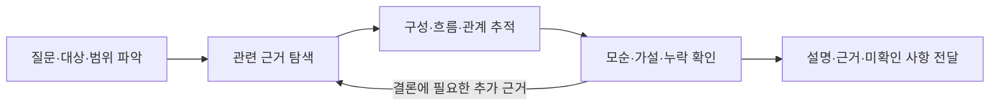

# 조사 가이드 (Inspect)

## 목적과 범위

코드·문서·설정·시스템 동작 등 사용자가 지정한 대상을 조사하여 구성·흐름·관계·조건을 설명한다.
자료 전체를 요약하기보다 질문에 답하는 데 필요한 근거를 연결하고, 후속 판단이나 작업을 시작할 수 있는 설명을 만든다.

| 질문 | 조사 방향 |
| --- | --- |
| 이 기능·시스템은 어떻게 동작하는가? | 구성, 시작 조건, 처리 순서, 결과·상태 변화 |
| 이 문서·스킬은 무엇을 지시하는가? | 목적, 적용 조건, 절차, 산출물, 제약·의존 관계 |
| 변경 전에 무엇을 알아야 하는가? | 현재 책임·계약, 의존성, 영향받는 대상과 주의점 |
| 설명·설정과 실제 동작이 왜 다른가? | 자료의 버전·적용 범위, 조건과 실제 관찰의 불일치 |
| 이 문제가 왜 발생하는가? | 증상, 재현 조건, 원인 후보와 가설을 구별할 검증 |

현재 상태의 설명과 앞으로 바꿀 내용의 제안을 구분한다.
새 책임·계약을 결정하는 작업은 설계로, 원하는 동작·정책을 정하는 작업은 요구사항 정의로 이어간다.
조사만 요청받았다면 발견 사항을 설명하는 데까지 수행한다. 수정·구현도 요청받았다면 해당 범위에서 후속 작업을 이어간다.

## 조사 과정

### 1. 질문과 필요한 근거 수준 정리

답해야 할 질문과 포함·제외 범위를 짧게 정리한다. 이미 명확한 내용은 되묻지 않는다.
문서 버전, 코드 커밋, 설정의 적용 범위, 관찰 시점·환경 등 결론을 바꿀 수 있는 조건을 명시한다.
합리적으로 좁힐 수 있는 질문은 해석을 밝히고 진행하며, 대상·환경에 따라 답이 크게 달라지면 확인한다.

문서가 지시하는 절차는 원문으로 확인할 수 있지만, 실제 적용 여부는 사용 경로나 관찰 근거가 필요하다.
구현 구조는 소스·설정 대조로 설명할 수 있지만, 실제 장애·성능·실행 상태를 단정하려면 실행 관찰이 필요하다.
원본을 읽는 것으로 충분한 질문에 실행 검증을 의무화하지 않는다.

### 2. 관련 원본과 관찰 자료 찾기

대상에 맞는 진입점을 선택한다. 문서·스킬은 본문과 참조 자료, 코드는 공개 진입점과 호출자, 시스템은 적용 설정·로그·관찰 결과부터 확인한다.
외부 자료는 원문과 공식 자료를 우선하고, 현재 상태에 민감한 주장은 최신 자료의 시점·적용 범위를 확인한다.
프로젝트 구조는 아키텍처 개요를 지도처럼 활용하고, `rg`로 관련 파일·심볼·설정을 찾아 실제 원본과 대조한다.
테스트·예시는 의도와 기대 결과의 근거이며, 존재 자체가 실행 성공이나 실제 사용을 증명하지는 않는다.

각 주장의 근거를 다시 찾을 수 있도록 경로·절·심볼·링크·관찰 조건을 유지한다.
검색에 나오지 않았다는 이유만으로 대상이 없다고 단정하지 않는다. 부재를 결론으로 삼을 때는 조사 범위와 접근하지 못한 자료·외부 의존성 등 한계를 밝힌다.
`docs/notes`는 사용자가 명시적으로 요청한 문서만 읽는다.

### 3. 구성·흐름·관계 추적

작은 질문은 직접 추적하고, 여러 영역이 얽힌 질문은 겹침이 적은 관점으로 나눠 조사한다.
아래 항목은 대상에 맞게 선택하며, 항목을 채우기 위해 무관한 자료를 읽지 않는다.

| 관점 | 확인할 내용 |
| --- | --- |
| 구성·책임 | 구성요소·역할·담당 범위와 위치 |
| 흐름 | 시작 조건, 처리·의사결정 순서, 중요한 분기 |
| 입력·결과 | 입력·출력, 변환, 상태 변화, 산출물·부수 효과 |
| 관계·경계 | 의존성, 연결 대상, 계약, 권한·책임의 경계 |
| 조건·예외 | 설정·정책·환경 차이, 실패·취소 등 관련 경로 |
| 근거·공백 | 확인한 주요 자료, 확인하지 못한 연결과 남은 질문 |

단계 이름만 나열하지 말고 각 단계가 무엇을 받아 어떤 결과를 다음 단계로 넘기는지 설명한다.
외부 서비스나 접근할 수 없는 자료는 확인 가능한 경계에서 멈추고, 그 너머를 사실로 채우지 않는다.

### 4. 디버깅에서 원인 후보 좁히기

문제 분석이 질문에 포함되면 적용한다. 일반적인 구조·문서 조사에 재현 절차를 추가하지 않는다.

1. 기대 결과, 실제 증상, 발생·미발생 조건을 정리한다. 사용자 보고, 로그로 관찰한 현상, 직접 재현한 결과를 구분한다.
2. 증상이 나타나는 경로에서 입력·설정·상태·의존성을 추적한다. 오류가 드러난 위치와 원인이 시작된 위치를 구분한다.
3. 근거가 있는 원인 후보를 정리하고, 후보를 구별할 관찰이나 최소 재현을 선택한다. 특정 후보에 유리한 자료만 모으지 않는다.
4. 허용된 범위에서 관련 테스트·재현 경로·로그 등을 확인하고, 각 후보를 지지하거나 반박하는 결과를 남긴다. 조사 요청이 운영 상태 변경이나 영구적인 계측 추가까지 허용한다고 간주하지 않는다.
5. 증상과 원인 사이의 연결을 확인하면 근거와 적용 조건을 설명한다. 재현·관찰이 부족하면 후보를 확정하지 않고 남은 검증을 제시한다.

분석만 요청받았다면 수정안은 제안으로 구분한다.
수정도 요청받았다면 분석 근거를 이어받아 수정하고, 같은 재현 조건과 영향받는 경로에서 결과를 검증한다.

### 5. 결과 대조와 불확실성 처리

관점별 결과의 중복을 합치고, 서로 다른 설명은 적용 조건·버전·원본·관찰 결과를 대조한다.
문서가 의도하는 동작, 설정된 값, 구현된 동작, 실제 관찰된 결과가 다르면 각각 구분한다.
모든 질문에서 하나의 자료 유형을 우선하지 말고, 무엇을 확인하려는지에 맞춰 근거를 선택한다.

중요한 주장에는 근거와 함께 다음 표시를 사용한다.

- `(확인)`: 직접 읽은 원본 또는 관찰한 결과. 자료 확인인지 실행·현장 관찰인지 문장에서 드러낸다.
- `(추론)`: 확인한 사실에서 도출한 판단. 결론을 지탱하는 근거를 연결한다.
- `(추측)`: 아직 검증하지 못한 가능성. 필요한 경우에만 제시하고 확인 방법을 덧붙인다.

현재 구조만으로 과거의 결정 의도나 작성자의 동기를 확정하지 않는다.
동기가 질문의 핵심이면 결정 문서·이력 등 직접 근거를 찾고, 찾지 못하면 미확인으로 남긴다.
실행 확인 시 대상·환경·관찰 결과를 남기고, 실행할 수 없으면 결론의 한계를 밝힌다.

### 6. 질문에 답하는 설명 작성

답을 먼저 쓰고, 해당 영역에 익숙하지 않은 독자가 따라갈 수 있게 핵심 개념과 흐름을 연결한다.
추상적인 역할 이름만 나열하지 말고 실제 문서·설정·구성요소·함수 이름으로 관계를 설명한다.
핵심 주장에는 원본의 위치나 관찰 근거를 연결하고, 긴 원문·코드 블록보다 필요한 부분만 인용한다.

다음 구성에서 질문에 필요한 항목만 사용한다. 짧은 질문에는 답과 근거만으로 충분하다.

| 구성 | 내용 |
| --- | --- |
| 답·개요 | 질문에 대한 직접 답변, 조사 대상·범위 |
| 핵심 개념 | 이후 설명에 필요한 개념·구성요소와 짧은 정의 |
| 구조·흐름 | 구성, 관계, 단계별 처리·결과와 중요한 조건 |
| 관련 자료 | 후속 작업을 시작할 주요 파일·문서·관찰 근거 |
| 원인 분석 | 문제 조사 시 증상, 원인 후보, 검증 결과와 판단 |
| 주의점·미확인 사항 | 한계, 결론에 미치는 영향과 후속 확인 방법 |

관계·처리 순서를 이해하는 데 도움이 되면 Mermaid 흐름도·시퀀스 다이어그램을 추가한다.
그림도 근거와 일치해야 하며, 추정한 연결은 확인된 연결과 구분한다.

## 결과 보존과 후속 작업

일반 질문에는 대화로 답한다. 파일 저장을 요청받았거나 후속 작업의 근거로 보존할 필요가 있으면 기존 관련 문서의 현황·조사 근거 절을 활용한다.
별도 문서가 필요하면 사용자 지정 위치나 기존 관련 작업 디렉터리를 사용하고 조사 대상 버전·범위와 근거를 남긴다.
확인한 현재 상태를 합의된 요구사항이나 채택된 설계로 처리하지 않는다.
요구사항·설계·검증 문서에 반영할 때는 [문서 관리 규칙](../document-management/index.md)을 따른다.

## 완료 확인

- 사용자의 질문에 직접 답했고, 조사 범위·대상·조건이 드러나는가?
- 중요한 구성·흐름·관계를 원본이나 관찰 자료에서 따라갈 수 있는가?
- 결론에 영향을 주는 조건·예외를 확인했거나 미확인으로 밝혔는가?
- 자료에 적힌 내용과 실제 관찰, 추론·추측을 구분하고 모순과 공백을 드러냈는가?
- 문제 조사에서는 증상과 원인 후보, 검증한 결과와 남은 가설을 구분했는가?
- 현재 상태·과거 동기·향후 제안을 구분하고, 요청받은 분석·수정 범위를 지켰는가?

## 참고

[pstack의 how 스킬](https://github.com/cursor/plugins/tree/main/pstack/skills/how)의 탐색·설명 분리와 근거 전달 관점을 참고하여, 코드 외의 대상과 디버깅 분석에도 적용하도록 구성했다.
특정 모델·하위 에이전트 도구를 전제하지 않으며, 작은 질문은 직접 조사한다.
