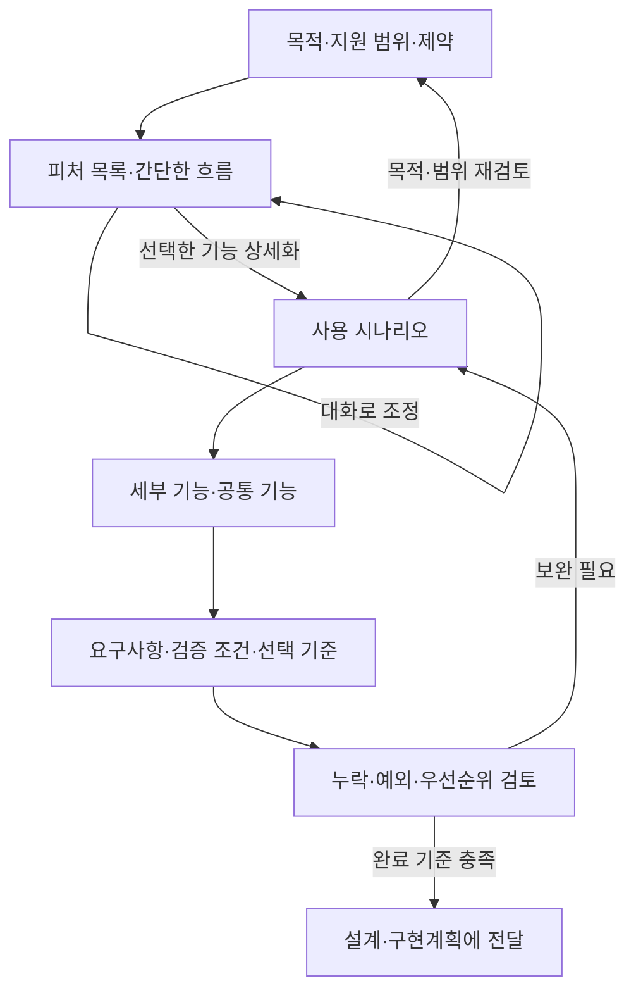

# 요구사항 정의 가이드

## 목적과 적용 범위

사용자의 목적·지원 범위·제약에서 피처 목록과 간단한 흐름을 구상하고,
필요한 항목의 시나리오·정책·요구사항·검증 조건을 상세화한다.
구상부터 설계·구현계획에 전달할 요구사항까지, 요청한 깊이로 내용을 정리하는 것이 목적이다. (확인: 사용자 지정 방향)

지원할 기능 목록을 대화로 정리하거나 새 기능의 요구사항을 정의하고 기존 요구사항을 보완할 때 사용한다.
설계·구현·결과물 채택의 상세 절차는 이 가이드의 범위에 포함하지 않는다.
요구사항 정의 요청만으로 구현까지 진행하라는 의미로 해석하지 않는다.

## 대화의 근거와 참조 범위

기본은 사용자가 대화에서 제공한 정보와 일반적인 개념 지식으로 시작한다.
이 가이드와 연결된 요구사항 스킬 외의 스킬·저장소·내부 문서·외부 자료를 자동으로 참조하지 않는다.
앞선 대화에서 확인한 구현 정보도 사용자가 이번 작업의 전제로 지정하지 않으면 판단 근거에 넣지 않는다. (확인: 사용자 지정 방향)

사용자가 자료 참조를 명시적으로 요청하면 지정한 범위에서 확인한다.
자료 확인이 필요하다고 판단하면 무엇을 왜 확인할지 질문하고, 동의 답변을 받은 뒤 참조한다.
답변이 없다는 이유로 참조하지 않으며, 이미 허용한 범위의 확인을 반복해서 묻지 않는다.
사용자가 문서 저장·갱신을 요청한 경우에는 아래 작성 양식과 문서 관리 규칙을 해당 작업에 활용한다. (제안·추론)

자료를 확인한 뒤에도 **사용자가 원하는 동작**과 **현재 구현·문서의 상태**를 구분한다.
차이가 있으면 반영 여부를 논의하며, 기존 코드나 문서를 자동으로 요구사항으로 채택하지 않는다.
실제 구현 여부나 외부 서비스의 지원 조건은 조사 없이 확인된 사실로 표현하지 않고 확인할 항목으로 남긴다. (제안·추론)

## 기본 원칙

- 사용자 요구는 무엇을 왜 제공하고 어떤 조건을 충족해야 하는지 설명한다. 파일·모듈·API와 구현 순서는 설계·구현계획에서 정한다. 사용자가 명시한 기술 제약은 요구사항에 포함한다.
- 피처 목록 구상은 기능명·한 줄 설명·범위·간단한 흐름을 중심으로 정리한다. 개별 기능을 상세화할 때 진입 경로, 사용자 입력·행동, 시스템 반응과 기대 결과를 구체화한다.
- 이번 대화의 결정과 허용된 자료를 활용하고, 명확한 내용은 다시 질문하지 않는다.
- 결과는 기본적으로 대화에서 유지한다. 별도 문서 저장은 사용자가 요청할 때 수행한다. 불필요한 단계·식별자·문서를 만들지 않는다.
- 사실, 합의한 결정, AI의 제안과 미검증 가정을 구분한다. 중요한 내용에는 근거와 함께 `(확인)`, `(추론)`, `(추측)`을 표시한다. 이 표시는 요구사항의 승인 여부를 대신하지 않는다.
- 성능 수치, 권한, 데이터 처리 정책 등을 근거 없이 확정하지 않는다.

## 진행 절차

피처 목록 구상과 요구사항 상세화를 이어지는 두 수준으로 다룬다.
사용자가 요청한 깊이까지만 진행하고, 목록만 요청한 경우 상세 시나리오·정책·검증 조건을 모두 작성하지 않는다.
이미 상세화할 기능과 범위가 정해졌다면 목록 구상부터 반복하지 않는다. (제안·추론)

아래 순서로 내용을 구체화하되, 이번 대화와 허용된 자료에서 이미 정리된 내용은 재사용한다.
단계별로 산출물의 누락과 해석 차이를 점검하고 필요한 부분을 보완한다.
단계를 구분했다는 이유만으로 매 단계마다 사용자 승인을 요청하지 않는다.
사용자가 단계별 확인을 요청했다면 해당 방식으로 진행한다.

| 단계 | 정리할 내용 | 점검할 사항 |
| --- | --- | --- |
| 1. 목적·지원 범위·제약 | 사용자, 해결할 문제, 지원할 대상·방식, 기대 결과, 포함·제외 범위와 나중에 정할 사항 | 누구의 어떤 목표를 달성하려는지 설명할 수 있는가? |
| 2. 피처 목록 구상 | 기능명·한 줄 설명, 포함 범위·후보·보류, 간단한 흐름과 열린 질문 | 무엇을 지원할지와 나중에 정할 사항을 설명할 수 있는가? |
| 3. 사용 시나리오 | 선택한 기능의 상황과 계기, 사용자 행동, 시스템 반응, 기대 결과, 필요한 대안·실패 흐름 | 사용 시작부터 결과 확인까지 이어지는가? |
| 4. 세부 기능 도출 | 기능별 책임, 입력과 결과, 공통 기능, 시나리오와 기능의 연결 | 시나리오에 필요한 기능이 빠지거나 중복되지 않았는가? |
| 5. 요구사항과 판단 기준 | 동작·정책, 품질 기준·제약, 검증 조건, 선택 기준, 자율 결정 범위, 미결정 사항 | 필수 조건과 구현 대안을 비교할 기준이 구분되는가? |
| 6. 누락·우선순위 검토 | 권한, 빈 상태, 실패, 경계 조건, 충돌·의존 관계, 이번 범위, 보류 항목과 이유 | 중요한 누락과 이번 범위를 바꾸는 불확실성이 남아 있는가? |

브레인스토밍은 목적이나 사용 방식을 탐색할 필요가 있을 때 활용한다.
유즈케이스는 여러 시나리오를 사용자 목표별로 묶을 필요가 있을 때 작성한다.
둘 다 필수적인 별도 단계로 두지 않는다.

시나리오에 드러난 기능 외에 성능·보안·접근성·운영 제약처럼 여러 흐름에 공통으로 적용되는 조건도 검토한다.
작업과 관련 있는 조건만 다루고, 정해지지 않은 기준은 미결정 사항으로 남긴다.

### 피처 목록 수준의 진행

처음부터 기능과 시나리오를 엄격히 구분하지 않고, 사용자가 하려는 일과 시스템이 제공할 일을 짧게 정리한다.
사용자가 명시한 지원 범위는 포함으로 반영하고, 새로 도출한 기능은 후보임을 드러낸다.
필요할 때 `포함`, `후보`, `보류`, `제외`로 구분하며, 보류는 제품에서 지원하지 않는다는 뜻으로 사용하지 않는다. (제안·추론)

간단한 흐름은 기능의 연결과 누락을 확인할 정도로 제시한다.
한 번에 중요한 질문 한두 개를 다루고, 대화로 항목의 추가·통합·분리와 대상·지원 방식·범위 조정을 진행한다.
계정 종류 같은 체계도 목록을 검토하다 구분할 필요가 드러나면 후보로 정리한다.
상세화한 항목이 생겨도 전체 피처 목록과 연결을 유지하며, 목록 상태와 상세화 수준은 구분한다. (제안·추론)

예를 들어 “로컬·구글·카카오 계정을 이메일 기반으로 지원하고 웹 연동은 나중에 정한다”는 입력을 받으면,
로컬·소셜 가입과 로그인을 목록에 담고, 이메일 확인·로그인 수단 연결·복구 등은 후보로 제안할 수 있다.
큰 흐름은 `가입 또는 소셜 인증 → 계정 식별·생성 → 로그인 완료 → 계정 사용` 정도로 제시한다.
세션·JWT-cookie는 보류하고, 같은 이메일의 계정 자동 통합 같은 정책이나 제공자별 지원 조건은 임의로 확정하지 않는다.
이는 구상 방식의 예시이며 실제 프로젝트의 요구사항은 아니다. (예시·추론)

## 질문과 결정 기준

먼저 사용자 요청과 이번 대화의 결정, 참조가 허용된 자료에서 답을 찾는다. 중요한 판단에 필요한 정보가 없으면 영향과 선택지를 정리하여 질문한다.
답변을 기다리는 동안에는 해당 결정에 의존하지 않는 내용을 정리할 수 있다.

| 구분 | 처리 방식 | 예시 |
| --- | --- | --- |
| 이미 명확한 요구와 결정 | 그대로 반영하고 근거를 연결한다 | 사용자가 지정한 이번 작업 범위 |
| 영향이 작고 수정하기 쉬운 세부사항 | 기존 규칙 안에서 합리적으로 정리하고, 중요한 가정은 기록한다 | 용어 통일, 문서 구성, 시나리오 묶음 |
| 목적·범위·중요 정책을 바꾸는 결정 | 기존 권한과 합의로 판단할 수 없으면 사용자에게 확인한다 | 대상 사용자 확대, 접근 권한 변경, 개인정보 외부 전송 |
| 아직 정해지지 않은 조건 | 미결정 내용, 영향, 확인 필요 시점을 남긴다 | 성능 목표 수치, 외부 서비스 실패 시 정책 |

사실이 확인되었다는 것과 사용자에게 제안을 승인받았다는 것을 구분한다.
AI의 제안을 확정 요구사항으로 바꾸거나, 가정을 근거로 작업 범위를 확대하지 않는다.
미결정 사항은 구현계획 진행을 막는 항목과 가정을 명시하고 진행할 수 있는 항목으로 구분한다.

## 산출물

기본 산출물은 대화에서 갱신하는 현재 범위·피처 목록·간단한 흐름·열린 질문이다.
요청한 기능을 상세화하면 해당 시나리오·요구사항·검증 조건을 함께 유지한다.
목록 구상만으로 상세 요구사항이나 설계가 완료되었다고 판단하지 않는다. (제안·추론)

사용자가 문서 저장·갱신을 요청하면 [문서 관리 규칙](../document-management/index.md)에 따라 Markdown 문서를 작성·수정한다.
새 문서는 [작성 양식](template.md)을 복사하고 자리표시자를 실제 문서 ID·제목·요구사항 ID·앵커로 바꾼다.
양식 상단의 작성 안내는 실제 산출물에서 제거한다. 관련 없는 항목은 생략하거나 해당 없음을 표시한다.
개별 요구사항은 ID와 명시적 앵커를 가진 제목 아래에 작성하여 검색과 세부 참조에 활용한다.
문서 상태는 문서 전체의 채택 여부이며, 항목의 합의 상태와 구현 완료 여부는 별도로 기록한다.

- 목적·사용 방식과 이번 범위
- 피처 목록: 기능명·한 줄 설명·범위 상태·상세화 수준·관련 항목
- 주요 시나리오와 필요한 대안·예외 흐름
- 세부 기능과 공통 기능
- 요구사항과 관찰 가능한 검증 조건
- 필수 조건을 만족한 결과물의 선택 기준
- AI가 결정할 범위와 사전 확인이 필요한 결정
- 우선순위, 보류 항목, 가정·미결정 사항
- 검토 중 수정한 중요한 내용과 이유

시나리오·기능·요구사항·검증 조건은 변경 영향과 누락을 찾을 수 있을 정도로 연결한다.
연결이 복잡해질 때 식별자나 링크를 사용하며, 일대일 대응을 강제하지 않는다.

## 완료 기준과 후속 연결

피처 목록 구상은 요청한 범위의 기능과 간단한 흐름, 후보·보류 항목과 열린 질문이 정리되면 해당 수준에서 마칠 수 있다.
개별 기능의 상세화가 필요하면 그 항목을 이어서 구체화한다.
자료 참조·문서 저장·설계·구현으로의 전환은 사용자 요청에 따라 진행한다. (제안·추론)

상세 요구사항은 아래 조건을 충족하면 이번 범위의 설계·구현계획에 전달할 수 있다.

- 대상 사용자, 목적, 사용 방식, 포함·제외 범위가 명확하다.
- 주요 시나리오와 필요한 대안·예외 흐름에 대응하는 기능이 정리되어 있다.
- 기능·정책·품질 기준·제약과 우선순위가 필요한 수준으로 정리되어 있다.
- 필수 조건의 충족 여부를 관찰 가능한 결과로 판정할 수 있다.
- 선택 기준과 AI의 자율 결정 범위가 정리되어 있다.
- 중요한 해석 차이와 수정 이유가 기록되어 있다.
- 미결정 사항과 가정의 영향이 표시되어 있고, 다음 진행을 막는 중요한 결정이 해소되어 있다.

완료는 요구사항을 영구적으로 고정한다는 의미가 아니다.
후속 설계·구현에서 새 제약이 발견되면 관련 시나리오·요구사항·검증 조건을 함께 갱신한다.
결과물에 맞춰 필수 조건을 임의로 완화하지 않는다.

후속 과정에는 이 산출물과 남은 가정·제약을 전달한다.
구현 방법, 작업 분해, 의존 관계, 구현 순서와 검증 실행 방법은 설계·구현계획에서 구체화한다.
