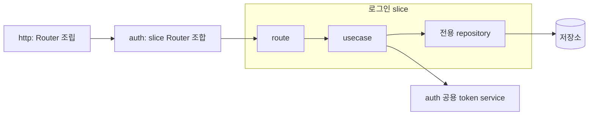

# 앱 개발 구조: Vertical Slice Architecture

## 목적과 범위

앱의 코드를 `auth` 같은 feature로 묶고, 그 안에서는 로그인·사용자 생성처럼
완결된 작업 시나리오를 vertical slice로 구성한다.
한 시나리오의 요청·처리·저장 접근·테스트를 가까이 두어, 변경에 필요한 맥락과 수정 범위를 모으는 것이 목적이다.
지역성을 높여 에이전트 기반 개발에 적합한 구조를 지향한다는 방향은 사용자 요청이다. (확인)

`usecase`, `service`, `repository`, `route`는 각각 시나리오, 공용 작업, 저장, 제어의 책임을 나타낸다.
이 책임 구분은 유지하되, 물리적 배치의 우선 기준은 시나리오다.
역할마다 앱이나 feature 전체를 가로지르는 계층을 만들지는 않는다. (제안·추론)

이 문서는 백엔드인 `tlab-app`의 개발 구조를 정리한다.
현재 앱은 [`app::Container`](../../tlab-app/src/app.rs)에서 구성요소를 소유하고,
[`http`](../../tlab-app/src/http.rs)에서 Router 조립과 서버 실행·종료를 담당한다.
아직 feature별 모듈은 없으며, 아래 배치와 경계는 향후 개발을 위한 제안이다. (확인·추론)

앱과 공통 라이브러리의 역할은 [아키텍처 개요](index.md)를 따른다.
특정 feature의 정책과 시나리오는 앱에 두고, 앱과 독립적으로 재사용할 기반 기능은 `tlab`이 제공한다. (추론)

## feature·slice·역할의 경계

| 구분 | 기준 | 소유할 내용 |
| --- | --- | --- |
| feature | 관련 기능과 정책의 소유 범위 | `auth`의 공용 정책·타입·작업, 관련 slice, 스키마 |
| slice | 호출자가 달성하려는 하나의 목표 | 로그인 등 시나리오의 입력·출력, 제어, 실행, 전용 쿼리와 테스트 |
| 역할 | 코드가 담당하는 책임 | slice 내부와 feature 공용 코드의 usecase·service·repository·route 책임 |

slice는 HTTP 엔드포인트나 테이블 수로 나누지 않고, 함께 완료되고 같은 이유로 바뀌는 작업을 기준으로 나눈다.
같은 목표의 HTTP·CLI 진입점은 하나의 usecase를 사용할 수 있다.
같은 테이블을 사용해도 목표와 정책이 다르면 서로 다른 slice에 둔다. (제안·추론)

아래는 배치 예시이며 현재 앱에 구현된 기능을 뜻하지 않는다.
작은 slice는 단일 파일에서 시작하고, 커지면 같은 이름의 디렉터리 아래에서 역할별 파일로 분리한다.
파일을 분리해도 시나리오 단위의 경계는 유지한다. (제안·추론)

```text
tlab-app/src/
├── app.rs                         # 앱 설정·공유 인스턴스 소유와 조립
├── http.rs                        # feature Router 조합·서버 실행과 종료
├── main.rs                        # 실행 경로 선택
└── auth/
    ├── mod.rs                     # slice 선언·feature의 공개 계약
    ├── route.rs                   # 각 slice Router의 등록·조합
    ├── entity.rs                  # 여러 slice가 공유하는 타입·불변 조건
    ├── create_managed_user.rs     # 작은 slice: 요청·처리·전용 쿼리·테스트
    ├── login_managed_user/
    │   ├── mod.rs                # slice 공개 진입점·타입
    │   ├── route.rs              # 요청·응답·제어
    │   ├── usecase.rs            # 로그인 시나리오와 트랜잭션
    │   ├── repository.rs         # 로그인에만 필요한 쿼리·row 변환
    │   └── tests.rs              # 로그인 계약·상태 변화 검증
    ├── service/
    │   ├── mod.rs
    │   └── token_service.rs       # 여러 slice가 함께 사용하는 토큰 작업
    └── migrations/               # feature 소유 스키마가 있을 때
```

`auth/route.rs`는 Router를 조합하고, 실제 handler와 요청·응답 타입은 각 slice에 둔다.
Rust 모듈은 기본적으로 비공개로 두고, 상위 조립이나 외부 호출에 필요한 항목만 제한적으로 공개한다.
하위 모듈의 테스트 파일은 해당 모듈에서 `#[cfg(test)] mod tests;`로 연결할 수 있다.
필요한 역할과 파일만 만들며, `migrations/`의 실행·등록 방식은 별도 계약을 따른다. (제안·추론)

## 지역성과 공용화 기준

시나리오 전용 코드의 기본 소유자는 해당 slice다.
요청·응답 타입, 검증, 결과 타입, 전용 쿼리와 DB row는 사용하는 slice 가까이에 둔다.
조회마다 필요한 데이터가 다르면 slice별 조회 모델을 사용할 수 있으며,
하나의 공용 entity나 범용 repository에 모든 요구를 모으지 않는다. (제안·추론)

여러 slice가 같은 의미와 변경 이유로 사용하는 작업은 feature 공용 service로 추출한다.
동일한 업무 불변 조건은 소유 feature의 공용 정책·타입에서 관리한다.
SQL이나 코드 모양이 비슷하다는 이유만으로 공용화하지 않으며, 공용 저장 연산도 실제로 같은 계약이 필요할 때 추출한다.
공용화는 중복 감소와 함께 변경 영향이 넓어지는 비용을 고려한다. (제안·추론)

한 slice에서 다른 slice의 내부 handler·쿼리·보조 함수를 가져다 쓰지 않는다.
재사용이 필요하면 소유 feature의 공용 작업으로 분리할지 검토하고,
여러 feature를 조합하는 목표는 그 목표를 책임지는 usecase에 둔다.
같은 스키마와 공용 정책을 사용하는 slice는 변경 영향이 연결되므로 별도 확인이 필요하다. (제안·추론)

## 역할과 책임

아래 정의는 사용자 기준이며, 세부 책임과 예시는 이를 구체화한 제안이다. (확인·추론)

| 역할 | 정의 | 담당할 책임 | 예시 |
| --- | --- | --- | --- |
| `usecase` | 완결성이 있는 작업 시나리오 | 작업의 입력·완료 조건·실패 결과를 정의하고, 정책 판단과 service·repository 호출을 조합한다. 함께 성공해야 하는 변경의 트랜잭션 범위를 정한다. | 사용자 생성, 로그인, 사용자 역할 변경 |
| `service` | 공용으로 사용되는 작업 범위 기능 | 여러 시나리오나 호출자가 사용하는 응집된 작업·정책을 제공한다. 자신이 맡은 작업의 입력·결과·부수 효과를 책임진다. | 토큰 발급·검증, 권한 판단, 소셜 사용자 조회 또는 생성 |
| `repository` | 저장 레이어 | slice에 필요한 조회·저장·삭제, 쿼리와 저장 형식 변환, 저장소 오류 변환을 담당한다. 실제 공용 계약이 있을 때 feature 수준으로 추출한다. | 로그인용 사용자·자격 정보 조회, 사용자 저장 |
| `route` (`controller`) | 제어 영역 | 요청·인증 정보를 해석하고, 실행할 작업을 선택·호출하며, 결과·오류를 HTTP 응답·헤더·쿠키로 변환한다. | 로그인 요청을 command로 변환하고 토큰을 응답 |

### usecase: 작업의 완료를 책임지는 주체

usecase의 단위는 함수 크기나 테이블 하나가 아니라 호출자가 달성하려는 목표다.
사용자 생성이라면 계정·인증 수단·자격 정보 저장까지 묶어 성공 여부를 정할 수 있다.
읽기 작업도 여러 조회와 정책을 조합해 하나의 결과를 완성해야 한다면 usecase로 둔다. (제안·추론)

usecase의 입력과 결과는 같은 slice 안에서 HTTP 요청·응답 타입과 책임을 구분한다.
HTTP 상태 코드나 쿠키를 직접 다루지 않고, 호출자가 해석할 결과와 오류를 제공한다.
계약상 차이가 없다면 동일한 데이터 타입을 사용할 수 있으며, 계층별로 같은 필드의 타입을 반복 생성하지 않는다.
다른 시나리오에서 일부 처리를 재사용해야 한다면 그 작업을 service로 분리할지 검토한다. (제안·추론)

### service: 재사용할 작업 범위를 책임지는 주체

service의 공용 범위는 feature 내부에서 시작한다. 여러 feature가 사용하더라도
토큰이나 권한처럼 특정 feature가 소유하는 기능은 해당 feature의 공개 계약으로 제공한다.
호출자가 여러 곳이라는 이유만으로 앱 공통 모듈이나 `tlab`으로 이동하지 않는다. (제안·추론)

service는 필요한 정책과 repository 호출을 포함할 수 있고, 상태가 필요하면 관련 상태를 소유한다.
단순히 usecase의 모든 호출을 중계하거나 관련 없는 기능을 모으는 역할로 만들지 않는다.
한 시나리오에만 필요한 세부 처리는 해당 slice의 내부 함수나 모듈로 둔다. (제안·추론)

### repository: 저장 방법을 책임지는 주체

repository 책임은 slice 내부의 함수나 모듈로 구현할 수 있고, 별도 trait·객체를 필수로 만들지 않는다.
호출자가 지정한 조건으로 데이터를 읽고 쓰며 저장소의 제약과 오류를 계약으로 드러낸다.
사용자를 로그인시킬 수 있는지, 어떤 변경을 함께 완료해야 하는지 같은 시나리오 판단은 상위 호출자가 담당한다.
조회 결과 없음, 중복, 갱신 대상 없음의 의미를 호출자가 구분할 수 있게 한다. (제안·추론)

여러 저장 작업을 묶을 때는 usecase가 트랜잭션을 열고 동일한 DB context를
service와 repository에 전달하는 방식을 기본으로 한다.
repository는 전달받은 context로 실행하며 호출자의 트랜잭션을 임의로 commit하지 않는다.
현재 앱의 [`app::db::Context`](../../tlab-app/src/app.rs)와
[`sqlxdb`](../../tlab/src/sqlxdb.rs)의 연결·트랜잭션 API를 활용할 수 있다. (제안·추론)

### route: 요청과 작업 실행의 연결을 책임지는 주체

route는 요청 형식 검증, 인증 주체 추출, 진입 권한 확인, 입력 변환과 응답 구성을 담당한다.
작업 자체의 상태 조건·정책·여러 저장 작업의 조정은 usecase 또는 service에 둔다.
HTTP 이외의 경로에서도 지켜야 하는 권한·업무 조건은 실행할 작업의 계약에 포함한다. (제안·추론)

단순 조회처럼 별도 정책이나 조정이 없는 처리는 route에서 repository를 직접 호출할 수 있다.
조건 판단과 처리 조합이 늘어나면 usecase로 옮긴다.
모든 요청에 usecase와 service를 형식적으로 하나씩 추가하지 않는다. (제안·추론)

## slice 내부 협력과 외부 의존

각 slice는 필요한 처리 구조를 선택한다. 아래는 로그인 slice의 예시이며,
단순 조회는 같은 slice의 route에서 repository를 호출하는 형태로 구성할 수 있다.
service와 repository는 HTTP 진입점을 알지 않으며, repository는 usecase나 service의 정책에 의존하지 않는다. (제안·추론)



지속적으로 공유할 인스턴스와 설정의 조립·소유는 `app::Container`에 둔다.
요청마다 만드는 usecase는 route에서 필요한 의존성을 전달해 생성할 수 있다.
service와 repository에 Container 전체를 넘기기보다 담당 작업에 필요한 의존성이나 context를 전달한다. (제안·추론)

공용 service는 자신의 저장 접근을 포함할 수 있다.
이때 호출자의 slice 전용 repository에 의존하지 않고, 자신이 소유하는 저장 구현이나 feature의 공용 저장 계약을 사용한다.
전체 작업의 원자성이 필요하면 같은 DB context를 전달하고, 독립된 저장 작업이면 그 경계를 계약에 명시한다. (제안·추론)

## 에이전트 기반 개발에서의 작업 범위

에이전트가 하나의 시나리오를 변경할 때 읽고 수정할 코드, 테스트와 계약을 가까운 위치에서 찾도록 한다.
이 배치는 탐색 범위와 다른 작업과의 파일 충돌을 줄이는 데 유리할 것으로 판단하지만,
실제 효과는 변경 시 함께 읽고 수정하는 파일과 공용 코드의 의존 범위를 통해 확인해야 한다. (추론)

1. 대상 slice와 기대 동작을 확인한다. 관련 명세가 있으면 `docs/specs/<feature>/<행위>/`에서 함께 읽는다.
2. slice의 공개 진입점과 직접 사용하는 공용 작업·정책·스키마를 확인해 영향 범위를 정한다.
3. 시나리오 전용 변경과 검증은 slice 안에서 완료한다. 전역 Router 등록·Container 변경은 조립에 필요한 경우 수행한다.
4. 공용 계약이나 스키마를 바꾸면 참조하는 다른 slice를 검색하고 영향받는 동작도 검증한다. (제안·추론)

## 참조 구조에서 확인한 사례

사용자가 지정한 [tlab-rust의 auth 모듈](https://github.com/ghtak/tlab-rust/tree/e743075bb9921469e53e7bfb885aac9e1ad25d2e/tlab-boilerplate/src/auth)을 참조했다.
확인 기준은 커밋 `e743075bb9921469e53e7bfb885aac9e1ad25d2e`이며,
이 저장소에 해당 인증 기능을 도입하기로 결정한 것은 아니다. (확인)

참조 구조는 `auth` 아래에서 `route/`, `usecase/`, `service/`, `repository/`로 나뉜다.
역할과 처리 흐름의 사례는 참고하되, 이 문서에서는 시나리오 전용 코드를 각 slice 아래로 모으는 방향으로 배치를 조정한다. (확인·제안)

- [`route.rs`](https://github.com/ghtak/tlab-rust/blob/e743075bb9921469e53e7bfb885aac9e1ad25d2e/tlab-boilerplate/src/auth/route.rs): 로그인은 request를 command로 바꾸고 usecase 결과를 쿠키·응답으로 변환한다. `/me`는 repository를 직접 호출한다.
- [`login_managed_user.rs`](https://github.com/ghtak/tlab-rust/blob/e743075bb9921469e53e7bfb885aac9e1ad25d2e/tlab-boilerplate/src/auth/usecase/login_managed_user.rs): 사용자·자격 정보 조회, 비밀번호 검증, 토큰 발급, 로그인 시각 저장을 조합하고 트랜잭션을 완료한다. commit 이후 접근 토큰 활성화도 수행한다.
- [`create_managed_user.rs`](https://github.com/ghtak/tlab-rust/blob/e743075bb9921469e53e7bfb885aac9e1ad25d2e/tlab-boilerplate/src/auth/usecase/create_managed_user.rs): 별도 service 없이 해싱 기능과 repository를 사용해 사용자 생성 시나리오를 완성한다.
- [`social_user_service.rs`](https://github.com/ghtak/tlab-rust/blob/e743075bb9921469e53e7bfb885aac9e1ad25d2e/tlab-boilerplate/src/auth/service/social_user_service.rs): 호출자가 전달한 DB context 안에서 소셜 사용자를 조회하거나 생성하는 작업을 제공한다.
- [`user_repository.rs`](https://github.com/ghtak/tlab-rust/blob/e743075bb9921469e53e7bfb885aac9e1ad25d2e/tlab-boilerplate/src/auth/repository/user_repository.rs): DB context를 받는 함수들로 SQL 실행과 row·entity 변환을 제공한다. (확인)

참조 코드의 모든 구현 방식을 규칙으로 채택하지는 않는다.
특히 DB commit 이후 외부 상태를 갱신하는 작업은 DB 트랜잭션만으로 원자성을 보장할 수 없으므로,
해당 시나리오 설계에서 완료 조건, 실패 시 남는 상태와 복구 방법을 정한다. (제안·추론)

## 개발 시 점검 기준

- feature의 데이터·정책 소유자와 slice의 시나리오 완료 조건이 명확한가?
- 시나리오의 요청·처리·전용 쿼리·테스트를 같은 slice에서 찾을 수 있는가?
- 다른 slice의 내부 구현에 의존하거나, 전용 코드를 공용 계층에 배치하지 않았는가?
- 공용 작업은 같은 의미와 변경 이유를 가지며, 공유 정책·스키마 변경의 영향 범위를 확인했는가?
- usecase가 작업의 완료 조건, 실패 결과와 함께 성공해야 하는 변경 범위를 설명하는가?
- service가 재사용할 작업을 제공하고, repository가 저장 접근을 담당하는가?
- route의 요청·응답 처리와 작업 자체의 정책을 구분했는가?
- 계층 수를 맞추기 위한 중계 모듈이나 필요 이상의 공통화를 추가하지 않았는가?
- [테스트·검증 가이드](guide-test.md)에 따라 route의 응답 계약, usecase의 성공·실패와 상태 변화,
  service의 공용 작업 계약, repository의 실제 저장 동작 중 변경에 필요한 범위를 검증하는가? (제안·추론)

관련 관점은 Jimmy Bogard의 [Vertical Slice Architecture](https://www.jimmybogard.com/vertical-slice-architecture/)에서
설명하는 변경 축을 따른 구성, slice 내부 응집도와 slice 간 결합을 기준으로 참고했다.
이 문서의 Rust 배치와 네 역할의 구체적인 계약은 현재 프로젝트에 맞춘 제안이다. (확인·추론)
