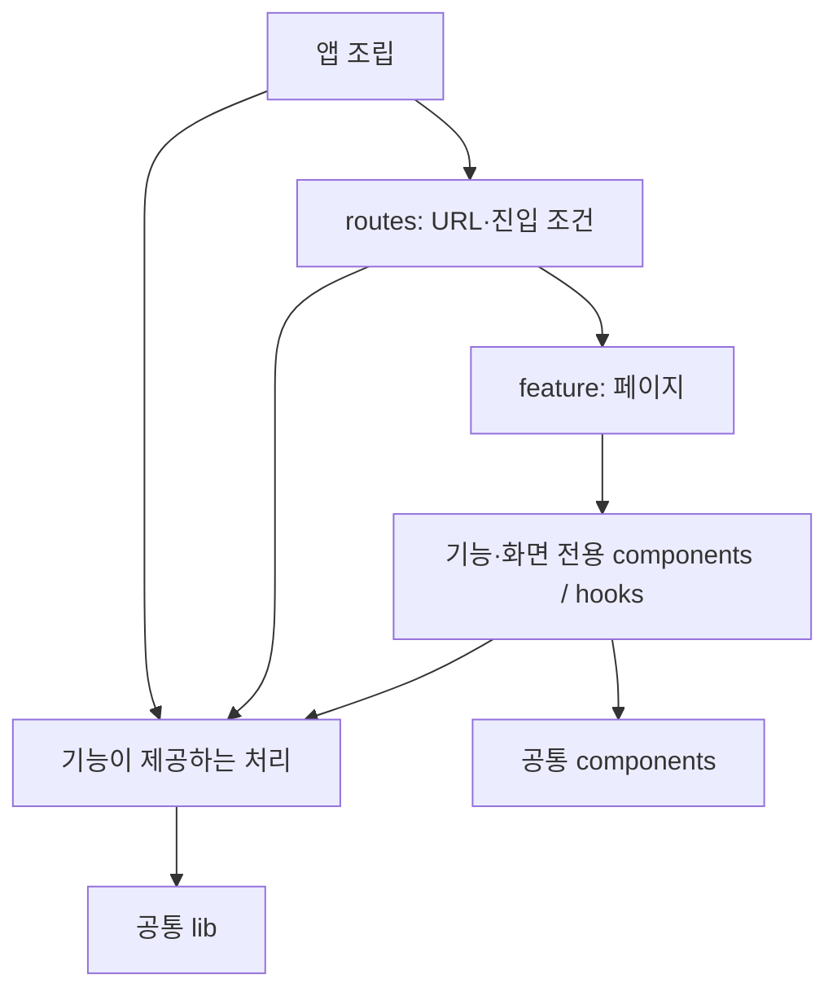

# 프런트엔드 개발 구조

## 목적과 적용 범위

`tlab-app-ui`는 관련 기능·화면과 그 동작에 필요한 코드를 `feature/` 아래에 모은다. 하나의 사용자 작업을 변경할 때 함께 읽고 수정할 코드를 가까이 두고, 실제로 공유하는 기반과 UI는 각각 `lib/`, `components/`에 둔다. 기능·화면별 지역성을 우선한다는 방향은 사용자 지정 기준이다. (확인)

이 문서는 앞으로 적용할 배치와 책임 기준이다. 아래 예시는 디렉터리 생성 목록이나 현재 구현 상태를 뜻하지 않는다. 기존 코드는 관련 기능을 변경할 때 필요한 범위에서 조정한다. 구현과 검증은 [구현 가이드](guide-impl.md), [테스트·검증 가이드](guide-test.md)를 따른다. (제안)

## 기술 구성과 현재 연결 상태

프런트엔드 기술의 역할과 구조 기준은 이 문서에서 관리한다. 설치·실행·빌드 명령은 [UI README](../../tlab-app-ui/README.md), 직접 의존성과 허용 버전은 [package.json](../../tlab-app-ui/package.json), 설치 버전은 [package-lock.json](../../tlab-app-ui/package-lock.json)을 기준으로 한다. 이 문서에 패키지·버전 전체 목록을 복제하지 않는다. (확인)

| 기술 | 역할과 배치 | 현재 연결 상태 |
| --- | --- | --- |
| React | 컴포넌트와 화면 렌더링. 화면은 feature, 공통 UI는 components에 배치 | 로그인·빈 대시보드와 React 진입점 구성 |
| TypeScript | 컴포넌트·요청 계약·설정의 타입 검사 | strict 모드와 `@/*` 경로 설정 |
| Vite | 개발 서버·프로덕션 빌드. React·Router·Tailwind 플러그인과 경로 별칭 조립 | 개발·빌드 설정 구성 |
| TanStack Router | routes의 파일 기반 경로·진입 조건·화면 연결 | RouterProvider와 파일 생성·자동 코드 분할 플러그인 연결 |
| TanStack Query | 서버 데이터 조회·변경 상태·캐시·재조회 관리 | QueryClientProvider와 auth 세션 Query·로그인/로그아웃 mutation 연결 |
| ky | `lib/api.ts`의 API 통신과 공통 오류 처리 | ky 2 기반 공통 HTTP·오류·AbortSignal·인증 실패 통지 연결 |
| Tailwind CSS | 유틸리티 클래스 기반 스타일과 테마 색상 | Vite 플러그인과 `src/index.css` 구성 |
| shadcn/ui | 프로젝트가 소유하는 UI 소스를 `components/ui`에서 관리 | `components.json`과 버튼 구성 |

위 현재 상태는 소스·설정을 확인한 결과다. `feature/auth/pages/login`, `feature/auth/services`, `feature/dashboard`에 인증과 최소 대시보드를 구현했다. 사용자는 세션 Query 한 곳에서 관리하며 별도 사용자 store를 두지 않는다. (확인)

공통 버튼은 Radix Slot의 `asChild`와 class-variance-authority의 변형 설정을 사용한다. `src/lib/utils.ts`의 `cn`은 clsx와 tailwind-merge로 조건부 클래스와 Tailwind 클래스를 합친다. Lucide는 아이콘 의존성으로 포함되어 있다. 이들은 UI 표현을 위한 도구이며 기능별 상태나 인증 정책을 소유하지 않는다. (확인·제안)

| 원본 파일 | 확인할 설정·책임 |
| --- | --- |
| [vite.config.ts](../../tlab-app-ui/vite.config.ts) | 개발·빌드 플러그인과 `@` 별칭 |
| [tsconfig.json](../../tlab-app-ui/tsconfig.json) | 타입 검사와 `@/*` 경로 |
| [components.json](../../tlab-app-ui/components.json) | shadcn/ui 스타일·테마·소스 경로 |
| [main.tsx](../../tlab-app-ui/src/main.tsx) | React 진입과 Query·Router 인스턴스 조립 |
| [index.css](../../tlab-app-ui/src/index.css) | Tailwind와 공통 스타일을 가져오는 진입점 |
| [theme.css](../../tlab-app-ui/src/styles/theme.css) | 의미 기반 토큰·라이트/다크 값·Tailwind 유틸리티 연결 |
| [base.css](../../tlab-app-ui/src/styles/base.css) | body 등 전역 기본 스타일 |
| [button.tsx](../../tlab-app-ui/src/components/ui/button.tsx) · [utils.ts](../../tlab-app-ui/src/lib/utils.ts) | 공통 버튼과 스타일 유틸리티 |

새 URL은 `src/routes`에 등록하고 화면은 아래 기능별 배치 기준에 따라 연결한다. `__root.tsx`는 공통 루트, `index.tsx`는 `/` 경로를 담당한다. `src/routeTree.gen.ts`는 개발 서버·빌드에서 생성하므로 직접 수정하지 않는다. `index.html`은 브라우저 진입 HTML이다. (확인·제안)

## 기본 구조와 책임

```text
src/
├── lib/                       # 기능과 독립적인 공통 기반
│   └── api.ts
├── components/
│   └── ui/                    # 버튼·입력 등 공통 UI
├── feature/
│   └── auth/
│       ├── pages/
│       │   └── login-page.tsx
│       ├── components/
│       │   └── login-form.tsx
│       ├── services/
│       │   ├── auth-api.ts
│       │   └── session.ts
│       ├── hooks/
│       │   └── use-session.ts
│       └── types.ts
├── routes/                    # URL·진입 조건·화면 연결
└── main.tsx                   # 앱 인스턴스 조립
```

| 위치 | 소유할 책임 |
| --- | --- |
| `feature/<기능>/` | 관련 사용자 목적, 화면, 상태, API 계약과 처리 |
| `pages/` | 화면 구성과 해당 화면에서 제공하는 사용자 작업의 연결 |
| `components/` | 해당 기능 또는 화면 전용 UI |
| `services/` | API 호출, 상태 전환 등의 처리. 의미가 다른 처리는 구체적인 이름으로 구분 |
| `hooks/` | React 상태·구독·생명주기와의 연결 |
| `types.ts` 또는 `types/` | 해당 기능 내부에서 공유하는 타입과 계약 |
| 공통 `lib/` | HTTP 등 기능 고유의 판단을 갖지 않는 공통 기반 |
| 공통 `components/` | 여러 기능이 같은 의미와 표현 계약으로 사용하는 UI |
| `routes/` | URL, 검색 매개변수, loader, 진입 조건과 화면 연결 |
| `main.tsx` 등의 앱 조립 | QueryClient·Router 등의 생성·소유와 의존성 연결 |

위 표는 책임의 구분이다. 각 기능에 모든 폴더를 만들 필요는 없다. 작은 기능은 몇 개의 파일로 시작하고, 관련 코드가 늘어날 때 필요한 역할만 분리한다. `types.ts`도 여러 파일이 필요해지기 전에는 디렉터리로 만들지 않는다. (제안)

## 기능·화면의 경계와 지역성

`feature/<이름>`은 기능 또는 관련 화면의 묶음을 나타내며 URL 하나와 반드시 일대일로 대응하지 않는다. 예를 들어 인증은 로그인 화면, 앱 시작 시 사용자 확인, 보호 화면, 로그아웃에서 같은 세션 계약을 사용하므로 `feature/auth`로 묶는다. 화면만으로 완결되는 기능은 화면 단위의 묶음으로 시작한다. (제안)

화면 전용 코드는 해당 화면 가까이에 둔다. 같은 기능에 여러 화면이 생기고 전용 코드가 늘어나면 `pages/login/`처럼 화면별로 페이지와 전용 components·hooks 등을 모은다. 여러 화면이 같은 의미로 사용하는 것만 기능 직속으로 올린다. 역할별 폴더를 우선해 화면 전용 코드를 기능 전체에 흩어 놓지 않는다. (제안)

```text
feature/auth/
├── pages/
│   └── login/
│       ├── login-page.tsx
│       └── components/
│           └── login-form.tsx
└── services/
    └── session.ts             # 화면을 가로지르는 인증 책임
```

분리는 파일 개수나 미래의 확장 예상만으로 하지 않고, 변경에 필요한 맥락과 실제 공유 범위를 기준으로 판단한다. (제안)

## 공통화와 의존 방향

- 전용 코드는 우선 사용하는 기능·화면에 둔다. 여러 호출자가 같은 의미와 변경 이유를 공유할 때 그 범위를 소유하는 위치로 이동한다. 공통화할 수 있을 것 같다는 이유만으로 바깥에 두지 않는다.
- 공통 `lib/`와 `components/`는 개별 기능이나 Router를 import하지 않는다. 기능이 공통 코드를 사용하며, 기능 고유의 판단이 필요하면 callback이나 props로 상위에서 전달한다.
- 기능 간 연결이 필요하면 필요한 계약이 드러나는 모듈을 통해 사용한다. 다른 기능의 페이지 내부나 전용 hook을 직접 가져다 쓰지 않는다. 단순한 연결을 위해 새 공통 service를 늘리지 않고 관계를 소유하는 쪽에서 조립한다.
- props는 사용하는 컴포넌트 가까이에, API 요청·응답 타입은 API 코드 가까이에 둔다. 모든 타입을 `types/`로 모으지 않고 기능 내부에서 공유하는 계약만 분리한다.

이 기준은 의존 순환과 공통 영역의 불필요한 확대를 줄이기 위한 배치 원칙이다. 기능 간 협력은 해당 관계의 목적과 소유권을 기준으로 구성한다. (제안·추론)



## 구현 시 판단 기준

`routes/`는 어떤 URL에서 어떤 조건으로 화면을 여는지를, `pages/`는 해당 화면이 무엇을 보여주고 어떤 사용자 작업을 제공하는지를 담당한다. Router의 파일 규약과 기능별 배치를 함께 사용하고, 경로 파일에 화면 구현 전체를 모으지 않는다. (제안)

service는 API 통신이나 세션 관리처럼 구체적인 처리 책임을 가진다. hook은 React와의 연결이 필요할 때 두며, 단순히 함수를 한 번 호출하는 포장이라면 계층을 늘리지 않는다. 모든 호출에 `page → hook → service`를 강제하지 않는다. (제안)

상태의 소유자는 데이터별로 정한다. 서버 상태를 React Query가 관리한다면 같은 데이터를 별도 store에 복제하지 않는다. 화면의 입력·열림 상태 등은 사용하는 화면·컴포넌트가 소유하고, 공유가 필요한 범위만 상위로 이동한다. (제안)

테스트는 계약을 소유하는 기능·화면 가까이에 둔다. 화면을 가로지르는 앱 연결은 그 연결을 확인할 수 있는 경계에서 검증한다. 공용 테스트 준비도 실제 공유하는 책임만 분리하며, 구체적인 검증 범위는 변경 영향에 맞춘다. (제안)

## API 호출과 서버 상태 관리

공통 API 클라이언트는 `lib/api.ts`에 두고 ky 기반 요청·응답 및 공통 오류 처리를 제공한다. 기능별 요청 함수와 요청·응답 타입은 `feature/<기능>/services` 가까이에 둔다. TanStack Query는 이 요청 함수를 사용하여 조회 상태·캐시·재조회를 관리하고, 변경 작업은 mutation으로 연결한다. 기능별 Query 옵션과 캐시 정책은 해당 기능이 소유한다. (제안)

기본 흐름은 `화면 → TanStack Query → 기능별 API 함수 → lib/api.ts의 ky 클라이언트`다. 화면의 Query 구독을 실제로 공유할 때 기능 내부 hook으로 분리한다. `lib/api.ts`에는 기능별 Query나 세션 정책을 넣지 않으며 QueryClient·Router 같은 앱 인스턴스는 상위에서 조립한다. (제안)

## 관련 설계

- [웹 UI API와 세션](../specs/auth/web-ui-session/plan.md): 이 배치 기준을 적용하는 인증 기능 설계.
- [백엔드 앱 개발 구조](app-structure.md): 시나리오 단위의 지역성과 책임 배치. 프런트엔드에는 UI의 역할과 변경 이유에 맞는 경계를 적용한다.

## 인증 구현 연결

`main.tsx`가 QueryClient·ky 클라이언트·auth API·session·Router를 조립한다. `lib/api.ts`는 전달받은 세대·401 통지 계약으로 보호 요청의 오류를 연결하고, 이전 세대의 보호 요청 성공을 취소로 전달한다. 로그인·로그아웃·me는 auth가 오류 의미와 전환을 직접 처리한다. Query와 ky 재시도는 명시적으로 끄며, 사용자 Query는 `['user', sub, ...]` 계약을 따른다. API 타입은 `auth-api.ts`, 세션 계약과 Query 옵션은 `session.ts`, 화면 props는 컴포넌트 옆에 둔다. (확인)

`session.ts`는 세션 Query의 성공 결과가 캐시에 반영된 뒤 최초 확인·로그인 여부·사용자 ID·세션 ID 변경을 한 경로의 callback으로 통지한다. focus/reconnect 자동 재조회도 같은 경로를 사용하며 닉네임 등 프로필만 바뀌면 라우터 재평가를 요청하지 않는다. `main.tsx`는 이 통지를 `router.invalidate()`에 연결하고 HMR 해제 시 `session.dispose()`로 구독을 해제한다. 로그인 경로의 callback은 성공 후 `/` 이동만 담당한다. (확인)

현재 보호 URL은 `/` 하나이므로 로그인 성공 후 `/`로 이동한다. 임의 복귀 URL 입력은 받지 않는다. 추가 보호 경로의 복귀 정책은 그 경로를 도입할 때 정한다. 개발 서버는 localhost:5173과 `/web/v1` proxy를 사용한다. 실제 검증과 운영 미검증 범위는 [인증 기록](../specs/auth/web-ui-session/plan.md)의 최신 구현 기록을 따른다. (확인)
