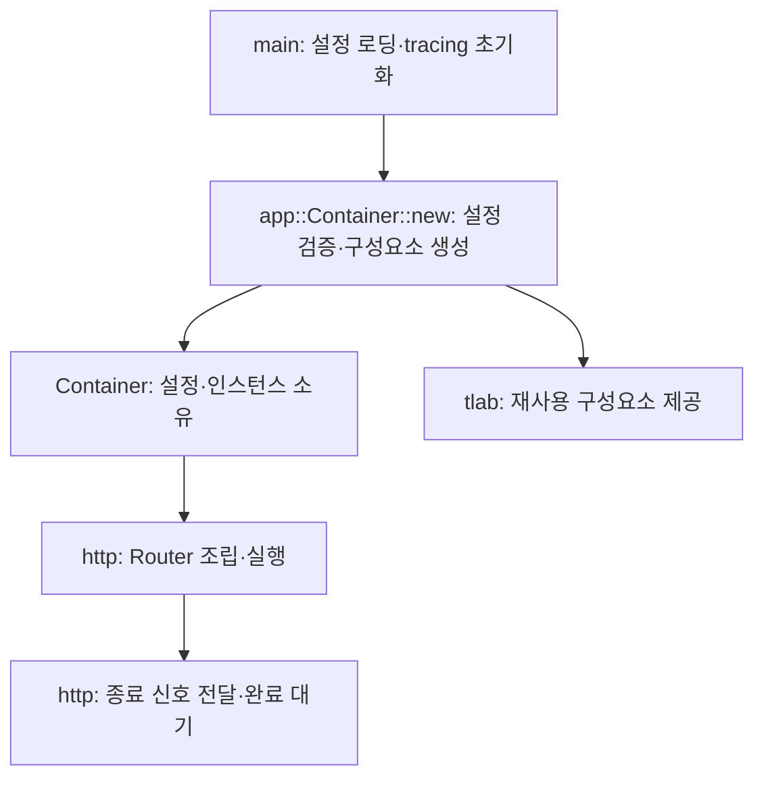

# 아키텍처

## 프로젝트 역할과 범위

워크스페이스는 공통 라이브러리 [`tlab`](../../tlab/Cargo.toml), 실행 애플리케이션 [`tlab-app`](../../tlab-app/Cargo.toml), React 프런트엔드 [`tlab-app-ui`](../../tlab-app-ui/package.json)로 구성된다. UI는 Vite로 개발·빌드하며 현재 서버와 별도로 실행된다. (확인)

- `tlab`은 에러 처리, 설정 로딩, DB, tracing, 키파일 관리 등 재사용 가능한 기반 기능을 제공한다.
- `tlab-app`은 `tlab`의 기능을 조합하고 실행 환경을 구성한다.
- 의존 방향은 `tlab-app → tlab`이며, `tlab`은 앱에 의존하지 않는다.
- 공통 기능은 `tlab`이 제공하고, 설정 선택과 초기화·종료 생명주기는 앱이 관리한다. (확인)

이 개요에는 역할·책임·의존 방향을 정리한다.
상세 계약과 결정 근거는 필요할 때 기능별 문서로 구성하고 여기에서 참조한다. (확인)

## 앱 구성과 실행

`tlab-app`은 `app::Container`에서 앱에 필요한 구성요소를 조립하고 소유하며, `main`에서 실행 경로를 선택한다. HTTP 모듈은 서버를 연결해 실행한다. 재사용 기능의 구현은 `tlab`에 두고 앱별 조합과 생명주기는 `tlab-app`에서 관리한다. (확인)

| 위치 | 책임 |
| --- | --- |
| [`app::Config`](../../tlab-app/src/app.rs) | 앱이 사용하는 설정 타입을 정의하고 공통 라이브러리의 설정 타입을 조합한다. |
| `app::Container` | 앱 설정과 구성요소 인스턴스를 소유한다. 생성자에서 앱 수준의 설정 조합을 검증하고 구성요소를 생성한다. |
| [`main`](../../tlab-app/src/main.rs) | 옵션과 설정을 읽고 tracing을 초기화한 뒤 마이그레이션 또는 서버 실행을 선택한다. |
| [`http`](../../tlab-app/src/http.rs) | Router를 조립하고 두 서버의 실행·종료를 연결한다. |
| [`app::response`](../../tlab-app/src/app/response.rs) | 정상 JSON·공통 에러 본문·JSON 입력 실패 응답을 생성한다. 기능별 HTTP 상태·코드 판단과 로깅은 route에 둔다. |
| [`app::error`](../../tlab-app/src/app/error.rs) | InvalidInput·InternalFailure의 공용 데이터 구조를 제공한다. 오류 종류와 실패 의미는 각 slice가 소유한다. |
| [`tlab`](../../tlab/src/lib.rs) | 개별 구성요소의 설정·생성·실행 API를 제공한다. 앱의 Container나 구성요소 간 조합을 알지 않는다. |

위 책임은 현재 코드에서 확인한 구분이다. tracing guard는 main이 보관해 실행과 종료 동안 로그 출력을 유지한다. (확인)

설정은 Container로 이동하며, HTTP 모듈은 `container.config`를 참조한다. Container 생성은 실행 준비까지 담당하고, 실제 리스너 실행과 종료 요청은 HTTP 모듈에서 수행한다. (확인)

구성요소를 추가할 때도 앱별 생성과 의존성 연결은 Container에 모으고, main은 실행 경로를 선택한다. 개별 기능의 설정 정책과 실행 계약은 해당 명세에서 다룬다. (추론)

## 현재 구현 상태

- [에러 모듈](../../tlab/src/error.rs): 공통 에러 타입과 변환을 제공한다. 상세는 [에러 설계](../specs/error/plan.md)를 참조한다.
- [설정 모듈](../../tlab/src/config.rs): 파일과 환경변수를 병합해 호출자가 정의한 설정 타입으로 읽는다. 상세는 [설정 로딩 명세](../specs/config/load/spec.md)를 참조한다.
- [DB 모듈](../../tlab/src/sqlxdb.rs): SQLx 기반의 DB 접근과 트랜잭션 관리를 제공한다. 상세는 [DB 설계](../specs/database/plan.md)를 참조한다.
- [tracing 모듈](../../tlab/src/tracing.rs): 콘솔·파일 출력과 프로세스 전역 tracing 초기화를 제공한다.
- [키파일 모듈](../../tlab/src/keyfiles.rs): 소비자가 포함하는 파일 설정 타입과 TLS·Ed25519 자료의 로드·개발용 생성을 제공한다. 상세는 [키파일 관리 명세](../specs/keyfiles/spec.md)를 참조한다.
- [비밀번호 해싱 모듈](../../tlab/src/password.rs): Argon2id·PBKDF2 해시 생성과 PHC 검증을 제공한다. [명세](../specs/password/hash/spec.md)와 [설계](../specs/password/hash/plan.md)를 참조한다.
- [HTTP 모듈](../../tlab/src/http.rs): 앱이 조립한 Axum Router로 단일 HTTP 또는 HTTPS 리스너를 실행하고 정적 파일 Router 생성과 TLS 재로드를 제공한다. 다중 인스턴스 조정은 앱이 맡는다. [설계](../specs/http/plan.md)와 [검증·리뷰](../specs/http/verification.md)를 참조한다.
- [앱 구성](../../tlab-app/src/app.rs): 설정을 소유하고 HTTP·HTTPS 설정 검증과 서버 생성을 담당하는 Container를 제공한다. [앱 진입점](../../tlab-app/src/main.rs)은 설정 로딩·tracing 초기화와 실행 경로 선택을, [앱 HTTP 모듈](../../tlab-app/src/http.rs)은 Router 조립과 서버 실행·종료를 맡는다. [앱 HTTP 명세](../specs/http/app/spec.md)를 참조한다. (확인)
- [로컬 사용자 추가](../../tlab-app/src/auth/create_local_user/usecase.rs): 시나리오 안에 HTTP 처리·usecase·테스트를 모으고, auth 공용 entity와 저장소별 CRUD API를 사용한다. Argon2id·비밀번호 정책·해싱 동시성 자원은 Container가 조립한다. [설계·검증 결과](../specs/account/create-local-user/plan.md)를 참조한다. 접근 제한은 후속 RBAC 범위다. (확인)

## 개발 가이드

설계·구현·테스트 시 참조하는 가이드를 정리한다.
`create-plan`으로 설계 문서를 작성할 때도 아래 가이드를 읽고 구현 방향과 검증할 계약·기대 결과에 반영한다. (확인)

- [구현 가이드](guide-impl.md): 기존 구조와 동작을 존중하며 필요한 범위만 구현·수정하고 실행으로 검증하는 원칙.
- [앱 개발 구조](app-structure.md): 시나리오별 지역성을 높이는 Vertical Slice Architecture와 usecase·service·repository·route의 책임 구분.
- [테스트·검증 가이드](guide-test.md): 요구사항과 계약에 따른 기대 결과, 테스트 재사용과 격리, 변경과 위험에 맞는 검증 원칙. (확인)
