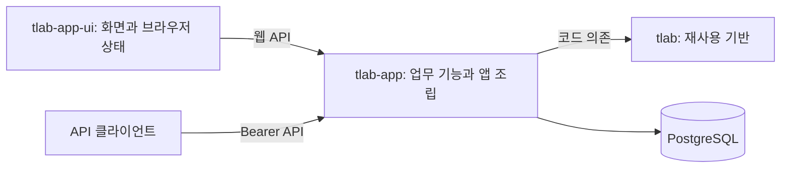

# 아키텍처 탐색 가이드

LLM이 작업 대상의 책임과 경계를 파악하고 관련 코드·개발 가이드를 찾아가기 위한 문서다.
아래 영역과 연결은 현재 소스코드를 기준으로 정리했다. 상세 API·타입·정책·실행 순서는 링크한 원본에서 확인한다. (확인)

## 전체 구성과 경계

| 영역 | 소유하는 책임 | 탐색 시작점 |
| --- | --- | --- |
| `tlab` | 앱과 독립적으로 재사용하는 기반 기능. 호출자가 선택한 설정과 입력으로 동작한다. | [공개 모듈](../../tlab/src/lib.rs) · [의존성](../../tlab/Cargo.toml) |
| `tlab-app` | 백엔드의 업무 정책·저장 모델·시나리오와 실행 환경. 기반 기능을 조합하고 앱의 생명주기를 관리한다. | [진입점](../../tlab-app/src/main.rs) · [의존성](../../tlab-app/Cargo.toml) |
| `tlab-app-ui` | 브라우저의 화면·사용자 작업·서버 상태와 라우팅. HTTP로 백엔드 기능을 사용한다. | [진입점](../../tlab-app-ui/src/main.tsx) · [의존성·스크립트](../../tlab-app-ui/package.json) |

Rust 워크스페이스는 `tlab`과 `tlab-app`으로 구성되며, 코드 의존 방향은 `tlab-app → tlab`이다.
UI는 별도 Node 프로젝트이며 백엔드의 Rust 모듈을 직접 사용하지 않는다.
UI와 백엔드의 연결은 `/web/v1` 웹 API를 사용하고, 별도 클라이언트를 위한 Bearer API는 `/api/v1`에 조립한다. (확인)

## 공통 기반: tlab

공통 라이브러리는 설정 로딩·DB 접근·서버 실행 등의 수단을 제공한다.
앱의 계정·역할·인증 시나리오와 Router 조합은 `tlab-app`이 소유한다.
기반 기능을 변경할 때는 [공개 모듈](../../tlab/src/lib.rs)에서 해당 구현으로 이동하고 앱의 사용처도 함께 확인한다. (확인)

| 관심 영역 | 코드에서 확인할 경계 | 원본 |
| --- | --- | --- |
| 설정·오류·진단 | 설정을 읽는 방식, 공통 오류와 로깅 기반. 앱별 설정 선택과 업무 오류의 의미는 호출자가 정한다. | [config](../../tlab/src/config.rs) · [error](../../tlab/src/error.rs) · [tracing](../../tlab/src/tracing.rs) |
| 저장 기반 | 연결·트랜잭션 context와 마이그레이션 실행. 업무 SQL·스키마와 작업의 트랜잭션 범위는 앱이 정한다. | [sqlxdb](../../tlab/src/sqlxdb.rs) · [migration](../../tlab/src/migration.rs) |
| 전송·암호 기반 | 단일 HTTP/HTTPS 서버, 키파일과 비밀번호 해싱. 서버 간 조정·인증 정책·토큰 수명은 앱이 정한다. | [http](../../tlab/src/http.rs) · [keyfiles](../../tlab/src/keyfiles.rs) · [password](../../tlab/src/password.rs) |

## 백엔드: tlab-app

백엔드는 실행·조립 영역과 업무 feature 영역으로 나뉜다.
`main`은 실행 경로를 선택하고, `app`은 공유 설정·인스턴스를 소유하며, `http`는 외부 요청과 feature를 연결한다.
업무 feature는 각자의 정책·데이터와 시나리오를 소유한다. (확인)

| 영역 | 책임과 경계 | 탐색 시작점 |
| --- | --- | --- |
| 실행 진입 | 설정과 옵션을 읽고 서버·마이그레이션·초기 관리자 CLI 실행을 선택한다. | [main](../../tlab-app/src/main.rs) · [options](../../tlab-app/src/options.rs) |
| 앱 조립·공통 계약 | 앱 설정 검증과 공유 인스턴스 조립·소유, 앱 오류와 HTTP 응답 변환을 담당한다. | [app](../../tlab-app/src/app.rs) · [error](../../tlab-app/src/app/error.rs) · [response](../../tlab-app/src/app/response.rs) |
| HTTP 연결 | API·웹 전송 경로, 공유 업무 Router와 정적 파일을 조립하고 서버 실행·종료를 조정한다. | [http](../../tlab-app/src/http.rs) · [api](../../tlab-app/src/http/api.rs) · [web](../../tlab-app/src/http/web.rs) |
| 인증 `auth` | 계정·인증 수단, 로그인·세션·토큰과 웹 쿠키 인증을 소유한다. 외부에서 사용할 계약은 모듈 진입점에 노출한다. | [모듈 계약](../../tlab-app/src/auth/mod.rs) · [경로 연결](../../tlab-app/src/auth/route.rs) · [시나리오 목록](../../tlab-app/src/auth/slice/mod.rs) |
| 인가 `rbac` | 역할·퍼미션·계정 역할 부여와 권한 판단, 관리 시나리오를 소유한다. 인증된 주체의 역할을 해석해 권한을 판단한다. | [모듈 계약](../../tlab-app/src/rbac/mod.rs) · [경로 연결](../../tlab-app/src/rbac/route.rs) · [시나리오 목록](../../tlab-app/src/rbac/slice/mod.rs) |
| 스키마·초기화 | 앱의 SQL 스키마와 코드 마이그레이션 등록, 초기 관리자 생성 진입을 제공한다. | [SQL migrations](../../tlab-app/migrations) · [코드 등록](../../tlab-app/src/migrations.rs) · [관리자 CLI](../../tlab-app/src/rbac/slice/bootstrap_admin/cli.rs) |

인증과 인가를 함께 변경할 때는 `auth`의 [인증 주체 추출](../../tlab-app/src/auth/extractor.rs)과
`rbac`의 [주체 해석](../../tlab-app/src/rbac/claims.rs)·[권한 판단](../../tlab-app/src/rbac/authorization.rs)을 연결해 읽는다.
HTTP 전송별 보호 범위는 앱의 `http`가 선택하고, 쿠키·요청 인증 처리는 [auth/web](../../tlab-app/src/auth/web.rs)이 제공한다.
각 feature 내부의 시나리오·공용 코드 배치는 [백엔드 기능 개발 가이드](guide-be-feature-dev.md)를 따른다. (확인)

## 프런트엔드: tlab-app-ui

프런트엔드는 앱 조립·URL 연결·기능별 화면과 처리·공통 기반 및 UI로 나뉜다.
서버의 인증·인가 정책은 백엔드가 담당하고, UI는 API 결과를 바탕으로 화면 진입과 사용자 상태를 관리한다. (확인)

| 영역 | 책임과 경계 | 탐색 시작점 |
| --- | --- | --- |
| 앱 조립 | API 클라이언트·QueryClient·세션·Router와 공통 Provider를 생성하고 연결한다. | [main.tsx](../../tlab-app-ui/src/main.tsx) |
| URL·화면 연결 | URL별 진입 조건과 화면 연결, 공통 루트 표현을 담당한다. | [routes](../../tlab-app-ui/src/routes) |
| 업무 feature | 기능별 화면·요청 계약·상태 처리를 소유한다. 현재 auth는 인증 API와 세션을, dashboard는 대시보드 화면을 제공한다. | [feature](../../tlab-app-ui/src/feature) · [auth API](../../tlab-app-ui/src/feature/auth/services/auth-api.ts) · [session](../../tlab-app-ui/src/feature/auth/services/session.ts) |
| 공통 기반·UI | 기능별 정책과 분리된 HTTP 기반, 재사용 UI·테마·스타일을 제공한다. | [lib](../../tlab-app-ui/src/lib) · [components](../../tlab-app-ui/src/components) · [styles](../../tlab-app-ui/src/styles) |
| 개발·빌드 연결 | 플러그인·별칭·개발 proxy와 실행 명령을 관리한다. | [Vite 설정](../../tlab-app-ui/vite.config.ts) · [UI README](../../tlab-app-ui/README.md) |

기능·화면별 코드 배치와 상태 소유권은 [프런트엔드 기능 개발 가이드](guide-fe-feature-dev.md)를 따른다.
인증 연결을 변경할 때는 UI의 auth 서비스와 백엔드의 웹 전송 경계를 함께 확인한다.
세션·인증의 상세 계약과 변경 근거는 [웹 UI API와 세션 설계](../specs/auth/web-ui-session/plan.md)에서 찾는다. (확인)

## 작업할 때 참조하는 순서

1. 위 영역에서 변경할 책임의 소유자를 찾고, 해당 진입점과 직접 호출하는 코드를 읽는다. 공용 계약을 바꾸면 사용처를 검색해 영향 범위를 확인한다.
2. [구현 가이드](guide-impl.md)와 대상의 [백엔드](guide-be-feature-dev.md) 또는 [프런트엔드](guide-fe-feature-dev.md) 기능 개발 가이드를 읽는다. 설계 문서를 작성할 때도 같은 경계와 배치 기준을 적용한다.
3. 기능의 정책·예외·결정 근거가 필요하면 [docs/specs](../specs)에서 대상 기능의 명세·설계를 찾고 현재 코드와 대조한다. 구현·검증 기록은 대상과 시점을 확인해 읽는다.
4. [테스트·검증 가이드](guide-test.md)에 따라 관련 테스트를 찾는다. 기반 기능은 [tlab/tests](../../tlab/tests), 백엔드는 대상 모듈·slice의 테스트, UI는 기능 인접 테스트와 [브라우저 테스트](../../tlab-app-ui/tests)에서 시작한다. 실행 방법은 [루트 README](../../README.md)·[justfile](../../justfile)·[UI README](../../tlab-app-ui/README.md)를 참조한다. (추론: 탐색 절차)

이 문서는 상위 책임·연결·탐색 경로를 유지한다. 함수 계약과 정책의 세부 내용은 코드·명세에,
구현 완료 여부와 검증 결과는 해당 작업 기록에 남긴다. (추론: 문서 관리 기준)
