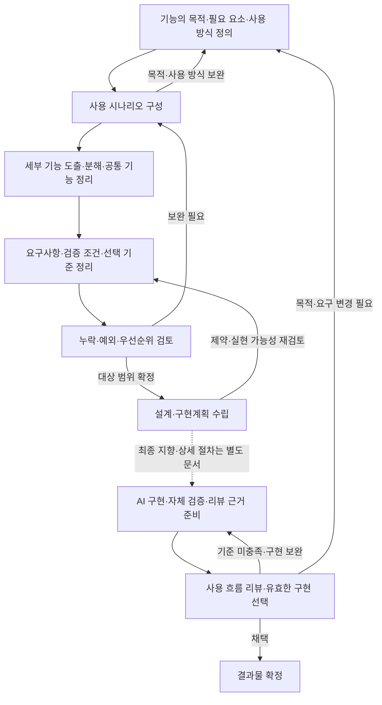

# 요구사항 정의 과정

만들려는 기능의 목적과 사용 방식을 먼저 정의하고, 사용 시나리오를 바탕으로 세부 기능을 도출하여
요구사항과 구현계획으로 연결하는 작업 흐름을 정리한다. 이는 앞선 논의에서 정리한 관점이다. (확인)

이 문서는 그 논의를 바탕으로 정리한 작업 가이드다. 최종적으로는 구현의 자동화와 사용자 선택을 지향하지만,
현재는 그 방식의 신뢰도를 확인하기 위해 요구사항 정의를 단계별로 진행한다. (확인)

현재 문서의 중심 범위는 요구사항 정의와 후속 구현계획에 전달할 입력의 정리다.
결과물의 구현·검증·선택에 관한 상세 절차는 별도 문서에서 정리할 예정이며,
여기에 포함된 관련 내용은 최종 지향점과 후속 과정의 참고로 유지한다. (확인)

## AI 기반 작업에서의 목적

최종적으로는 요구사항과 판단 기준을 먼저 정하고, AI가 주요 사용 흐름을 구현한 결과를
사용자가 빠르게 리뷰하여 유효한 구현을 선택하는 방향을 지향한다.
현재는 이 방식의 신뢰도를 확인하는 과정이며, 단계별 산출물을 검토·보완하면서 다음 단계로 진행한다. (확인)

최종 지향점에서 요구사항 정의의 목적은 AI가 구현 중 매번 사람의 결정을 기다리지 않고,
리뷰 가능한 결과물까지 진행할 수 있도록 입력을 준비하는 것이다.
모든 세부사항을 미리 확정하기보다 목적·사용 방식·필수 조건·선택 기준을 명확히 하고,
AI에게 맡길 선택의 범위를 함께 정한다. (추론)

자동화가 신뢰할 수 있는 수준에 이르면 사람의 리뷰는 주요 사용자 흐름과 결과물 선택에 모으는 것을 지향한다.
구현 내부의 작업 분해와 수정·테스트는 AI가 수행하며, 개별 작업의 완료를 매번 사람에게 확인받는 절차로 만들지 않는다.
결과물은 정해진 범위에서 처음부터 끝까지 사용하고 판단할 수 있는 상태를 목표로 한다. (추론)

현재는 각 단계에서 사용자 의도가 다음 산출물에 제대로 반영되는지, 누락이나 임의의 가정이 생기는지,
다음 단계의 입력으로 사용할 만큼 구체적인지를 확인한다.
수정한 내용과 이유를 기록하여 어떤 부분을 AI에 맡길 수 있고 어디에 사람의 판단이 필요한지 근거를 쌓는다.
이 단계별 진행은 자동화의 신뢰도를 확인하기 위한 현재의 운영 방식이다. (추론)

## 범위와 기본 관점

요구사항 정의는 사용자와 문제를 이해하고, 무엇을 왜 제공해야 하며 어떤 상태를 충족해야 하는지 구체화하는 과정으로 본다.
설계·구현계획은 이를 어떻게 만들고 어떤 순서로 진행할지 정하는 과정으로 구분한다.
두 과정은 연결해서 관리하되, 구현 방법의 선택을 사용자 요구 자체와 혼동하지 않는다. (추론)

출발점에서는 누가 왜 이 기능을 사용하는지, 무엇이 필요하고 어떤 방식으로 사용할지를 전체적으로 정한다.
이때 사용 방식은 진입 경로, 사용자 입력·행동, 기대 결과를 뜻하며, 내부 기술 구조까지 미리 정하는 것은 아니다.
처음부터 세부 기능을 모두 확정하기보다 시나리오를 구성하며 빠진 기능과 조건을 보완한다. (추론)

전체 기능과 세부 기능, 시나리오 등은 다음 관점으로 구분한다. 아래 구분은 이 문서에서 사용하는 작업 기준이다. (추론)

| 구분 | 중심 질문 | 정리할 내용 |
| --- | --- | --- |
| 기능의 목적과 사용 방식 | 누가 왜 사용하며, 무엇이 필요하고 어떻게 사용하는가? | 해결할 문제, 필요한 능력·정보, 진입 경로, 주요 행동, 기대 결과, 범위 |
| 사용자 시나리오 | 사용자가 특정 상황에서 어떻게 목표를 달성하는가? | 사용자, 상황, 계기, 행동 흐름, 기대 결과 |
| 세부 기능 | 시나리오를 실현하려면 어떤 기능이 필요한가? | 개별 기능의 책임, 입력·결과, 공통 기능, 기능 간 관계 |
| 유즈케이스 | 사용자 목표를 달성하기 위해 시스템이 어떤 상호작용을 제공해야 하는가? | 참여자, 사전조건, 기본·대안·예외 흐름, 완료 상태 |
| 요구사항 | 시스템이 무엇을 제공하고 어떤 조건을 충족해야 하는가? | 기능, 정책, 품질 기준, 제약, 우선순위, 검증 조건 |
| 구현계획 | 요구사항을 어떤 작업과 순서로 실현할 것인가? | 구조, 작업 단위, 의존 관계, 구현 순서, 검증 방법 |
| 결과물 선택 기준 | 필수 조건을 만족한 구현 중 무엇을 채택할 것인가? | 사용 목적의 달성, 사용 흐름의 적절성, 비교할 항목과 우선순위 |

유즈케이스는 시나리오를 사용자 목표별로 묶어 정리할 필요가 있을 때 사용하는 방법이며, 필수적인 별도 단계로 두지 않는다.
세부 기능 분해와 유즈케이스 정리는 목적이 다르다. 기능 분해는 필요한 시스템의 능력을 나누는 것이고,
유즈케이스 정리는 사용자 목표와 상호작용을 묶는 것이다.
같은 목표의 여러 시나리오를 하나의 유즈케이스의 기본·대안·예외 흐름으로 묶을 수 있고,
한 시나리오에 여러 목표가 섞여 있다면 여러 유즈케이스로 나눌 수도 있다. (추론)

## 전체 흐름

현재는 아래 요구사항 정의 단계를 순서대로 진행하고, 단계별 산출물을 검토·보완한 뒤 다음 단계로 연결한다.
각 단계마다 별도 문서를 만들 필요는 없으며, 소규모 작업은 한 문서 안에서 정리한다.
아래 실선은 현재의 요구사항 정의 흐름과 구현계획으로의 연결이고,
점선 이후는 최종적으로 지향하는 후속 과정이다. 구현·검증·선택의 상세 절차는 별도 문서에서 다룬다. (추론)

브레인스토밍은 기능의 목적·사용 방식을 탐색하거나 시나리오를 보완할 때 활용한다.
이미 목적과 사용 방식이 명확하다면 별도 단계로 수행하지 않아도 된다. (추론)



## 단계별 작업과 산출물

현재는 1~5단계의 산출물을 순서대로 확인하며 요구사항 정의 방식의 신뢰도를 점검한다.
6단계는 후속 구현계획과의 연결을 보여 주기 위해 유지하며, 상세 진행 방법은 별도 문서에서 정리한다.
아래 산출물은 필요한 내용을 빠뜨리지 않기 위한 기준이며, 모든 작업에 같은 분량을 요구하지 않는다. (추론)

| 단계 | 핵심 질문 | 작업 | 산출물 |
| --- | --- | --- | --- |
| 1. 기능의 목적·필요 요소·사용 방식 정의 | 누가 왜 사용하고 무엇이 필요하며 어떻게 사용하는가? | 사용자, 문제, 필요한 능력·정보, 진입 경로, 주요 행동과 결과, 범위 정리 | 기능 개요, 사용 방식, 범위, 알려진 제약과 가정 |
| 2. 사용 시나리오 구성 | 특정 상황에서 사용자는 어떻게 행동하는가? | 계기부터 기대 결과까지 행동과 시스템 반응을 구체화 | 주요 시나리오와 대안·실패 상황, 필요시 유즈케이스 정리 |
| 3. 세부 기능 도출·분해 | 각 시나리오를 실현하려면 어떤 기능이 필요한가? | 필요한 기능을 추출하고 책임을 나누며 공통 기능을 묶음 | 세부 기능 목록, 기능별 역할, 시나리오와 기능의 연결 |
| 4. 요구사항·검증 조건·선택 기준 정리 | 무엇을 반드시 충족하며 어떤 구현을 채택할 것인가? | 기능별 동작·정책, 공통 품질 기준·제약, 기대 상태, 선택 기준과 AI에게 맡길 선택 범위 정의 | 요구사항, 검증 조건, 선택 기준, 자율 결정 범위, 미결정 사항 |
| 5. 누락·예외·우선순위 검토 | 빠진 상황은 무엇이며 무엇부터 제공할 것인가? | 권한, 빈 상태, 실패, 경계 조건, 요구 간 충돌과 의존 관계 검토 | 우선순위, 이번 범위, 보류 항목과 이유 |
| 6. 설계·구현계획 수립 (후속 과정 참고) | AI가 리뷰 가능한 결과물까지 어떻게 구현·검증할 것인가? | 기존 구조 확인, 구현 방법 선택, 내부 작업 분해, 전체 사용 흐름 검증과 리뷰 근거 준비 계획 | 작업 목록, 의존 관계, 구현 순서, 검증계획, 리뷰할 결과물의 범위 |

시나리오별로 기능을 따로 만들기보다 전체 시나리오에서 공통으로 필요한 기능을 확인한다.
이 단계의 기능 분해는 사용자에게 제공할 동작과 책임을 나누는 것이며,
파일·모듈·API 등 기술적 구현 단위는 설계·구현계획에서 구체화한다. (추론)

사용 시나리오에서 드러나는 기능 외에도 공통 요구사항을 확인한다.
성능, 보안, 접근성, 운영 제약처럼 여러 흐름에 공통으로 적용되는 요구사항도 별도로 확인한다.
수치 기준이나 정책이 정해지지 않았다면 임의로 확정하지 않고 미결정 사항으로 남긴다. (추론)

## 구현 전에 정할 판단 기준과 자율 결정 범위

현재는 아래 구분에 따라 기준과 결정 범위를 정리하고, AI가 이를 적절히 해석하는지 단계별로 확인한다.
자율 결정 범위를 작성했다는 이유만으로 전체 구현 과정의 신뢰도가 확보되었다고 간주하지 않는다. (추론)

필수 조건과 구현 선택의 기준을 구분하면, 충족 여부의 검증과 결과물의 채택 판단을 연결할 수 있다.
AI에게 맡긴 선택은 구현 후 근거와 함께 제시하게 한다. (추론)

| 구분 | 정할 내용 | 예시 |
| --- | --- | --- |
| 필수 조건 | 구현이 반드시 충족해야 하는 동작·정책·제약 | 다른 구매자의 주문 정보가 노출되지 않아야 한다 |
| 검증 조건 | 필수 조건의 충족 여부와 필요한 근거 | 권한별 조회 결과와 접근 제어 검토로 정보 노출 여부를 확인한다 |
| 선택 기준 | 조건을 만족한 결과물의 채택 여부나 대안 간 비교 기준 | 배송 상태와 조회 실패를 쉽게 구별하고 다음 행동을 알 수 있는가 |
| AI 자율 결정 범위 | 목적과 제약 안에서 별도 확인 없이 선택할 사항 | 기존 UI 규칙에 맞는 배치와 문구, 내부 작업 순서 |
| 사전 확인이 필요한 결정 | AI에게 맡기지 않은 중요한 정책·범위 변경 | 주문 접근 권한 확대, 개인정보의 외부 전송 |

결과물은 하나일 수도 있고 비교가 필요한 대안이 여러 개일 수도 있다.
대안은 사용 방식이나 설계 선택에 중요한 불확실성이 있을 때 준비하며, 모든 기능에 복수 구현을 요구하지 않는다. (추론)

## 연결 예시: 주문 배송 상태 조회

아래는 단계 사이의 관계를 보여 주는 가상 예시다. 실제 서비스의 정책이나 확정 요구사항을 의미하지 않는다.
구현계획과 리뷰할 결과물 행은 후속 과정에서 지향하는 모습을 설명하기 위한 참고다. (추측)

| 단계 | 예시 산출물 |
| --- | --- |
| 기능의 목적·필요 요소·사용 방식 | 구매자가 고객센터에 문의하지 않고 배송 상태를 확인한다. 주문·운송장 정보가 필요하며, 자신의 주문 상세에서 배송 조회를 요청하고 결과를 확인한다 |
| 사용 시나리오 | 정상: 배송 상태가 표시된다. 운송장 미등록: 미등록 안내가 나타난다. 외부 조회 실패: 실패 상태를 안내한다. 다른 구매자의 주문 접근: 조회가 거부된다 |
| 세부 기능 도출·분해 | 주문 접근 권한 확인, 운송장 등록 여부 확인, 배송 상태 조회, 조회 결과·미등록·실패 상태 표시. 접근 권한 확인은 각 조회 흐름에서 공통으로 사용한다 |
| 요구사항 | 구매자는 자신의 주문 배송 상태를 조회할 수 있다. 운송장이 없거나 조회에 실패하면 해당 상태를 안내한다 |
| 검증 조건 | 정상 응답이면 해당 배송 상태가 표시된다. 운송장이 없으면 미등록 안내가 나타난다. 조회 실패 시 성공으로 오인할 상태를 표시하지 않는다. 다른 구매자의 주문 정보는 노출되지 않는다 |
| 선택 기준·자율 결정 범위 | 배송 상태와 오류를 명확히 구분할 수 있는지 리뷰한다. AI는 기존 UI 규칙 안에서 표시 방식과 문구를 선택하고 선택 이유를 제시한다 |
| 우선순위·범위 | 조회와 권한 확인, 미등록·실패 처리를 이번 범위로 정하고, 탐색 중 나온 배송 지연 알림은 보류한다 |
| 구현계획 | 주문 접근 권한과 기존 조회 구조 확인 → 배송 조회 연동 → 화면 상태 처리 → 정상·미등록·실패·권한 조건 검증 |
| 리뷰할 결과물 | 주문 상세 진입부터 조회 결과 확인까지 연결된 구현과 조건별 검증 근거를 준비한다. 사람은 주요 흐름을 리뷰하여 채택하거나 보완할 사항을 정한다 |

이 예시에서 운송장 미등록과 외부 조회 실패는 같은 조회 목표에서 발생하는 별도 시나리오이며,
하나의 배송 상태 조회 유즈케이스 안에서 대안·예외 흐름으로 정리할 수 있다. (추론)

## 구현계획으로 넘어가는 기준

요구사항이 영구적으로 고정된 시점보다, 이번 범위를 구현하고 결과를 판정할 수 있는 상태를 기준으로 삼는다.
다음 항목을 확인하고 중요한 미결정 사항이 있으면 먼저 해소한다. (추론)

- 대상 사용자, 해결할 문제, 필요한 요소, 사용 방식과 이번 범위가 명확한가?
- 주요 시나리오와 필요한 대안·예외 흐름을 설명할 수 있는가?
- 각 시나리오에 필요한 세부 기능과 공통 기능이 도출되어 있는가?
- 필요한 기능·정책·품질 기준·제약과 우선순위가 정리되었는가?
- 요구사항 충족 여부를 관찰 가능한 결과로 판정할 수 있는가?
- 결과물의 선택 기준과 AI에게 맡길 결정의 범위가 명확한가?
- 현재 단계별 검토에서 발견한 누락·해석 차이·수정 이유가 정리되어 있는가?
- 미결정 사항과 가정이 표시되어 있고, 구현에 미치는 영향을 판단했는가?

영향이 작은 세부사항은 가정을 기록하고 진행할 수 있다.
범위, 권한, 데이터 처리 정책처럼 영향이 큰 결정은 관계자와 확인한 뒤 구현계획에 반영한다.
구현 중 새 제약이 드러나면 해당 요구사항과 연결된 시나리오·검증 조건·계획을 함께 갱신한다. (추론)

장기적으로는 사람이 중간마다 판단하지 않아도 주요 사용 흐름의 구현·검증까지 진행할 수 있는지를 확인한다.
이는 현재 단계에서 이미 달성했다고 전제하는 조건이 아니라, 신뢰도 확인을 통해 판단할 자동화의 목표다. (추론)

## 최종 지향점 참고: 결과물 리뷰와 선택

아래 내용은 최종적으로 지향하는 후속 과정의 개요로 보존한다.
현재 문서에서 이 실행 절차를 확정하지 않으며, 구현·검증·선택의 상세 운영은 별도 문서에서 정리할 예정이다. (확인)

AI는 구현 결과와 함께 아래 자료를 준비하여 리뷰에서 필요한 근거를 바로 확인할 수 있게 한다. (추론)

- 실행 가능한 결과물과 주요 사용 흐름의 실행·관찰 근거
- 필수 조건별 충족 여부, 관련 테스트·검토 결과, 미충족·미확인 사항
- 자율적으로 선택한 가정과 구현 방식, 선택 이유와 남은 제약
- 대안이 있는 경우 같은 선택 기준으로 비교한 차이와 장단점

사람은 필수 조건 충족 여부와 실제 사용 목적에 맞는지를 함께 보고 유효한 구현을 채택한다.
판단은 채택, 구현 보완, 요구사항 재정의로 구분한다.
기준을 충족하지 못한 구현은 AI가 수정·재검증하고, 요구 자체가 목적에 맞지 않는 경우에는 요구사항과 판단 기준을 갱신한다.
결과물에 맞춰 기존 기준을 사후에 완화하지 않는다. (추론)

## 기록과 후속 작업 연결

필요한 수준에서 기능 개요, 시나리오, 세부 기능, 요구사항, 검증 조건, 구현 작업을 식별자나 링크로 연결한다.
유즈케이스를 작성한 경우에는 관련 시나리오와 함께 연결한다.
현재는 단계별 입력·산출물, 검토 결과, 수정 이유와 미해결 사항을 기록하여 신뢰도를 확인할 근거로 삼는다.
후속 결과물 리뷰에서는 대상 구현 버전, 적용한 요구사항·판단 기준, 검증 근거와 선택 이유를 함께 기록하는 것을 지향한다.
연결 관계는 일대일로 강제하지 않고 변경의 영향과 누락을 찾을 수 있을 정도로 유지한다. (추론)

```text
기능의 목적·사용 방식 → 사용 시나리오 → 세부 기능 → 요구사항 → 검증 조건
                                                          └→ 구현 작업
```

요구사항 정의 결과는 [SW 공장 기반 작업 과정](software-factory.md)의 ‘표준화된 입력 구성’과
‘검증 조건 정의’에 연결한다. 해당 문서는 목표·범위·요구사항·완료 조건을 입력으로 삼고,
검증 조건을 바탕으로 구현과 결과물 판정을 진행하도록 정리되어 있다. (확인)
