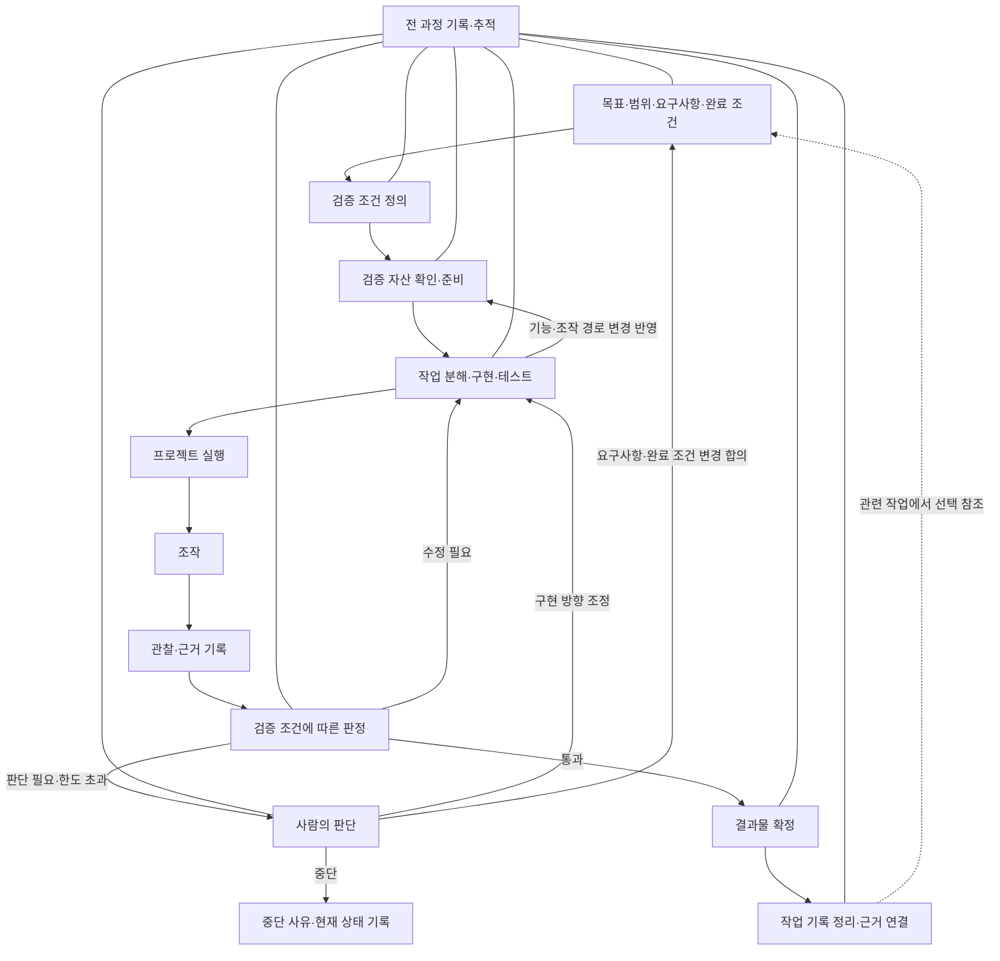

# SW 공장 기반 작업 과정

AI 기반 SW 생산을 위해 하네스에 필요한 구성 요소와 작업 흐름을 정리한다.
표준화된 입력, 검증 및 측정, 추적 및 재현 가능성, 작업 기록을 기본 축으로 삼는다.
아래 내용은 운영 방향에 대한 초안이며, 작업의 범위와 위험에 맞게 적용한다. (추론)

## 핵심 관점: 검증 가능한 개발과 프로젝트 자산

검증을 AI 기반 개발의 핵심 기반으로 둔다. 에이전트가 구현한 결과를 직접 실행·조작·관찰하고,
요구사항에 따라 판정한 뒤 실패 원인을 수정할 수 있도록 작업 환경을 구성한다.
이를 통해 사람이 매번 실행과 문제 전달을 대신하는 반복을 줄이는 것을 목표로 한다. (추론)

검증에는 다음 세 가지가 함께 필요하다. 재사용할 기준과 도구는 프로젝트 자산으로 관리하고,
실행별 결과는 해당 버전에 대한 근거로 보존한다. (추론)

| 구분 | 답할 질문 | 관리할 내용 |
| --- | --- | --- |
| 검증 조건 | 무엇을 충족해야 하는가? | 요구사항, 기대 상태, 판정 기준 |
| 검증 자산 | 어떻게 실행·조작·관찰할 것인가? | 작은 도구, 기능 지도, 검증 절차, 데이터 준비·정리 방법 |
| 검증 기록 | 이번 결과물이 충족했는가? | 대상 버전, 환경, 수행한 조작, 관찰 근거, 판정 결과 |

작업 결과물은 기능 구현물과 함께, 필요한 검증 자산의 변경 및 이번 검증 근거를 포함한다.
다음 에이전트가 이전 대화 없이도 검증 방법을 찾아 수행할 수 있는 상태를 지향한다. (추론)

## 프로젝트의 기준과 근거

프로젝트의 기준과 사실을 확인하는 출처는 코드, 요구사항·구현 문서, 커밋으로 구성한다.
실제 동작의 판단에는 해당 버전의 실행·검증 근거를 함께 사용한다.
별도 메모리 시스템이나 기록을 기억으로 승격하는 관리 절차는 두지 않는다. (추론)

| 출처 | 확인할 내용 |
| --- | --- |
| 요구사항 문서 | 충족해야 하는 동작·정책·제약과 판정 기준 |
| 코드와 테스트 | 현재 구현 구조와 로직, 테스트로 확인하는 동작 |
| 구현 문서 | 구현 구조, 주요 선택과 제약 |
| 커밋 | 버전별 변경 내용과 기록된 변경 이유 |
| 실행·검증 근거 | 해당 버전과 환경에서 관찰한 실제 동작과 조건별 판정 |
| 작업 기록 | 위 출처를 연결하고 작업 경위·시도·미해결 사항을 보충 |

요구사항은 의도한 동작을, 코드는 현재 구현을 설명하므로 서로 다르면 불일치로 확인하고 해소한다.
과거 기록의 설명으로 현재 코드나 요구사항을 대신하지 않는다.
작업에 필요한 근거를 원래 관리하는 위치에서 찾아 읽고, 동일한 지식을 별도 기억으로 중복 관리하지 않는다. (추론)

## 전체 흐름

입력에서 요구사항과 완료 조건을 정하고, 결과물을 판정할 검증 조건을 정의한다.
검증 자산의 준비 상태를 확인하고, 구현과 테스트를 진행하며 필요한 자산을 보완한다.
프로젝트를 실행·조작·관찰하여 검증 조건에 따라 판정한다.
성공하면 완료 조건을 확인하여 결과물을 확정하고, 실패하면 수정 후 다시 검증한다.
추적과 기록은 전 과정에 적용하며, 다음 작업에서는 관련 기록을 선택해 참고한다. (추론)



## 1. 표준화된 입력 구성

구현 방향뿐 아니라 결과를 판정할 기준까지 입력에 포함한다. (추론)

- 기능 목표: 해결할 문제와 기대하는 동작
- 구현 범위: 포함할 기능과 제외할 기능
- 기술적 제약: 기존 구조, 기술 스택, 의존성, 실행 환경
- 요구사항: 기능, 테스트, 보안, 성능 등
- 완료 조건: 요구사항별 검증 조건의 충족과 필요한 결과물의 준비 등 작업을 끝낼 수 있는 기준

필요한 검증 자산이 갱신되고 대상 버전의 검증 기록이 남아 있는지도 작업에 따라 완료 조건에 포함한다. (추론)

예를 들어 ‘검색 기능 구현’을 ‘지정한 조건으로 검색되고, 결과 없음과 오류 상태를 처리한다’로 구체화한다.
요구사항과 완료 조건을 바탕으로 다음 단계에서 결과물을 판정할 검증 조건을 구체화한다. (추론)

## 2. 검증 조건 정의

검증 조건은 결과물이 요구사항에 맞는지 판정하는 기준이다.
테스트는 그 판단에 필요한 근거를 확보하는 수단 중 하나이며, 검증 조건을 개별 테스트 케이스나 도구 수준으로 한정하지 않는다. (추론)

- 대상 요구사항: 무엇의 충족 여부를 판단하는가
- 판정 기준: 어떤 상태를 충족 또는 미충족으로 볼 것인가
- 필요한 근거: 판정에 필요한 테스트 결과, 실행 결과, 코드·설계 검토, 측정 자료 등

예를 들어 접근 권한에 관한 요구사항은 다음과 같이 구현 및 테스트와 연결한다. (추론)

| 구분 | 예시 |
| --- | --- |
| 요구사항 | 권한이 있는 사용자만 특정 정보를 조회할 수 있다 |
| 검증 조건 | 허용된 접근은 가능하고, 허용되지 않은 접근 경로에서는 정보가 노출되지 않는다 |
| 필요한 근거 | 접근 경로와 권한 처리 검토, 권한별 테스트 및 실행 결과 |
| 구현 및 테스트 | 접근 제어를 구현하고 구체적인 권한별 테스트 케이스를 작성·실행한다 |
| 결과물 검증 | 근거를 종합하여 검증 조건의 충족 여부를 판정한다 |

구체적인 테스트 케이스와 도구는 구현 과정에서 선택하고 보완한다.
새로운 제약이 발견되면 검증 조건을 재검토하되, 구현 결과에 맞춰 판정 기준을 임의로 완화하지 않는다.
요구사항이나 완료 조건의 변경이 필요하면 사용자와 합의한다. (추론)

## 3. 작업 분해 및 구현

정리된 요구사항과 검증 조건을 바탕으로 기존 코드를 파악하고, 검증 가능한 작업 단위로 나누어 구현한다.
테스트는 구현 과정에 포함하여 변경의 동작을 확인하고, 결과물 검증에 사용할 근거를 확보한다. (추론)

- 기존 구조 파악: 관련 코드, 의존성, 영향 범위, 재사용 가능한 요소 확인
- 작업 분해: 요구사항과 연결되는 작업 단위, 의존 관계, 구현 순서 정리
- 구현: 기존 구조와 기술적 제약을 존중하며 필요한 변경 수행
- 테스트: 변경 범위와 위험에 맞는 케이스를 작성·실행하고 실패 원인 수정
- 검증 자산 보완: 변경된 기능의 접근 경로, 조작 방법, 기대 상태, 관찰 방법을 함께 갱신
- 결과 정리: 변경물, 요구사항과의 연결, 테스트 결과, 미해결 사항과 남은 위험 기록

| 테스트 수준 | 확인할 내용 |
| --- | --- |
| Unit | 개별 로직의 동작과 경계 조건 |
| Integration | 구성 요소 간 연동과 데이터 흐름 |
| E2E | 주요 사용자 흐름의 동작 |

모든 작업에 같은 테스트를 요구하지 않고 필요한 수준과 범위를 선택한다.
구현과 테스트를 반복한 뒤 결과물 및 관련 근거를 다음 단계로 전달한다.
테스트 통과만으로 작업 전체의 완료를 판단하지 않는다. (추론)

## 4. 결과물 검증 및 판정

프로젝트를 실제로 실행하고, 요구한 사용 흐름에 따라 조작한 뒤 관찰 결과를 검증 조건과 비교한다.
구현 중 확보한 테스트 결과와 필요한 코드·설계 검토, 보안 검토, 성능 측정도 함께 활용하여 요구사항의 충족 여부를 판정한다. (추론)

검증은 프로젝트에 준비된 도구와 기능별 절차를 활용한다.
화면 조작, API 호출 등 요구사항이 가리키는 실제 경로를 수행하며,
내부 상태를 직접 바꾸어 기대 화면을 만드는 방식으로 해당 경로의 성공을 대신하지 않는다. (추론)

### 실행·조작·관찰·판정

| 과정 | 수행 내용 | 남길 근거 |
| --- | --- | --- |
| 프로젝트 실행 | 검증 대상 버전과 환경을 확인하고 필요한 서비스·데이터를 준비하여 실행 | 실행 버전, 환경, 명령, 준비 상태 |
| 조작 | 검증 조건에 해당하는 사용 흐름을 수행. 화면 조작, API 요청, CLI 명령 등 프로젝트에 맞는 방식 사용 | 입력, 계정·권한, 수행 순서 |
| 관찰 | 화면과 응답, 상태 변화, 저장 데이터, 로그 등 관련 결과 확인 | 실제 관찰 결과와 필요한 캡처·응답·로그·측정값 |
| 검증 판정 | 관찰 결과와 관련 근거를 사전에 정의한 검증 조건과 비교 | 조건별 기대 결과, 실제 결과, 충족 여부, 판정 이유 |
| 성공 시 완료 | 필요한 검증 조건과 완료 조건의 충족을 확인하여 결과물 확정 | 최종 판정과 확정한 결과물 버전 |
| 실패 시 수정 | 재현 절차와 근거로 원인을 파악하여 구현 수정 후 다시 실행·조작·관찰·판정 | 실패 원인, 수정 내용, 수정 버전의 재검증 결과 |

한 사용 흐름의 성공만으로 전체 완료를 판단하지 않고, 필요한 검증 조건을 모두 확인한다.
수정 후에는 실패한 조건과 변경으로 영향을 받는 조건을 다시 검증한다.
실행이나 관찰이 불가능하면 사유를 기록하고 판단을 요청하며, 확인되지 않은 결과를 성공으로 처리하지 않는다. (추론)

### 검증 관점과 최종 판정

| 검증 관점 | 판정할 내용 |
| --- | --- |
| 기능 | 요구한 동작과 주요 사용자 흐름을 충족하는가 |
| 보안 | 접근 권한, 입력 처리, 민감 정보 보호 등에 관한 조건을 충족하는가 |
| 성능 | 요구된 응답 시간, 처리량, 자원 사용량 등의 기준을 충족하는가 |
| 품질 | 합의한 유지보수성, 가독성, 사용성 등의 기준을 충족하는가 |
| 결과물 준비 | 필요한 코드, 문서, 설정 등 전달할 결과물이 갖춰졌는가 |

각 관점의 구체적인 판정 기준은 앞서 정의한 검증 조건을 따른다.
검증 조건별 근거와 충족 여부를 기록하고, 전체 결과를 통과, 수정 필요, 판단 필요로 구분한다.
확인하지 못했거나 근거가 부족한 조건은 사유와 영향을 기록하며, 충족한 것으로 취급하지 않는다. (추론)

미충족 사항은 구현 단계로 돌려보내 수정한다.
검증 조건이 충족되고 필요한 결과물이 준비되었는지 등 완료 조건을 최종 확인하여 결과물을 확정한다. (추론)

## 공통 기반: 재사용 가능한 검증 자산

### 구성과 책임

검증 자산은 프로젝트 지식과 실행 도구의 결합이다.
조건은 판정 기준을 제공하고, 기능별 절차는 수행 경로를 안내하며, 도구는 실제 조작과 근거 수집을 담당한다.
기존 테스트와 하네스를 먼저 활용하고, 부족한 반복 작업을 작은 도구로 보완한다. (추론)

| 자산 | 포함할 내용 |
| --- | --- |
| 진입 문서 | 자산의 위치, 언제 사용하는지, 실행·점검·조작·관찰·정리 방법 |
| 기능 지도 | 기능 목록, 사용자 관점의 접근 경로, 관련 요구사항과 검증 조건, 기능별 절차 링크 |
| 기능별 검증 절차 | 사전 상태, 조작 순서, 기대 상태, 관찰 지점, 알려진 제약 |
| 작은 도구 | 실행·상태 점검·조작·관찰·정리를 반복 수행할 명령 또는 스크립트 |
| 데이터 준비 방법 | 필요한 계정과 권한, 초기 데이터, 생성·초기화·정리 방법 |
| 기록 형식 | 실행 식별자, 대상 버전, 조건별 근거와 판정, 증거 저장 위치 |

작업 기록은 수행 내용과 판단의 경위를 남기고, 검증 자산은 현재 프로젝트를 실제로 다루는 방법을 제공한다.
관련 기록을 연결하되, 재사용할 기능별 검증 절차는 과거 대화나 작업 기록에만 남겨두지 않고 검증 자산에 반영한다. (추론)

### 작은 도구가 제공할 능력

명령 이름과 구현 방식은 프로젝트에 맞게 정한다. 아래는 도구가 담당할 능력의 예시이며,
새로운 공통 프레임워크를 먼저 만들기보다 기존 명령과 도구를 연결하는 것부터 시작한다. (추론)

| 능력 | 동작 예시 | 결과 |
| --- | --- | --- |
| 실행·준비 | 프로젝트 실행, 데이터 준비, 사용 가능한 상태까지 대기 | 실행 식별자, 접속 정보, 준비 상태 |
| 상태 점검 | 대상 버전, 프로세스, 인증, 데이터 준비 상태 확인 | 조작 가능한지와 문제 원인 |
| 조작 | 화면 입력·클릭, API 요청, CLI 명령 수행 | 수행한 행동, 입력, 성공 또는 실패 |
| 관찰 | 화면·응답·로그·저장 상태·측정값 수집 | 판정에 사용할 실제 상태와 증거 경로 |
| 정리 | 이번 실행에서 만든 프로세스·세션·임시 데이터 정리 | 정리 결과와 보존한 검증 기록 위치 |

도구의 사용법, 입력, 출력, 실패 신호를 명확히 하고 실행 가능한 예시를 제공한다.
조작 완료 신호와 요구사항 충족 판정은 구분한다. 클릭 명령의 성공은 기대 상태에 도달했다는 의미가 아니다. (추론)

실행 환경은 포트·데이터·세션을 구분하여 검증 간 간섭을 줄인다.
준비 상태는 프로세스 생존뿐 아니라 필요한 인증과 데이터까지 갖추었는지 확인한다.
정리는 이번 실행이 만든 자원에 한정하고, 증거는 정리 후에도 남긴다. (추론)

### 기능별 검증 절차 예시

다음은 프로젝트에 맞게 구체화할 문서 형태의 예시다. 실제 자산에는 해당 프로젝트에서 확인한
경로와 명령을 기재하고, 필요한 사전 상태를 마련하지 못하면 그 사유를 기록한다. (추론)

| 항목 | 검색 기능 예시 |
| --- | --- |
| 대상 | 검색 결과 없음 처리에 관한 요구사항과 검증 조건 |
| 접근 경로 | 검색 화면 진입 → 검색어 입력 → 검색 실행 |
| 사전 상태 | 검색 권한이 있는 계정, 내용이 확인된 검색용 데이터 |
| 조작 | 일치하는 데이터가 없는 검색어로 검색. 이전 검색 결과가 있는 상태에서도 수행 |
| 기대 상태 | 빈 결과 안내가 나타나고 이전 결과가 제거됨 |
| 관찰 지점 | 검색 응답, 안내 표시, 결과 목록 상태 |
| 근거 | 입력과 수행 순서, 응답, 조작 전후 화면 또는 상태 기록 |
| 알려진 제약 | 필요한 데이터나 권한을 준비하지 못한 경우 검증 불가로 기록 |

사용자가 접근하는 경로가 여러 개이면 기능 지도에 표시하고, 이번 검증의 범위와 제외 사유를 남긴다.
화면 외에 데이터 저장이나 파일 생성 등 요구된 효과가 있다면 그 결과도 확인한다. (추론)

### 준비·갱신·완료 시점

검증 자산은 마지막에 한 번 작성하는 문서가 아니라 구현과 함께 유지하는 자산이다. (추론)

1. **작업 시작:** 기존 자산과 대상 기능을 확인하고 실제 실행·조작이 가능한지 점검한다.
2. **검증 조건 정의 후:** 조건별로 사용할 절차와 도구를 연결하고 부족한 능력을 작업에 포함한다.
3. **구현 중:** 기능·접근 경로·응답·데이터 구조가 바뀌면 관련 절차와 도구를 갱신한다.
4. **검증 중:** 실제로 갱신한 자산을 사용하여 대상 버전의 결과를 확인한다.
5. **완료 시:** 구현물, 자산 변경, 검증 기록의 버전을 연결하고 남은 제약을 전달한다.

처음에는 핵심 사용자 흐름 몇 개부터 지원하고, 반복되는 조작과 실패 진단을 중심으로 확장한다.
브라우저나 HTTP 클라이언트 등 범용 실행 능력은 재사용하되, 프로젝트의 기능·판정 기준·데이터 준비 방법은 프로젝트별로 관리한다. (추론)

### 저장 구조 예시

아래 경로는 설명을 위한 예시다. 기존 저장소의 구조와 사용하는 에이전트 도구에 맞춰 배치한다.
검증 자산은 코드와 함께 버전 관리하고, 실행별 증거는 별도 보관 위치를 정해 기록에서 연결한다. (추론)

```text
verification/
  README.md              # 실행·점검·조작·관찰·정리 진입점
  tools/                 # 재사용할 작은 도구
  features/
    README.md            # 기능 지도와 검증 절차 색인
    search.md            # 기능별 조건·조작·기대 상태
  fixtures/              # 검증 데이터 및 준비 방법
  record-template.md     # 실행별 기록 형식
```

스킬 형식으로 제공한다면 진입 문서에서 이 자산을 안내한다.
특정 에이전트의 스킬 형식과 프로젝트의 검증 기준·도구를 구분하여 다른 환경에서도 재사용할 수 있게 한다. (추론)

## 공통 기반: 추적 및 재현 가능성

작업 기록을 연결하여 어떤 입력과 판단으로 결과가 만들어졌는지 확인할 수 있게 한다. (추론)

- 작업 연결: task, prompt, model, agent와 설정
- 버전 및 환경: 입력 코드 버전, 의존성, 실행 환경, 사용 도구 버전
- 결과 및 검증: 요구사항과 검증 조건의 연결, 실제 변경물, 실행 환경·조작 순서·관찰 결과, 테스트·검토·측정 결과, 검증 조건별 판정, 확인하지 못한 조건
- 판단 기록: 주요 결정과 근거, 필요한 경우 approver와 승인 대상 버전

실행별 검증 기록은 최소한 아래 항목으로 구성한다.
과거 버전에서 통과한 기록을 수정한 버전의 근거로 대체하지 않는다. (추론)

- 실행 식별자, 시각, 작업과 요구사항, 대상 코드 및 검증 자산 버전
- 실행 환경과 사전 데이터, 실행·조작 순서
- 검증 조건별 기대 상태와 실제 관찰 결과, 증거 위치
- 조건별 충족·미충족·미확인 상태와 전체 판정, 남은 위험
- 실패 시 원인과 수정 내용, 연결된 재검증 기록

추적은 작업의 경로와 근거를 확인하는 것이고, 재현은 기록된 조건에서 동작과 검증 결과를 다시 확인하는 것이다.
같은 코드를 다시 생성하는 것보다, 실제 결과물과 검증 조건을 보존하는 것을 우선한다. (추론)

## 공통 기반: 작업 기록

작업 기록은 무엇을 수행했고 어떤 근거로 판단했으며 어떤 결과와 미해결 사항이 남았는지 보존한다.
관련 작업을 이어가거나 과거 경위를 확인할 때 필요한 기록을 선택해서 읽으며,
기록 전체를 상시 지침으로 사용하지 않는다. (추론)

- 수행 내용: 작업 목표와 범위, 진행 내용, 관련 변경물
- 판단 경위: 결정사항, 선택 이유, 실패 원인과 해결 과정
- 결과와 후속 사항: 검증 결과, 미해결 사항, 남은 위험과 다음 작업
- 연결 정보: 관련 요구사항, 대상 버전, 검증 기록, 선행·후속 작업

과거의 결정이나 일회성 해결책을 현재 작업의 확정 지침으로 간주하지 않고, 적용 당시의 조건과 현재 맥락을 함께 확인한다.
새로운 판단은 기존 기록과 연결해 남긴다. 코드·문서·커밋에 이미 있는 내용은 기록에 중복해서 옮기기보다 참조를 남긴다.
중단한 작업도 중단 사유, 현재 상태와 확인된 결과를 기록한다. (추론)

### 반복 문제의 개선

매 작업의 완료 절차로 기억 후보를 추출하거나 승격 여부를 심사하지 않는다.
리팩토링·디버깅 등에서 같은 문제가 반복되거나 재사용할 필요가 확인되면,
원인에 맞는 기존 자산을 직접 개선한다. (추론)

| 확인한 문제 | 개선할 위치의 예시 |
| --- | --- |
| 같은 결함이 다시 발생함 | 원인 코드 수정과 필요한 회귀 테스트 |
| 같은 진단·조작을 반복함 | 검증 도구, 진단 절차, 관련 스킬 |
| 같은 작업 방식의 오류가 반복됨 | 적용 범위에 맞는 에이전트 지침이나 스킬 |
| 구조·정책의 해석이 반복해서 어긋남 | 요구사항·구현·아키텍처 문서 |

개선에는 확인한 원인과 적용 범위를 반영하고, 조건이 달라지거나 반례가 확인되면 해당 자산을 갱신한다.
별도 메모리 도입은 기존 출처와 탐색 방식으로 해결하기 어려운 맥락 유실이 반복될 때 그 문제에 한정하여 검토한다. (추론)

## 실행 및 실패 처리

입력 정리, 검증 조건 정의, 구현 및 테스트, 결과물 검증을 연결하고 필요에 따라 수정·재검증한다.
각 단계의 입력, 결과물, 통과 조건, 실패 시 행동을 최소한으로 정리한다. (추론)

| 단계 | 입력 | 결과물 | 통과 조건 | 실패 시 행동 |
| --- | --- | --- | --- | --- |
| 입력 정리 | 요청과 기존 맥락 | 목표·범위·제약·요구사항·완료 조건 | 구현과 검증 방향을 정할 수 있음 | 위험이 큰 모호함은 질문하고 나머지는 가정을 기록 |
| 검증 조건 정의 | 요구사항과 완료 조건 | 대상 요구사항·판정 기준·필요한 근거 | 요구사항 충족 여부를 판정할 수 있음 | 모호한 기준과 근거 확보 가능성을 재검토 |
| 검증 자산 확인·준비 | 검증 조건과 기존 자산 | 사용할 절차·도구, 보완할 작업 | 필요한 실행·조작·관찰 방법이 정해짐 | 부족한 능력을 구현 작업에 포함하거나 검증 제약 보고 |
| 작업 분해·구현·테스트 | 정리된 입력·검증 조건·현재 코드·검증 자산 | 변경물·테스트 결과·갱신한 자산 | 결과물 검증에 필요한 변경물과 근거 수집 수단이 준비됨 | 원인을 판단하고 구현·테스트·자산 보완 |
| 결과물 검증·판정 | 결과물·검증 조건·관련 근거 | 실행·조작·관찰 기록, 조건별 충족 여부와 전체 판정 | 관찰 결과와 근거가 검증 조건 및 완료 조건을 충족함 | 구현 수정 후 다시 실행·조작·관찰·판정하거나 사람의 판단 요청 |
| 결과물 확정 | 변경물·검증 자산·검증 기록 | 확정된 결과물과 남은 위험 | 완료 조건 충족, 필요한 검토·승인, 버전과 근거 연결이 끝남 | 보완하거나 확정 보류 |
| 작업 기록 정리 | 수행 내용, 결정사항, 결과와 미해결 사항 | 관련 작업·버전·근거가 연결된 기록 | 경위와 후속 사항을 확인하고 원래 근거를 찾을 수 있음 | 누락된 경위나 근거 연결을 보완 |

반복 실패에 대비해 작업에 맞는 재시도 횟수, 시간 또는 비용 한도를 정한다.
한도에 도달하거나 같은 원인으로 실패가 반복되면 자동 반복을 멈추고 현재 상태, 시도한 내용, 선택지를 정리한다.
이후 계속 진행, 범위 축소, 중단 여부를 판단하며, 범위나 완료 조건을 바꾸는 경우 사용자와 합의한다. (추론)

결과물 확정과 배포·공개는 구분한다. 배포가 작업 범위에 포함되면 필요한 승인과 배포 후 검증을 별도 단계로 연결한다. (추론)

## 참고 자료

- [Cursor pstack: create-verification-skill](https://github.com/cursor/plugins/blob/main/pstack/skills/create-verification-skill/SKILL.md): 프로젝트별 검증 스킬의 실행·점검·조작·증거·정리와 기능 지도 구성을 참고했다. (확인)

위 자료의 방향을 바탕으로 이 문서의 단계, 기록 형식, 저장 구조를 제안했다.
예시 명령이나 구조를 실제 프로젝트에서 검증한 것으로 간주하지 않는다. (추론)
