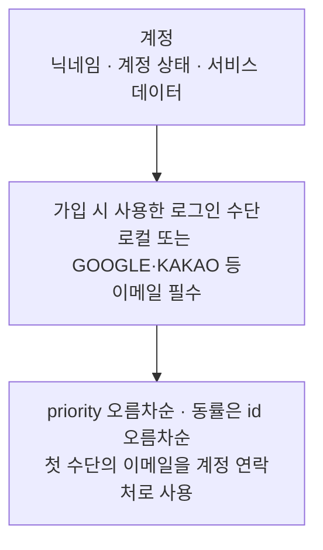

# 사용자 계정 관리 기능 구상

## 목적과 범위

현재 범위는 로컬·SNS를 통한 기본 가입·로그인과 계정 탈퇴다. 계정과 로그인 수단을 분리하여 향후 확장할 수 있도록 하되, 기존 계정에 로그인 수단을 추가로 연결하거나 계정을 통합하는 기능은 후속 과제로 둔다. 연결·통합 정책은 해당 서비스의 목적에 따라 결정한다. (확인)

로그인 수단은 `priority`가 작은 순서로 선택하고, 동률이면 `id` 오름차순으로 정한다. 첫 로그인 수단의 이메일을 계정의 컨택 포인트로 사용한다. 계정 비활성·재활성 등 기존에 논의한 부가 기능도 현재 기본 범위에서는 보류한다. (확인: 연락처 역할 / 추론: 기본 범위에 따른 보류)

이 문서는 대화에서 합의한 개념과 필요한 기능·할 일·관계를 정리한다. 세부 설계는 아래 산출물과 개별 기능에서 구체화한다. 기존 구현을 조사하거나 구현 완료 여부를 확인한 문서는 아니다.

## 현재 설계 산출물

- [계정·identity 초기 스키마](../../../tlab-app/migrations/0001_create_tlab_account.sql): 숫자 ID, 가입·활성·탈퇴 상태, identity 우선순위. (확인)
- [로컬 사용자 추가 설계](create-local-user/plan.md): 기존 Argon2id 해셔와 계정·LOCAL identity 생성 트랜잭션. HTTP 사용자 추가, entity 기반 저장과 검증 결과를 포함한다. RBAC는 후속 범위다. (확인)
- [로컬 로그인 설계](login-local/plan.md): 이메일·비밀번호 인증과 계정 상태 판단을 구현했다. usecase는 인증된 Account를 반환하고 HTTP 응답은 계정 ID·상태를 제공한다. 토큰·세션 생성과 웹 계층의 토큰 처리는 별도 설계로 둔다. (확인)

## 합의한 개념과 책임

| 대상 | 책임·정보 |
| --- | --- |
| 계정 | 사용자 식별, 닉네임, 계정 상태, 서비스 데이터 소유 |
| 로그인 수단 | 계정에 연결되는 로컬·GOOGLE·KAKAO 등의 인증 수단과 수단별 이메일 등 정보 |
| 로그인 수단 우선순위 | identity가 소유하는 `priority`. 작은 값 우선이며, 첫 수단의 이메일을 계정의 컨택 포인트로 제공 |

계정과 로그인 수단을 구분하고, 수단별 우선순위로 연락처를 선택한다. 계정에 별도 대표 identity ID를 두지 않는다. (확인) 닉네임·상태·서비스 데이터는 계정에 두고 인증에 필요한 정보는 각 로그인 수단에 두는 책임 구분안이다. (추론)

현재 범위에서는 가입 시 사용한 로그인 수단 하나를 `priority = 0`으로 생성한다. 여러 수단의 연결과 우선순위 변경은 후속 확장으로 둔다. (확인)

다음은 대화에서 확인한 방향이다. (확인)

- 계정과 로그인 수단을 구분한다.
- 로그인 수단의 우선순위로 연락처로 사용할 수단을 선택한다.
- 이메일은 필수이며, 로컬과 SNS 로그인 수단 모두 이메일을 갖는다.
- 우선순위가 가장 높은 로그인 수단의 이메일을 계정의 연락처로 사용한다.

향후 여러 로그인 수단을 연결한다면, 수단별 이메일은 서로 다를 수 있고 어느 수단으로 로그인하든 동일한 계정을 사용한다. 이는 확장 방향이며 현재 연결 기능을 제공한다는 의미는 아니다. (확인)

로컬 사용자와 SNS 사용자는 별도 계정 종류로 나누기보다, 계정에 연결된 로그인 수단의 차이로 표현할 수 있다. 로컬 가입과 SNS 가입은 계정을 만드는 서로 다른 진입 경로로 본다. (추론)

## 현재 기능·할 일

가입·로그인·탈퇴에 필요한 범위로 기능을 한정한다. DB 설계는 이를 지원하면서 계정과 로그인 수단의 책임을 분리하는 작업으로 포함한다. (확인: 기능 범위 / 추론: 설계 범위)

| 기능·할 일 | 한 줄 설명·범위 | 관련 항목·열린 논점 |
| --- | --- | --- |
| 계정·로그인 수단 DB 설계 | 계정·로그인 수단의 관계, 우선순위와 무결성 설계 | 향후 연결을 고려한 책임 분리, 현재의 중복·탈퇴 정책 |
| 로컬 가입 | 계정과 이메일을 사용하는 로컬 로그인 수단 생성 | 이메일 인증, 중복 가입 처리, 닉네임과 우선 연락처 설정 |
| 로컬 로그인 | 로컬 인증으로 연결된 계정에 접근 | 로그인 실패 처리, 계정 상태와 접근 제한 |
| SNS 가입 | GOOGLE·KAKAO 등으로 계정과 로그인 수단 생성 | 필수 이메일 확보, 중복 가입 처리, 닉네임과 우선 연락처 설정 |
| SNS 로그인 | SNS 인증으로 연결된 계정에 접근 | 최초 가입과 재로그인 흐름, 제공자 연동 실패 |
| 계정 탈퇴 | 계정 종료와 로그인 수단·서비스 데이터의 후속 처리 | 본인 확인, 기존 로그인 종료, 재가입과 정보 보관·삭제 |

이메일 인증과 로그인 유지·종료 처리는 가입·로그인·탈퇴를 성립시키는 데 필요한 수준으로 상세 요구사항에서 검토한다. 독립적인 관리 기능까지 현재 범위에 포함한 것은 아니다. (추론)

## 후속 과제와 확장 경계

로그인 수단 연결·해제와 계정 통합은 후속 과제로 둔다. 구체적인 정책은 서비스 목적과 서비스 데이터의 성격을 파악한 뒤 결정한다. 현재 기능의 선행 조건으로 삼지 않는다. (확인)

| 보류 항목 | 이후 검토할 내용 |
| --- | --- |
| 로그인 수단 연결·해제 | 기존 계정에 수단 추가·제거, 소유 확인, 다른 계정에 연결된 수단 처리 |
| 계정 통합 | 양쪽 계정 소유 확인, 남길 계정 선택, 서비스 데이터 충돌·이전 정책 |
| 로그인 수단 우선순위·연락처 변경 | 여러 수단의 순서 변경, 이메일 변경 반영 |
| 프로필 변경 | 닉네임·이메일 등 변경 정책 |
| 계정 비활성·재활성 및 관리자 관리 | 일시 중단·정지·복구의 주체와 정책 |
| 비밀번호 변경·재설정 및 계정 복구 | 인증 정보 관리와 접근 불가 상황의 복구 |
| 세션 관리 확장 | 기기별 조회·종료, 전체 기기 로그아웃 등 관리 기능 |

보류 항목의 세부 범위는 향후 논의한다. 확장 지원은 계정과 로그인 수단의 책임·관계를 분리하는 수준으로 두고, 사용하지 않는 연결·통합 절차나 서비스 데이터 병합 규칙을 미리 구현하는 뜻으로 확대하지 않는다. (추론)

## 주요 흐름과 관계

상세 시나리오 정의에 앞서 다음 흐름을 기준으로 기능 사이의 관계를 검토한다. (추론)

- **신규 가입:** 로컬 가입 정보 입력 또는 SNS 인증 → 필수 이메일 확보 → 계정·로그인 수단 생성 → 가입 수단의 우선순위를 0으로 설정.
- **기존 사용자 로그인:** 연결된 수단으로 인증 → 계정 확인 → 계정 상태에 따른 접근 처리.
- **탈퇴:** 본인 확인 → 계정 종료 → 이후 로그인과 기존 세션 처리 → 데이터 후속 처리.

다른 로그인 수단에서 같은 이메일을 받더라도 현재 범위에서는 자동 연결·통합하지 않는 방향이다. 중복을 발견했을 때의 가입 제한·안내는 현재 가입 정책으로 정해야 한다. (추론)

위 순서는 구상용이며 구체적인 처리 순서·검증 조건·트랜잭션을 확정하지 않는다.

## 남은 질문

다음 항목은 아직 결정하지 않았다. 각 기능의 요구사항 또는 설계에서 구체화한다. (확인)

| 관련 기능 | 열린 질문 |
| --- | --- |
| 가입 | SNS가 이메일을 제공하지 않으면 추가 입력으로 확보할지, 해당 가입을 제한할지? |
| 이메일 관리 | 이메일 소유 확인을 언제 요구하며, SNS 제공자의 인증 결과를 어떻게 취급할지? |
| 가입 | 이메일 중복을 어느 범위까지 허용하며, 중복 발견 시 어떻게 안내할지? |
| SNS 가입·로그인 | 제공자가 변경된 이메일을 전달하면 기존 연락처에 어떻게 반영할지? |
| 가입 | 닉네임 중복을 허용할지, 최초 닉네임을 어떻게 설정할지? |
| 로그인·탈퇴 | 로그인 유지·만료·종료와 탈퇴 시 기존 세션 처리를 어떻게 정할지? |
| 탈퇴 | 연결 정보와 서비스 데이터 처리, 재가입 시 기존 정보 취급을 어떻게 정할지? |

연결 개수·우선순위 변경·계정 통합 등 후속 과제의 정책은 현재 범위의 열린 질문에서 분리하고, 해당 기능을 다룰 때 구체화한다. (추론)
