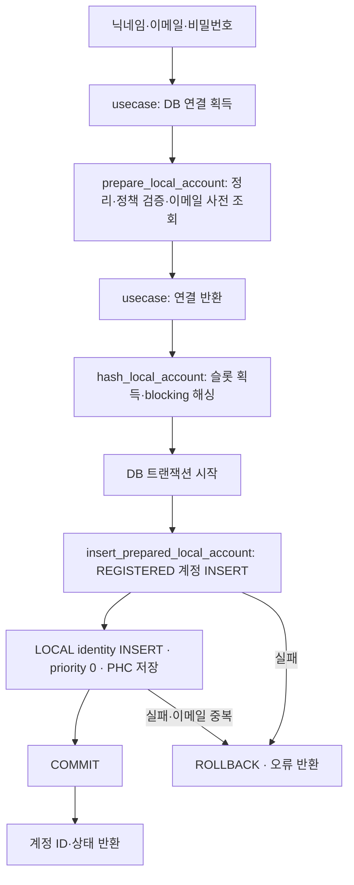

# 로컬 사용자 추가 설계

## 연결 문서

| 관계 | 대상 | 설명 |
| --- | --- | --- |
| realizes | [계정 기능 구상](../account.md) | 계정과 identity 분리, 로컬 가입 |
| follows | [PLN-PASSWORD-HASH](../../password/hash/plan.md) | 기존 Argon2id 해셔의 생성·저장 계약 |
| 참고 | [PLN-RBAC-MANAGE-ACCESS](../../rbac/manage-access/plan.md#rbac-07-08-current) | 공용 준비·저장, bootstrap과 가입 진입 인가 |

## 목적과 범위

닉네임·이메일·비밀번호를 받아 계정과 LOCAL identity를 함께 생성하는 HTTP API를 제공한다. 비밀번호는 기존 Argon2id 해셔로 처리한다. 별도 요구사항 문서 없이 대화와 현재 스키마를 기준으로 설계한다. HTTP 노출, 향후 RBAC로 제한된 사용자만 접근, 비밀번호 정책 trait 분리, 해싱 동시성 초기값 2는 사용자 지정 방향이다. 사용자의 “구현 진행해” 요청으로 설계와 구현을 승인받았으며 저장소 CRUD·entity 기준 API 및 VSA 배치에 대한 후속 의견을 반영했다. 현재 구현과 검증 결과는 하단 기록을 참조한다. (확인: 요청 / 추론: 세부 설계)

신규 계정은 REGISTERED, 첫 identity는 priority = 0으로 생성한다. 이메일 소유 확인은 수행하지 않으므로 email_verified_at은 NULL이다. 가입과 동시에 활성화하거나 로그인 세션을 발급하지 않는다. SNS 가입·기존 계정에 수단 연결·인증 메일 발송·활성 전환은 후속 흐름이다. (확인: 상태·우선순위 방향 / 추론: 이번 생성 흐름)

## 설계 시작 시점에 확인한 구조

- [`Container`](../../../../tlab-app/src/app.rs)는 DB와 `Box<dyn PasswordHasher>`를 소유하며, `argon2id::Hasher::new(&config.passwd_hasher)`로 해셔를 생성한다. 별도 Argon2 구현이나 알고리즘 선택 계층은 필요 없다. (확인)
- [`PasswordHasher`](../../../../tlab/src/password.rs)의 `hash(&str)`는 동기 함수다. [`Argon2id`](../../../../tlab/src/password/argon2id.rs)는 OS 난수 salt를 매번 생성하고 PHC 문자열을 반환한다. 현재 앱 설정은 memory_kib = 19456, iterations = 2, parallelism = 1이다. (확인)
- [`0001 SQL`](../../../../tlab-app/migrations/0001_create_tlab_account.sql)은 숫자 ID, 계정 상태, identity 우선순위와 LOCAL 이메일의 `lower(email)` UNIQUE 인덱스를 제공한다. provider 목록과 자격 정보 조합은 DB에서 제한하지 않는다. 이 작업에 스키마 변경은 필요 없다. (확인)
- [`HTTP 조립`](../../../../tlab-app/src/http.rs)은 `/health`, `/db_status`와 정적 파일을 연결한다. auth slice와 업무 오류의 HTTP 변환은 아직 없다. [백엔드 기능 개발 가이드](../../../architecture/guide-be-feature-dev.md)에 따라 시나리오 가까이에 배치한다. (확인: 소스 / 추론: 배치)

## 현재 구현과 조립 상태

RBAC 06에서 입력 준비·해싱·저장을 `auth/local_account.rs`의 공용 작업으로 추출했다. 일반 가입과 초기 관리자 생성이 같은 작업을 사용하며 각 usecase가 연결·트랜잭션과 완료 조건을 조합한다. 아래는 현재 책임 배치이며 과거 구현·검증 기록은 하단에 보존한다. (확인)

리뷰 수정에서 `auth/mod.rs`의 `local_account` 선언과 입력·준비·해싱·저장 함수 재노출을 연결했다. 원본 workspace fmt·Clippy 및 인증·가입 테스트 64개가 통과했다. RBAC 07/08에서 계정 조회 재노출·slice 선언·HTTP·CLI를 연결하고 원본 앱 통합 검증을 완료했다. 과거 임시 조립 사본의 검증 기록과 이번 원본 검증을 구분한다. (확인)

## 책임과 배치

HTTP 처리·usecase·테스트를 사용자 생성 시나리오 안에 모으고, 저장소 API와 entity·비밀번호 정책은 auth 공용으로 둔다. 역할별 전역 route/service 디렉터리 대신 시나리오가 변경의 중심이 되는 VSA 배치다. 저장소의 API 축은 사용자의 후속 지시에 따라 account·identity CRUD로 유지한다. (확인: 요청·현재 구현)

```text
auth/
├── route.rs                     # API 경로·메서드와 slice handler를 연결해 상위 HTTP 모듈에 제공
├── slice/
│   ├── mod.rs
│   └── create_local_user/
│       ├── mod.rs
│       ├── route.rs             # HTTP 인증·account.create 진입 인가·입력·응답
│       ├── usecase.rs           # 공용 준비·해싱·저장 호출, 연결·트랜잭션 완료
│       └── tests.rs             # HTTP·usecase·실제 DB 통합 계약
├── local_account.rs             # 준비·해싱·저장 공용 작업, 인라인 해싱 테스트
├── entity.rs                    # 계정·identity entity와 AccountStatus·Provider enum
├── repository/
│   ├── account.rs               # 계정 저장소 CRUD
│   └── identity.rs              # identity 저장소 CRUD
└── passwd_policy.rs           # PasswordPolicy와 기본 정책
```

| 주체 | 책임 |
| --- | --- |
| slice의 route | 인증된 Actor의 account.create 인가 후 JSON 요청 해석·usecase 호출·공통 오류 응답 |
| app/response.rs | 정상 JSON·공통 에러 본문·JSON 추출 실패 응답 생성 |
| slice의 usecase | DB 연결 획득·반환, 공용 준비·해싱 호출, 저장 tx 시작·commit과 생성 결과 반환 |
| auth/local_account.rs | Context 기반 정리·검증·이메일 중복 사전 조회, 연결 없는 해싱·슬롯 관리, REGISTERED·LOCAL·priority 0 지정과 호출자 Context의 account/identity 저장 |
| 공용 entity | 저장할 값과 저장된 행의 타입. 생성용 New 타입은 DB가 채울 ID·생성/변경 시각을 제외 |
| 공용 repository | entity를 받아 bind·SQL 실행·행 매핑. 생성된 entity를 반환하고 DB 오류를 그대로 상위에 전달 |
| app::Container | 비밀번호 정책·Argon2id 인스턴스·DB·공유 해싱 슬롯의 생성과 소유 |
| auth/route.rs | API 경로·메서드와 각 slice handler를 직접 연결하고 auth Router를 상위로 제공 |
| http.rs | auth 등 feature Router를 기존 HTTP·HTTPS 서버에 연결 |
| tlab::password | Argon2id 연산·salt·PHC 형식. 앱의 비밀번호 정책·동시성·가입 절차는 소유하지 않음 |

repository에는 기능별 `create_local_user`나 `insert_local_identity`를 두지 않는다. 현재 필요한 API는 `account::insert(ctx, &NewAccount) -> Account`, `identity::insert(ctx, &NewIdentity) -> Identity`다. 개별 필드 인자를 호출마다 나열하지 않으며 SQL 필드 매핑은 저장소별 한 곳에서 관리한다. 트랜잭션 시작·commit은 usecase가 맡고 LOCAL 계정의 상태·우선순위·제공자 값 선택은 auth 공용 로컬 계정 저장 작업이 맡는다. 아직 사용하지 않는 조회·수정·삭제 연산은 필요해질 때 같은 entity 기준으로 추가한다. (확인)

`sqlx::FromRow` derive로 반환 행을 entity로 매핑하고 TIMESTAMPTZ는 `chrono::DateTime<Utc>`를 사용한다. query macro의 빌드 시 DB 조회는 사용하지 않는다. `AccountStatus`는 Registered·Active·Withdrawn, `Provider`는 Local·Google·Kakao를 지원하는 Rust enum이다. SQLx Type을 통해 DB의 TEXT 대문자 코드와 매핑한다. DB에 새로운 제공자 값을 저장하는 것은 가능하지만 현재 Rust enum이 지원하지 않는 값을 디코딩하면 오류를 반환한다. 지원 확대 시 Rust variant와 처리 코드를 추가한다. 생성 응답도 AccountStatus를 사용하며 JSON은 기존 REGISTERED 형식을 유지한다. (확인)

entity는 HTTP 응답과 분리하며 identity와 생성 입력에는 Debug·Serialize를 적용하지 않는다. 전체 저장 행을 표현하는 Account·Identity에 한해서 현재 slice가 읽지 않는 필드의 dead_code 경고를 허용한다. (확인)

handler는 usecase에 DB·정책·해셔·슬롯만 전달한다. Container 전체를 usecase·repository에 넘기지 않고, repository가 임의로 commit하지 않는다. (확인)

## 입력과 결과 계약

usecase 입력은 `nickname: String`, `email: String`, `password: String`이다. provider, priority, status, email_verified_at은 서버에서 결정하며 입력으로 받지 않는다. HTTP 전용 타입과 usecase 타입은 경계가 필요한 만큼만 나누고 같은 필드를 형식적으로 복제하지 않는다. 입력에 비밀번호가 있으므로 Debug 출력과 인자 전체 tracing을 사용하지 않는다. (추론)

| 입력 | 처리 |
| --- | --- |
| nickname | 앞뒤 공백 제거 후 빈 값 또는 NUL 포함 시 거부. 중복 허용 |
| email | 앞뒤 공백 제거 후 단일 이메일 주소 형식 검증. 표시 이름·주소 목록은 받지 않음. 대소문자는 저장 시 보존하고 식별은 DB `lower(email)` 기준 |
| password | 주입한 PasswordPolicy로 검증. trim·대소문자 변환·Unicode 정규화·절단 없이 입력 그대로 해싱 |

이메일 형식 검증은 검증된 파서를 활용하고 자체 정규식으로 범용 이메일 문법을 구현하지 않는다. `email_address` 0.2.9의 `parse_with_options(..., Options::default().without_display_text())`를 사용한다. 닉네임에는 trim 후 빈 값 거부 외 별도 길이 제약을 추가하지 않으며, 이메일 길이·문법은 파서의 검증을 따른다. 비밀번호 최소·최대 길이 등은 정책 구현체에서 정의하며 usecase·해셔·DB에 고정하지 않는다. (추론: 처리안 / 확인: 정책 분리 방향)

### 비밀번호 정책 계약

비밀번호 제약은 앱의 auth 영역이 소유하고 Argon2id 해싱과 분리한다. 정책은 원문을 검사해 통과 또는 위반 사유를 반환하며 비밀번호를 변환하지 않는다. Container에서 `Arc<dyn PasswordPolicy>`로 선택·주입한다. (확인: trait 분리 요청 / 추론: 소유·주입 방식)

```rust
pub trait PasswordPolicy: Send + Sync {
    fn validate(&self, password: &str) -> Result<(), PasswordPolicyViolation>;
}

pub struct PasswordPolicyViolation {
    pub code: AppErrorCode,
    pub message: &'static str,
}
```

위 인터페이스를 구현했다. 위반 결과에는 비밀번호 원문을 포함하지 않는다. 공용 준비 작업은 정책을 해싱 슬롯 획득 전에 호출하고, 실패하면 해당 코드·메시지의 공통 AppError를 반환한다. HTTP 외 호출도 같은 정책을 적용한다. (추론)

초기 구현체는 `NonEmptyPasswordPolicy`로 빈 문자열만 거부한다. 길이·문자 구성·금지 비밀번호 같은 실제 제약은 정책 구현체를 교체하거나 그 안에서 조합하도록 하며, 이번에 별도 규칙 조합 프레임워크는 도입하지 않는다. 비밀번호 재설정 등 후속 시나리오도 동일한 정책이 필요하면 이 trait을 사용한다. 구체 강도 정책은 후속으로 이 구현체를 교체해 적용한다. (확인: 현재 기본값 / 추론: 확장 경계)

성공 결과는 `account_id: i64`, `status: REGISTERED`다. identity ID와 PHC·비밀번호는 응답하지 않는다. ID는 현재 프로젝트 내부 식별자를 반환하는 안이며 별도 외부용 UUID는 만들지 않는다. (추론)

usecase는 공통 `AppError { code: AppErrorCode, message, stage, cause: Option<tlab::Error> }`를 반환한다. 실패 의미는 해당 usecase가 판단하고, 공개 메시지는 오류 생성 시 개별 지정한다. `AppErrorCode`는 enum이며 HTTP 계층에서 상태 코드로 대응한다. slice별 Error enum과 InvalidInput·InternalFailure는 사용하지 않는다. cause에는 DB·해싱의 원본 오류를 보존하고 응답으로 직렬화하지 않는다. (확인: 사용자 합의와 구현)


### HTTP 진입점과 접근 제어

`POST /api/v1/accounts/local`은 Bearer 인증, `POST /web/v1/accounts/local`은 기존 쿠키 인증·자동 갱신·Origin/CSRF 계약을 사용한다. 두 진입점은 검증된 claims의 Actor로 현재 역할 퍼미션을 조회하고 `account.create`를 확인한 뒤 같은 가입 usecase를 호출한다. execute 자체는 HTTP와 독립적인 신뢰된 내부 작업이다. (확인)

인증 실패는 401, 권한 없음은 403/RBAC_FORBIDDEN, resolver 장애는 500/INTERNAL_ERROR다. 인가를 통과한 뒤 기존 입력·해싱·저장 계약을 적용한다. 인증 검사와 업무 진입 인가를 일반 JWT 검증기나 저장소로 이동하지 않는다. 실제 앱 검증은 [RBAC 07/08](../../rbac/manage-access/verification.md)에 기록한다. (확인)

```json
{"nickname":"사용자","email":"user@example.com","password":"입력한 비밀번호"}
```

| 결과 | HTTP 응답 |
| --- | --- |
| 생성·commit 성공 | 201, `{"account_id":123,"status":"REGISTERED"}` |
| JSON·필수 필드·입력 검증 실패 | 400, 안전한 오류 코드와 메시지. 알 수 없는 필드도 거부 |
| 기본 JSON body 제한 초과 | 413, 원문 없는 INVALID_REQUEST |
| LOCAL 이메일 중복 | 409, `EMAIL_ALREADY_EXISTS` |
| 해싱 동시성 슬롯 소진 | 503, `BUSY` |
| 해싱·DB·blocking 작업 실패 | 500, `INTERNAL_ERROR` |

`app::response::success(status, data)`와 `error(status, code, message)`가 JSON을 생성하고 `invalid_json`이 원문 없는 파싱 실패를 처리한다. 공통 `IntoResponse for AppError` 구현은 code를 HTTP 상태로 변환하고 클라이언트에 `{ code, message }`만 반환한다. 오류 응답은 `Cache-Control: no-store`를 사용한다. route는 `error.into_response()`를 호출하며 쿠키 삭제 등 전송 방식별 처리를 담당한다. (확인)

공통 IntoResponse 변환을 거치는 모든 AppError는 stage·cause·code를 한 번 기록한다. InternalError는 ERROR, Busy는 WARN, 입력 오류·인증 실패·이메일 중복 등 나머지는 INFO를 사용한다. 진단 로그는 현재 요청 span을 사용하며 cause는 Debug 형식으로 남긴다. HTTP 응답에는 stage·cause·field를 포함하지 않고, message는 내부 오류 문자열에서 생성하지 않는다. (확인)


이 매핑은 인가를 통과한 가입 작업의 HTTP 응답 계약이다. RBAC 07에서 앞의 401·403 진입 계약을 연결했다. HTTP 상태·응답 변환은 handler 책임이며 usecase는 HTTP 타입을 알지 않는다. (추론)

## 처리 흐름과 트랜잭션



1. usecase가 DB 연결을 얻고 `prepare_local_account(ctx, policy, input)`을 호출한다. 정리·검증·이메일 중복 사전 조회를 caller Context에서 수행하고 정리된 `LocalAccountInput`을 반환한다. 공용 작업은 연결·tx를 열지 않는다.
2. usecase가 준비에 사용한 연결을 반환한 뒤 `hash_local_account(input, hasher, slots)`를 호출한다. 슬롯이 없으면 Busy를 반환하며 blocking 작업에서 원문을 그대로 해싱한다.
3. 해싱 결과인 `PreparedLocalAccount`는 비공개 필드에 닉네임·이메일·해시를 보관하고 Debug/Serialize를 제공하지 않는다. 해싱 중 DB 연결·tx는 없다.
4. usecase가 tx를 열고 `insert_prepared_local_account(ctx, prepared)`를 호출한다. 같은 Context에 REGISTERED 계정과 LOCAL identity를 저장하며 저장 작업은 commit하지 않는다.
5. usecase가 commit한 뒤 `CreatedLocalUser { account_id, status }`를 반환한다. bootstrap은 같은 준비·해싱·저장을 사용하되 계정·identity와 RBAC 역할·연결을 하나의 tx로 조합한다.

위 순서로 구현했다. 비밀번호와 생성 해시를 이벤트·로그·응답에 넣지 않고, DB에는 PHC 문자열만 저장한다. 비밀번호 확인용 재입력은 UI 책임으로 보고 저장하지 않는다. (추론)

### 해싱 실행과 자원 소유

Container는 해셔를 `Arc<dyn PasswordHasher>`로 공유한다. Container는 계속 Argon2id 구현체를 선택하고, blocking closure에는 해셔 Arc·비밀번호·슬롯 permit만 이동한다. 해셔 자체의 trait과 동기 API는 변경하지 않는다. (추론)

동시성 슬롯은 `Arc<tokio::sync::Semaphore>`로 앱이 소유한다. 초기 동시성은 2로 정한다. 앱 설정에 `[auth] max_concurrent_password_hashes = 2`를 두고 0 또는 Semaphore의 최대 허용값 초과는 설정 오류로 처리한다. (확인: 초기값 2 / 추론: 설정 계약)

이 제한은 Argon2 인스턴스 수·알고리즘 선택·Argon2의 parallelism과 독립적이다. 같은 세마포어를 사용하는 작업은 인스턴스가 몇 개든 총 2개까지만 실행 슬롯을 점유한다. blocking executor에서 실행을 기다리는 작업도 슬롯을 점유한다. 하나의 해셔를 공유해도 동시 실행은 가능하며, 해셔가 자동으로 이 제한을 적용하는 것은 아니다. (추론: 실행 구조)

적용 범위는 해당 앱 인스턴스의 공유 세마포어다. 프로세스를 여러 개 띄우면 각각 2개이며, 향후 다른 해싱 호출 경로에도 같은 제한을 적용하려면 동일한 슬롯 자원을 전달해야 한다. Argon2의 memory_kib·iterations·parallelism은 기존 해셔 설정을 그대로 따른다. 초기값 2는 성능 측정 결과를 의미하지 않으며 배포 환경에 따라 조정한다. (추론: 범위·운영 의미)

permit은 blocking closure가 끝날 때 해제한다. HTTP 요청이 취소되어도 이미 시작한 해싱은 계속될 수 있으므로, 요청 future 해제만으로 슬롯을 반환하지 않는다. 해싱 중에는 DB 연결·트랜잭션을 보유하지 않는다. 생성 호출이 해싱 결과를 받지 못하면 후속 DB 작업으로 진행하지 않으며, DB 트랜잭션 도중 취소된 경우 미완료 트랜잭션은 기존 래퍼의 rollback-on-drop 계약을 따른다. (추론: 기존 API를 이용한 실행 계약)

### 저장 계약

auth 공용 `insert_prepared_local_account`는 `NewAccount { nickname, status: REGISTERED, withdrawn_at: None }`와 `NewIdentity { account_id, provider: LOCAL, provider_subject: None, email, email_verified_at: None, password_hash: Some(PHC), priority: 0 }`를 구성한다. repository는 이를 받아 bind 처리하고 `INSERT ... RETURNING *`를 통해 Account·Identity로 매핑한다. 비밀번호 해시를 포함한 저장 entity를 HTTP 응답에 직접 직렬화하지 않는다. (확인)

해싱 전에 LOCAL 이메일을 대소문자 구분 없이 조회하여 중복을 거부한다. 사전 조회가 보장하지 못하는 동시 가입은 `tlab_account_identity_local_email_key`의 UNIQUE 제약으로 차단한다. 저장 중 충돌은 InternalError로 전달하며 사용자가 재시도하면 사전 조회에서 EmailAlreadyExists를 반환한다. identity 저장 실패 시 트랜잭션 종료로 먼저 생성한 계정도 rollback된다. (확인: 사용자 합의와 구현)

SNS와 이메일이 같아도 새 LOCAL 계정을 만들며 자동 연결하지 않는다. 탈퇴 계정의 LOCAL identity가 남아 있으면 기존 UNIQUE 인덱스로 중복 처리한다. 이 slice에서 기존 계정을 복구·활성화하거나 identity를 이전하지 않는다. (확인: 스키마·기존 방향 / 추론: 생성 계약)

해싱 실패 시 DB 변경은 없다. commit 전에 확인된 저장 실패는 rollback한다. commit 중 연결 단절은 성공 여부가 불명확할 수 있으므로 미저장을 보장하거나 자동 재시도하지 않는다. 별도 멱등성 키는 이번 설계에 포함하지 않는다. (확인: DB 래퍼 계약 / 추론: 실패 처리)

## 검증할 계약

[구현 가이드](../../../architecture/guide-impl.md)와 [테스트·검증 가이드](../../../architecture/guide-test.md)에 따라 실제 공개 진입점과 PostgreSQL에서 확인한다. 라이브러리 Argon2 알고리즘 자체의 테스트는 중복 작성하지 않고 앱의 사용·저장 계약을 검증한다. (추론)

| 상황 | 기대 결과 |
| --- | --- |
| 정상 생성 | REGISTERED 계정 1개와 LOCAL identity 1개, priority 0, subject·이메일 인증 시각 NULL |
| 실제 Argon2id 연계 | 저장된 PHC가 argon2id이며 기존 해셔로 원래 비밀번호 true, 다른 비밀번호 false |
| 비밀번호 앞뒤 공백 포함 | 원문으로만 검증 성공. trim된 값과 다른 비밀번호로 취급 |
| 입력 오류 | 명시한 입력 정책으로 거부하고 계정·identity 미생성. NUL 닉네임은 해싱 슬롯이 소진돼도 400/INVALID_NICKNAME |
| 내부 오류 진단 | 요청 span·단계·cause를 서버 로그에서 확인. HTTP 응답에는 내부 원인이나 DB 진단을 노출하지 않음. 요청 본문·비밀번호·PHC를 별도 필드로 로깅하지 않음 |
| 비밀번호 정책 교체 | 같은 생성 usecase가 주입된 정책에 따라 수락·거부. 거부 시 해싱·DB 변경 없음 |
| 같은 LOCAL 이메일의 대소문자 변형·동시 요청 | 1건만 성공, 나머지는 EmailAlreadyExists. 고아 계정 없음 |
| SNS와 같은 이메일 | LOCAL 신규 계정 생성, 기존 계정 연결·수정 없음 |
| identity 저장 실패 | 계정 INSERT까지 포함해 rollback |
| 해싱 실패·blocking 실패·슬롯 소진 | 내부 실패 또는 Busy를 구분하고 DB 변경 없음 |
| 해싱 중 호출 취소 | 실제 작업이 종료되기 전까지 permit 유지 |
| 해셔 인스턴스와 동시성 | 해셔 1개 또는 여러 개가 동일 슬롯을 공유할 때 2개까지 허용, 세 번째 작업은 Busy |
| HTTP 진입점 | JSON 오류·성공·중복·Busy·내부 오류 매핑, 비밀번호·해시·DB 상세 미노출 |

DB 테스트는 전용 스키마에서 현재 migration을 적용하고 격리·정리한다. 실패 주입은 PasswordHasher trait의 테스트 구현 등 실제로 필요한 경계에서만 사용한다. 실행한 테스트와 결과는 하단의 검증 기록을 따른다. (추론: 검증 방식 / 확인: 미실행)

## 후속 범위

- RBAC 인증·account.create·401/403 계약은 07/08에서 연결·검증했다. 후속 권한 정책 변경 시 RBAC 명세와 함께 검토한다. (확인)
- 비밀번호 강도 정책은 PasswordPolicy 구현체 교체로 확장한다. 현재 기본값은 빈 문자열 거부다. (확인)
- 이메일 소유 확인·활성 전환·SNS 가입·수단 연결·우선순위 변경은 후속 흐름이다. (확인)

## 구현·변경 기록

- 사용자 요청에 따라 현재 priority 기반 스키마와 Container의 Argon2id 해셔를 확인하고 로컬 사용자 생성 설계 초안을 작성했다. 별도 요구사항 문서·앱 코드·SQL 변경은 수행하지 않았다. (확인)
- 설계 점검: 관계·식별 무결성은 기존 DB 제약을 활용하고, LOCAL 자격 정보 구성과 가입 흐름은 앱이 책임지도록 구분했다. 구현 시 공유 해셔의 소유 형태와 blocking 작업 자원 관리 변경이 필요하다. 실행 검증은 미수행이다. (확인: 점검 범위 / 추론: 구현 영향)
- 사용자 후속 의견 반영: HTTP 노출·향후 RBAC 접근 제한, 앱 auth 영역의 PasswordPolicy trait 분리, 해셔 인스턴스와 독립적인 공유 실행 슬롯 2개를 설계에 반영했다. 인터페이스·정책 주입·슬롯 범위와 검증 조건을 보완했으며 앱 코드 변경이나 실행 검증은 수행하지 않았다. (확인)


### 구현 및 구조 조정

- 승인 근거: 사용자 “구현 진행해”, repository는 저장소 CRUD 기반, VSA 배치 재검토, entity 기반 저장 요청. 기존의 단일 slice 파일 제안을 시나리오 디렉터리와 공용 entity·repository로 구체화했다. (확인)
- 구현: HTTP POST, 로컬 사용자 생성 서비스, Account·Identity entity와 생성용 New 타입, repository INSERT, 비밀번호 정책 주입, 기존 Argon2id PHC 저장, 공유 해싱 슬롯 2개를 추가했다. 데이터베이스 migration은 변경하지 않았다. (확인)
- 의존성: 이메일 검증에 email_address, 행 매핑에 SQLx derive·time feature, in-process Router 검증에 테스트용 tower util을 사용한다. Cargo.lock을 함께 갱신했다. (확인)
- 설계의 기본 경로·NonEmptyPasswordPolicy·동시성 설정명을 채택했고, 권한 제한은 사용자 요청대로 후속 RBAC 범위에 남겼다. (확인)


### 최종 검증·자체 점검

- `cargo test --workspace --locked --offline`: 통과. 기존 DB 연동 5건과 신규 앱 DB 연동 1건은 기본 실행에서 제외되며, 환경변수 helper 1건은 상위 테스트가 별도 프로세스로 실행한다. (확인)
- `TLAB_TEST_DATABASE_URL=<로컬 PostgreSQL URL> cargo test -p tlab-app --locked --offline -- --include-ignored`: 최종 VSA·entity 기반 코드에서 9개 테스트 모두 통과. 앱 단위 검증은 in-process Axum Router를 통한 HTTP 요청과 실제 PostgreSQL을 연결했다. (확인)
- 실행으로 확인한 범위: REGISTERED·LOCAL·priority 0 저장, 실제 PHC와 원문 공백 보존, 대소문자 중복 및 동시 가입, 고아 계정 방지, 다른 UNIQUE 오류의 500 변환과 rollback, SNS 이메일과의 공존, 새 제공자 entity 저장·행 매핑, 정책 교체·잘못된 JSON·추가 필드 거부, 슬롯 소진, 해싱 실패 및 취소 후 실제 작업 종료까지 슬롯 유지. (확인)
- 최초 DB 테스트는 샌드박스 소켓 접근 제한으로 실패했고, 권한 허용 환경에서 실행하여 통과했다. 테스트마다 고유 스키마를 만들고 panic 시에도 테스트 소유 스키마를 정리하도록 구성했다. 공유 업무 스키마에는 migration이나 사용자 데이터를 적용하지 않았다. (확인)
- `cargo fmt --all -- --check`, `cargo clippy --workspace --all-targets --locked --offline -- -D warnings`, `git diff --check`: 통과. 신규 파일의 공백과 문서 링크도 점검했다. (확인)
- `cargo audit`: 통과. advisory 1,422개를 로드하여 잠금 파일의 284개 의존성을 검사했다. (확인)
- 자체 점검: 역할별 전역 디렉터리를 시나리오 디렉터리로 조정했고, repository 입력을 저장소별 임시 Insert 타입에서 공용 생성 entity로 변경했다. 제공자·가입 상태·우선순위 구성과 중복의 업무 의미는 서비스에 유지하고, SQL 매핑·저장 오류는 repository에 두었다. (확인)
- 미검증·후속: 새 엔드포인트의 별도 TCP/HTTPS 실호출, 운영 부하, commit 도중 통신 단절 주입은 이번에 수행하지 않았다. 실제 RBAC·강화 비밀번호 정책·이메일 소유 확인은 후속 범위다. 커밋·배포는 수행하지 않았다. (확인)


### 공통 HTTP 응답 처리

- 사용자 요청으로 `app/response.rs`에 정상 응답·에러 본문·JSON 추출 실패 응답 처리를 모았다. 로컬 사용자 route는 서비스 오류의 HTTP 의미를 선택하고 공통 응답 생성 함수를 호출한다. `/db_status`도 같은 정상 응답 함수를 사용한다. 응답 JSON 계약은 유지했다. (확인)
- 변경 후 PostgreSQL을 포함한 앱 테스트 9개, workspace Clippy, fmt 및 diff 검사를 다시 실행해 통과했다. 실제 DB의 고유 테스트 스키마는 정리했다. (확인)

- 사용자 요청으로 해싱 단위 테스트를 `create_local_user/service.rs`의 인라인 tests 모듈로 이동하고 별도 `service/tests.rs` 파일과 빈 디렉터리를 제거했다. (확인)

- 사용자 지적에 따라 시나리오 전체·정책 판단·트랜잭션을 담당하는 파일을 `service.rs`에서 `usecase.rs`로 변경하고 모듈·테스트·문서 참조를 갱신했다. 재사용 공용 작업을 담당하는 service와 시나리오 책임을 구분한다. (확인)

- 사용자 요청으로 `auth/route.rs`가 하위 slice Router를 조합하고 `auth::router()`로 상위에 제공하도록 변경했다. HTTP 통합 테스트도 feature Router를 통해 요청하도록 바꿨으며, 기본 앱 테스트 8개와 PostgreSQL HTTP 연동 테스트 1개가 통과했다. (확인)

- 리뷰 중 사용자 요청에 따라 `auth/entity.rs`에 AccountStatus·Provider enum을 추가하고 entity·repository·usecase·응답 타입을 갱신했다. DB TEXT 타입과 migration은 유지하며, 지원하지 않는 코드의 디코딩은 실패하도록 정의했다. (확인)


## 코드 리뷰

- 대상: HEAD `e8883110e5706cac9081f1615fcba71c02a6c169` 대비 미커밋 변경 전체와 신규 파일. 리뷰 중 사용자 요청으로 추가한 AccountStatus·Provider enum까지 포함한다. Rust 소스·앱 설정·Cargo manifest·lock 20개 파일을 경로순으로 `경로 + NUL + 내용 + NUL` 형식으로 결합한 SHA-256은 `304797e54427b621bca7e12cf0e6149c92d2b3c36005f4a42488de986738a2a6`이다. (확인)
- 환경: Rust/Cargo 1.97.1, aarch64-apple-darwin, 기본 feature. (확인)
- 선행 검사: `cargo fmt --all -- --check`, `cargo clippy --workspace --all-targets --locked -- -D warnings`, `cargo audit` 통과 후 LLM 리뷰를 수행했다. enum 변경 후 fmt·Clippy를 재실행했고, 의존성과 lock은 바뀌지 않아 audit 결과를 재사용했다. advisory DB `309392b18f6b17022f82c701f300433126901068`, advisory 1,422개·의존성 284개 검사. (확인)
- 조건부 검사: 직접 작성한 unsafe·메모리 조작·자체 동기화 알고리즘은 없고 Tokio의 Semaphore·spawn_blocking을 조합한다. Miri는 비대상, Geiger는 별도 unsafe 현황 조사가 필요하지 않아 미실행이다. (확인: 변경 범위 / 추론: 검사 선정)
- 판정: **통과, 경미한 개선 2건**. 가이드의 초기 배점 기준으로 **86.25/100**, 리스크 **R2**다. 합의된 RBAC·강화 비밀번호 정책의 후속 구현을 현재 범위의 결함으로 감점하지 않았다. 공개 운영 환경에 대한 배포 승인을 뜻하지 않는다. (추론)

### 발견 사항

1. **[경미] 닉네임에 NUL이 있으면 입력 오류 대신 HTTP 500을 반환한다.** [`usecase.rs`](../../../../tlab-app/src/auth/slice/create_local_user/usecase.rs)의 nickname 검증은 trim 후 빈 값만 검사한다. JSON의 `member\u0000name`은 이 검증을 통과한 뒤 PostgreSQL TEXT 저장에서 실패해 Internal로 변환된다. 현재 코드와 일치하는 임시 사본을 HTTP Router·고유 PostgreSQL 스키마에 연결해 정상 입력 201, NUL 입력 500/INTERNAL_ERROR를 재현했다. 데이터를 손상시키지는 않지만 입력 오류 분류가 잘못되고 불필요한 해싱·DB 작업을 수행한다. 닉네임의 NUL을 해싱 전에 거부해 400으로 응답하고 이 사례를 기존 입력 검증 테스트에 추가하는 방향을 권한다. (확인: 재현 / 추론: 수정 방향)
2. **[경미] 내부 오류의 진단 원인이 route에서 소실된다.** [`route.rs`](../../../../tlab-app/src/auth/slice/create_local_user/route.rs)의 `Error::Internal(cause)` 분기는 cause를 사용하지 않고 `local user creation failed`만 기록한다. DB 연결 실패·제약 위반·해싱 실패·blocking task 실패를 구분할 진단 정보가 최종 로그에 남지 않는다. 응답에서 원문을 숨기는 것은 적절하지만, 서버에서도 구분이 사라져 장애 원인 파악이 어려워진다. DB 원문 메시지를 그대로 기록하는 대신 실패 단계·안전한 오류 종류·허용한 SQLSTATE 등 비밀을 포함하지 않는 진단 필드를 보존하는 방향을 권한다. (확인: 코드 / 추론: 영향·개선 방향)

provider·status의 String 사용은 리뷰 중 논의에 따라 Rust enum으로 변경하고 실제 DB 인코딩·디코딩을 검증했다. 현재 리뷰에서는 해결된 구조 개선으로 기록한다. DB TEXT 확장과 앱이 지원하는 enum 범위를 구분하며 알 수 없는 코드의 디코딩은 명시적으로 실패한다. (확인)

### 항목별 평가

| 항목 | 점수 | 근거 |
| --- | --- | --- |
| 기능 | 3/4 | 생성·중복·오류 응답·enum 매핑 검증. NUL 입력의 500 분류는 경미한 보완 사항 |
| 가독성과 구조 | 4/4 | 시나리오 내 route·usecase·테스트, 저장소별 entity API, 공통 응답·Router 조합의 책임이 명확 |
| 안정성 | 3/4 | 원자적 생성·중복 경쟁·해싱 슬롯·취소 시 자원 수명 검증. 내부 실패 진단 정보 보완 권장 |
| 보안 | 4/4 | 합의 범위에서 Argon2id·OS salt·정책 주입·bind·비밀 미노출·해싱 동시성 제어 확인. RBAC는 명시적 후속 범위 |
| 성능 | 4/4 | 해싱 중 DB 연결을 보유하지 않고 실행 슬롯을 제한. 저장은 트랜잭션 내 INSERT 2회. 운영 처리량은 측정하지 않았으며 처리량을 보장하는 점수는 아님 |
| 테스트 용이성 | 3/4 | 실제 DB 격리와 실패 주입, 해셔·정책 대역, 취소·동시성 검증이 가능. 위 입력 경계와 안전한 오류 진단의 검증 보완 권장 |

### 검증·복구와 남은 범위

- enum 변경을 포함한 최종 코드에서 `TLAB_TEST_DATABASE_URL=<로컬 PostgreSQL URL> cargo test -p tlab-app --locked --offline -- --include-ignored` 9개 통과. 상태 3개·provider 3개의 TEXT 상호 변환과 미지원 값의 디코딩 실패, 기존 HTTP 생성·중복·rollback 계약을 확인했다. 기본 workspace 테스트의 앞선 통과 결과는 유지하되 최종 변경 영향은 앱 테스트로 재확인했다. (확인)
- 경계 재현은 임시 실행기에서 수행했다. 최초 임시 실행기의 외부 모듈 경로 지정이 컴파일에 실패해, 원본과 바이트가 일치하는 소스 사본을 일반 모듈 배치로 구성한 뒤 정상·실패 HTTP 결과를 확인했다. 원본 코드에 재현용 변경을 넣지 않았으며 테스트 소유 DB 스키마는 정리했다. (확인)
- 아키텍처 변경은 있음: 기존 서버에 사용자 생성 HTTP 계약과 VSA slice, 공용 entity·repository·응답 모듈, 정책·해싱 실행 자원 조립을 추가했다. 라이브러리 해셔·DB 트랜잭션 API와 기존 health 응답 계약은 유지한다. DB migration은 이 리뷰 대상 diff에 포함되지 않는다. (확인)
- 복구는 코드·manifest/lock·앱 설정을 함께 되돌려 기존 서버 동작으로 복귀할 수 있는 R2로 판단한다. 외부 설정에도 새 auth 항목을 추가했다면 그 항목을 함께 복원해야 한다. DB 스키마는 이번 변경에서 바뀌지 않았고 생성된 계정 행은 이전 앱의 동작을 막지 않는다. 단, 코드 복원은 이미 생성한 계정 데이터를 삭제하지 않으므로 생성 효과 자체를 취소하려면 별도 데이터 처리가 필요하다. 실제 rollback은 수행하지 않았다. (확인: 전후 코드·스키마 / 추론: 복구 분류·조건)
- 적용·중단 기준: 기존 migration이 있는 DB에 앱·설정을 함께 적용한다. 5xx 증가나 생성 실패가 있으면 쓰기 호출을 중단하고 코드·설정을 복원할 수 있다. 현재 진단 로그의 구분 부족은 발견 사항 2의 개선 대상으로 남긴다. (추론)
- 미검증: 새 경로의 실제 TCP/HTTPS 요청, 운영 부하, commit 중 단절 주입, 실제 rollback. 현재 RBAC와 강화 비밀번호 정책은 후속 범위이며 검증 완료로 표현하지 않는다. (확인)
- 리뷰 중 승인받은 enum 변경 외 발견 사항의 자동 수정, 커밋·배포는 수행하지 않았다. (확인)


### 발견 사항 수정·재리뷰

- 승인 근거: 사용자 “발견사항 수정해”. 앞선 리뷰 기록은 해당 SHA-256 대상의 이력으로 보존하고 아래에 수정 결과를 기록한다. (확인)
- 발견 사항 1 해결: nickname의 NUL을 usecase 입력 검증에서 거부해 400/INVALID_NICKNAME을 반환한다. 해싱 슬롯을 모두 점유한 상태에서도 동일한 400을 확인해 해싱 이전의 검증임을 검증했다. 계정·identity 생성은 수행되지 않는다. (확인)
- 발견 사항 2 해결: InternalFailure가 원인과 실패 단계를 보존한다. 트랜잭션 시작·계정/identity 저장·rollback·commit·해싱 슬롯·해싱 task·해싱 실행을 구분한다. route는 `app::response::internal_error`에 작업·단계·원인을 전달하고, 공통 응답 모듈은 원인 체인에서 안전한 오류 종류와 SQLSTATE만 추출해 기록한다. HTTP의 일반 에러 응답은 유지한다. (확인)
- 회귀 테스트: 먼저 추가한 로그 검증이 기존 코드에서 오류 종류 필드 부재로 실패함을 확인했다. 수정 후에는 IO 원인 메시지에 넣은 비밀 표식이 응답·로그에 없고 단계·io 종류가 남는 것을 검증했다. 실제 DB UNIQUE 오류에서도 insert_identity·database·23505가 남으며 이메일·비밀번호·PHC가 로그에 없는 것을 확인했다. (확인)
- 로그 캡처는 테스트 로컬 tracing subscriber로 격리한다. 테스트 의존성에 tracing-subscriber를 직접 선언했으며 실행 의존성과 패키지 버전은 바꾸지 않았다. (확인)
- 최종 검증: PostgreSQL을 포함한 앱 테스트 10개 통과. `cargo fmt --all -- --check`, `cargo clippy --workspace --all-targets --locked -- -D warnings`, `cargo audit`, `git diff --check` 통과. audit DB `309392b18f6b17022f82c701f300433126901068`, advisory 1,422개·의존성 284개 검사. 테스트 소유 DB 스키마는 정리했다. (확인)
- 재리뷰 대상: 같은 HEAD 대비 전체 변경 중 수정 영향 경로를 재검토했다. 코드·앱 설정·manifest·lock 20개 파일의 SHA-256은 `b9b5ce30b3287de80616017a17d913e297792cc3498c5ae7f078417daf4f0a0a`이며 계산 방식은 앞선 리뷰와 같다. 새로운 unsafe·메모리 조작은 없어 Miri 비대상, Geiger 미실행이다. (확인)
- 재리뷰 결과: 두 발견 사항 해결, 추가 수정이 필요한 결함을 발견하지 못했다. 초기 점수 기준으로 기능 4·구조 4·안정성 4·보안 4·성능 4·테스트 용이성 4, 현재 검토 범위에서 100/100·통과로 갱신한다. 구조·보안·성능 판단은 앞선 근거를 유지하고, 기능·안정성·테스트 용이성은 회귀 검증과 수정 경로 확인을 근거로 갱신했다. 리스크는 R2를 유지한다. (추론)
- 복구 조건과 후속 범위는 앞선 리뷰와 같다. 신규 migration·계정 상태 변경·권한 정책 변경은 없고 앱 코드·설정 복원 조건은 유지한다. 실제 TCP/HTTPS 실호출·운영 부하·commit 중 단절·실제 rollback은 검증하지 않았다. 이번 판정은 그 범위의 보장이나 배포 승인이 아니다. (확인: 수행 범위 / 추론: 한계)

### 요청 tracing에 따른 오류 로그 책임 정리

- 승인 근거: 공통 응답 생성과 명시적 route 로깅의 분리안을 제시한 뒤 사용자가 “변경해”라고 지시했다. 후속 “error_metadata는 너무 많은 것을 알아야 한다”는 의견을 반영해 공통 원인 분류 도우미도 제거했다. 이 기록은 `9b8071d` 이후 해당 미커밋 변경에 대한 것이며, 앞선 리뷰의 점수·판정은 당시 대상의 이력으로 남긴다. (확인)
- 요구사항·설계: 기존 상태 코드·JSON·민감정보 미출력 계약을 유지하며, route가 내부 실패 ERROR와 Busy WARN을 명시한다. `app::response::internal_error(message)`는 응답만 만든다. 공통 레이어의 SQLx·Tokio·앱 오류별 분류와 SQLSTATE 추출은 제거한다. 입력 오류와 중복은 별도 진단 로그 없이 요청·응답 로그로 관찰한다. (확인: 사용자 요청과 채택 범위)
- 구현: route에서 `operation`, `stage`를 현재 요청 span에 기록한다. 원인은 `InternalFailure`가 보존하고 표준 `Error::source`로 제공하며, Display에는 실패 단계만 표시한다. TraceLayer의 자동 실패 로그를 꺼 중복 ERROR와 Busy의 자동 ERROR를 제거했다. trace ID와 상태·latency의 INFO 로그는 유지한다. (확인)
- 회귀 검증: 먼저 추가한 `oneshot` 테스트가 기존 코드에서 Busy 503의 불필요한 ERROR 때문에 실패하는 것을 재현했다. 이후 실제 오류의 `IntoResponse` 구현과 앱의 `trace_requests`를 연결해 400·409의 진단 로그 부재, 503의 WARN 한 건, 500의 ERROR 한 건, 모든 로그의 수신 trace ID 연결, 오류 원문의 비밀 표식 미노출을 확인했다. 공통 500 응답 생성 자체는 로그를 남기지 않는 것도 확인했다. (확인)
- 실행 결과: 변경 도중 `cargo test --workspace --locked` 통과. 공통 원인 분류 제거와 표준 source 보존의 최종 변경 후 영향받은 `cargo test -p tlab-app --locked`는 12개 통과, 기존 PostgreSQL 연동 1개 ignored. 최종 `cargo fmt --all -- --check`, `cargo clippy --workspace --all-targets --locked -- -D warnings`, `git diff --check` 통과. DB 연동·새 프로세스 기동은 추가로 실행하지 않았다. (확인)
- 자체 점검: 공통 응답 함수의 호출자와 오류 매핑, 민감정보 미출력, 실패 원인 보존, 로그 수준·중복과 요청 span 연결을 대조했다. 추가 수정이 필요한 결함을 발견하지 못했다. 이전 원인 분류와 달리 현재 로그에는 `error_kind`·`sqlstate`가 없고, `operation`·`stage`만 남는다. 이후 새 오류 진입점도 해당 경계에서 명시적 진단 로그를 책임진다. 스키마·설정·의존성 변경은 없고 코드 복원으로 이전 동작에 돌아갈 수 있다. (확인: 변경 범위 / 추론: 복구 가능성)

### 후속 변경: route에서 cause 기록

- 사용자 “로그에는 cause를 남기는 게 맞지 않나” 의견을 반영해 route의 ERROR 이벤트에 `cause = ?failure.cause`를 추가했다. 위 단계만 출력하는 중간 결과를 대체하며, 현재 계약은 본문의 HTTP 진입점·로그 설명을 따른다. 서버 로그의 원인 원문 미출력 정책은 이번 사용자 지시에 따라 변경되었고, HTTP 응답의 내부 원인 미노출은 유지한다. (확인)
- 공통 오류 분류기나 별도 로깅 계층 없이 기존 `InternalFailure`를 사용한다. 중간에 추가했던 `Display`·`Error::source` 구현은 직접 cause 로깅에 필요하지 않아 제거했다. 원인과 실패 단계는 기존처럼 usecase에서 보존한다. (확인)
- `oneshot`과 직접 응답 변환 테스트를 갱신해 cause의 진단 메시지가 trace ID가 연결된 ERROR 한 건에 남고, HTTP 응답에는 포함되지 않는 것을 확인한다. DB 연동 테스트의 기대값도 독립 SQLSTATE 필드 대신 cause에 담긴 DB 진단을 확인하도록 조정한다. 원인 메시지에 포함된 입력값이 서버 로그에도 남을 수 있으며, 요청 본문·비밀번호·해시를 별도 필드로 로깅하는 동작은 추가하지 않는다. (확인: 변경 계약)
- 최종 검증: `cargo test -p tlab-app --locked` 12개 통과·기존 DB 연동 1개 ignored, `cargo fmt --all -- --check`, `cargo clippy --workspace --all-targets --locked -- -D warnings`, `git diff --check` 통과. 실제 DB 연동 테스트는 이번 후속 변경에서 실행하지 않았다. (확인)


### 후속 변경: 공통 오류 데이터 분리

- 승인 근거: slice별 Error의 지역성을 유지하면서 InvalidInput·InternalFailure를 공유하자는 논의에 대한 사용자 “ㅇㅇ 반영해줘” 요청. 두 데이터 구조를 app::error로 옮기고 가입·로그인이 공유하도록 변경했다. (확인)
- InvalidInput은 field·code·message, InternalFailure는 stage·cause: tlab::Error를 보관한다. slice의 오류 분류와 route의 HTTP 변환·로깅 책임은 유지한다. DB·해셔 오류는 원래 분류를 보존하고 Tokio 등 전용 변환이 없는 오류는 Internal에 담는다. (확인)
- 검증: `cargo test -p tlab-app --locked --offline` 14개 통과·DB 의존 2개 제외. 실제 PostgreSQL을 연결한 `TLAB_TEST_DATABASE_URL=<로컬 PostgreSQL URL> cargo test -p tlab-app --locked --offline -- --include-ignored` 16개 모두 통과. fmt·workspace Clippy·diff 검사도 통과했다. 고유 테스트 스키마를 정리했다. (확인)
- 자체 점검: 입력 오류의 field·code·message, 내부 실패의 stage·원인, 기존 HTTP 상태·본문과 로그 계약을 대조했다. 회귀 테스트에서 내부 원인이 HTTP 응답에 노출되지 않으며 원래 tlab::Error 분류와 Tokio 실패의 Internal 분류가 보존됨을 확인했다. 스키마·설정·의존성 변경은 없다. (확인)

### 관련 코드 리뷰: 로그인 구현·공통 오류 데이터

- 사용자 요청으로 직전 로그인 커밋 `92ea677`과 미커밋 공통 오류 데이터 변경을 함께 리뷰했다. 가입 usecase·route·테스트의 공용 타입 적용도 포함하며, 전체 가입 구현을 다시 평가한 것은 아니다. 대상 식별·선행 검사·발견 사항·점수·복구 근거는 [로컬 로그인 코드 리뷰](../login-local/plan.md#코드-리뷰)에 기록했다. (확인)

### 후속 변경: handler 직접 등록과 v1 경로

- 사용자 요청으로 slice의 Router 대신 handler 함수를 auth::router에서 직접 등록한다. 사용자 추가는 `POST /api/v1/accounts/local`, 로그인은 `POST /api/v1/auth/local`로 제공한다. 과거 하위 Router 조합 기록을 대체하며 테스트·현재 설계·앱 개발 구조 문서를 갱신했다. (확인)
- 일반 앱 테스트 14개 통과·DB 의존 2개 제외, 실제 PostgreSQL 포함 앱 테스트 16개 모두 통과. fmt·workspace Clippy·diff 검사 통과. 이전 리뷰 점수는 이번 변경 전 대상의 이력으로 유지한다. (확인)

### AUTH-06: 현재 slice 배치 안내

사용자 요청으로 현재 책임·배치 도식에 slice 중간 경로를 추가했다. 과거 설계 시작 상태와 리뷰의 파일 경로·검증 결과는 당시 기록으로 보존했다. 문서·실제 파일 대조와 diff 검사를 수행했다. (확인)

### 공통 애플리케이션 오류로 통합

- 사용자가 합의한 AppError·AppErrorCode로 가입·로그인·갱신·로그아웃 오류를 통합했다. 공개 message는 생성 지점에서 지정하고, 공통 IntoResponse가 HTTP 변환과 stage·cause 로깅을 담당한다. 입력 응답의 field는 제거했다. (확인)
- 초기 이메일 중복 조회와 사용자 재시도 전제를 유지한다. 사전 조회를 통과한 동시 가입 충돌은 내부 오류로 전달하고, 재시도에서는 이메일 중복으로 판정한다. UNIQUE 제약과 트랜잭션이 중복·고아 계정 생성을 방지한다. 이 설명은 앞선 최초 구현의 UNIQUE 오류 변환 방침을 대체한다. (확인)
- 검증: 로컬 PostgreSQL의 격리 스키마를 사용하는 `env TLAB_TEST_DATABASE_URL=<로컬 개발 DB> cargo test -p tlab-app --locked -- --include-ignored`에서 71개 모두 통과했다. 공통 응답의 code·message 두 필드, 진단 원인 비노출과 요청 span 로깅, 가입 경합 후 재시도, 로그인·갱신·로그아웃·웹 쿠키 회귀를 확인했다. workspace Clippy(`-D warnings`), fmt 검사, diff 검사도 통과했다. (확인)

### 공통 오류·전체 AppError 로깅 리뷰

- 대상: HEAD `5095c51` 대비 미커밋 변경 23개 파일. AppError·AppErrorCode 통합, code·message 응답, IntoResponse 진단 로깅을 검토했다. 초기 이메일 검증과 사용자 재시도, field 제거는 합의된 계약으로 평가했다. (확인)
- 선행 검사: Rust 1.97.1, 기본 feature에서 `cargo fmt --all -- --check`, `cargo clippy --workspace --all-targets --locked -- -D warnings`, `cargo audit` 통과. audit은 RustSec DB `309392b1`의 advisory 1422개와 잠금 의존성 297개를 검사했다. unsafe·메모리·동시성 구현 변경이 없어 Miri는 비대상이며, 의존성·unsafe 현황 조사 목적이 없어 Geiger는 수행하지 않았다. LLM 리뷰 진행. (확인)
- 검증: 실제 로컬 PostgreSQL을 사용하는 `env TLAB_TEST_DATABASE_URL=<로컬 개발 DB> cargo test -p tlab-app --locked -- --include-ignored` 71 passed, 0 failed, 0 ignored. 모든 변경 후의 최신 실행이며, 추가한 INFO·WARN·ERROR 단일 진단 및 trace 연결 테스트를 포함한다. `git diff --check`도 통과했다. (확인)
- 발견 사항: 수정이 필요한 결함 없음. 공통 AppErrorCode와 HTTP 전용 문자열 코드가 함께 존재하는 점은 구조의 개선 여지이며, 현재 동작 결함으로 보지 않는다. (추론)
- 점수: 기능 4/4, 가독성과 구조 3/4, 안정성 4/4, 보안 4/4, 성능 4/4, 테스트 용이성 4/4. 총점 96.25/100, 판정 통과. 응답·진단 분리, 거래 실패·경합 재시도·취소 후 용량 유지, 인증·쿠키 회귀를 근거로 평가했으며 실사용 부하 측정은 수행하지 않았다. (추론)
- 리스크 R2: slice별 실패 타입과 HTTP 변환 책임을 앱 공통 경계로 옮기는 아키텍처 변경이다. 스키마·저장 데이터 계약·외부 발송은 변경하지 않아 코드 복원으로 이전 오류 처리에 돌아갈 수 있다고 판단한다. 실제 배포 롤백은 수행하지 않았다. code·message만 받는 클라이언트와 HTTP 상태의 호환성은 합의된 변경 범위에서 확인했다. (추론)
- 범위: 전체 로깅은 IntoResponse를 거치는 AppError에 적용한다. JSON 파싱·CSRF·Bearer 등 response::error 직접 생성 경로와 정상 처리로 흡수되는 오류는 이 진단 로깅 대상에 포함되지 않는다. 해당 경로도 포함할지는 별도 정책 변경이며 이번 합의 범위의 결함으로 보지 않는다. 운영 로그량·부하·보관 정책은 검증하지 않았다. (확인·추론)


### RBAC 06: 로컬 계정 준비·해싱·저장 공용화

- 일반 가입과 bootstrap이 공유하도록 `auth/local_account.rs`에 준비·해싱·저장을 추출했다. 사용자 피드백에 따라 준비는 호출자 Context를 받고, 연결 반환 후 별도 해싱을 수행한다. usecase는 공통 AppResult를 사용하고 연결·저장 tx·commit을 소유한다. 기존 이메일 재시도, 비밀번호 원문 유지, 해싱 슬롯·취소 및 저장 원자성 계약은 유지했다. (확인)
- 준비의 Context 전환 후 임시 조립 사본에서 기존 인증·가입 64개, 실제 소스 harness의 bootstrap·가입 관련 3개가 통과했다. 이후 batch INSERT·bootstrap advisory lock 제거에 대한 재검증은 [RBAC plan](../../rbac/manage-access/plan.md#rbac-07-08-current) 기록을 따른다. 실제 관리 HTTP·CLI와 원본 전체 앱 통과를 뜻하지 않는다. (확인)
- 07은 `auth/mod.rs`에 `local_account`를 선언하고 `LocalAccountInput`, `prepare_local_account`, `hash_local_account`, `insert_prepared_local_account`를 재노출해야 한다. 이번 문서 현행화는 연결표·책임·처리 흐름을 현재 소스와 대조했으며 코드·테스트 실행은 추가하지 않았다. (확인)

### 리뷰 수정: auth 공용 작업 연결

- 사용자 수정·재리뷰 요청으로 `auth/mod.rs`에 공용 작업 선언과 위 네 항목의 crate 범위 재노출을 추가해 E0432를 해결했다. 비밀 입력의 Debug/Serialize 계약과 공용 작업 구현은 변경하지 않았다. 원본 인증·가입 테스트는 DB 테스트를 포함해 64개 통과했다. [RBAC 재리뷰 기록](../../rbac/manage-access/plan.md#rbac-06-rereview)에서 선행 검사·audit·점수·남은 결함을 함께 관리한다. (확인)
