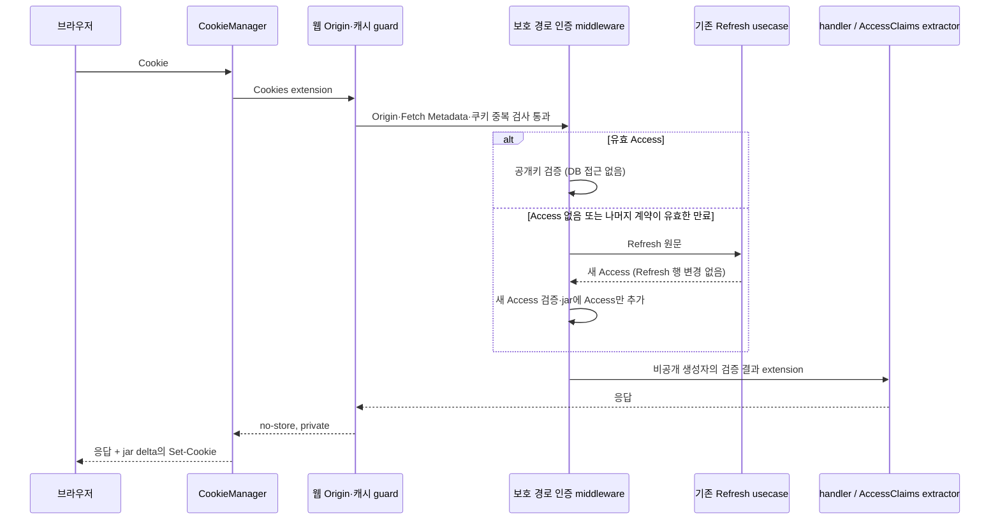

# JWT 웹 쿠키 연결과 검증

## 연결 문서

| 관계 | 대상 | 설명 |
| --- | --- | --- |
| realizes | [SPEC-AUTH-JWT](../jwt.md) | 같은 사이트의 웹 인증 전달 |
| follows | [PLN-AUTH-JWT-TODO](../jwt-todo.md) | 7번 웹 연계 |
| follows | [갱신·종료 계약](../jwt-refresh-lifecycle/plan.md) | 동일 Refresh 반복 사용·고정 만료·경합 허용 |

## 범위와 채택 근거

이번 사용자 요청은 조사·구현·검증을 승인하고 단계별 승인을 생략했다. 웹 쿠키와 자동 Access 갱신, 같은 요청의 claims 추출, CSRF·캐시 방어와 HTTP 검증을 구현한다. 기존 JSON API·Bearer 계약을 보존한다. JWKS·키 교체·RBAC·회원탈퇴·Refresh rotation·singleflight·Redis lock 및 로그인 화면 제작은 포함하지 않는다. UI는 현재 별도 Vite 기본 화면이며 웹 로그인 화면은 기존에도 없다. 실제 브라우저 검증 여부는 아래 결과와 구분한다. (확인)

시작 Git 상태는 clean이었다. 실제 `auth/slice/login_local`, `refresh_access_token`, `logout` 각각이 route·usecase·테스트를 소유하고 `auth/token`, entity·repository를 공유하는 경계를 확인했다. 과거 plan의 lifecycle 단일 모듈 경로는 현재 배치를 뜻하지 않는다. 사용자 지침·herdr AGENTS와 hc skill, JWT 및 관련 plan, 아키텍처·앱 구조·구현·테스트·조사·문서 관리 가이드를 읽었다. 추가 agent와 commit은 실행하지 않는다. (확인)

## tower-cookies 적합성

공식 v0.11.0 [Cargo.toml](https://github.com/imbolc/tower-cookies/blob/v0.11.0/Cargo.toml), [사용 예제](https://github.com/imbolc/tower-cookies/blob/v0.11.0/README.md), [요청 처리](https://github.com/imbolc/tower-cookies/blob/v0.11.0/src/service/mod.rs), [응답 future](https://github.com/imbolc/tower-cookies/blob/v0.11.0/src/service/future.rs)를 확인했다. docs.rs 조회가 도구 오류로 실패하여 공식 저장소의 버전 고정 원문과 다운로드된 crate 소스를 대조했다. (확인)

- 현재 Axum은 lock 기준 0.8.9, tower-cookies 0.11.0은 axum-core 0.5·http 1을 사용하며 공식 dev-dependency도 Axum 0.8이다. 실제 컴파일과 Router 실행으로 호환성을 확인했다. (확인)
- CookieManager는 Cookie 헤더에서 jar를 만들고 요청 extension에 `Cookies`를 삽입한다. 내부 future가 응답한 다음 jar delta를 **append**하여 `Set-Cookie`로 보낸다. 인증 middleware가 요청·응답을 처리할 때 같은 jar를 변경하면 handler 성공·실패 응답에 반영할 수 있다. 마지막 `.layer(CookieManagerLayer::new())`로 가장 바깥에 둔다. (확인)
- 일반 쿠키 jar만 채택한다. JWT 서명과 고엔트로피 Refresh를 그대로 재사용하며 `signed`·`private` feature, 추가 쿠키 키나 암호화를 도입하지 않는다. 쿠키·jar·원문 토큰·claims를 Debug나 로그 필드에 넣지 않는다. (확인)

## 책임과 HTTP 계약

| 위치 | 소유 책임 |
| --- | --- |
| `auth/web.rs` | 쿠키 속성·웹 guard·자동 갱신 middleware·검증 결과 marker·웹 Router 조립 |
| `slice/login_local/route.rs::web_login` | 기존 공통 발급 usecase 호출 후 웹 쿠키와 비밀값 없는 응답 구성 |
| `slice/logout/route.rs::web_logout` | 해당 Refresh 폐기 usecase 호출 후 쿠키 제거 |
| 기존 login/refresh/logout usecase | 자격 인증·저장·최신 계정 정책·발급·폐기·트랜잭션과 고정 만료 |
| `auth/token.rs` | 서명·iss/aud·형식·시간 검증, 정상 발급된 토큰의 만료와 나머지 오류 구별 |
| `auth/extractor.rs` | 웹 marker가 있으면 그 검증 결과, 그 외는 기존 Bearer 검증 |
| Container / http | 설정 검증·인스턴스 소유 / 웹 Router 병합 |

handler는 웹에서도 `claims: AccessClaims`를 사용한다. `VerifiedWebClaims`의 필드는 web 모듈에 비공개여서 생성자는 이 middleware에만 있다. 일반 `AccessClaims` extension은 무시한다. 클라이언트 JSON·헤더로 claims나 marker를 만들지 않으며 middleware가 Authorization 헤더를 합성하지 않는다. 인증 후 업무별 권한 판단은 handler/usecase 책임이다. (확인)

| 메서드·경로 | 입력·결과 |
| --- | --- |
| POST `/web/auth/local` | 정확한 Origin + JSON `email`, `password`. 공통 발급 commit 후 Access·Refresh 쿠키, 200 JSON `account_id`, `status`. 본문에 토큰 없음 |
| GET/HEAD `/web/auth/me` | 쿠키 인증 보호 경로. 200 JSON `sub`, `sid`, `user`. GET의 업무 변경 없음 |
| POST `/web/auth/logout` | 정확한 Origin + Refresh 쿠키. 해당 로그인만 폐기 후 200 `{}`와 두 쿠키 제거. Access는 없어도 됨 |

웹은 Authorization을 인증원으로 사용하지 않는다. Bearer와 쿠키가 같이 오면 웹은 쿠키만 검증하며, 쿠키가 없거나 잘못되어도 Bearer로 대체하지 않는다. API에는 웹 middleware·CookieManager를 적용하지 않으며 Bearer만 사용하고 쿠키 fallback이 없다. 기존 `/api/v1/auth/*`의 JSON 요청·응답·오류·Bearer challenge는 유지된다. (확인)

인증 middleware는 보호 그룹에만 적용한다. 로그인·로그아웃은 guard와 CookieManager만 적용하고 자동 갱신하지 않는다. 정적 파일·로그인 화면 경로·health·API는 이 웹 그룹 밖이다. 새 업무 경로도 필요한 보호 그룹에 명시적으로 추가해야 한다. 현재 실제 앱의 `/health` 및 정적 Router는 auth 밖에서 병합되며, 테스트의 `/login`, `/assets/test`는 바깥 배치를 확인하는 독립 경로다. (확인)

## 자동 갱신과 실패 계약

| 조건 | 동작·응답·쿠키 |
| --- | --- |
| 유효 Access | 서명/EdDSA·iss·aud·필수 claims·UUID·iat/exp·600초 수명 검증. DB·파일·네트워크 조회 없이 handler 실행. 쿠키 변경 없음 |
| Access 없음 | 브라우저가 만료 쿠키를 삭제한 경우 포함. 유효 Refresh로 재인증하여 Access만 새 발급, 같은 요청에 검증 claims 제공 |
| 정상 발급된 만료 Access | 서명·iss/aud·필수 필드·시간 외 계약을 먼저 검증한 후 `ExpiredAccess`로 구별. Refresh 재인증으로 Access만 발급 |
| 잘못된 서명·issuer/audience·형식·수명·미래 iat | 만료로 보지 않음. Refresh DB 조회 없이 401 `INVALID_ACCESS_TOKEN`, 두 쿠키 제거 |
| Refresh 없음·미존재·만료·폐기·계정 갱신 불가 | 401 `INVALID_ACCESS_TOKEN`, 두 쿠키 제거. 상세 존재/상태를 클라이언트에 구분 노출하지 않음 |
| Refresh DB·서명 등 내부 실패 | 500 공통 `INTERNAL_ERROR`, handler 미실행, 쿠키 보존하여 일시 오류 후 재시도 가능. 민감한 cause 대신 고정 operation·stage만 기록 |
| 중복 인증 쿠키·해석 불가 Cookie 헤더 | jar가 임의 값을 선택하기 전 401, 두 쿠키 제거. percent decoding은 tower-cookies와 같은 parser 사용 |
| CSRF 거부 | 403 `CSRF_REJECTED`, handler/갱신/DB 미실행, 쿠키 보존 |
| 로그아웃 Refresh 없음·미존재 | 정리 작업으로 200 및 두 쿠키 제거. 만료/이미 폐기된 기존 Refresh도 공통 usecase의 반복 로그아웃 허용 |
| 로그아웃 내부 실패 | 500, 폐기 성공으로 표시하지 않고 쿠키 보존·재시도 허용 |
| 로그인 입력·인증·내부 실패 | 기존 login 오류 계약. 신규 쿠키를 발급하지 않음 |

검증기에서 `ExpiredAccess`를 추가했지만 API는 기존처럼 모든 검증 실패를 401/Bearer로 변환한다. 만료 claims를 handler나 갱신의 신원 근거로 사용하지 않는다. 정상 Refresh 자체가 재인증 수단이므로 과거 Access와 sid/sub가 다르더라도 갱신 신원은 조회한 Refresh·최신 계정에서만 얻는다. 이는 기존 JWT 명세의 독립 Refresh 인증 및 이번 요청의 Access 부재 갱신 범위에 따른다. 잘못된 Access가 같이 있는 경우까지 Refresh 재인증을 넓히지는 않는다. (확인·추론)

공통 Refresh usecase는 동일 원문의 반복·동시 갱신을 허용한다. middleware는 Refresh 쿠키를 재설정하지 않고 DB 행·최초 7일 만료도 바꾸지 않는다. 진행 중 종료와 겹친 Access 발급을 허용하는 기존 경합 정책도 그대로다. 새 Access의 600초 유효기간과 Refresh의 7일 한도는 별개이며, 7일 직전에 발급한 Access는 그 이후에도 자체 만료까지 유효하다. (확인)

## 쿠키·CSRF·캐시·운영 설정

| 속성 | 선택·이유 |
| --- | --- |
| 이름 | 운영 `__Host-tlab_access`, `__Host-tlab_refresh`: Secure·Path=/·Domain 없음과 결합하여 하위 도메인의 Domain 쿠키 주입 범위를 제한 |
| HttpOnly / Secure | 두 쿠키 모두 기본 true. JS 토큰 노출과 평문 전송 방지 |
| Domain / Path | Domain 미설정 host-only, 둘 다 `/`. 보호 요청에 Refresh가 도달해야 하므로 갱신 URL에 묶지 않음. 쿠키 Path는 권한 경계가 아님 |
| SameSite | Lax. 같은 origin의 웹 사용을 기준으로 하고, 외부 탐색에서 Refresh 갱신을 유발하지 않도록 Fetch Metadata도 검사 |
| 수명 | Access의 JWT exp와 로그인 시 정해진 Refresh 만료를 Expires에 설정. Max-Age도 각각 남은 초로 제한(최대 600 / 604800). 갱신은 Refresh를 재설정하지 않음 |
| 제거 | 발급과 같은 이름·Path=/·Domain 없음·보호 속성으로 빈 값·Max-Age=0·과거 Expires 설정. 요청에서 빠진 쿠키도 명시적 제거 응답 |

SameSite만으로 CSRF를 해결하지 않는다. 웹 그룹의 POST 등 unsafe 메서드는 정확히 하나의 `Origin`이 `auth.web.origin`과 일치해야 한다. 누락·null·다른 origin·중복은 거부한다. 로그인/로그아웃에도 같은 검사를 적용한다. Host·X-Forwarded-*로 신뢰 origin을 추측하지 않는다. OPTIONS를 포함한 safe 요청도 Origin이 있으면 정확히 일치해야 한다. `Sec-Fetch-Site`가 있으면 `same-origin` 또는 `none`만 허용하며 `same-site`의 형제 도메인과 `cross-site`도 거부한다. CORS credentials를 다른 origin에 개방하지 않는다. (확인)

Fetch Metadata가 없는 HTTP 클라이언트·구형 브라우저의 safe 요청은 허용한다. 이 경우 SameSite=Lax의 외부 최상위 탐색에서 인증 재발급이 일어날 수 있으나 GET/HEAD는 업무 상태 변경을 수행하지 않는다. 자동 갱신은 인증 유지용 Access 발급뿐이며, 새 unsafe 업무 handler도 웹 guard와 자체 권한·입력 계약 안에서 구현해야 한다. XSS나 신뢰 origin 자체의 침해를 CSRF 검사로 방어하는 계약은 아니다. (확인·추론)

웹 그룹의 성공·오류·CSRF 거부·로그인·로그아웃 모두 `Cache-Control: no-store, private`다. 자동 갱신 Set-Cookie 응답도 같은 정책을 가지며 민감한 사용자별 응답을 공유 캐시에 저장하지 않는다. GET/HEAD라는 이유로 갱신 응답을 캐시하지 않는다. 외부 CDN/프록시도 이 정책을 우회하지 않아야 한다. API의 기존 `no-store`는 유지한다. (확인)

`[auth.web] origin = "https://localhost:8081"`, `allow_insecure_http = false`가 기본이며 Container에서 키/DB 준비 전에 검증한다. 운영 origin은 실제 외부 **정확한 origin**(scheme·host·필요 시 port, 끝 `/` 없음)으로 지정한다. 경로·query·userinfo는 허용하지 않는다. TLS 종료 프록시를 사용해도 외부 HTTPS origin을 설정한다. (확인)

HTTP 개발 예외는 명시적으로 `origin = "http://localhost:8080"`와 `allow_insecure_http = true`를 함께 설정해야 한다. 이 경우에만 Secure=false와 별도 `tlab_dev_access`, `tlab_dev_refresh` 이름을 사용한다. HTTPS origin에서는 flag=true여도 Secure를 유지한다. 로컬 HTTPS와 신뢰한 개발 인증서 사용을 우선한다. HTTP 예외와 운영 설정을 전환하면 다른 이름의 기존 쿠키는 재사용하지 않으며 재로그인이 필요하다. (확인)

별도 Vite UI의 cross-origin 직접 호출은 현재 계약이 아니다. UI를 같은 origin에서 제공하거나 개발 reverse proxy의 외부 origin과 위 설정을 맞춘다. UI 로그인 화면·Vite proxy/CORS 설정은 이번 백엔드 연결에서 추가하지 않았다. 쿠키·토큰을 query로 전달하지 않는다. 기존 전체 URI tracing의 잘못 전달된 query 토큰 노출 한계는 [API 기록](../jwt-api/plan.md)에 따른다. (확인)

## 검증

각 웹 시나리오는 독립 준비·행동·기대값을 가지며 DB/키/Container 준비만 좁게 공유한다. 실제 PostgreSQL은 `auth/test_support.rs`의 UUID 임시 스키마에만 migration·데이터·실패용 DDL을 적용하고 종료 시 DROP한다. 정상 사용자·운영 스키마·데이터는 변경하지 않는다. 운영 함수에 signer·clock 테스트 주입 경계를 추가하지 않았다. (확인)

- 실제 Router에서 CookieManager 순서, 정상 Access와 public 경로의 DB 무접근(4개 풀 연결 전부 점유하고 요청 완료), Access 없음/정상 만료의 같은 요청 claims와 Access Set-Cookie, Refresh 해시·원문 조회·생성/만료 시각 불변, 알려지지 않은 Refresh의 401과 DB 실패의 500, 폐기 후 갱신 거부, 로그아웃 cookie scope 제거를 검증했다. (확인)
- 웹 로그인은 실제 API 계정 준비 후 공통 로그인으로 쿠키를 발급하고 DB Refresh 만료와 cookie Expires 일치·7일·보호 속성·본문 토큰 부재를 확인한다. Bearer/쿠키 동시 전달의 서로 다른 신원과 fallback 거부, malformed/잘못 서명된 만료 Access의 갱신 거부, 중복 쿠키 거부, CSRF 선행 거부·캐시 정책도 확인했다. (확인)
- 세부 서명/iss/aud/형식/시간은 token 계층에서 책임지고 `ExpiredAccess` 분류를 별도 검증했다. 임의 claims extension 거부는 DB 없는 extractor Router 테스트가 책임진다. 기존 API 로그인→보호→갱신→폐기, DB usecase·저장소·경합 테스트도 전체 앱 실행에 포함한다. (확인)

| 최종 실행 | 결과 |
| --- | --- |
| `cargo test --workspace --locked` | 성공. 앱 28 passed, 외부 DB 40 ignored. 라이브러리 일반 테스트 및 doctest 성공 |
| `env TLAB_TEST_DATABASE_URL=<공개 로컬 개발 DB> cargo test -p tlab-app --locked -- --include-ignored --test-threads=1` | 앱 68 passed, 0 ignored. 웹 14개(그중 DB 12개) 포함. 고유 임시 스키마 정리 |
| `cargo fmt --all -- --check` | 성공 |
| `cargo clippy --workspace --all-targets --locked -- -D warnings` | 성공 |
| `cargo audit` | 성공. 297 의존성, 1422 advisory. tower-cookies 추가 후 실행, 이후 의존성 변경 없음 |
| `git diff --check` | 성공 |

초기 웹 Router 11개 통과 후 `__Host-`/개발 쿠키 분리와 분류·경계 검증을 보강하여 위 전체 앱·workspace·clippy를 재실행했다. 장시간 빌드와 테스트는 절대경로 hc에서 실행했고 샌드박스의 core 접근 제한은 권한을 부여해 재실행했다. 설정 예제 반영 후 `cargo test -p tlab-app app::tests --locked` 6개를 추가 실행해 통과했고, 문서 상대 링크와 미추적 새 파일까지 공백 검사를 확인했다. (확인)

실제 브라우저 실행 도구는 연결되어 있지 않았다. 따라서 위 결과는 실제 Router/HTTP 헤더 계약 검증이며, 브라우저가 HttpOnly·Secure·SameSite·host prefix·쿠키 만료 삭제를 실제로 적용하는지와 화면 흐름은 **브라우저 미검증**이다. Access 부재 요청으로 만료 삭제 이후의 서버 동작을 검증했지만 브라우저 실행으로 간주하지 않는다. 라이브러리 ignored DB 테스트의 재실행, UI build, 실제 네트워크 TLS 배포·CDN 설정·부하·운영 복구·JWKS/키 교체도 미실행이다. (확인)

## 구현·변경 기록

7번 웹 연계를 기존 slice의 별도 웹 route와 auth 공용 웹 middleware로 연결했다. tower-cookies 적합성과 layer 순서를 공식 버전 소스·실제 Router로 확인해 채택했다. JWT 검증기에 만료 분류를 추가하되 API의 외부 실패 계약을 유지하고, 웹 marker로 동일 요청 claims를 안전하게 제공한다. 쿠키·CSRF·캐시·개발 설정 및 이 문서의 실패 계약을 구현했다. 위 최종 검증을 통과했으며 커밋·추가 agent·운영 DB 변경은 없다. 실제 브라우저 정책 검증과 운영 키 연결은 후속 범위다. (확인)
