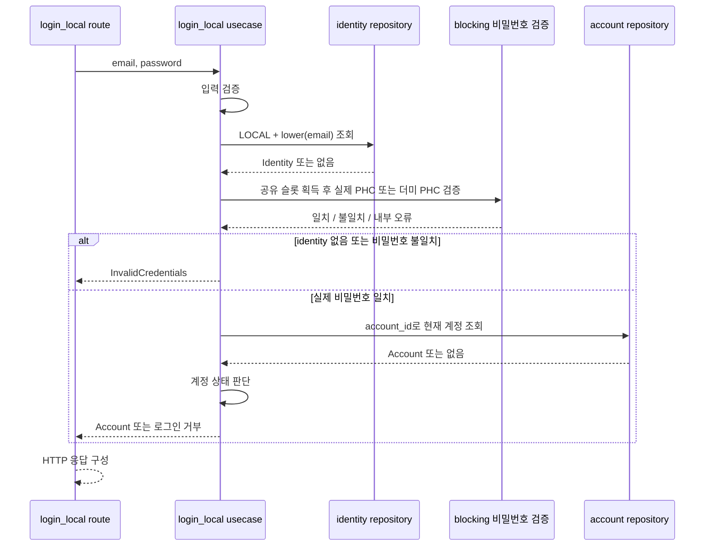

# 로컬 로그인 요청 처리 설계

## 연결 문서

| 관계 | 대상 | 설명 |
| --- | --- | --- |
| realizes | [계정 기능 구상](../account.md) | 로컬 인증으로 연결된 계정에 접근 |

기존 [로컬 사용자 추가 설계](../create-local-user/plan.md), [백엔드 기능 개발 가이드](../../../architecture/guide-be-feature-dev.md), [구현 가이드](../../../architecture/guide-impl.md), [테스트·검증 가이드](../../../architecture/guide-test.md)를 참조한다.

## 목표·범위

이메일·비밀번호를 받아 LOCAL identity를 인증하고, 연결된 계정이 로그인 가능한 상태인지 판단하여 인증된 계정 식별 결과를 반환한다. 사용자 요청에 따라 이번 설계는 해당 요청의 처리까지 다룬다. (확인)

이 문서는 `LocalLogin::execute`의 입력 검증, LOCAL identity 조회, PHC 비밀번호 검증, 계정 상태 판단과 실행 자원 제한을 소유한다. 내부 `execute`는 토큰을 만들지 않고 Account를 반환한다. 현재 HTTP 로그인은 `execute_with_tokens`를 호출해 Refresh 저장·Access 서명·commit 후 계정 ID·상태와 Access·Refresh를 반환한다. 토큰 발급과 저장 계약은 [로그인 발급 설계](../jwt-login/plan.md), HTTP·후속 요청 인증은 [JWT API](../jwt-api/plan.md)를 따른다. 웹 쿠키·CSRF 연결은 후속 범위다. (확인)

가입·자동 가입, 이메일 인증, 계정 활성 전환, 비밀번호 재설정, SNS 로그인, RBAC, 실패 횟수 저장·계정 잠금·IP별 요청 제한은 이번 작업에서 추가하지 않는다. 해싱 동시성 제한은 서버 자원 보호이며 로그인 시도 횟수 제한을 대신하지 않는다. (추론: 범위 제안)

## 설계 시작 시 상태와 재사용 대상

| 대상 | 확인한 상태 | 이번 설계의 사용·변경 |
| --- | --- | --- |
| [가입 usecase](../../../../tlab-app/src/auth/slice/create_local_user/usecase.rs) | 이메일 trim, 비밀번호 원문 해싱, REGISTERED·LOCAL identity 생성 | 가입 계약 유지 |
| [entity](../../../../tlab-app/src/auth/entity.rs) | AccountStatus는 REGISTERED·ACTIVE·WITHDRAWN, Identity가 PHC 소유 | 그대로 사용 |
| [초기 스키마](../../../../tlab-app/migrations/0001_create_tlab_account.sql) | LOCAL의 lower(email) 고유 인덱스, account FK | 기존 인덱스로 조회, migration 없음 |
| [repository](../../../../tlab-app/src/auth/repository/identity.rs) | account·identity별 insert 제공 | 저장소별 조회 API 추가 |
| [PasswordHasher](../../../../tlab/src/password.rs) | 동기 verify(password, encoded_hash) 제공 | 기존 Argon2id 검증 사용 |
| [Argon2id](../../../../tlab/src/password/argon2id.rs) | 일치 true, 불일치 false, 손상·비지원 PHC는 Err | 불일치와 내부 데이터 오류 구분 |
| [Container](../../../../tlab-app/src/app.rs) | Arc 해셔·Semaphore, 동시성 기본값 2 소유 | 가입·로그인이 같은 슬롯 공유, LocalLogin 인스턴스 조립 |
| [공통 응답](../../../../tlab-app/src/app/response.rs) | 정상 JSON·에러 JSON 생성, 로깅은 route 책임 | 기존 응답 함수 재사용 |

위 표는 설계 시작 시 소스에서 확인한 기준이다. 이후 구현과 실행 결과는 하단 구현·변경 기록에 남긴다. (확인)

## 구성과 책임

`auth` feature에 `login_local` slice를 추가한다. 요청·응답 타입, usecase, HTTP 매핑과 시나리오 테스트를 해당 slice에 둔다. 다른 slice의 내부 함수는 호출하지 않는다. (추론: 제안)

```text
tlab-app/src/auth/
├── slice/
│   ├── mod.rs
│   └── login_local/
│       ├── mod.rs
│       ├── route.rs   # 요청 해석·HTTP 변환·로깅
│       ├── usecase.rs # 입력·인증·계정 상태 판단과 토큰 발급 조합
│       └── tests.rs   # 요청 처리 계약 검증
├── repository/
│   ├── identity.rs    # LOCAL 이메일 조회 추가
│   └── account.rs     # ID 조회 추가
└── route.rs           # API 경로·메서드와 slice handler 연결
```

| 주체 | 소유하는 판단·행동 |
| --- | --- |
| Container | 해셔, 전체 비밀번호 연산 슬롯, LocalLogin 인스턴스 조립·수명 |
| login_local::route | JSON 해석, usecase 호출, HTTP 상태·본문·Cache-Control, 실패 로그 |
| login_local::usecase::LocalLogin | 더미 PHC의 생성·비공개 보관, 입력 정리, 저장소 호출 조합, 비밀번호 검증 실행, 로그인 가능 상태 판단 |
| identity/account repository | SQL·bind·entity 매핑, 미조회와 저장소 오류 구분 |
| tlab::password | Argon2id·PHC 검증 연산, true/false/오류 반환 |
| app::error | InvalidInput(field·code·message), InternalFailure(stage·cause: tlab::Error)의 공용 데이터 구조. slice 오류 분류·HTTP 변환은 소유하지 않음 |

로그인 정책을 repository나 라이브러리 해셔에 넣지 않는다. 가입의 PasswordPolicy는 새 비밀번호 설정 규칙이므로 로그인에서 호출하지 않는다. 정책이 강화되어도 저장된 비밀번호로 인증할 수 있어야 한다. (추론: 제안·근거)

아래 흐름은 내부 `execute`의 자격증명·계정 상태 확인을 나타낸다. HTTP 로그인은 이 결과에 토큰 발급·저장 단계를 연결한다. (확인)



## 인터페이스 계약

사용자의 설계 후속 “구현해” 요청을 근거로 아래 계약을 채택했다. 후속 의견에 따라 usecase의 결과는 별도 AuthenticatedAccount 대신 기존 Account를 사용한다. (확인)

### usecase

Container가 `LocalLogin::new(hasher, password_slots, access_issuer).await`로 usecase 인스턴스를 생성한다. `local_login.execute(database, command) -> Result<Account, Error>`는 내부 자격증명·계정 상태 확인 API다. 현재 HTTP route는 `execute_with_tokens(database, command)`를 호출하며 이 메서드는 `execute`의 인증 결과에 토큰 발급을 연결한다. 해셔·슬롯은 가입과 같은 인스턴스를 공유하며 더미 PHC는 usecase의 비공개 필드다. 호출자는 더미 PHC를 생성하거나 전달하지 않는다. (확인)

| 구분 | 계약 |
| --- | --- |
| Command | email: String, password: String. 비밀번호를 포함하므로 Debug·전체 인자 tracing 금지 |
| email | 앞뒤 trim 후 기존 가입과 같은 email_address 옵션으로 단일 이메일 검증. 조회는 DB lower(email) = lower($1) 사용 |
| password | 빈 문자열은 입력 오류. trim·대소문자 변환·Unicode 정규화·절단 없이 원문 전달. 공백만 있는 비밀번호도 원문대로 검증 |
| Account | 내부 execute가 반환하는 인증·상태 검증을 통과한 기존 Account entity 전체. identity·PHC는 포함하지 않음. 현재 HTTP route는 토큰 발급 결과에서 계정 ID·상태와 Access·Refresh를 선택 |
| InvalidInput | field·고정 code·message. 저장소·비밀번호 연산 이전에 반환 |
| InvalidCredentials | LOCAL identity 미존재 또는 비밀번호 불일치. 같은 외부 결과 |
| AccountUnavailable | 비밀번호 일치 후 계정이 WITHDRAWN인 경우 |
| Busy | 비밀번호 연산 슬롯이 모두 사용 중인 경우 |
| Internal | DB·PHC·blocking 작업·자원 오류. 실패 stage와 cause 보존 |

`Error::InvalidInput(app::error::InvalidInput)`과 `Error::Internal(app::error::InternalFailure)`로 공용 데이터를 감싼다. 공용 타입은 [app/error.rs](../../../../tlab-app/src/app/error.rs)에 두고 로그인 전용 오류 종류는 slice에 유지한다. 내부 원인은 원래 tlab::Error 분류로 보존하고, Tokio 등 전용 변환이 없는 원인은 tlab::Error::Internal에 담는다. tlab::Error에서 HTTP 응답을 자동 선택하지 않는다. (확인: 사용자 요청과 구현)

입력 형식이 정상이어도 identity가 없으면 더미 PHC를 검증한 뒤 InvalidCredentials를 반환한다. 더미 검증 결과가 true여도 실제 identity가 없으면 성공할 수 없다. SNS identity에 같은 이메일이 있어도 인증 대상으로 사용하지 않는다. (추론: 제안)

LOCAL identity의 password_hash가 NULL이거나 PHC가 손상·비지원이면 데이터 오류로 Internal을 반환한다. 해셔가 반환한 InvalidInput을 요청 비밀번호의 오류로 변환하지 않는다. identity가 있는데 소유 계정이 조회되지 않는 경우도 저장 무결성 오류로 Internal을 반환한다. (추론: 제안)

### 계정 상태 정책

| 상태 | 비밀번호 일치 후 결과 | 상태 변경 |
| --- | --- | --- |
| REGISTERED | 성공 | 없음 |
| ACTIVE | 성공 | 없음 |
| WITHDRAWN | AccountUnavailable | 없음 |

기존 가입은 REGISTERED를 만들며 ACTIVE 전환 조건과 이메일 인증 정책은 아직 정의되어 있지 않다. 현재 범위에서 가입한 계정으로 로그인할 수 있도록 REGISTERED도 허용한다. 로그인 자체가 이메일 소유 확인이나 계정 활성 전환을 수행하지 않는다. 설계 후속 구현 요청에 따라 이 정책을 적용했으며, 이후 ACTIVE만 허용하려면 별도 활성 절차를 먼저 정의해야 한다. (확인: 현재 가입·채택 범위 / 추론: 허용 이유)

계정 조회·상태 판단은 비밀번호 검증 후 수행한다. 따라서 탈퇴 계정에 틀린 비밀번호를 제출하면 일반 InvalidCredentials를 반환하고, 올바른 비밀번호를 제출한 경우에만 AccountUnavailable을 반환한다. (추론: 제안)

### repository와 일관성

- `identity::find_local_by_email(ctx, email) -> Result<Option<Identity>>`: `provider = 'LOCAL' AND lower(email) = lower($1)` 조건으로 조회한다. 값은 bind하고 DB의 기존 부분 고유 인덱스와 같은 비교식을 사용한다.
- `account::find_by_id(ctx, account_id) -> Result<Option<Account>>`: PK로 조회하며 로그인 상태 필터는 넣지 않는다.

조회 결과 없음은 None, DB·entity 디코딩 오류는 Err다. 로그인 허용·거부 의미는 usecase가 결정한다. 두 API는 기존 저장 entity를 반환하며 로그인 전용 JOIN 모델이나 저장소 trait은 추가하지 않는다. (추론: 제안)

내부 `execute`는 각 조회가 끝나면 DB context·연결을 반환하고 비밀번호 연산 중에는 연결·트랜잭션·행 잠금을 유지하지 않는다. 이 메서드는 읽기만 수행하며 쓰기 트랜잭션, last_login 갱신, 재해싱·상태 변경은 없다. 계정 상태는 검증 후 계정 조회 시점의 값으로 판단한다. (확인)

`execute`의 반환은 계정 조회 시점의 인증 결과다. 현재 `execute_with_tokens`는 이 결과를 받은 뒤 별도 트랜잭션에서 계정 행을 잠그고 상태를 다시 확인한다. Refresh 저장·Access 서명·commit 후에만 성공 결과를 반환한다. 계정 상태 변경·전체 폐기 호출자도 같은 계정 잠금을 사용해야 직렬화된다. 상세는 [로그인 발급 계약](../jwt-login/plan.md)을 따른다. (확인)

### HTTP

`POST /api/v1/auth/local`을 비로그인 요청에 제공하고, `auth::router()`에서 해당 경로·POST 메서드와 slice의 login handler를 직접 연결한다. slice는 별도 Router를 제공하지 않는다. JSON 필드는 email과 password만 허용하며 미지정·잘못된 타입·추가 필드는 기존 공통 JSON 오류로 반환한다. (확인: 구현)

```json
{"email":"user@example.com","password":"입력한 비밀번호"}
```

성공 시 Refresh 행을 저장하고 Access를 서명한 뒤 commit 성공 후 `200 OK`와 다음 형태의 JSON을 반환한다. 토큰 문자열은 예시이며 쿠키와 별도 data 래퍼는 만들지 않는다. 상세 토큰·HTTP 계약은 [JWT API](../jwt-api/plan.md)를 따른다. (확인)

```json
{"account_id":123,"status":"REGISTERED","access_token":"<Access JWT>","refresh_token":"<Refresh>"}
```

| 결과 | HTTP | code / field |
| --- | --- | --- |
| JSON 형식·필드 오류 | 400 | INVALID_REQUEST / 없음 |
| 기존 JSON 추출기의 본문 크기 초과 | 413 | INVALID_REQUEST / 없음 |
| 이메일 형식 오류 | 400 | INVALID_EMAIL / email |
| 빈 비밀번호 | 400 | PASSWORD_REQUIRED / password |
| 인증 불일치·LOCAL 미존재 | 401 | INVALID_CREDENTIALS / 없음 |
| 인증된 탈퇴 계정 | 403 | ACCOUNT_UNAVAILABLE / 없음 |
| 슬롯 소진 | 503 | BUSY / 없음 |
| 내부 실패 | 500 | INTERNAL_ERROR / 없음 |

에러는 공통 `{code, field?, message}` 형식을 사용한다. InvalidCredentials의 message는 `email or password is incorrect`로 통일하고 계정 존재 여부를 따로 반환하지 않는다. 성공·실패 응답 모두 route에서 `Cache-Control: no-store`를 지정한다. (추론: 제안)

### 비밀번호 연산 자원과 관찰

가입과 동일한 `passwd_hasher` 및 `passwd_hash_slots`를 사용한다. 기존 `auth.max_concurrent_password_hashes` 설정의 적용 대상을 생성·검증 전체로 확장하고 이름과 기본값 2는 유지한다. 슬롯은 `try_acquire_owned`로 획득하고 가용 슬롯이 없으면 대기열 없이 Busy를 반환한다. 닫힌 Semaphore는 Internal이다. (추론: 제안)

검증은 `spawn_blocking`에서 실행하고 permit을 클로저로 이동하여 요청 취소 후에도 실제 연산 종료까지 보유한다. 기존 가입 slice의 해싱 helper는 호출하지 않는다. 공유하는 것은 해셔·자원이며 로그인 검증 실행은 해당 slice가 소유한다. (추론: 제안)

`usecase.rs`의 LocalLogin 초기화 중 같은 해셔로 더미 PHC 하나를 blocking executor에서 생성하고 비공개 필드로 보관한다. 생성 실패는 Container에 전달되어 앱 시작을 중단한다. Container와 route는 더미 PHC를 알지 않으며 요청마다 더미 해시를 생성하지 않는다. 더미 검증은 미존재 경로의 고비용 연산 생략을 줄이는 목적이며 응답 시간의 완전한 동일성을 보장하지 않는다. (확인: 사용자 의견 반영 / 추론: 제약)

route가 기존 요청 trace에 연결하여 Busy는 WARN, Internal은 operation=`login_local`·stage·cause를 담은 ERROR를 남긴다. 일반 입력·인증 실패는 기존 요청·응답 로그로 관찰한다. 비밀번호·PHC·Command·Identity 전체는 로그에 넣지 않는다. cause 기록은 기존 앱 방식을 따르며 SQL 진단에 이메일 등이 포함될 수 있다는 기존 제한도 따른다. HTTP 응답에는 내부 원인을 넣지 않는다. (확인: 기존 로그 방식 / 추론: 적용안)

## 검증할 계약

기존 in-process Axum Router·실제 PostgreSQL의 고유 테스트 스키마 구성을 사용한다. 내부 `execute`는 DB 변경 없는 인증을 확인하고, HTTP 로그인은 계정·identity를 변경하지 않으면서 Refresh 해시를 저장하고 토큰을 반환하는지 구분해 검증한다. 아래는 검증 조건이며 이번 문서 작업에서 테스트한 결과가 아니다. (확인·추론)

| 시나리오 | 기대 결과 |
| --- | --- |
| 내부 execute로 REGISTERED 및 ACTIVE 계정 인증 | 올바른 비밀번호로 Account 반환, DB 변경 없음 |
| HTTP로 REGISTERED 및 ACTIVE 계정 로그인 | 200, 계정 ID·원래 상태·Access·Refresh 반환. 계정·identity는 불변이며 Refresh 해시 행 생성 |
| 이메일 앞뒤 공백·대소문자 변형 | 같은 LOCAL identity 인증 |
| 앞뒤 공백이 포함된 비밀번호 | 정확한 원문만 성공, trim한 값은 401 |
| LOCAL 없음·SNS만 존재·비밀번호 불일치 | 같은 401 code·message, 더미 경로에서 실제 검증 실행 |
| WITHDRAWN | 올바른 비밀번호 403, 틀린 비밀번호 401 |
| 잘못된 입력·추가 필드·크기 초과 | 정의한 400·413, 입력 검증에서 실패하면 DB 조회·비싼 연산 실행 없음 |
| NULL·손상·비지원 PHC, DB·blocking 실패 | 500, 원인·입력 비밀은 응답에 없음 |
| 가입과 로그인으로 공유 슬롯 소진 | 다른 쪽 요청도 503, 취소해도 실제 작업 종료까지 슬롯 유지 |
| 모든 HTTP 응답 | no-store, PHC·비밀번호·Set-Cookie 없음, 로그 수준·trace 연결 확인. 성공 본문에만 Access·Refresh 포함 |

앱 기능 테스트와 공유 자원에 영향받는 기존 가입 테스트를 실행하고 fmt·Clippy를 확인한다. 토큰 발급·저장·API 연동의 검증 범위는 [로그인 발급](../jwt-login/plan.md)과 [JWT API](../jwt-api/plan.md)에 연결한다. 브라우저 연동과 운영 부하는 이 검증으로 보장하지 않는다. 이 문서 수정에서는 migration 동작 변경이나 테스트 실행을 수행하지 않았다. (확인·추론)

## 결정사항·남은 사항

- **범위:** 요청의 자격 증명 검증과 계정 결과 반환까지로 제한한다. 웹 계층 토큰 처리는 사용자의 별도 설계 범위다. (확인: 사용자 요청 / 추론: 완료 경계)
- **상태 정책:** REGISTERED·ACTIVE 허용, WITHDRAWN 거부, 로그인으로 상태를 바꾸지 않는다. 설계에 이은 구현 요청을 근거로 채택했다. (확인)
- **구조 제안:** 저장소별 조회와 slice 내부 정책 조합을 사용한다. 단일 JOIN으로 로그인 판단을 저장소에 묶는 안보다 기존 entity·repository 책임을 유지하고 검증 후 계정 상태를 조회하는 안을 선택한다. (추론)
- **결과 소유:** 사용자 의견에 따라 usecase는 Account를 그대로 반환한다. HTTP 노출 필드는 route가 선택하므로 Account에 Serialize를 추가하지 않는다. (확인)
- **연결 과제:** 후속 토큰 설계는 Account를 입력으로 사용할 수 있으나, 토큰 발급 실패·발급 직전 탈퇴 경쟁·후속 요청의 계정 상태 확인은 그 시나리오에서 별도 결정해야 한다. (추론)
- **채택 범위:** REGISTERED 허용, 자격 증명 일치 후 탈퇴 계정의 403 응답, 위 엔드포인트를 구현했다. 토큰·세션·계정 활성 절차의 정책은 이번 채택에 포함하지 않는다. (확인)

## 구현·변경 기록

### 최초 설계

- 사용자 요청과 현재 계정·가입·해셔·HTTP 구조를 기준으로 설계 초안을 작성하고 계정 index에 연결했다. 소스·스키마 변경 및 구현은 수행하지 않았다. (확인)
- 문서 검증: 변경 문서의 상대 링크 존재 여부와 문서 ID 유일성, diff를 점검했다. 로그인 동작 테스트는 구현 후 수행할 항목으로 남긴다. (확인: 작업 범위)

### 1차 구현 및 후속 의견 반영

- 승인 근거: 설계 초안에 대한 사용자 “구현해” 요청. 기존 설계의 요청 처리 범위·상태 정책·HTTP 계약을 구현했다. 후속 “AuthenticatedAccount … 그냥 Account를 리턴” 의견에 따라 usecase는 `Result<Account, Error>`를 제공하고 route가 전용 LoginResponse로 변환한다. (확인)
- 구현: login_local slice, 저장소별 조회 API, Container의 더미 PHC 초기화와 기존 가입·로그인 공유 슬롯을 추가했다. migration·의존성·토큰·세션은 변경하지 않았다. 더미 PHC는 blocking executor에서 한 번 생성한다. (확인)
- 기존 결함 조치: 최초 앱 테스트가 기존 `http/tests.rs`·가입 테스트의 `trace_requests` 참조 누락으로 컴파일 실패했다. HEAD의 http.rs에도 함수가 없는 것을 확인했다. 공통 함수를 복구하고 실제 서버 조립에 연결하여 기존 INFO 요청·응답 로그와 자동 실패 로그 비활성화 계약을 회복했다. 기존 HTTP·가입 로그 테스트로 확인했다. (확인)
- 실행 검증: 실제 PostgreSQL에 연결한 in-process Router 테스트에서 가입→로그인, Account 전체 반환, REGISTERED·ACTIVE·WITHDRAWN 정책, 이메일 정리, 비밀번호 원문 보존, 미존재·SNS·불일치 401 통일, 입력·크기 제한, NULL·손상·비지원 PHC, DB 실패, 공유 슬롯과 취소·blocking 실패, no-store 및 쿠키 미생성을 확인한다. 각 DB 검증은 고유 스키마를 만들고 panic 시에도 정리한다. (확인: 테스트 구성)
- 첫 DB 실행은 샌드박스 소켓 접근 제한으로 실패했으며, 권한 허용 환경에서 재실행했다. 실행 결과와 자체 점검은 아래 최종 검증 기록에 남긴다. (확인)

### 후속 변경: 더미 PHC의 소유 위치

- 사용자 “dummy_password_hash는 usecase.rs 내부 변수” 의견을 반영했다. `LocalLogin`이 해셔·공유 슬롯과 비공개 더미 PHC를 보유하고 초기화 시 한 번 생성한다. Container는 LocalLogin을 조립·보관하며 route와 execute 호출자는 더미 PHC를 전달하지 않는다. 앞선 Container의 더미 PHC 필드를 대체한다. 요청별 생성 비용과 프로세스 전역 캐시의 설정 간 결합을 피한다. (확인: 변경 / 추론: 선택 이유)

### 최종 검증·자체 점검

- `cargo test --workspace --locked --offline`: 통과. 이 실행은 Account 반환 변경 전이며, 이후 앱 내부 변경은 아래 최종 앱 테스트와 workspace Clippy로 확인했다. 기본 실행에서 DB 의존 테스트는 제외되며 환경변수 helper는 상위 테스트가 별도 프로세스로 실행한다. (확인)
- `TLAB_TEST_DATABASE_URL=<로컬 PostgreSQL URL> cargo test -p tlab-app --locked --offline -- --include-ignored`: 최종 LocalLogin·Account 반환 코드에서 16개 모두 통과했다. 기존 가입 회귀와 신규 로그인 계약을 실제 PostgreSQL의 고유 테스트 스키마에서 확인했고 테스트 스키마를 정리했다. (확인)
- `cargo fmt --all -- --check`, `cargo clippy --workspace --all-targets --locked --offline -- -D warnings`, `git diff --check`: 통과. 신규 파일의 공백과 변경 문서의 상대 링크도 확인했다. 의존성은 바뀌지 않아 별도 audit을 실행하지 않았다. (확인)
- 자체 점검: 로그인 정책은 usecase, SQL·매핑은 repository, HTTP 응답 선택은 route, 인스턴스 조립은 Container에 있다. 비밀번호 검증 중 DB 연결을 보유하지 않고 공유 permit은 blocking 작업 종료까지 유지한다. 더미 해시의 true 결과로 미존재 계정에 로그인할 수 없음을 실제 더미 비밀번호 제출로 검증했다. Account를 반환하면서도 entity 전체를 HTTP로 노출하지 않고 원래 두 필드 응답을 유지했다. (확인)
- 남은 범위: 새 엔드포인트의 TCP/HTTPS 실호출, 운영 부하와 로그 내용의 운영 검토, 토큰·세션·후속 요청 인증은 수행하지 않았다. 코드·문서만 변경했으며 DB migration·커밋·배포는 수행하지 않았다. (확인)

### 후속 변경: 공통 오류 데이터 분리

- 승인 근거: slice별 Error의 지역성을 유지하면서 InvalidInput·InternalFailure를 공유하자는 논의에 대한 사용자 “ㅇㅇ 반영해줘” 요청. 두 데이터 구조를 app::error로 옮기고 가입·로그인 usecase·route·테스트에 적용했다. (확인)
- InternalFailure는 stage와 원본 tlab::Error를 보관한다. DB·해셔 오류의 분류를 유지하고 Tokio 작업·Semaphore 오류는 Internal로 감싸 원인을 보존한다. 로그인 실패 의미와 HTTP 상태·코드·메시지는 유지했다. (확인)
- 검증·자체 점검: 실제 PostgreSQL을 연결한 앱 테스트 16개 모두 통과. fmt·workspace Clippy·diff 검사도 통과했다. 기존 HTTP 응답·로그 계약과 실패 stage·cause 보존을 확인했으며, 해셔의 IllegalState와 Tokio 작업 실패의 Internal 분류를 회귀 검증에 추가했다. 고유 테스트 스키마를 정리했으며 스키마·설정·의존성 변경은 없다. (확인)

### 후속 변경: handler 직접 등록과 v1 경로

- 승인 근거: 사용자 요청으로 auth::router가 실제 handler 함수를 직접 연결하도록 변경했다. slice별 Router 생성·merge를 제거하고 메서드·경로 등록은 auth/route.rs에서 담당한다. handler·입출력 타입·HTTP 오류 변환은 각 slice에 유지한다. (확인)
- 최종 경로: 후속 사용자 정정에 따라 로그인은 `POST /api/v1/auth/local`, 사용자 추가는 `POST /api/v1/accounts/local`이다. 이전 `/api/auth/local/login`·`/api/accounts/local` 경로를 대체하며 이전 경로의 alias는 추가하지 않았다. 실제 호출 테스트·명세·앱 개발 구조 문서를 함께 갱신했다. (확인)
- 검증: 최종 경로에서 일반 앱 테스트 14개 통과·DB 의존 2개 제외, 실제 PostgreSQL 포함 앱 테스트 16개 모두 통과. fmt·workspace Clippy·diff 검사 통과. 최종 diff에서 handler 연결과 요청 경로, no-store·쿠키 미생성 검증의 적용 조건을 대조했다. (확인)
- 아래 코드 리뷰의 소스 스냅샷·점수는 이 경로 변경 전 대상에 대한 기록으로 보존한다. 이번 변경의 검증 결과를 해당 리뷰의 재리뷰 판정으로 취급하지 않는다. (확인)

## 코드 리뷰

### 대상과 선행 검사

- 요청: 사용자 “이전의 commit과 같이 리뷰해줘”. 비교 기준 `06998d4f553c7d55f1c033bce1a2e95c9e5e0a1f`에서 로그인 구현 커밋 `92ea677ad7cfc2edf8fb1e57ff7f1615d00501bc` 및 현재 미커밋 공용 오류 데이터 변경까지 함께 검토했다. `app/error.rs` 신규 파일과 관련 문서도 포함한다. 이전 tracing 복구 커밋 자체는 비교 기준에 포함되어 있으므로 이번 변경 평가 대상은 아니다. (확인)
- 식별: 변경된 Rust 소스 13개를 경로순으로 `경로 + NUL + 내용 + NUL` 결합한 SHA-256은 `902bc674b809bf1d244b783a2cd21404810ce24dfd49f31a066c84bd9488ff6a`다. 이번 리뷰에서는 실행 코드를 수정하지 않았다. (확인)
- 환경: Rust/Cargo 1.97.1, aarch64-apple-darwin, 기본 feature. Clippy 0.1.97, rustfmt 1.9.0-stable, cargo-audit 0.22.2. (확인)
- fmt·Clippy: 같은 세션·동일 최종 코드에서 수행한 `cargo fmt --all -- --check`와 `cargo clippy --workspace --all-targets --locked --offline -- -D warnings`의 통과 결과를 재사용했다. 이후 코드·의존성·설정 변경은 없다. (확인)
- 의존성 검사: 이번 리뷰에서 `cargo audit`를 실행하여 통과했다. advisory DB `309392b18f6b17022f82c701f300433126901068`, advisory 1,422개·잠금 파일 의존성 291개 검사. 예외·경고 무시는 적용하지 않았다. (확인)
- 조건부 검사: 직접 작성한 unsafe·메모리 조작·자체 동기화 알고리즘 변경은 없다. Tokio Semaphore·spawn_blocking의 소유권 조합이므로 Miri는 비대상이다. unsafe 사용 현황이 필요한 의존성 변경도 없어 Geiger는 미실행이다. 의존성 내부에 unsafe가 없다는 뜻은 아니다. (확인: 코드 범위 / 추론: 검사 선정)
- 위 선행 검사를 통과한 뒤 LLM 리뷰를 진행했다. 테스트는 같은 최종 코드에서 확인한 일반 앱 테스트 14개 통과·DB 의존 2개 제외 및 실제 PostgreSQL을 포함한 앱 테스트 16개 전체 통과 결과를 재사용했다. 리뷰 중 테스트를 다시 실행하지 않았다. (확인)

### 발견 사항과 판정

- 수정이 필요한 결함을 발견하지 못했다. 로컬 자격 증명 검증, 계정 상태 판단, Account 반환과 HTTP 응답 필드 선택, 공통 오류 데이터와 slice 오류 분류의 경계를 대조했다. 요청·비밀번호·PHC의 전체 로깅 없이 기존 stage·cause 진단 계약을 유지한다. (확인: 검토 범위 / 추론: 결론)
- 판정은 **통과**, 가이드의 초기 배점 기준으로 **100/100**, 변경 리스크는 **R2**다. 점수는 이번 요청 처리 범위의 평가이며 토큰·세션·운영 배포의 승인이나 보장을 뜻하지 않는다. (추론)

### 항목별 점수

| 항목 | 점수 | 근거·한계 |
| --- | --- | --- |
| 기능 | 4/4 | 가입한 REGISTERED·ACTIVE 계정 인증, WITHDRAWN 거부, 이메일 정리·원문 비밀번호, SNS·없는 이메일·불일치 구분, Account 반환과 두 필드 HTTP 응답을 코드·DB 테스트로 확인 |
| 가독성과 구조 | 4/4 | 로그인 slice의 정책·더미 PHC 소유, Container의 조립, 저장소별 entity 조회, app::error의 공용 데이터와 지역 Error 구분이 합의와 일치 |
| 안정성 | 4/4 | 검증 중 DB 연결을 놓고 permit을 blocking 작업에 보유. 취소·panic·슬롯 소진·DB 실패·손상 PHC를 구분하며 stage·tlab::Error 분류를 보존. 읽기만 수행하고 상태를 변경하지 않음 |
| 보안 | 4/4 | LOCAL에 한정한 bind 조회, 실제 identity 부재 시 더미 검증의 true로 성공하지 않음, 자격 증명 일치 후 상태 판단, PHC 미직렬화·일반 내부 오류 응답·no-store. 토큰·시도 횟수 제한·이메일 인증은 합의한 후속 범위 |
| 성능 | 4/4 | 기존 lower(email) 부분 고유 인덱스·계정 PK 조회, 요청별 더미 해시 생성 없음, 생성·검증 공유 동시성 제한과 DB 연결 수명 확인. 운영 처리량·부하는 측정하지 않음 |
| 테스트 용이성 | 4/4 | in-process Router와 실제 PostgreSQL의 고유 스키마·정리, 주입한 해셔와 동기화 신호로 실패·취소 재현, DB 스냅샷으로 부수 효과 부재 확인. 저장소 대역을 추가하지 않고 실제 SQL 계약 검증 |

점수 근거는 코드·계약·실행 결과의 조합이며 도구 통과 자체를 만점 근거로 삼지 않았다. (추론)

### 복구와 남은 범위

- 복구 가능성은 **코드 롤백만으로 이전 동작 복귀 가능**으로 판단한다. 로그인은 저장된 값을 읽고 새 토큰·세션·DB 데이터를 생성하지 않는다. migration·설정 키·의존성 변경이 없으며 공통 오류 데이터 변경도 앱 코드 안에 한정된다. 두 변경을 함께 복원하면 기존 가입과 로그인 추가 전 앱으로 돌아갈 수 있다. 실제 rollback은 실행하지 않았다. (확인: 전후 코드 / 추론: 복구 가능성)
- 아키텍처 변경은 **있음**: 새 로그인 HTTP 계약·slice·LocalLogin 인스턴스, 저장소 조회 계약과 앱 공통 오류 데이터 소유 경계를 추가했다. 기존 가입 HTTP 응답과 tlab::Error 계약은 유지한다. 코드 롤백 가능·아키텍처 변경 있음의 조합으로 R2를 적용했다. (확인: 변경 범위 / 추론: 분류)
- 적용·중단 조건: 기존 account migration이 적용된 DB에서 앱 코드를 적용한다. 로그인 5xx·503 증가가 관찰되면 새 로그인 호출을 중단하거나 앱 코드를 복원한다. 로그인은 쓰기·세션 발급을 하지 않아 별도 데이터 보정·세션 폐기가 필요하지 않다. 새 엔드포인트를 사용하는 외부 호출자가 생긴 뒤 롤백할 경우 해당 호출자도 함께 조정해야 한다. (추론)
- 미검증 범위: 새 엔드포인트의 실제 TCP/HTTPS 호출, 운영 부하·처리량·완전한 타이밍 동일성, 실제 rollback, 토큰·세션 발급과 탈퇴 경쟁의 원자성. 로그의 cause 원문에 DB 진단 등이 포함될 수 있는 기존 정책은 유지하며 이를 별도로 강화한 변경은 아니다. 이번 리뷰는 이 범위를 보장하지 않는다. (확인: 수행·합의 범위)

## 구현·변경 기록: AUTH-03·06 문서 정합성

사용자 요청으로 내부 execute의 Account 반환·읽기 전용 계약과 HTTP의 execute_with_tokens·Refresh 저장·토큰 응답을 구분했다. 현재 HTTP 예시·검증 조건과 slice 경로 도식을 맞췄으며 과거 리뷰·복구 평가는 당시 대상의 기록으로 보존했다. 문서·소스 대조와 diff 검사를 수행했다. 이번 문서 수정 자체를 토큰 발급 동작 변경이나 재검증으로 취급하지 않는다. (확인)
