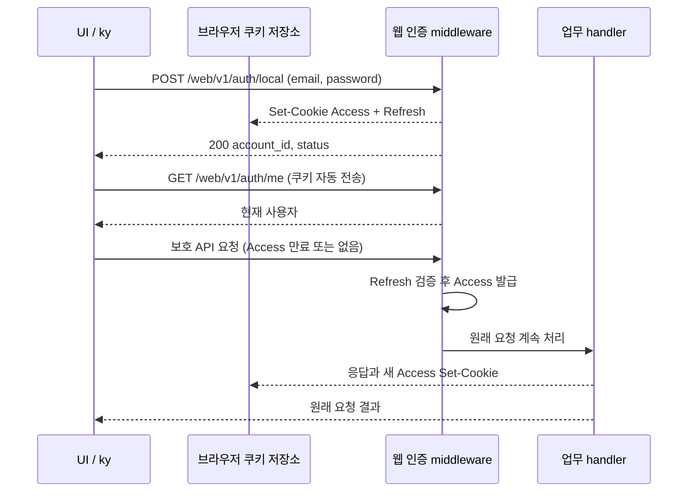

# 웹 UI API와 세션 설계

## 연결 문서

| 관계 | 대상 | 설명 |
| --- | --- | --- |
| follows | [PLN-AUTH-JWT-WEB](../jwt-web/plan.md) | 웹 쿠키·동일 origin·서버 자동 갱신 계약 |
| follows | [PLN-AUTH-JWT-REFRESH-LIFECYCLE](../jwt-refresh-lifecycle/plan.md) | Refresh 수명과 폐기 |

## 현재 상태와 목표

`tlab-app-ui`는 Vite 기반이며 ky와 API 연결, 로그인 화면이 없다. React Query와 Router는 조립되어 있다. Vite proxy는 설정되지 않았다. [UI package](../../../../tlab-app-ui/package.json), [진입점](../../../../tlab-app-ui/src/main.tsx), [Vite 설정](../../../../tlab-app-ui/vite.config.ts) 참조. (확인)

백엔드는 브라우저 전용 `/web/v1` 경로에서 쿠키를 발급하고, 보호 요청의 Access가 없거나 정상 만료이면 Refresh를 검증하여 새 Access를 발급한 뒤 **원래 요청을 계속 처리**한다. 잘못된 Access는 갱신하지 않는다. [웹 middleware](../../../../tlab-app/src/auth/web.rs), [웹 로그인](../../../../tlab-app/src/auth/slice/login_local/route.rs), [로그아웃](../../../../tlab-app/src/auth/slice/logout/route.rs). (확인)

목표는 ky로 웹 API를 호출하고 로그인 유지·만료 후 갱신·세션 종료를 연결할 구현 가능한 초안을 만드는 것이다. 로그인 UI의 상세 디자인, 백엔드 토큰 정책 변경과 구현은 이번 설계 범위 밖이다. 아래는 제안이며 사용자와 합의 전이다. (확인·제안)

## 설계안과 경계

브라우저가 서버의 HttpOnly 쿠키를 보관·전송하고, 갱신 판단과 발급은 서버가 소유한다. UI는 토큰 값이나 만료 시각을 저장하지 않고 현재 사용자 정보와 요청 상태만 관리한다. 이는 기존 웹 계약을 재사용하는 최소안이다. `/api/v1`의 JSON 토큰을 localStorage 등에 저장하고 UI가 갱신하는 대안은 기존 웹 계약과 별도 저장·갱신·경합 처리가 필요하다. (제안·추론)

| 주체 | 책임 |
| --- | --- |
| 공용 ky 인스턴스 | 같은 origin 상대 경로, JSON 호출과 HTTP 오류 전달. 기본 재시도를 `0`으로 명시해 중복 업무 처리를 피한다. 호출별 재시도는 안전성이 확인된 경우에만 명시한다. |
| auth API | 로그인·현재 사용자·로그아웃의 요청과 응답 타입을 제공한다. 비밀값을 로그나 영속 저장소에 기록하지 않는다. |
| 세션 상태 / React Query | `/web/v1/auth/me`를 사용자 정보의 기준으로 삼는다. 초기 상태는 확인 중이며, 성공 시 인증됨, 보호 API의 인증 실패 시 미인증으로 전환한다. 네트워크·서버 오류는 미인증으로 단정하지 않는다. |
| 브라우저 / 백엔드 | 쿠키 수명·전송 / 인증·갱신·폐기·CSRF 판단을 각각 소유한다. |

ky는 현재 의존성에 없으므로 구현 시 버전을 선택해 lockfile과 함께 추가한다. [ky 공식 문서](https://github.com/sindresorhus/ky)는 인스턴스·HTTP 오류·재시도를 지원하며 저장소 기본 브랜치 문서는 다음 버전용이라고 명시한다. 실제 설치 버전의 문서를 기준으로 옵션과 타입을 확인한다. (확인·제안)

## 인터페이스와 상태 전이

- `POST /web/v1/auth/local`: `{email, password}` → 200 `{account_id, status}` 및 두 쿠키. 성공 후 `/web/v1/auth/me`를 조회해 세션을 갱신한다. 로그인 실패의 401은 자격 실패이며 전역 세션 만료 처리로 바꾸지 않는다. (확인·제안)
- `GET /web/v1/auth/me`: 200 `{sub, sid, user}`. `user`는 현재 `nickname`, `status`, `role_ids`를 포함한다. 새로고침 시 이 요청으로 세션을 복원하며, 유효 Refresh가 있으면 서버가 필요 시 자동 갱신한다. (확인)
- 보호 `/web/v1/*`: 401 `INVALID_ACCESS_TOKEN`이면 인증 실패로 처리하고 현재 사용자와 사용자별 캐시를 지운다. 무조건 모든 401을 세션 만료로 취급하지 않도록 보호 요청과 로그인 오류를 구분한다. 403 권한 거부 또는 `CSRF_REJECTED`, 422, 5xx 및 네트워크 실패는 각 오류로 전달하고 인증 만료로 바꾸지 않는다. 서버 갱신의 내부 실패는 500이고 쿠키가 유지된다. (확인·제안)
- `POST /web/v1/auth/logout`: 본문 없이 호출한다. 성공 시 사용자 정보 및 사용자별 캐시를 제거한다. 서버 내부 실패 또는 네트워크 실패는 로그아웃 성공으로 표시하지 않고 재시도를 제공한다. 요청 취소나 응답 유실은 서버 처리 여부가 불확실하므로 이후 `/web/v1/auth/me`로 다시 확인한다. (확인·제안)
- 401에서 별도의 `/web/v1/auth/refresh` 호출이나 원 요청 재실행은 하지 않는다. 웹 갱신 경로는 보호 요청 내부에 있으며 `/api/v1/auth/refresh`는 JSON Refresh 원문을 요구하는 별도 Bearer 계약이다. (확인·제안)

동시 만료 요청은 서버가 동일 Refresh의 반복 사용을 허용하므로 각각 갱신할 수 있다. 현재 설계에서 UI singleflight는 필요하지 않다. 여러 탭 간 즉시 로그아웃 동기화는 보장하지 않으며 다음 보호 요청이나 `/web/v1/auth/me` 재조회로 확인한다. 로그아웃과 이미 진행 중인 갱신의 경합으로 발급된 Access는 자체 만료까지 유효할 수 있다. (확인·추론)

로그인·로그아웃 및 세션 확인의 응답이 순서가 뒤바뀔 때 이전 요청이 새 사용자 상태를 덮어쓰지 않도록 세션 변경 시 이전 조회를 취소하거나 결과를 무효화한다. 사용자 전환 시에도 이전 사용자의 캐시가 새 사용자에게 표시되지 않도록 한다. (제안)

## 실행 환경

웹 API와 UI는 브라우저 관점에서 같은 origin이어야 한다. `credentials: 'same-origin'`을 명시하고 상대 경로 `/web/v1/...`를 사용한다. 서버 guard는 unsafe 요청에 정확한 `auth.web.origin`을 요구하고 `Sec-Fetch-Site`도 확인한다. 현 Vite는 별도 서버이고 proxy가 없어 그대로는 연결되지 않는다. (확인·제안)

개발 시 Vite origin에서 `/web/v1`을 백엔드로 reverse proxy하고 백엔드의 `auth.web.origin`을 브라우저의 Vite origin과 일치시킨다. 프록시가 브라우저 Origin과 Set-Cookie를 보존하고, 백엔드 TLS 인증서 신뢰 및 브라우저 쿠키 정책이 맞아야 한다. HTTP 개발은 명시적 `allow_insecure_http` 예외와 별도 개발 쿠키 이름을 사용한다. 운영은 동일 origin의 정적 UI와 `/web/v1` 라우팅을 제공하는 서버 또는 reverse proxy를 선택한다. 구체적인 개발 포트·TLS 및 운영 배치는 미결정이다. (확인·제안)

## 검증할 계약

- 실제 브라우저와 백엔드에서 로그인 → `/web/v1/auth/me` → 새로고침으로 사용자 복원 → Access 부재/만료 상태의 보호 요청 성공과 새 Access 쿠키 → 로그아웃 후 갱신 거부를 확인한다. 쿠키 값은 기록하지 않는다.
- 유효하지 않은 Refresh의 401에서 UI가 미인증 상태로 바뀌고, 로그인 401·권한 403·CSRF 403·서버 500·네트워크 오류가 각각 구분되는지 확인한다.
- 동시 보호 요청, 로그인/로그아웃과 진행 중 사용자 조회의 경합, 다른 사용자로 로그인한 뒤 캐시 제거를 확인한다.
- 실제 개발 proxy와 운영에 준하는 HTTPS 구성에서 Origin, 쿠키 저장·전송·삭제와 정적 UI 경로를 확인한다. 서버 측 Router 테스트만으로 브라우저 동작을 확인했다고 간주하지 않는다.

## 결정과 미결정 사항

- **제안:** 서버 쿠키 기반 `/web/v1`을 사용한다. 토큰 노출을 줄이고 기존 서버 갱신 계약을 재사용한다. (추론)
- **논의 필요:** 개발 및 운영에서 동일 origin을 제공할 구체적인 방식과 주소. 기존 Vite 별도 실행만으로는 guard를 통과할 수 없다. (확인·추론)
- **논의 필요:** 세션 만료 시 로그인 화면 이동 방식, 사용자별 캐시 범위와 다른 탭의 즉시 동기화 필요성은 실제 UI 기능에 맞춰 정한다. 기본안은 현재 요청에 오류를 전달하고 사용자 상태를 미인증으로 전환하는 것이다. (제안)

## 구현·변경 기록

- 설계 초안 작성. 코드 변경과 브라우저 실행 검증은 하지 않았다. (확인)
