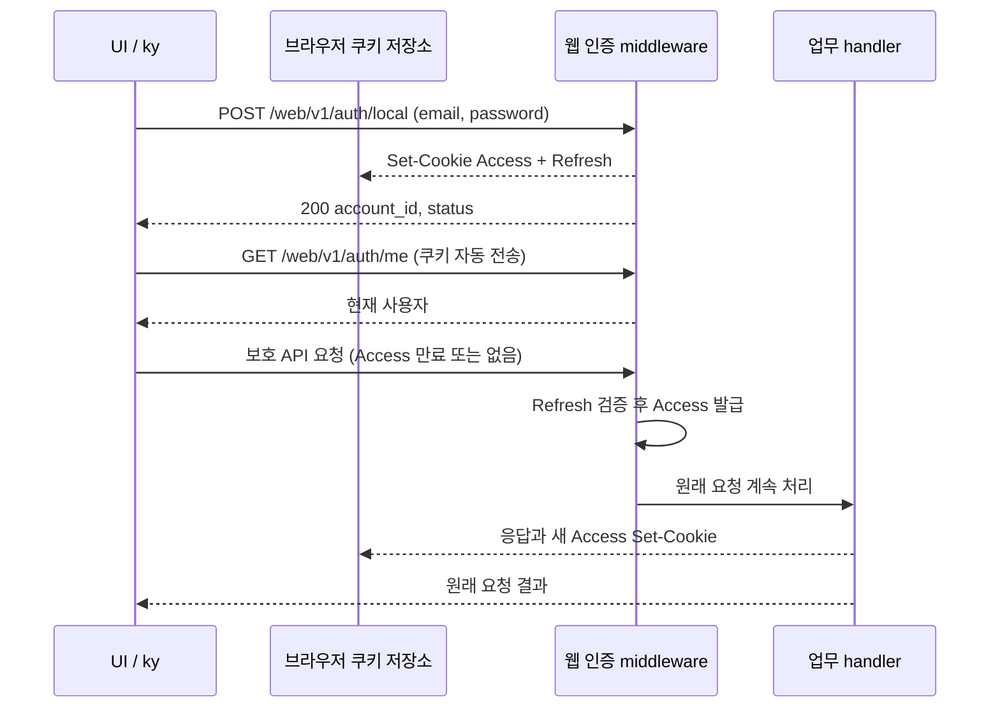
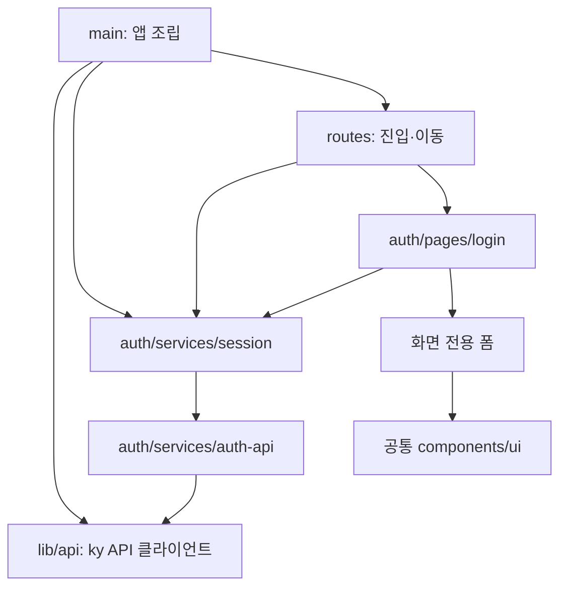

# 웹 UI API와 세션 설계

## 연결 문서

| 관계 | 대상 | 설명 |
| --- | --- | --- |
| follows | [프런트엔드 개발 구조](../../../architecture/fe-structure.md) | 기능·화면별 지역성과 공통 코드 배치 |
| follows | [PLN-HTTP-ROUTE-COMPOSITION](../../http/route-composition/plan.md) | 구현된 API·웹 라우터 조립과 버전 prefix |
| follows | [PLN-AUTH-JWT-WEB](../jwt-web/plan.md) | 웹 쿠키·동일 origin·서버 자동 갱신 계약 |
| follows | [PLN-AUTH-JWT-REFRESH-LIFECYCLE](../jwt-refresh-lifecycle/plan.md) | Refresh 수명과 폐기 |

## 현재 상태와 목표

`tlab-app-ui`는 Vite 기반이며 ky와 API 연결, 로그인 화면이 없다. React Query와 Router는 조립되어 있다. Vite proxy는 설정되지 않았다. [UI package](../../../../tlab-app-ui/package.json), [진입점](../../../../tlab-app-ui/src/main.tsx), [Vite 설정](../../../../tlab-app-ui/vite.config.ts) 참조. (확인)

백엔드는 브라우저 전용 `/web/v1` 경로에서 쿠키를 발급하고, 보호 요청의 Access가 없거나 정상 만료이면 Refresh를 검증하여 새 Access를 발급한 뒤 **원래 요청을 계속 처리**한다. 잘못된 Access는 갱신하지 않는다. [웹 middleware](../../../../tlab-app/src/auth/web.rs), [웹 로그인](../../../../tlab-app/src/auth/slice/login_local/route.rs), [로그아웃](../../../../tlab-app/src/auth/slice/logout/route.rs). (확인)

목표는 ky로 웹 API를 호출하고 로그인 유지·만료 후 갱신·세션 종료를 연결할 구현 가능한 초안을 만드는 것이다. 로그인 UI의 상세 디자인, 백엔드 토큰 정책 변경과 구현은 이번 설계 범위 밖이다. 쿠키 인증과 라우터 공유 방향은 사용자 지정 구조를 따른다. UI 배치·상태·화면 정책의 세부안은 제안이며 문서 상태는 draft로 유지한다. (확인·제안)

## 설계안과 경계

브라우저가 서버의 HttpOnly 쿠키를 보관·전송하고, 갱신 판단과 발급은 서버가 소유한다. UI는 토큰 값이나 만료 시각을 저장하지 않고 현재 사용자 정보와 요청 상태만 관리한다. 이는 기존 웹 계약을 재사용하는 최소안이다. `/api/v1`의 JSON 토큰을 localStorage 등에 저장하고 UI가 갱신하는 대안은 기존 웹 계약과 별도 저장·갱신·경합 처리가 필요하다. (제안·추론)



| 주체 | 책임 |
| --- | --- |
| 공용 ky 인스턴스 | 같은 origin 상대 경로, JSON 호출과 HTTP 오류 전달. 기본 재시도를 `0`으로 명시해 중복 업무 처리를 피한다. 호출별 재시도는 안전성이 확인된 경우에만 명시한다. |
| auth API | 로그인·현재 사용자·로그아웃의 요청과 응답 타입을 제공한다. 비밀값을 로그나 영속 저장소에 기록하지 않는다. |
| 세션 상태 / React Query | `/web/v1/auth/me`를 사용자 정보의 기준으로 삼는다. 초기 상태는 확인 중이며, 성공 시 인증됨, 보호 API의 인증 실패 시 미인증으로 전환한다. 네트워크·서버 오류는 미인증으로 단정하지 않는다. |
| 브라우저 / 백엔드 | 쿠키 수명·전송 / 인증·갱신·폐기·CSRF 판단을 각각 소유한다. |

ky는 현재 의존성에 없으므로 구현 시 버전을 선택해 lockfile과 함께 추가한다. [ky 공식 문서](https://github.com/sindresorhus/ky)는 인스턴스·HTTP 오류·재시도를 지원하며 저장소 기본 브랜치 문서는 다음 버전용이라고 명시한다. 실제 설치 버전의 문서를 기준으로 옵션과 타입을 확인한다. (확인·제안)

## 인터페이스와 상태 전이

- `POST /web/v1/auth/local`: `{email, password}` → 200 `{account_id, status}` 및 두 쿠키. 성공 후 `/web/v1/auth/me`를 조회해 세션을 갱신한다. 로그인 실패의 401은 자격 실패이며 전역 세션 만료 처리로 바꾸지 않는다. (확인·제안)
- `GET /web/v1/auth/me`: 200 `{sub, sid, user}`. `user`는 현재 `nickname`, `status`, `role_ids`를 포함한다. 새로고침 시 이 요청으로 세션을 복원하며, 유효 Refresh가 있으면 서버가 필요 시 자동 갱신한다. (확인)
- 보호 `/web/v1/*`: 401 `INVALID_ACCESS_TOKEN`이면 인증 실패로 처리하고 현재 사용자와 사용자별 캐시를 지운다. 무조건 모든 401을 세션 만료로 취급하지 않도록 보호 요청과 로그인 오류를 구분한다. 403 권한 거부 또는 `CSRF_REJECTED`, 422, 5xx 및 네트워크 실패는 각 오류로 전달하고 인증 만료로 바꾸지 않는다. 서버 갱신의 내부 실패는 500이고 쿠키가 유지된다. (확인·제안)
- `POST /web/v1/auth/logout`: 본문 없이 호출한다. 성공 시 사용자 정보 및 사용자별 캐시를 제거한다. 서버 내부 실패 또는 네트워크 실패는 로그아웃 성공으로 표시하지 않고 재시도를 제공한다. 요청 취소나 응답 유실은 서버 처리 여부가 불확실하므로 이후 `/web/v1/auth/me`로 다시 확인한다. (확인·제안)
- 401에서 별도의 `/web/v1/auth/refresh` 호출이나 원 요청 재실행은 하지 않는다. 웹 갱신 경로는 보호 요청 내부에 있으며 `/api/v1/auth/refresh`는 JSON Refresh 원문을 요구하는 별도 Bearer 계약이다. (확인·제안)

동시 만료 요청은 서버가 동일 Refresh의 반복 사용을 허용하므로 각각 갱신할 수 있다. 현재 설계에서 UI singleflight는 필요하지 않다. 여러 탭 간 즉시 로그아웃 동기화는 보장하지 않으며 다음 보호 요청이나 `/web/v1/auth/me` 재조회로 확인한다. 로그아웃과 이미 진행 중인 갱신의 경합으로 발급된 Access는 자체 만료까지 유효할 수 있다. (확인·추론)

로그인·로그아웃 및 세션 확인의 응답이 순서가 뒤바뀔 때 이전 요청이 새 사용자 상태를 덮어쓰지 않도록 세션 변경 시 이전 조회를 취소하거나 결과를 무효화한다. 사용자 전환 시에도 이전 사용자의 캐시가 새 사용자에게 표시되지 않도록 한다. (제안)

## 실행 환경

웹 API와 UI는 브라우저 관점에서 같은 origin이어야 한다. `credentials: 'same-origin'`을 명시하고 상대 경로 `/web/v1/...`를 사용한다. 서버 guard는 unsafe 요청에 정확한 `auth.web.origin`을 요구하고 `Sec-Fetch-Site`도 확인한다. 현 Vite는 별도 서버이고 proxy가 없어 그대로는 연결되지 않는다. (확인·제안)

개발 시 Vite origin에서 `/web/v1`을 백엔드로 reverse proxy하고 백엔드의 `auth.web.origin`을 브라우저의 Vite origin과 일치시킨다. 프록시가 브라우저 Origin과 Set-Cookie를 보존하고, 백엔드 TLS 인증서 신뢰 및 브라우저 쿠키 정책이 맞아야 한다. HTTP 개발은 명시적 `allow_insecure_http` 예외와 별도 개발 쿠키 이름을 사용한다. 운영은 동일 origin의 정적 UI와 `/web/v1` 라우팅을 제공하는 서버 또는 reverse proxy를 선택한다. 구체적인 개발 포트·TLS 및 운영 배치는 미결정이다. (확인·제안)

## UI 구성과 의존 방향

확정된 백엔드 경계는 `http`가 `/api/v1`·`/web/v1`과 공유 업무 Router를 조립하고 `auth`가 인증을 제공하는 구조다. React는 `/web/v1`만 사용한다. `/api/v1`의 Bearer 계약은 별도 클라이언트를 위한 계약으로 유지한다. 사용자는 이 구조를 기준으로 인증 설계를 계속하도록 요청했다. 아래 UI 배치와 세부 정책은 후속 구현을 위한 제안이다. (확인·제안)

이번 인증 기능은 로그인 화면 전용 UI와 앱 전체에서 쓰는 세션 처리를 구분한다. 페이지 전용 폼은 로그인 페이지 아래에 두고, 여러 화면과 경로가 이용하는 인증 통신·세션 처리는 `feature/auth/services`에 둔다. 아래 트리는 역할과 배치 기준이며 모든 폴더를 미리 생성하는 목록은 아니다. (제안)

```text
tlab-app-ui/src/
├── lib/
│   └── api.ts                     기능과 독립적인 ky 생성·HTTP 오류 계약
├── components/
│   └── ui/                         기존 공통 버튼·추가로 공유할 입력 등
├── feature/
│   └── auth/
│       ├── pages/
│       │   └── login/
│       │       ├── login-page.tsx   로그인 화면·진행·오류 표시
│       │       └── components/
│       │           └── login-form.tsx  분리할 필요가 있을 때만 생성
│       ├── services/
│       │   ├── auth-api.ts         login / me / logout와 요청·응답 타입
│       │   └── session.ts          세션 Query·전환·사용자 캐시 정리
│       └── hooks/
│           └── use-session.ts      React 구독을 실제로 공유할 때만 생성
├── routes/
│   ├── login.tsx                   URL·검색 매개변수와 화면 연결
│   └── _authenticated.tsx          보호 화면 공통 진입 검사
└── main.tsx                        HTTP·QueryClient·세션·Router 조립
```

| 소유 위치 | 제공할 계약 | 경계와 선택 이유 |
| --- | --- | --- |
| `lib/api.ts` | 설정을 받는 `createApiClient`, `ApiError`, 요청 취소·HTTP 오류 전달 | 기능·Router·QueryClient를 import하지 않는다. `/web/v1/` 같은 앱 주소와 인증 판단은 상위에서 전달한다. |
| `feature/auth/services/auth-api.ts` | `login(input, signal?)`, `me(signal?)`, `logout()` 및 인접한 요청·응답 타입 | 주입받은 HTTP 클라이언트를 사용한다. 데이터 보관·라우팅을 담당하지 않는다. |
| `feature/auth/services/session.ts` | 세션 Query 옵션, 확인·로그인·로그아웃·인증 실패 처리 | QueryClient와 auth API를 전달받아 세션 수명·경합·사용자 캐시 정리를 조정한다. Router 이동은 호출자가 결정한다. |
| `feature/auth/pages/login/` | 로그인 화면과 해당 화면의 입력·진행·오류 표현 | 입력은 화면 내부에 보관한다. 폼을 분리해도 props와 전용 처리 코드는 같은 화면 가까이에 둔다. |
| `feature/auth/hooks/` | 화면에서 필요한 세션 구독·React 생명주기 연결 | 구독 설정의 실제 공유가 필요할 때 추가한다. service 호출을 포장하기만 하는 hook은 만들지 않는다. |
| `components/ui/` | 기능 고유의 인증 판단을 갖지 않는 UI | 로그인 폼·세션 만료 안내는 auth가 소유한다. 공통 컴포넌트로 옮기는 것은 실제 공유 계약이 있을 때다. |
| `routes/` | URL·복귀 주소·진입 조건·loader와 기능 연결 | auth가 제공하는 세션 계약과 페이지를 사용한다. 화면 구현이나 세션 상태 복사본을 두지 않는다. |
| `main.tsx` | 앱 인스턴스 생성·소유·의존성 연결 | `/web/v1/`, credentials, 재시도 정책을 설정하고 HTTP의 오류 통지와 세션·Router 재평가를 연결한다. |

공개 요청인 로그인·로그아웃의 실패와 보호 요청의 인증 실패를 구분한다. HTTP 모듈은 보호/공개 의미를 직접 소유하지 않고 상위가 전달한 요청 설정·오류 통지 계약을 제공한다. auth API 호출자는 로그인 자격 오류를 처리하고, 보호 요청의 `INVALID_ACCESS_TOKEN`은 세션 계층에서 처리한다. 같은 ky 설정을 공유하며 HTTP 클라이언트를 별도 설정으로 중복 관리하지 않는다. 구체적인 hook/context 문법은 설치한 ky 버전에서 확인한다. (제안)

서버 사용자 정보의 단일 기준은 QueryClient의 세션 조회 결과다. `session.ts`는 이를 갱신하고 해석하며 별도 사용자 store를 만들지 않는다. 로그인/로그아웃 진행 상태와 전환 세대 번호는 세션 수명 제어용으로 소유한다. 로그인 입력값과 폼 상태는 해당 화면이 소유한다. React hook이나 Router context에도 사용자의 복사본을 별도로 저장하지 않는다. (제안)

API 요청·응답 및 `SessionUser` 타입은 우선 `auth-api.ts`에 두고, 여러 모듈에서 쓰더라도 API 계약을 기준으로 참조한다. 세션 전용 타입은 `session.ts`, props는 해당 컴포넌트에 둔다. 독립된 기능 공용 계약이 생기기 전에는 `types/`나 일괄 재노출용 `index.ts`를 추가하지 않는다. 테스트도 계약을 소유하는 코드 가까이에 두고 파일 간 세부 호출 순서보다 공개 동작을 검증한다. (제안)



다이어그램은 계약 사용과 조립 방향을 나타낸다. 공통 HTTP가 세션·Router를 역으로 import하지 않으며 오류 통지의 연결은 main이 담당한다. 다른 기능이 인증을 필요로 하면 `session.ts`의 계약을 사용하고 로그인 페이지 내부나 전용 hook을 가져다 쓰지 않는다. 향후 다른 auth 화면이 추가될 때도 해당 화면의 전용 코드는 화면 아래에 두고 실제 공유 부분만 feature 직속으로 올린다. (제안)

## TanStack Query와 API 호출의 연결

인증 화면의 서버 상태는 TanStack Query를 통해 조회·변경한다. 조회는 세션 Query가 `auth-api.ts`의 `me()`를 호출하고, 로그인·로그아웃은 mutation으로 세션 처리 계약을 실행한다. `session.ts`는 Query 옵션·상태 전환·캐시 정리를 제공하고 화면은 이를 사용한다. 조회 구독의 React 연결을 공유할 필요가 있을 때 `use-session.ts`로 분리한다. (제안)

기본 호출 흐름은 `로그인/보호 화면 → TanStack Query → auth의 세션 처리·API 함수 → lib/api.ts의 ky 클라이언트`다. 보호 경로의 진입 검사는 동일한 세션 Query를 QueryClient로 확인한다. Query가 조회 상태·캐시·재조회를 소유하고 ky가 실제 HTTP 호출·공통 오류 전달을 담당한다. 세션 정책이나 Query 정의를 공통 API 클라이언트로 이동하지 않는다. (제안)

## ky와 오류 계약

성공 JSON은 서버가 반환하는 데이터 자체이며 `{data: ...}` 공통 envelope를 가정하지 않는다. 오류 본문은 `{code, message}`다. HTTP 오류는 `status`, 선택적 `code`와 `message`를 제공하는 `ApiError`로 전달하고, JSON이 아닌 프록시 오류 본문도 상태 코드를 잃지 않게 처리한다. 네트워크·타임아웃·취소는 인증 오류로 변환하지 않는다. Query가 제공한 AbortSignal을 실제 ky 호출까지 전달한다. TypeScript 타입 지정은 런타임 응답 검증을 의미하지 않는다. (확인·제안)

| 요청·결과 | UI 처리 | 세션 영향 |
| --- | --- | --- |
| 로그인 401 `INVALID_CREDENTIALS` | 입력 화면에 자격 오류 표시 | 미인증 유지, 만료 안내로 바꾸지 않음 |
| 로그인 403 `ACCOUNT_UNAVAILABLE` | 로그인 불가 안내 | 인증 성공으로 취급하지 않음 |
| 보호 요청 401 `INVALID_ACCESS_TOKEN` | 세션 종료 통지 후 해당 요청 실패 전달 | 사용자별 요청 중단·캐시 정리·미인증 |
| 업무 403 `RBAC_FORBIDDEN` | 권한 없음 표시 | 인증 유지 |
| 403 `CSRF_REJECTED` | 요청 환경 오류 표시 | 로그인 화면 이동 대신 오류 유지 |
| 422 `AUTH_COOKIE_TOO_LARGE` | 인증 응답 처리 실패 안내 | 성공으로 간주하지 않음 |
| 서버 5xx·네트워크·타임아웃 | 오류와 명시적 재시도 제공 | 인증 실패로 단정하지 않음 |
| 사용자 이동·조회 취소 | 오류 알림 생략 | 세션 변경 없음 |

위 오류 코드는 현재 서버의 응답 계약에 맞춘다. 메시지는 사용자용으로 매핑할 수 있지만 입력 비밀번호·쿠키·원문 토큰·전체 요청 헤더는 오류 로그에 남기지 않는다. HTTP와 Query 양쪽의 기본 재시도를 명시적으로 끈다. 나중에 읽기 API 재시도가 필요하면 해당 조회의 안전성과 오류 종류에 맞춰 한 계층에서만 설정한다. (확인·제안)

## 세션 상태와 조회 계약

`SessionUser`는 `/auth/me`의 `{sub: string, sid: string, user: {nickname, status, role_ids}}`를 바탕으로 한다. 사용자 식별 기준은 `sub`를 사용하며 로그인 응답의 숫자 `account_id`를 별도 사용자 기준으로 저장하지 않는다. `user`는 Access 발급 시점의 정보이므로 현재 DB의 실시간 프로필·역할이라고 보장하지 않는다. 최종 업무 권한 판단은 서버가 수행한다. (확인·제안)

| 논리 상태 | 의미 | 보호 화면 동작 |
| --- | --- | --- |
| 확인 중 | 첫 `/auth/me` 진행 또는 로그인 후 사용자 확인 중 | 대기 표시, 보호 업무 조회 시작 보류 |
| 인증됨 | `/auth/me` 성공 | 화면과 업무 조회 활성화 |
| 미인증 | `/auth/me` 또는 보호 요청에서 확정된 인증 실패 | 로그인 화면 이동 |
| 확인 실패 | 초기·로그인 후 확인에서 서버 또는 네트워크 실패 | 오류·재시도 표시, 미인증으로 단정하지 않음 |

논리 상태를 별도 store에 복제하지 않고 Query 데이터·오류·진행 상태에서 도출한다. 인증됨 이후 백그라운드 조회가 일시 실패하면 마지막 사용자 표시를 유지하고 확인 실패를 표시할 수 있다. 보호 API의 최종 허용 여부는 서버가 결정한다. (제안)

- 세션 Query key는 `['auth', 'session']`, 성공 값은 `SessionUser`, 확정된 미인증 값은 `null`이다. 인증 실패는 정상적인 미인증 결과로 변환하고 나머지 오류는 reject한다. 세션 조회는 `retry: false`, 영속 캐시 저장 없음으로 시작한다. (제안)
- 최초 보호 경로 진입에서 세션을 확인하고, 이후에는 같은 Query 결과를 사용한다. 화면 전환마다 `/auth/me`를 강제로 호출하지 않는다. 탭이 다시 활성화되거나 네트워크가 복구되면 재조회해 사용자 상태를 확인한다. 만료 감지용 타이머나 주기 polling은 추가하지 않는다. (제안)
- 세션 종료나 사용자 전환 시 사용자 데이터 Query를 취소·제거한다. 업무 Query는 `['user', sub, ...]` 범위에 두어 공용 데이터와 구분한다. 아직 없는 업무별 캐시 계층은 미리 구현하지 않고, 사용자 데이터 추가 시 이 계약을 따른다. (제안)

React Query는 [조회 취소](https://tanstack.com/query/latest/docs/framework/react/guides/query-cancellation)에 AbortSignal을 제공하고 [조회 재시도](https://tanstack.com/query/latest/docs/framework/react/guides/query-retries)를 설정할 수 있다. 위 선택은 라이브러리 기본값에 맡기지 않고 이번 세션 계약으로 명시하는 정책이다. (확인·제안)

## 로그인·로그아웃과 화면 흐름

1. 보호 경로의 공통 `beforeLoad`에서 세션 확인 결과를 기다린다. `null`일 때 `/login`으로 이동하고, 확인 실패는 해당 경로의 오류·재시도 UI로 전달한다. 인증 이후 업무 loader를 실행한다. [Router 공식 인증 가이드](https://tanstack.com/router/latest/docs/framework/react/guide/authenticated-routes)의 context와 진입 검사를 사용한다. 프런트엔드 진입 검사는 화면 제어이며 서버 권한 판단을 대체하지 않는다. (제안)
2. 로그인 화면에서 이메일·비밀번호를 제출한다. 로그인 200만으로 화면 진입을 완료하지 않고 새 쿠키를 사용하는 `/auth/me`의 성공까지 기다린다. 이 조회가 일시 실패하면 로그인 요청을 자동 반복하지 않고 사용자 확인만 재시도한다. 자격 입력값은 Query·localStorage 등에 보관하지 않는다. (제안)
3. 로그인 성공 후 Router 인증 context를 재평가한다. 이전 보호 화면의 내부 경로가 있으면 돌아가고 없으면 `/`로 이동한다. 복귀 주소는 같은 앱의 경로만 허용하고 외부 URL이나 `//host`는 허용하지 않는다. 실제 업무 화면이 추가되면 `/`의 공개/보호 여부를 확정한다. (제안)
4. 로그아웃 시작 시 사용자 작업을 잠시 막고 진행 중 사용자 조회를 취소한다. 서버 성공 후 세션을 `null`로 설정하고 사용자별 캐시를 제거한 뒤 로그인 화면으로 이동한다. 실패하면 세션을 종료했다고 표시하지 않고 오류와 재시도를 제공한다. 응답 유실 등 처리 여부가 불확실하면 `/auth/me`로 재확인한다. (제안)
5. 보호 요청의 인증 실패는 세션을 미인증으로 전환하고 Router 재평가를 요청한다. 동시 401에서 같은 상태 전환과 로그인 안내를 반복하지 않는다. 실패한 업무 요청을 로그인 이후 자동 재전송하지 않는다. (제안)

## 요청 경합과 보장 범위

세션 계층이 전환 세대 번호를 소유하고 로그인 시작·로그아웃 시작·확정된 인증 종료 시 갱신한다. 각 보호 요청은 시작 시 세대를 캡처한다. 이전 세대의 성공이나 인증 실패는 새 세션의 상태·캐시를 변경하지 못한다. Query 취소와 함께 적용하여 로그인 직후 도착한 과거 요청의 401이 새 로그인을 취소하는 경우를 방지한다. 동시에 로그인·로그아웃 작업은 하나만 허용한다. (제안)

이 제어는 UI의 상태 오염 방지다. 요청 취소는 이미 실행된 서버 작업이나 브라우저에 반영된 Set-Cookie를 되돌리지 못한다. 기존 서버 계약상 로그아웃과 겹쳐 발급된 Access는 만료까지 유효할 수 있고, 다른 탭도 유효 Access를 보유하는 동안 즉시 종료를 인지하지 못할 수 있다. 즉시 세션 폐기가 필요하면 서버의 매 요청 세션 확인 등 별도 정책 변경이 필요하며 이번 설계에는 포함하지 않는다. (확인·추론)

## 개발 환경 제안과 남은 결정

기본 개발안은 UI `http://localhost:5173`, Vite `/web/v1` proxy → BE `http://127.0.0.1:8080`이다. Vite는 포트가 바뀌지 않도록 고정하고, BE는 로컬 override에서 `auth.web.origin = 'http://localhost:5173'`, `allow_insecure_http = true`를 사용한다. Origin을 프록시 대상 주소로 재작성하지 않는다. 운영 기본 설정을 개발 편의 때문에 HTTP로 바꾸지 않는다. 이 주소 선택은 사용자 확정 전 제안이다. (제안)

운영은 UI와 `/web/v1`을 같은 외부 HTTPS origin으로 제공한다. 정적 파일을 BE에서 제공할지 reverse proxy에서 분리할지는 배포 시 결정할 수 있으며 프런트엔드 호출 계약은 동일하다. (제안)

남은 제품 정책은 기본 보호 화면, 세션 만료 안내 문구·복귀 UX, 다른 탭에서 즉시 로그아웃을 통지할 필요성이다. 현재 최소안은 같은 탭에서 상태를 전환하고 다른 탭은 재활성화/다음 인증 확인에 반영하는 방식이다. 즉시 로그아웃 통지는 서버의 즉시 토큰 폐기 보장과 별개의 기능이다. (제안)

## 구현 범위와 진행 단위

| 단위 | 변경 범위 | 완료 판단 |
| --- | --- | --- |
| HTTP 기반·개발 연결 | ky와 lockfile, `lib/api.ts`, main 조립, Vite proxy·로컬 실행 안내 | 같은 origin에서 웹 API 호출, HTTP 오류와 네트워크·취소 구분, 인증 기능에 대한 역방향 import 없음 |
| 인증 API·세션 | auth services와 필요한 인접 테스트 | 로그인 후 확인·로그아웃·보호 요청 인증 실패·늦은 응답·사용자 캐시 정리가 계약대로 동작 |
| 화면·경로 연결 | 로그인 페이지·전용 폼, 필요한 공통 UI, route 연결과 필요한 hook | 진입 대기·로그인 복귀·오류 재시도·로그아웃 흐름이 연결되고 화면/경로 책임이 구분됨 |
| 실제 연동 검증·기록 | 기존 BE와 브라우저 흐름, UI build·타입 검사, 이 문서의 구현 기록 | 아래 계약의 실행 결과와 미실행 범위가 구분되어 기록됨 |

위 단위는 변경 이유를 구분하기 위한 범위이며 단계별 승인 절차를 추가하지 않는다. 이번 후속 구현은 기존 BE 인증·라우터 계약을 사용하고, 업무 기능이나 다른 인증 화면을 미리 만들지 않는다. 세부 폴더·hook·타입 파일은 실제 구현 필요에 맞춰 최소한으로 만든다. (제안)

## 검증할 계약

- 실제 브라우저와 백엔드에서 로그인 → `/web/v1/auth/me` → 새로고침으로 사용자 복원 → Access 부재/만료 상태의 보호 요청 성공과 새 Access 쿠키 → 로그아웃 후 갱신 거부를 확인한다. 쿠키 값은 기록하지 않는다.
- 유효하지 않은 Refresh의 401에서 UI가 미인증 상태로 바뀌고, 로그인 401·권한 403·CSRF 403·서버 500·네트워크 오류가 각각 구분되는지 확인한다.
- auth 서비스 가까이에서 동시 보호 요청, 로그인/로그아웃과 진행 중 사용자 조회의 경합, 다른 사용자로 로그인한 뒤 캐시 제거를 검증한다. 화면 가까이에서는 입력 오류·사용자 확인 실패의 재시도·제출 중복 방지를, routes 연결에서는 보호 화면 진입과 내부 복귀 경로를 확인한다. 테스트 파일 구조를 맞추기 위한 단순 포장 함수 테스트는 추가하지 않는다.
- 실제 개발 proxy와 운영에 준하는 HTTPS 구성에서 Origin, 쿠키 저장·전송·삭제와 정적 UI 경로를 확인한다. 서버 측 Router 테스트만으로 브라우저 동작을 확인했다고 간주하지 않는다.

## 결정과 미결정 사항

- **방향 확인:** 구현된 `/web/v1` 쿠키 인증과 `/api/v1` Bearer 분리 구조를 기준으로 UI 인증을 설계한다. 토큰 보관·자동 갱신은 기존 서버·브라우저 계약을 따른다. (확인)
- **논의 필요:** 개발 및 운영에서 동일 origin을 제공할 구체적인 방식과 주소. 기존 Vite 별도 실행만으로는 guard를 통과할 수 없다. (확인·추론)
- **논의 필요:** 세션 만료 시 로그인 화면 이동 방식, 사용자별 캐시 범위와 다른 탭의 즉시 동기화 필요성은 실제 UI 기능에 맞춰 정한다. 기본안은 현재 요청에 오류를 전달하고 사용자 상태를 미인증으로 전환하는 것이다. (제안)

## 구현·변경 기록

- 설계 초안 작성. 코드 변경과 브라우저 실행 검증은 하지 않았다. (확인)

### 라우터 구조 확정 후 UI 인증 설계 구체화

- 사용자 요청에 따라 구현된 `/api/v1`·`/web/v1` 경계를 기준으로 ky·auth API·세션·Router의 책임과 의존 방향을 구체화했다. Query 기반 단일 사용자 상태, 오류별 처리, 로그인 후 확인과 로그아웃·경합·캐시 정책, 개발 proxy 최소안을 제안했다. (확인)
- UI 구현과 라이브러리 추가, 브라우저 실행 검증은 하지 않았다. UI 세부 정책과 개발 주소는 제안 상태다. (확인)

### 프런트엔드 배치 기준 반영

- 사용자 요청으로 추가한 [프런트엔드 개발 구조](../../../architecture/fe-structure.md)를 참조하고 인증 설계의 배치를 `feature/auth` 아래 pages·components·services·hooks 기준으로 맞췄다. 폴더·hook은 실제 필요에 따라 분리하며 소스 구현은 하지 않았다. (확인)

### 프런트엔드 가이드 기준으로 인증 플랜 갱신

- 파일 트리 외에도 소유 책임·제공 계약·의존 방향·상태 소유권을 가이드에 맞춰 재정리했다. 로그인 전용 폼은 페이지 아래로 옮기고, auth 서비스는 기능 단위로 유지한다. hook·types·공통 UI는 실제 필요에 따라 분리한다. (확인)
- 공통 HTTP에 고정해 두었던 앱 주소·인증 판단의 설정 책임을 상위 앱 조립으로 명확히 하고, 구현 단위별 범위와 검증 책임을 추가했다. 기존 인증·갱신 정책과 미결정 제품 정책은 유지했다. 소스 구현은 하지 않았다. (확인)

### API 클라이언트 명칭과 TanStack Query 책임 반영

- 사용자 요청에 따라 가이드와 본문의 공통 클라이언트를 `lib/api.ts`, 생성 계약을 `createApiClient`로 맞췄다. 기능별 API 함수·세션 Query·mutation·React 구독과 ky의 책임을 명시했다. (확인)
- 문서만 갱신했으며 UI 소스·의존성은 변경하지 않았다. (확인)

### 문서 리뷰

- `03bb84d` 대비 프런트엔드 배치 가이드와 인증 UI 설계 변경을 검토했다. 주요·경미 결함은 발견하지 못했다. 로컬 문서 링크와 서버의 인증 오류 코드를 확인했고 `git diff --check`를 통과했다. Rust 코드·의존성 변경이 없어 Rust 선행 검사와 audit은 비대상이다. (확인)
- 판정: 통과. 기능 3, 구조 4, 안정성 3, 보안 3, 테스트 용이성 4 (각 4점 만점); 성능은 문서 변경으로 N/A. 적용 배점 기준 81.94/100이다. 설계의 경합·오류 처리와 검증 조건은 구체화되어 있으나 구현과 브라우저 검증은 향후 작업이다. (추론)
- 리스크 R1: 실행 코드·데이터·설정을 바꾸지 않는 문서 변경이므로 문서 복원으로 되돌릴 수 있으며, 현재 실행 아키텍처의 변경은 없다. 실제 롤백은 실행하지 않았다. 제안된 UI 구조와 개발·운영 환경은 후속 합의 및 구현 검증이 필요하다. (추론)
