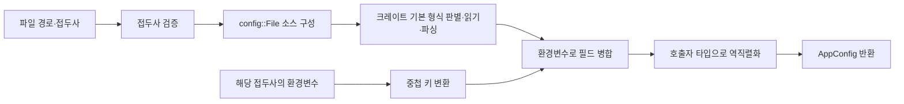

# 설정 파일 로딩

## 연결 문서

관련 기준은 [공통 에러 요구사항](../../error/requirements.md)과 [아키텍처 개요](../../../architecture/index.md)를 참조한다.
구현·검증 결과는 해당 단계에서 이 문서에 추가한다.

## 단계별 진행 상태

| 단계 | 상태 | 승인·수행 근거 |
| --- | --- | --- |
| 요구사항 정리 | 승인 | 사용자의 “셜계로 진행해” 응답을 요구사항 승인과 설계 진행 요청으로 기록 |
| 설계 | 승인 | 사용자의 “구현하고 코드리뷰까지 진행해. 문제점이 있을시 알아서 수정하고” 요청 |
| 구현·검증 | 완료 | 일괄 승인 범위에서 구현과 테스트·선행 검사 수행. 아래 실행 결과 참조 |
| 자체 점검·정식 코드 리뷰 | 완료 | 일괄 승인 범위에서 LLM 리뷰와 문서·테스트 보완 완료. 아래 코드 리뷰 참조 |

사용자는 단계별 문서 갱신과 사용자 승인 후 다음 단계 진행을 요청했다. 최초 구현 요청을 이후 단계의 승인으로 간주하지 않는다. (확인)

## 목적과 현재 상태

각 모듈이 정의한 설정 타입을 애플리케이션의 설정 타입으로 조합하고, 지정한 파일과 환경변수에서 읽어온다.
사용자가 요청한 형식은 다음과 같다. (확인)

```rust
mod xxx {
    pub struct Config {
        // 모듈이 사용하는 설정 필드
    }
}

struct AppConfig {
    pub xxx_config: xxx::Config,
}
```

설계 시작 당시 `tlab`은 단일 라이브러리 크레이트였으며 설정 모듈이 없었다. 현재는 `tlab::config::load`로 필수 파일과 접두사가 지정된 환경변수를 병합해 호출자 타입으로 읽는다. (확인)
공통 에러는 `tlab::Error`와 `tlab::Result`로 노출되며, 에러 enum은 `#[non_exhaustive]`로 확장 가능하다. (확인: [lib.rs](../../../../tlab/src/lib.rs), [error.rs](../../../../tlab/src/error.rs))

## 요구사항과 완료 조건

<a id="req-config-load-001"></a>
### REQ-CONFIG-LOAD-001: 지정한 설정 파일 로딩

- 호출자가 파일 이름 또는 경로를 파라미터로 전달한다. YAML과 TOML을 지원한다. (확인: 사용자 요청)
- YAML·TOML을 포함하여 `config` 크레이트의 기본 feature로 지원되는 파일 형식을 그대로 사용한다. `tlab`에서 별도 확장자 허용 목록이나 형식 판별기를 두지 않는다. (확인: 사용자의 확장자 제한 제거 요청)
- 파일 입력은 필수로 유지하며 형식 판별과 파일 이름 해석은 `config::File`의 기본 동작에 맡긴다. 파일 경로 파라미터의 타입은 변경하지 않는다. (추론: 수정 설계안)
- 완료 조건: YAML·TOML과 기본 feature의 추가 형식인 JSON에서 설정을 읽고, 파일 누락·크레이트가 판별하지 못하는 형식은 오류로 반환한다.

<a id="req-config-load-002"></a>
### REQ-CONFIG-LOAD-002: 모듈별 설정 타입 조합

- 각 모듈은 자체 `Config`를 정의하고, `AppConfig`는 `pub xxx_config: xxx::Config`처럼 조합한다. 로더가 특정 애플리케이션의 설정 필드를 고정하지 않는다. (확인: 사용자 요청)
- 설정 타입은 `serde::Deserialize`를 구현하여 읽는 방식을 제안한다. 필수 필드·기본값·선택 필드는 호출자의 타입 정의에 따른다. (추론: 제안 후 요구사항 승인)
- 완료 조건: 두 개 이상의 모듈 설정을 조합한 `AppConfig`로 중첩 문자열·숫자·불리언을 읽고, 필수 필드 누락·호환되지 않는 값은 오류로 반환한다.

<a id="req-config-load-003"></a>
### REQ-CONFIG-LOAD-003: 환경변수 오버라이드

- 환경변수로 파일의 설정을 덮어쓸 수 있다. (확인: 사용자 요청)
- 애플리케이션별 환경변수 접두사를 로딩 호출 시 전달하고, 접두사 뒤는 `_`, 중첩 필드는 `__`로 구분하는 방식을 제안한다. 예: 접두사 `APP`, 환경변수 `APP_XXX_CONFIG__PORT` → `xxx_config.port`. 필드 이름의 단일 `_`는 보존한다. (추론: 제안 후 요구사항 승인)
- 우선순위는 타입의 기본값보다 파일, 파일보다 환경변수를 높게 한다. 접두사가 다른 환경변수는 제외하고, 덮어쓰지 않은 파일 값은 유지한다. 환경변수에서 파일에 없는 필드를 보충할 수도 있다. (추론: 제안 후 요구사항 승인)
- 환경변수 값은 대상 필드 타입에 맞춰 변환한다. 문자열의 선행 0과 빈 문자열은 보존하고, 숫자·불리언으로 변환할 수 없는 값은 실패시킨다. 배열·맵 전체를 환경변수 문자열에서 해석하는 추가 문법은 이번 범위에서 제외한다. (추론: 제안 후 요구사항 승인)
- 완료 조건: 중첩 필드 덮어쓰기·미지정 값 유지·다른 접두사 제외·필드 보충과 타입 변환 성공·실패를 확인한다. 파일이 없으면 환경변수만으로 성공시키지 않는다.

<a id="req-config-load-004"></a>
### REQ-CONFIG-LOAD-004: 공통 에러 사용

- 실패는 `tlab::Error`로 반환하고, 공용 수준에서 필요한 에러 종류는 추가한다. (확인: 사용자 요청)
- 파일 접근 실패, 파일 파싱 실패, 필수 설정 누락·타입 변환 실패, 잘못된 로딩 인자를 호출자가 진단할 수 있어야 한다. 기존 I/O 에러·원인 보존 계약을 유지한다. 정확한 에러 분류는 설계 단계에서 정한다. (추론: 제안 후 요구사항 승인)
- 완료 조건: 실패가 panic 대신 공통 에러로 반환되고, 원본 오류가 있는 경우 원인 정보를 확인할 수 있다.

## 범위와 승인된 기준

- 구현 위치: 사용자 요청의 `tlab/config.rs`는 기존 Rust 소스 배치에 맞춰 `tlab/src/config.rs`, 공개 경로는 `tlab::config`로 해석한다. (추론: 제안 후 요구사항 승인)
- 파일 경로와 환경변수 접두사를 받는 제네릭 로딩 API를 제안한다. 구체 시그니처와 의존성은 설계에서 정한다. (추론: 제안 후 요구사항 승인)
- 다중 파일 병합, 파일 감시·자동 재로딩, `.env` 파일 로딩은 이번 범위에서 제외한다. 파일 형식 판별에 수반되는 `config::File`의 기본 이름 탐색 외에 자체 탐색 규칙은 추가하지 않는다. (추론: 수정 설계안)
- 요구사항은 사용자의 “셜계로 진행해” 응답으로 승인되었다. 이후 “구현하고 코드리뷰까지 진행해. 문제점이 있을시 알아서 수정하고” 요청으로 수정 설계에 따른 구현·검증·정식 리뷰·문제 수정까지 일괄 승인되었다. (확인: 진행 상태)

## 설계

아래 설계는 확장자 처리 위임 수정 후 사용자의 구현·리뷰 요청으로 구현 기준에 채택되었다. (확인: 승인 상태)

### 공개 API와 사용 방식

공개 경로는 `tlab::config::load`로 하고, 반환할 타입과 파일 경로·환경변수 접두사를 호출자가 지정한다.
설정은 호출 시점에 한 번 읽어 소유한 값으로 반환한다. 전역 설정 저장소나 싱글턴은 두지 않는다. (추론: 설계안)

```rust
pub fn load<T>(filename: impl AsRef<std::path::Path>, env_prefix: &str) -> tlab::Result<T>
where
    T: serde::de::DeserializeOwned;
```

사용 예는 다음과 같다. `Deserialize`는 소비 애플리케이션이 직접 의존하는 `serde`에서 가져온다. (추론: 설계안)

```rust
use serde::Deserialize;

mod server {
    #[derive(serde::Deserialize)]
    pub struct Config {
        pub host: String,
        pub port: u16,
    }
}

mod worker {
    #[derive(serde::Deserialize)]
    pub struct Config {
        pub enabled: bool,
    }
}

#[derive(Deserialize)]
struct AppConfig {
    pub server_config: server::Config,
    pub worker_config: worker::Config,
}

fn main() -> tlab::Result<()> {
    let config: AppConfig = tlab::config::load("app.yaml", "APP")?;
    assert!(config.server_config.port > 0);
    Ok(())
}
```

다음은 YAML과 TOML에서 같은 설정을 표현하는 예다. (추론: 설계 예시)

```yaml
server_config:
  host: localhost
  port: 8080
worker_config:
  enabled: true
```

```toml
[server_config]
host = "localhost"
port = 8080

[worker_config]
enabled = true
```

### 구성과 처리 책임

| 위치 | 책임·변경 |
| --- | --- |
| `tlab/src/config.rs` | 접두사 확인, `config::File`·환경변수 소스 구성, 병합·타입 변환 |
| `tlab/src/lib.rs` | `pub mod config` 추가. 기존 공개 경로 유지 |
| `tlab/src/error.rs` | 공통 `InvalidInput`·`Config` 에러 추가. 기존 변환 유지 |
| `tlab/Cargo.toml`, `Cargo.lock` | 설정 로딩·직렬화 의존성과 잠금 정보 추가 |
| `tlab/tests/config.rs` | 공개 로딩 API를 통한 계약·실패·환경변수 검증 |

소비 애플리케이션은 설정 구조와 기본값을 소유하고, `tlab`은 입력 경계에서 읽기·병합·역직렬화만 담당한다.
`config` 크레이트를 사용하면 형식별 파서·중첩 병합·타입 변환을 중복 구현하지 않아도 된다. (추론: 선택 이유)

| 의존성 | 제안 범위 | 이유 |
| --- | --- | --- |
| `config` | `0.15`, 기본 feature 사용 | 크레이트의 기본 지원 형식을 별도 제한 없이 사용 |
| `serde` | `1`, `features = ["derive"]` | 호출자 타입의 역직렬화 계약과 사용 예·테스트 |
| `tempfile` | 개발 의존성 `3` | 테스트별 실제 파일 격리·자동 정리 |

로컬에 있는 `config 0.15.27`의 소스에서 기본 feature의 TOML·JSON·YAML·INI·RON·JSON5 지원, 파일 형식 판별, 환경변수 접두사·중첩 구분자, 문자열에서 대상 타입으로 변환하는 구현을 확인했다.
설계 시점에는 실제 프로젝트 의존성 해석·컴파일·동작 검증을 수행하지 않았다. 이후 실행 결과는 하단에 기록한다. (확인: 소스 검토와 실행의 구분)

### 처리 순서와 파일 계약



1. 환경변수 접두사가 빈 문자열이면 `InvalidInput`으로 실패한다. 접두사에는 호출자가 원하는 이름만 전달하며 끝의 구분자를 붙이지 않는다.
2. 전달받은 경로로 `config::File::from(filename.as_ref()).required(true)` 소스를 구성한다. 확장자를 직접 검사하거나 `FileFormat`을 고정하지 않는다.
3. 형식 판별·읽기·파싱은 크레이트에 맡긴다. 상대 경로는 프로세스의 현재 디렉터리를 기준으로 해석하며 경로를 문자열로 강제 변환하지 않는다.
4. 파일 소스 뒤에 환경변수 소스를 추가하여 병합한다. 파일 누락·파싱 오류는 환경변수로 우회하지 않는다.
5. 병합한 결과를 `T: DeserializeOwned`로 역직렬화한다. 누락된 값의 기본값과 선택 필드는 `#[serde(default)]`·`Option` 등 호출자의 선언을 따른다. 알 수 없는 필드의 허용 여부도 `#[serde(deny_unknown_fields)]` 등 호출자의 선언을 따른다.

파일 소스의 기본 동작도 그대로 따른다. 정확한 이름의 파일이 있으면 그 파일의 확장자로 형식을 판별하며, 없으면 활성화된 형식의 확장자를 붙여 탐색한다. 예를 들어 `app`에 대해 `app.toml` 등을 찾을 수 있다. 확장자 대소문자나 탐색 순서를 `tlab`의 독립 정책으로 보장하지 않는다. (확인: `config 0.15.27` 소스 / 추론: 위임 범위)

이 순서로 파일 값을 먼저 읽고 환경변수로 덮어쓴다. 타입의 기본값은 병합 이후에도 값이 없을 때 역직렬화 과정에서 적용하므로 별도 기본값 트리를 만들지 않는다. (추론: 설계안)

### 환경변수 계약

`config::Environment::with_prefix(env_prefix).prefix_separator("_").separator("__")`를 사용한다.
접두사·환경변수 키는 대소문자를 구분하지 않고, 접두사를 제거한 키는 소문자로 바꿔 매핑한다. 기본 키 형식은 `snake_case`다. 다른 표기를 원하는 호출자는 `serde`의 이름 변환으로 맞춘다. (추론: 설계안)

| 환경변수 | 반영 위치·결과 |
| --- | --- |
| `APP_SERVER_CONFIG__PORT=9090` | `server_config.port`를 정수 `9090`으로 읽기 |
| `APP_WORKER_CONFIG__ENABLED=false` | `worker_config.enabled`를 불리언 `false`로 읽기 |
| `APP_SERVER_CONFIG__HOST=00123` | 문자열 `"00123"` 보존 |
| `APP_SERVER_CONFIG__HOST=` | 빈 문자열로 덮어쓰기 |
| `OTHER_SERVER_CONFIG__PORT=9999` | 접두사 `APP`의 로딩에서 제외 |

환경변수 수집 시 값의 자동 타입 추정을 켜지 않는다. 문자열을 유지한 채 최종 필드 타입으로 변환하여 선행 0 등 문자열 값의 변형을 피한다.
숫자·불리언의 잘못된 값은 파일 값으로 되돌리지 않고 오류를 반환한다. 유효 범위 등 도메인별 검증은 호출자 타입의 역직렬화 또는 로딩 이후 검증으로 처리한다. (추론: 설계안)

배열·맵 전체의 문자열 해석 문법은 제공하지 않는다. 파일에서 배열·맵을 읽는 동작은 역직렬화 타입에 따르며, 환경변수의 `__`는 중첩 필드 구분에 사용한다. (추론: 설계안)

### 공통 에러 계약

| 실패 | 공통 에러 | 진단·원인 |
| --- | --- | --- |
| 빈 접두사 | `Error::InvalidInput(Cow<'static, str>)` 추가 | 잘못된 인자를 설명하는 메시지 |
| 파일 탐색·읽기·형식 판별·파싱, 환경변수 처리·역직렬화 실패 | `Error::Config(config::ConfigError)` 추가 | `#[from]` 변환과 `source()`로 크레이트의 원본 설정 오류 유지 |

`InvalidInput`은 설정 외에도 잘못된 공용 API 인자에 사용할 일반 분류다. `Config`는 설정 입력을 읽고 타입으로 구성하는 실패를 구분한다.
원본 에러가 제공하는 파일·키·형식 오류 정보를 보존하며, 모든 설정 오류를 `Internal`로 뭉개지 않는다.
`Error::source()`는 저장한 `config::ConfigError`를 반환한다. 이 크레이트는 내부 원인을 `source()`로 연결하지 않으므로 파일 I/O 원인은 `ConfigError::Foreign`의 필드, 파싱 원인은 `ConfigError::FileParse`의 `cause`로 확인한다.
기존의 `From<std::io::Error>` → `IoError` 변환은 변경하지 않으며, 설정 로딩에서 생성된 오류를 다시 분해하여 재분류하지 않는다.
파일·모듈별 전용 에러 enum, 자동 로그 출력, 재시도는 추가하지 않는다. 기존 `IllegalState`·`IoError`·`Internal`과 `tlab::Result<T>`의 의미·변환은 유지한다. (추론: 설계안)

### 검증 방법

테스트에서는 모듈별 `Config`를 조합한 `AppConfig`를 사용하고 공개 `tlab::config::load`의 반환값·오류를 검증한다.
환경변수 검증은 별도 자식 프로세스의 환경을 설정하여 수행한다. Rust 2024의 프로세스 전역 환경변수 변경에 필요한 `unsafe`를 도입하거나 병렬 테스트끼리 환경을 공유하지 않는다. (추론: 검증 설계)

| 요구사항 | 실행으로 확인할 조건 |
| --- | --- |
| REQ-CONFIG-LOAD-001 | YAML·YML·TOML·JSON의 같은 설정값, 크레이트 기본 파일 이름 해석, 파일 누락·판별 불가 형식·잘못된 구문의 오류 |
| REQ-CONFIG-LOAD-002 | 복수 모듈의 중첩 설정, 문자열·숫자·불리언, 기본값·선택 필드, 필수 필드 누락·호환되지 않는 값 |
| REQ-CONFIG-LOAD-003 | 파일보다 높은 환경변수 우선순위, 미지정 필드 유지, 다른 접두사 제외, 필드 보충, 숫자·불리언 변환 실패, 선행 0·빈 문자열 보존 |
| REQ-CONFIG-LOAD-004 | 빈 접두사의 `InvalidInput`, 파일·설정 실패의 `Config` 분류와 원인 필드, 기존 `IoError` 변환·공통 에러 테스트 회귀 확인 |

구현 단계에서 `cargo fmt --all -- --check`, `cargo clippy --workspace --all-targets --locked -- -D warnings`, `cargo test --workspace --locked`로 형식·정적 검사·실행 결과를 확인한다.
의존성이 추가되므로 `cargo audit`도 수행한다. 네트워크·캐시·도구 문제는 코드 실패와 구분하여 기록한다.
위 명령은 설계 시점의 실행 계획이며, 실제 수행 결과는 하단 구현·검증 기록을 따른다. (확인: 기록 구분)

### 남은 위험과 승인 범위

- `config`의 타입 변환은 일반적인 설정 입력을 위한 변환이므로, 호출자 타입에 따라 파일의 문자열 숫자 등도 허용될 수 있다. 엄격한 도메인 제약은 호출자가 정의한다. (추론)
- 같은 키를 대소문자만 다르게 여러 환경변수에 정의하는 경우는 지원 계약에서 제외한다. 호출자는 키를 중복 정의하지 않는다. (추론: 제약 제안)
- 설정 오류의 원본 메시지에 입력 값이 포함될 수 있다. 로더는 값을 출력하지 않으며 에러의 표시·로그 정책은 호출자가 결정한다. (확인: 원본 오류 표현 / 추론: 사용 경계)
- 공개 API, 파일·환경변수 규칙, 의존성, 에러 분류와 검증 방법은 후속 구현·리뷰 요청으로 승인되었다. 해당 요청은 구현·검증·정식 리뷰·문제 수정을 함께 승인했으므로 그 범위에서는 단계별 재승인을 요청하지 않는다. (확인: 진행 방식)


### 설계 변경 기록: 확장자 처리 위임

- 계기: 사용자가 “경로가 아니라 확장자”라고 범위를 정정하고, 확장자 제한 대신 `config` 크레이트의 동작을 그대로 사용할 것을 요청했다. (확인)
- 변경: 자체 확장자 판별·YAML/TOML 허용 목록을 제거하고 기본 feature와 `config::File`을 사용한다. 파일 경로 파라미터는 유지한다. (추론: 수정 설계안)
- 영향: 기존의 확장자 생략 거부·대소문자 무시·정확한 파일만 읽기 정책은 크레이트 기본 해석으로 대체한다. 파일 오류도 `Config`에 원본을 보존하도록 에러·검증 계약을 함께 갱신했다. (추론)
- 상태: 사용자 요청에 따른 요구사항 변경을 반영한 뒤, 후속 구현·리뷰 요청으로 수정 설계를 승인받았다. (확인)

## 구현·검증 결과

### 1차 구현

- `tlab::config::load<T>(filename, env_prefix: &str) -> tlab::Result<T>`를 추가했다. 모듈별 `Config`를 조합한 `DeserializeOwned` 타입으로 반환하며, 파일 형식·이름 판별은 `config::File`에 위임한다. (확인)
- `config 0.15.27`의 기본 feature, `serde 1.0.229`, 개발 의존성 `tempfile 3.27.0`을 사용하고 `Cargo.lock`을 갱신했다. 기존 의존성 버전은 유지했다. (확인)
- `Error::InvalidInput`·`Error::Config`를 추가하고 기존 I/O·anyhow 변환은 유지했다. 에러 enum의 `non_exhaustive` 문서 테스트에도 새 종류를 포함하여, 단순 누락이 아닌 외부 fallback 요구를 검증하도록 유지했다. (확인)
- 환경변수 접두사는 사용자의 최종 요청 “필수로 넣어야겠네”, “임의로 덮어쓰면 안되니”에 따라 필수로 유지한다. 선택형으로 바꾸지 않았고 빈 접두사를 거부한다. 접두사가 다른 변수는 적용하지 않는다. (확인)

### 실행 결과

워크스페이스 루트, 기본 feature, 호스트 target에서 실행했다. 확인 시점은 2026-11-04 04:18 UTC이며 Rust·Cargo 1.97.1, Clippy 0.1.97, rustfmt 1.9.0-stable, cargo-audit 0.22.2를 사용했다. (확인)

| 명령 | 결과 |
| --- | --- |
| `cargo test --workspace --locked --offline` | 통과: 기존 단위 테스트 1개, 설정 통합 테스트 7개, 기존 에러 통합 테스트 5개, 문서 테스트 3개 |
| `cargo fmt --all -- --check` | 통과 |
| `cargo clippy --workspace --all-targets --locked --offline -- -D warnings` | 통과, 경고 없음 |
| `cargo audit` | 통과, advisory 1,403건으로 잠금 파일 의존성 69개 검사, 차단 항목 없음 |

- 환경변수 테스트용 helper 1개는 일반 실행에서 `ignored`로 표시되며, 상위 테스트가 자식 프로세스로 총 7회 명시 실행했다. 미검증 테스트를 건너뛴 결과가 아니다. (확인)
- 검증한 동작: YAML·YML·TOML·JSON 로딩, 기본 이름 탐색과 명시 파일 우선, 모듈 조합·기본값·선택 필드, 환경변수 덮어쓰기·필드 보충·다른 접두사 제외·선행 0·빈 문자열, 값·범위·구문·필수 필드·미지원 형식·빈 접두사 실패와 원인 보존. (확인)
- 최초 실행에서 원인 접근 방식과 필수 필드 오류의 문구에 대한 테스트 기대가 실제 크레이트 동작과 달라 2개 실패했다. 원본 구조를 확인해 원인 필드를 검증하고, 필드 이름으로 누락을 검증하도록 수정한 후 전체 테스트를 통과했다. 오류를 무시하거나 변환 실패 시 파일 값으로 되돌리는 우회는 추가하지 않았다. (확인)
- audit 최초 실행은 샌드박스 밖 advisory DB 잠금 파일에 접근하지 못했다. 승인받은 재실행으로 DB를 갱신하고 통과했다. DB 기준은 `965bf9ad083b58e6340d65829d85217b18be9290`이며 예외·경고 무시는 적용하지 않았다. (확인)
- Miri는 직접 작성한 unsafe·메모리 조작·관련 동시성 변경이 없어 비대상이다. Geiger는 별도 unsafe 통계가 필요한 변경으로 판단하지 않아 실행하지 않았으며, 의존성 내부에 unsafe가 없다는 근거로 사용하지 않는다. (추론: 적용 판단 / 확인: 미실행)

## 코드 리뷰

### 대상과 선행 검사

- 비교 기준: `79b51d8ec48e51664e371ffdaab866dff9620e6d` 대비 미커밋 설정 기능 변경. 대상은 `tlab/src/config.rs`, `tlab/src/error.rs`, `tlab/src/lib.rs`, `tlab/Cargo.toml`, `Cargo.lock`, `tlab/tests/config.rs`와 관련 설정 명세·아키텍처 설명이다. 별도 요청으로 변경한 `small-change` 스킬·가이드의 정식 품질 평가는 제외한다. (확인)
- 위 소스·Cargo·테스트 6개 파일의 검토 스냅샷 SHA-256은 `20eedc4103bd68b1ac901e66e5a656a1700919d68bf29228eee2ca4d2d9de3c9`다. 경로를 사전순 정렬하고 각 파일의 `경로 UTF-8 + NUL + 내용 + NUL`을 이어 해시했다. 문서만 갱신한 후에도 이 코드 스냅샷은 유지된다. (확인)
- 위 필수 선행 검사 통과 후 LLM 리뷰를 진행했다. 동일 코드·잠금 파일에서 통과한 테스트 근거를 재사용했다. 작성자가 수행한 LLM 리뷰이며 독립된 다른 검토자의 리뷰는 아니다. (확인)

### 발견 사항과 조치

- **경미·수정 완료:** 최초 설계의 “원인 체인” 설명은 `ConfigError` 내부 원인까지 `source()`로 접근할 수 있다는 오해를 만들었다. 실제 크레이트는 내부 원인을 필드에 보관하므로 [에러 문서](../../../../tlab/src/error.rs)와 본문을 수정하고, [공개 API 테스트](../../../../tlab/tests/config.rs)에서 I/O·파싱 원인 필드를 확인했다. (확인)
- **경미·수정 완료:** [아키텍처 개요](../../../architecture/index.md)의 설정 기능 미구현 설명과 공통 에러 목록을 현재 구현에 맞게 갱신했다. (확인)
- 최종 코드에서는 추가 수정이 필요한 치명·주요 결함이나 승인된 계약과의 불일치를 발견하지 못했다. (추론: 검토 결론)

### 항목별 점수와 판정

가이드의 초기 제안 기준으로 평가한다. 아래 점수는 이번 변경의 검토 범위에 한정한다. (확인: 기준 범위)

| 항목 | 점수 | 근거 |
| --- | --- | --- |
| 기능 | 4/4 | 파일·환경변수·중첩 타입·실패·오류 보존 계약을 공개 API로 검증하고 기존 API 테스트 유지 |
| 가독성과 구조 | 4/4 | 단일 함수에서 입력 검증·소스 구성·역직렬화가 드러나며 형식 판별·병합 중복 구현 없음 |
| 안정성 | 4/4 | 입력·파싱·변환 실패를 반환하고 필수 파일을 유지. 자식 프로세스로 환경을 격리하며 전역 상태·직접 작성한 unsafe 없음 |
| 보안 | 4/4 | 필수 접두사로 다른 환경변수 제외, 파일·설정 자동 출력 없음, 원본 오류의 값 노출 경계 문서화, 알려진 의존성 취약점 검사 통과 |
| 성능 | 4/4 | 호출당 파일·환경변수를 한 번 수집하고 병합·역직렬화. 재시도·감시·백그라운드 작업·값의 사전 타입 추정 없음 |
| 테스트 용이성 | 4/4 | 공개 제네릭 API, 격리한 실제 파일·프로세스 환경, 성공값·에러 종류·원본을 검증하여 실패 재현 가능 |

- 판정: **통과**, 품질 점수 **100/100**, 리스크 **R2**. 도구 통과만으로 점수를 부여하지 않고 위 계약·코드·실행 근거를 대조했다. (추론)
- 아키텍처 변경: 있음. 기존 단일 크레이트에 설정 입력 경계·공개 로딩 API와 `config`·`serde` 의존성을 추가했다. 의존 방향은 소비자 → `tlab` → 설정 라이브러리이며 애플리케이션 설정 타입·데이터 소유권은 소비자에게 남긴다. 기존 공개 API와 배포 단위는 유지한다. (확인: 전후 구조 / 추론: 분류)
- 복구 가능성: 저장소 내에서는 양방향으로 판단한다. 설정 로더는 입력을 읽기만 하며 파일·환경·DB·외부 상태를 변경하지 않는다. 새 API의 저장소 내 소비자는 추가 테스트·문서 예제뿐이므로 관련 소스·의존성·잠금·테스트·문서를 함께 복원하면 이전 기능으로 돌아갈 수 있다. 실제 롤백은 실행하지 않았다. (확인: 소비자·부수 효과 / 추론: 복구 판단)
- 외부 소비자가 새 API를 채택한 후 이전 버전으로 복원할 때는 해당 소비자의 코드·의존 버전도 함께 복원해야 한다. 외부 배포·소비 현황은 이번 대상이 아니다. (추론: 전환·복구 조건)
- 미확인 범위: INI·RON·JSON5의 개별 로딩, 다른 OS·Rust 버전, 성능 측정, 의존성 전체의 안전성 검증, 실제 롤백은 미실행이다. 추가 형식은 직접 제한·재구현하지 않고 크레이트 기본 기능에 위임하며, 실행으로 확인한 형식은 YAML·YML·TOML·JSON이다. (확인)

## 구현·변경 기록

### 1차 구현 요약

- 사용자 일괄 승인에 따라 설정 로더·공통 에러 확장·통합 테스트·문서 예제를 구현하고, 테스트·형식 검사·Clippy·취약점 검사 후 코드 리뷰까지 완료했다. 세부 근거는 위 구현·검증 결과와 코드 리뷰 절에 있다. (확인)
- 설계와의 차이: `ConfigError`의 내부 원인은 `source()` 체인이 아닌 원본 에러의 필드로 보존·확인한다. API와 파일·환경변수 정책은 승인된 설계와 일치한다. (확인)
- 최종 사용자 결정: 환경변수 접두사는 필수로 유지한다. 선택형 API로 변경하지 않았다. (확인)
- 추가 수정이 필요한 발견 사항은 남아 있지 않으며, 커밋·원격 게시·배포는 수행하지 않았다. (확인: 작업 상태)
