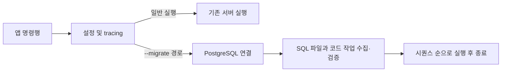

# DB 마이그레이션

기존 DB 지원 범위와 연결 기능은 [SPEC-DATABASE](../spec.md)를 참조한다.

## 진행 상태

- 요구사항: 승인. 초안 제시에 대한 사용자 “설계 진행해” 요청을 근거로 한다. 설계: 승인. 사용자 “구현 진행해” 요청을 근거로 한다. 구현·검증: 검토 대기. 자체 점검: 미착수. (확인)
- DB 상태 변경과 새로운 실행·등록 계약을 수반하므로 약식 구현 대상에서 벗어난다. 요구사항 승인 후 기존 문서와 승인 상태를 이어서 별도 설계 절차로 진행한다. (추론)

## 배경과 범위

현재 앱은 SQLx와 PostgreSQL을 사용하며 DB 연결을 생성한 후 HTTP 서버를 실행한다. 기존 DB 모듈은 연결과 트랜잭션을 제공하며 마이그레이션 기능은 없다. 최초 지원 대상은 기존과 같이 PostgreSQL로 제안한다. (확인·추론)

개발 환경과 작은 운영 환경에서 사용자가 직접 관리하는 SQL 및 코드 작업을 순서대로 실행한다. 마이그레이션의 역방향 실행이나 자동 복구는 범위에 포함하지 않는다. 사용자에게 SQL과 코드 작업의 안전한 반복 실행 및 DB 복구 책임이 있다. (확인)

## 요구사항과 완료 조건

### REQ-DATABASE-MIGRATION-001: 명령으로 실행

앱 실행 시 명령행 옵션으로 마이그레이션을 요청할 수 있다. 요청 시 지정된 DB에 작업을 수행하고 결과를 알리며 서버를 기동하지 않고 종료한다. 옵션을 사용하지 않은 기존 서버 실행은 유지한다. (확인: 옵션 요청 / 추론: 독립 실행 제안)

### REQ-DATABASE-MIGRATION-002: SQL과 코드 작업의 순차 실행

특정 경로의 `0001_...sql` 형태 SQL 파일과 코드에 시퀀스를 부여해 등록한 작업을 하나의 순서로 실행한다. SQL과 코드 사이에도 시퀀스 순서를 적용한다. 경로 지정 방식, 파일명 규칙과 중복 시퀀스 처리 등 상세 계약은 설계에서 정한다. (확인: 요청 / 추론: 통합 순서)

### REQ-DATABASE-MIGRATION-003: 반복 실행과 사용자 책임

SQL과 코드 작업은 재실행해도 문제가 없도록 사용자가 작성·관리한다. 롤백 기능은 제공하지 않는다. 작업이 실패하면 실패를 알리고 뒤 작업을 실행하지 않는 것을 제안한다. 실패 이전에 반영된 변경이나 부분 반영은 사용자 책임으로 확인·복구한다. (확인: 반복 실행 가정·롤백 제외 / 추론: 실패 처리 제안)

### REQ-DATABASE-MIGRATION-004: 실행 결과 확인

실행 순서, 성공과 실패를 사용자가 확인할 수 있어야 한다. 정상 실행, 반복 실행, SQL과 코드의 혼합 순서 및 실패 시 중단을 검증한다. 구체적인 메시지와 검증 방법은 설계에서 정한다. (추론)

## 검토할 정책

- 실행 이력 없이 매번 모든 작업을 실행한다. 요구사항 초안에 대한 사용자의 설계 진행 요청을 승인 근거로 한다. (확인)
- 아래 설계의 중복 번호, 파일 누락·잘못된 이름, 트랜잭션 경계 및 동시 실행 처리 방식은 설계 승인 대상이다. (추론)

## 설계 제안

### 책임과 흐름

`tlab`에 PostgreSQL 마이그레이션 실행 기능을 두고, `tlab-app`이 파일 경로와 코드 작업을 조립해 명령행 실행을 선택한다. 기존 `Database` 연결을 재사용한다. 일반 서버 실행 경로는 유지하고 마이그레이션 분기는 서버 Container 생성 전에 실행하여 TLS 파일이나 리스너 준비에 의존하지 않는다. 설정 로딩과 tracing 초기화는 공유한다. (추론)

### 명령과 작업 등록

- `tlab-app --migrate <디렉터리>`로 실행한다. 상대 경로는 프로세스 작업 디렉터리 기준이다. 인자 누락·중복·알 수 없는 옵션은 오류와 0이 아닌 종료 상태로 처리한다. 인자가 없으면 기존처럼 서버를 실행한다. (추론)
- 디렉터리의 직속 일반 파일 중 확장자가 `.sql`인 파일만 대상으로 한다. 파일명은 `숫자_이름.sql`이며 숫자는 1개 이상의 ASCII 숫자, 이름은 비어 있지 않아야 한다. 숫자는 정수로 비교하므로 `0001`과 `1`은 같은 시퀀스다. 잘못된 `.sql` 이름, 수치 범위 초과, 디렉터리 접근·읽기 오류는 실패로 처리한다. 다른 확장자와 하위 디렉터리는 무시한다. 빈 디렉터리는 성공한다. (추론)
- 앱은 코드 작업에 정수 시퀀스·이름·비동기 함수를 명시적으로 등록한다. 함수는 기존 PostgreSQL 연결의 `Context`를 받아 `tlab::Result<()>`를 반환한다. SQL과 코드 작업의 시퀀스가 중복되면 어떤 작업도 실행하기 전에 오류를 반환한다. 파일 내용을 실행 전에 모두 읽고 검증하여 이름·읽기 오류로 인한 부분 실행을 피한다. (추론)
- 실행기는 수집한 SQL과 코드 작업을 시퀀스 오름차순으로 하나씩 실행하고 각 작업의 시작·성공 및 실패를 식별할 수 있게 기록한다. 최초 실패에서 중단하고 오류를 반환한다. DB URL이나 SQL 내용은 로그에 출력하지 않는다. (추론)

### DB 변경과 운영 경계

- SQL 파일 하나를 SQLx `raw_sql`로 실행하여 여러 SQL 문을 지원한다. 실행기는 전체 작업이나 개별 코드 작업을 감싸는 트랜잭션을 추가하지 않는다. PostgreSQL의 SQL 실행 의미와 SQL 안의 명시적 트랜잭션은 그대로 적용되며, 코드 작업은 필요한 경계를 직접 관리한다. 실패 전에 확정된 변경이나 외부 부작용은 남을 수 있다. (추론)
- 실행 이력·체크섬·자동 롤백·재시도·동시 실행 잠금을 제공하지 않는다. 사용자는 실행을 직렬화하고 안전한 반복 실행과 실패 후 상태 확인·복구를 책임진다. 운영 실행 전 대상 DB와 백업은 사용자가 확인한다. (확인·추론)
- SQLx 내장 migrator는 이력 중심 동작이므로 이번 전체 재실행 정책과 맞지 않아 사용하지 않는다. 기존 DB 연결 API를 활용하고 별도 프레임워크나 의존성을 추가하지 않는다. (추론)

### 검증 계획

- 파일과 코드의 혼합 순서, 숫자 비교, 중복·잘못된 이름·읽기 실패의 실행 전 차단, 빈 디렉터리 및 CLI 오류를 검증한다. (추론)
- 기존 PostgreSQL 검증 환경의 격리된 테스트 대상에서 실제 SQL 여러 문과 코드 작업을 두 번 실행하고, 실패 후 뒤 작업 미실행과 이미 반영된 변경을 확인한다. 공유 데이터를 초기화하지 않고 테스트가 만든 객체만 정리한다. (추론)
- 일반 서버 경로 회귀와 프로젝트 필수 검사도 실행한다. 실제 DB나 필수 검사 실행이 불가능하면 미검증 범위와 이유를 기록한다. (추론)

## 구현·검증 결과

- `tlab::migration`에 SQL 파일 수집·검증, 코드 등록과 순차 실행을 추가했다. 앱은 `--migrate <디렉터리>`를 처리하며 코드 등록은 `tlab-app/src/migrations.rs`에 둔다. 사용법과 예제를 README에 추가했다. (확인)
- `cargo test --workspace --locked --offline`: 통과. 기존 DB 연동 4개와 신규 DB 연동 1개는 기본 실행에서 제외되며 환경변수 테스트 보조 1개는 별도 프로세스에서 실행된다. (확인)
- `TLAB_TEST_DATABASE_URL=... cargo test -p tlab --locked --offline --test migration -- --ignored`: PostgreSQL에서 통과. SQL 여러 문, 코드와의 순서, 반복 실행, 실패 후 중단과 선행 변경 유지를 확인했다. 세션 임시 테이블을 사용했다. (확인)
- 로컬 PostgreSQL을 대상으로 `cargo run -p tlab-app --locked --offline -- --migrate /private/tmp/tlab-migration-cli-check` 실행: SQL 두 문을 실행하고 성공 로그와 정상 종료를 확인했다. (확인)
- `cargo fmt --all -- --check`, `cargo clippy -p tlab --all-targets --locked --offline -- -D warnings`, `git diff --check`: 통과. 전체 workspace Clippy는 기존 `tlab-app`의 미사용 `passwd_hasher`, `Context`, `QueryBuilder` 경고 3건 때문에 실패했다. (확인)
- 미확인: 파일 읽기 실패의 실행 전 차단은 별도 실행으로 재현하지 않았으며 일반 서버의 실제 기동 회귀는 이번에 수행하지 않았다. 자체 점검은 승인 후 수행한다. (확인)

## SQL 검증과 코드 리뷰 선행 검사

- 대상: HEAD 대비 미커밋 마이그레이션 구현·문서 및 사용자가 추가한 `tlab-app/migrations/0001_create_tlab_user_account.sql`, `0002_create_user_identity_and_credential.sql`. Rust/Cargo 1.97.1, 호스트 기본 target·feature. (확인)
- PostgreSQL에서 고유 스키마를 트랜잭션 안에 만들고 SQL 두 파일을 순서대로 두 번 실행했다. 세 테이블 생성 및 반복 실행 성공을 확인한 뒤 전체 트랜잭션을 rollback했다. 이는 psql을 통한 SQL 검증이며 추가된 파일의 앱 CLI 실행 검증은 아니다. 기존 스키마와 데이터에 적용한 결과나 기존 테이블 구조와의 호환성은 확인하지 않았다. (확인)
- `cargo fmt --all -- --check`: 통과. `cargo clippy --workspace --all-targets --locked -- -D warnings`: 실패. 기존 `tlab-app/src/app.rs`의 미사용 `passwd_hasher`, `Context`, `QueryBuilder` 경고가 오류로 처리되었다. `cargo audit`은 선행 검사 중단 규칙에 따라 미실행. (확인)
- 코드 리뷰 선행 검사 판정: 수정 필요. LLM 리뷰 미진행, 품질 점수 미산정. 기존 경고의 처리 후 선행 검사부터 다시 수행해야 한다. 사용자 요청은 검증·리뷰이므로 코드는 자동 수정하지 않았다. (확인)

## 재리뷰

- 대상: HEAD `0d23f52` 대비 미커밋 변경 전체. Rust/Cargo 1.97.1, 호스트 기본 target·feature. (확인)
- 선행 검사: `cargo fmt --all -- --check`, `cargo clippy --workspace --all-targets --locked -- -D warnings`, `cargo audit` 통과. audit advisory DB `965bf9ad`, 274개 의존성 검사. `app.rs`에 추가된 모듈 전체 `allow(dead_code)`가 기존 경고를 숨긴 상태라는 한계가 있다. Miri는 unsafe·관련 동시성 구현 변경이 없어 비대상이다. (확인·추론)
- 판정: 수정 필요. 품질 점수 63.75/100. DB 변경은 코드 복원만으로 복구할 수 없고 공개 실행 경로·공통 API가 추가되어 R3이다. 실제 복구는 검증하지 않았고 대상 데이터에 따른 복원 계획이 필요하다. (추론)
- [주요] `tlab-app/migrations/0002_create_user_identity_and_credential.sql:15`: 비밀번호 자격 증명을 직접 관리 제공자에만 연결한다는 SQL 주석과 달리 `provider` 기본값은 제약이 아니다. 기존 identity가 `google`이면 credential에도 `google`을 명시해 외래 키를 통과할 수 있다. 직접 관리만 허용하는 정책이 맞다면 `CHECK (provider = 'managed')` 등으로 강제하고 거부 테스트가 필요하다. 기존 테이블에는 `CREATE TABLE IF NOT EXISTS`만으로 제약이 반영되지 않는다. (확인·추론)
- [경미] `tlab-app/src/app.rs:1`: 모듈 전체 `allow(dead_code)`가 기존 경고뿐 아니라 이후 추가될 미사용 코드 경고까지 숨긴다. 필요한 항목에 한정하거나 실제 사용 관계를 정리하는 편이 검사 신뢰성을 유지한다. (확인·추론)

| 항목 | 점수 | 근거 |
| --- | --- | --- |
| 기능 | 2/4 | 직접 관리 자격 증명 경계가 강제되지 않음 |
| 가독성과 구조 | 3/4 | 기존 조립 경계 활용, 광범위한 경고 억제 |
| 안정성 | 3/4 | 순서·반복·중단 검증, 복구는 사용자 책임 |
| 보안 | 2/4 | 외부 제공자 identity에 암호 자격 증명을 연결할 수 있음; 실제 인증 경로는 아직 미확인 |
| 성능 | 3/4 | 작은 범위 가정에서 단순 순차 실행; 부하 미측정 |
| 테스트 용이성 | 3/4 | PostgreSQL 통합 검증 존재; 자격 증명 제공자 제약 검증 부재 |

이전 격리 SQL 반복 실행과 실제 실행기 통합 테스트 결과를 재사용했다. 신규 SQL 파일의 앱 CLI 경유 실행, 기존 스키마 호환성, 운영 복구 및 향후 인증 코드의 실제 영향은 미확인이다. (확인)

## 앱 실행 경로 정리

- 사용자 요청에 따라 단계별 승인 없이 진행한다. 공통 옵션 구조로 `--migrate`를 해석하고 HTTP Router 조립·두 서버 실행·종료를 앱 HTTP 모듈로 이동한다. 기존 옵션 유효성 및 실행 경로와 HTTP 동작은 유지한다. (확인·추론)
- 구현·검증: `cargo test --workspace --locked --offline`, `cargo clippy --workspace --all-targets --locked --offline -- -D warnings`, `cargo fmt --all -- --check` 통과. 기본 테스트에서는 기존 DB 연동 5개가 제외되었다. 로컬 PostgreSQL에 연결한 앱에서 HTTP·HTTPS `/health`, HTTP `/db_status`, SIGTERM 종료 후 리스너 해제 및 빈 디렉터리의 마이그레이션 명령 정상 종료를 확인했다. (확인)
- 자체 점검: 기존 옵션의 정상·오류 분기, Router·신호 처리와 실행 경로를 최종 변경과 대조했다. 별도 기능 추가나 DB 상태 변경은 없으며, 실제 SQL 파일의 앱 CLI 실행은 이번 검증 범위에 포함하지 않았다. (확인)
