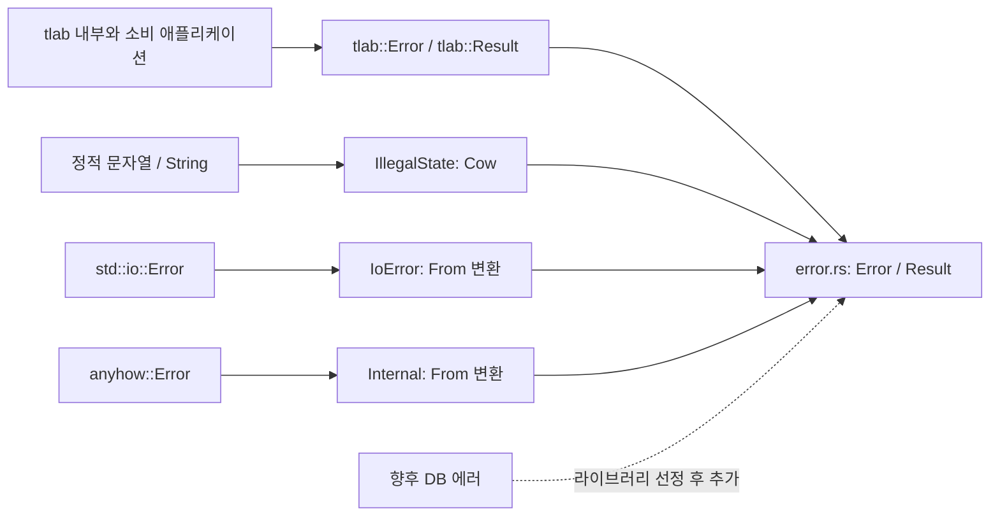

# tlab 공통 에러 설계

## 연결 문서

| 관계 | 대상 | 설명 |
| --- | --- | --- |
| realizes | [REQ-ERROR](./requirements.md) | 공통 에러의 정의·메시지·변환·반환 타입·점진적 확장 |

## 설계 시작 시점의 상태와 구조

- [워크스페이스](../../../Cargo.toml)는 `tlab` 크레이트 하나로 구성된다. [크레이트 설정](../../../tlab/Cargo.toml)은 edition 2024이며 의존성은 비어 있다. (확인)
- [lib.rs](../../../tlab/src/lib.rs)에는 예제 `add`와 해당 테스트만 있다. 공통 에러·기존 변환·DB 모듈은 없다. (확인)
- [아키텍처](../../architecture/index.md)의 코어 라이브러리 방향을 따르고, [구현 가이드](../../architecture/guide-impl.md)와 [테스트·검증 가이드](../../architecture/guide-test.md)에 따라 필요한 공개 계약만 추가하고 기존 동작은 유지한다. (추론)

## 목표·설계 범위·제약

`tlab`과 소비 애플리케이션이 같은 에러 타입과 반환 타입을 사용하고, 지원하는 외부 오류를 `?`로 전파하면서 원인을 유지하도록 한다. (추론)

- 사용자 지정 제약: `thiserror` enum, `error.rs`, `Internal(anyhow::Error)`, 일반 에러의 `Cow<'static, str>` 메시지, 외부 변환, `pub type Result<R>`. (확인)
- 사용자 후속 결정: DB는 변환 계약만 정의하고, 에러 종류는 실제 작업에서 필요할 때 확장한다. (확인)
- 아래 설계안은 최초 설계 후 사용자의 `구현도 진행해` 요청을 근거로 구현 기준으로 채택했다. 현재 구현 결과와 검증 근거는 하단 구현·변경 기록에 남긴다. (확인)
- DB 드라이버·임시 DB 페이로드·추가 분류·생성 도우미·로깅·재시도·외부 응답 매핑은 최초 구현 범위에 포함하지 않는다. (추론)

## 설계안

### 구성과 책임



구조와 흐름은 이번 설계의 제안이다. 실선은 최초 구현 범위, 점선은 후속 확장 계약을 뜻한다. (추론)

| 구성요소 | 책임·경계 | 변경 범위 |
| --- | --- | --- |
| `tlab/src/error.rs` | `Error`, `Result`, 종류별 표시와 외부 타입의 `From` 구현 | 신규 모듈 |
| `tlab/src/lib.rs` | `pub mod error;`와 `pub use error::{Error, Result};`로 공개 | 기존 예제는 유지하고 공개 선언 추가 |
| `tlab/Cargo.toml` | `thiserror`, `anyhow` 의존성 선언 | 각각 주 버전 2, 1의 기본 기능 사용 제안 |
| 공개 API를 통한 테스트 | 생성·변환·원인·반환 계약 검증 | `tlab/tests/error.rs`와 필요한 공개 API 문서 예제 |

위 파일 구성과 의존성 주 버전은 설계 제안이다. 구체적인 해석 버전·도구 체인 호환성은 구현 시 확인하며, 잠금 파일은 저장소 정책에 따라 함께 갱신한다. (추론)

### 소유권과 의존 방향

- `Error`가 메시지나 원본 에러를 소유한다. 정적 문자열은 빌릴 수 있고, 지역에서 생성한 문자열은 `Cow::Owned`로 소유권을 이전한다. 소비 코드에 지역 참조 수명을 전파하지 않는다. (추론)
- 공통 에러 모듈은 `std`, `thiserror`, `anyhow`에만 의존한다. DB 도입 전에 DB 의존성을 만들지 않는다. 후속 DB 변환은 공통 에러 타입을 소유하는 `tlab`에서 정의한다. (추론)
- 외부 에러는 해당 enum 필드에 원본 그대로 저장한다. 별도 `Cow` 메시지를 중복 보관하거나 변환 시 문자열로 치환하지 않는다. (추론)

## 인터페이스 계약

### 공개 타입과 표시

다음은 최초 구현의 API 제안이다. 각 enum 종류를 외부에서 직접 생성할 수 있도록 `#[non_exhaustive]`는 enum에만 붙인다. (추론)

```rust
// tlab/src/error.rs
use std::borrow::Cow;

#[derive(Debug, thiserror::Error)]
#[non_exhaustive]
pub enum Error {
    #[error("illegal state: {0}")]
    IllegalState(Cow<'static, str>),

    #[error("I/O error: {0}")]
    IoError(#[from] std::io::Error),

    #[error("{0}")]
    Internal(#[from] anyhow::Error),
}

pub type Result<R> = std::result::Result<R, Error>;
```

```rust
// tlab/src/lib.rs에 추가할 공개 선언
pub mod error;
pub use error::{Error, Result};
```

- `tlab::Error`와 `tlab::error::Error`, `tlab::Result<R>`와 `tlab::error::Result<R>`는 각각 같은 타입이다. 성공 타입 기본값이나 두 번째 타입 매개변수는 추가하지 않는다. (추론)
- `IllegalState`는 작업을 수행할 수 없는 상태를 표현한다. 메시지의 빈 문자열·언어를 검사하거나 변환하지 않고 유지하며, `source()`는 `None`이다. (추론)
- `IoError`는 `std::io::Error`를 보관한다. `source()`에서 원본 I/O 에러를 반환하여 종류·메시지를 조사할 수 있게 한다. (추론)
- `Internal`은 미분류 에러를 문맥과 함께 보관한다. `Display`는 가장 바깥쪽 메시지를 표시하며, 보관한 `anyhow::Error`에서 문맥·원인 체인을 조사할 수 있다. (추론)
- 표시 문구는 진단용이며, 에러 분기나 기계적 분석은 종류·페이로드를 사용한다. `Clone`·`PartialEq` 등 원본 에러가 제공하지 않는 계약은 요구하지 않는다. (추론)

### 생성·변환·전파

| 입력·호출 | 결과 | 호출자 조건 |
| --- | --- | --- |
| `Error::IllegalState("not initialized".into())` | 정적 메시지의 일반 에러 | 정적 문자열 전달 |
| `Error::IllegalState(format!("invalid state: {state}").into())` | 소유 메시지의 일반 에러 | 생성한 `String`의 소유권 전달 |
| `Error::from(io_error)` / I/O 결과의 `?` | `IoError` | 반환 타입이 `tlab::Result<R>` |
| `Error::from(anyhow_error)` / anyhow 결과의 `?` | `Internal` | 반환 타입이 `tlab::Result<R>` |
| 미지원 외부 에러 | 먼저 `anyhow::Error`로 감싸고 `Internal`로 변환 | 원본 에러가 anyhow의 `Send + Sync + 'static` 등 조건을 충족 |

생성·변환 API와 전파 조건은 설계 제안이다. 미지원 타입 전체를 대상으로 하는 범용 `From<E>`는 추가하지 않는다. (추론)

I/O 결과에 직접 `?`를 사용하면 `IoError`가 되고, 호출자가 먼저 anyhow로 변환하여 문맥을 추가한 결과는 `Internal`이 된다. 변환은 최종 입력 타입에 따르며, anyhow 내부를 조사하여 자동 재분류하지 않는다. (추론)

```rust
fn read(path: &std::path::Path) -> tlab::Result<String> {
    let text = std::fs::read_to_string(path)?;
    Ok(text)
}

fn validate(ready: bool) -> tlab::Result<()> {
    if !ready {
        return Err(tlab::Error::IllegalState("not initialized".into()));
    }
    Ok(())
}
```

위 예시는 공개 계약을 설명하기 위한 소비 코드다. 파일 읽기·상태 검증 기능 자체는 이번 추가 대상이 아니다. (추론)

### 원인 보존

`#[from]`은 `From` 구현과 원인 필드 지정을 겸한다. [thiserror 공식 문서](https://docs.rs/thiserror/latest/thiserror/)에서 이 동작을 확인했다. (확인)

`Internal`에는 `#[error("{0}")]`와 `#[from]`을 사용한다. `source()`에 보관한 anyhow의 가장 바깥쪽 에러를 포함하고, 진단 시 그 아래의 원인을 순서대로 탐색하도록 한다. `transparent`가 내부 `Display`와 `source`를 직접 위임하는 대안임을 검토했으며, 이번에는 일반 원인 필드를 사용한다. (추론)

anyhow의 기본 `Display`는 가장 바깥쪽 메시지만 표시한다. 보관한 값의 `chain()`·`root_cause()`나 대체 표시 형식으로 상세 정보를 얻을 수 있다. [anyhow 공식 문서](https://docs.rs/anyhow/latest/anyhow/struct.Error.html)에서 확인했다. 백트레이스의 수집·출력 보장은 공통 에러의 추가 계약으로 두지 않는다. (확인: anyhow 동작 / 추론: 계약 범위)

### 확장과 DB 변환 계약

- enum 자체에 `#[non_exhaustive]`를 지정하여 외부의 `match`가 향후 종류를 위한 `_` 분기를 갖게 한다. 기존 종류의 삭제·이름 변경·페이로드 변경에 대한 호환성까지 보장하지는 않는다. [Rust Reference](https://doc.rust-lang.org/reference/attributes/type_system.html#the-non_exhaustive-attribute)를 근거로 한다. (확인: 속성 동작 / 추론: 채택안)
- 새 종류는 필요한 분기와 의미가 명확해졌을 때 추가한다. 기존 I/O·anyhow 변환의 결과 분류를 바꾸지 않는다. (추론)
- DB 도입 시 구체 에러 타입 `E`를 정하고, DB로 식별할 수 있는 종류, `From<E>`, `?` 전파, 원본·`source()`를 통한 원인 조사를 구현한다. 종류 이름의 후보는 `DbError`이며, 이번 enum에는 임시 항목을 추가하지 않는다. (추론)
- 하나의 외부 타입을 문맥에 따라 다르게 분류해야 하면 호출 위치에서 명시적으로 매핑한다. 단일 `From<E>`에 서로 다른 분류 의미를 부여하지 않는 후속 판단 기준이며, 이번 추가 API는 아니다. (추론)

## 요구사항 대응·검증할 계약

| 요구사항 | 설계 대응 | 구현 시 검증·기대 결과 |
| --- | --- | --- |
| [REQ-ERROR-001](./requirements.md#req-error-001) | `error.rs`, Error 공개·재노출 | 외부 테스트에서 두 경로를 사용하고 표준 Error·Display·Debug로 취급할 수 있음 |
| [REQ-ERROR-002](./requirements.md#req-error-002) | `IllegalState(Cow<'static, str>)` | Borrowed·Owned 메시지가 유지되며 생성 함수에서 반환한 Owned 값도 유효 |
| [REQ-ERROR-003](./requirements.md#req-error-003) | `Internal`, `From<anyhow::Error>` | 문맥과 알려진 원인을 감싸 `?`로 전파하고 종류·문맥·원인을 확인 |
| [REQ-ERROR-004](./requirements.md#req-error-004) | `IoError`, `From<std::io::Error>`, 향후 DB 계약 | 직접 생성한 I/O 에러를 명시 변환·`?`로 전파하여 분류·원인 타입·ErrorKind 확인. DB 도입 시 같은 계약 검증 |
| [REQ-ERROR-005](./requirements.md#req-error-005) | 단일 타입 인자의 Result와 재노출 | 공개 경로를 사용하는 함수에서 성공값·실패값·외부 에러의 `?` 확인 |
| [REQ-ERROR-006](./requirements.md#req-error-006) | `#[non_exhaustive]`와 필요 시 종류 추가 | 외부 생성·`_`가 있는 match를 확인하고, 공개 API의 compile-fail 문서 예제로 `_` 없는 전체 종류 match가 거부되는지 확인 |

검증은 공개 API 사용과 원본 보존 계약을 묶어서 확인한다. 파생 코드 자체에 대한 중복 테스트, 실제 I/O·DB·네트워크 연결, OS별 메시지의 완전 일치는 요구하지 않는다. (추론)

구현 후 `cargo fmt --all -- --check`, `cargo test --workspace`를 실행하며 문서 테스트도 포함한다. 기존 `add` 테스트를 유지하고 미실행·실패·통과를 실행 근거와 함께 기록한다. 실행 결과는 하단 구현·변경 기록을 참조한다. (추론)

## 결정사항과 근거

아래 표는 최초 설계 시 선택안과 합의 상태를 기록한다. 이후 사용자가 구현을 요청하여 각 선택안을 이번 구현 기준으로 채택했다. (확인)

| 논점 | 선택안·이유 | 대안·영향 | 합의 상태 |
| --- | --- | --- | --- |
| 최초 종류 | `IllegalState`, `IoError`, `Internal`로 명시 요구를 최소한으로 충족 (추론) | 여러 범용 분류를 미리 준비하면 근거 없는 API 증가 | 설계 제안 |
| 메시지 범위 | 일반 에러는 Cow, 외부 에러는 원본 보관 (추론) | 모든 종류에 Cow를 추가하면 원본 메시지와 중복되고 단순 `#[from]` 사용도 어려움 | 설계 제안 |
| 원인 연결 | 일반 `#[from]` 필드 사용 (추론) | transparent는 표시와 source를 내부에 위임하므로 이번 원인 연결 방침과 차이가 있음 | 설계 제안 |
| 확장 호환성 | enum에 `#[non_exhaustive]` 적용 (추론) | 모든 종류의 열거를 허용하면 추가 시 외부 match가 깨질 수 있음 | 설계 제안 |
| 미분류 변환 | anyhow를 명시적인 중간 타입으로 사용 (추론) | 범용 `From<E>`는 전용 변환과 중복되거나 의도하지 않은 분류를 유발 | 설계 제안 |
| DB | 계약만 정의하고 원본 타입은 후속에서 선택 (확인) | 임시 boxed 에러나 드라이버 선택은 이번 범위를 확대 | 사용자 명시 결정 |

## 가정·미결정 사항

- `Error` 이름, 루트 재노출, 최초 세 종류, 표시 형식, enum의 확장 정책은 후속 구현 요청에 따라 구현 기준으로 채택했다. (확인)
- DB 원본 타입·페이로드·의존성은 후속 DB 도입 시 확정한다. 이번 공통 에러 구현을 막지 않는다. (확인: 보류 범위 / 추론: 영향)
- 해석된 의존성 버전은 `anyhow 1.0.104`, `thiserror 2.0.21`이며 [Cargo.lock](../../../Cargo.lock)에 기록했다. 현재 환경에서 컴파일·테스트를 통과했다. 별도의 최소 Rust 버전 보장은 정의하지 않았다. (확인)
- 구현 방향을 미정으로 남기는 중요 사항은 없다. 위 설계 제안을 전제로 구현에 전달할 수 있다. (추론)

## 구현·변경 기록

### 최초 설계

- 계기: 사용자가 요구사항 정의에 이어 `create-plan`을 요청했다. (확인)
- 반영 내용: 공개 타입·재노출, 세 종류의 원본·메시지 소유, From·source 계약, enum 확장 정책, DB 후속 변환 계약, 요구사항별 검증 조건을 설계했다. (추론)
- 상태: 설계 제안을 문서화했다. 코드·의존성은 변경하지 않았고 Rust 테스트는 실행하지 않았다. (확인)

### 1차 구현 요약

- 계기·채택 근거: 사용자가 설계 문서 작성 후 `구현도 진행해`라고 요청했다. 요구사항과 설계 상태를 `accepted`로 갱신했다. (확인)
- 구현 범위: [error.rs](../../../tlab/src/error.rs)에 세 종류의 에러·단일 인자의 Result를 추가하고, [lib.rs](../../../tlab/src/lib.rs)에서 모듈·루트 경로로 공개했다. `thiserror`·`anyhow` 의존성과 잠금 파일을 갱신했다. (확인)
- 설계와의 차이: 없음. DB 변환 구현·임시 종류를 추가하지 않았고 기존 `add` 함수를 유지했다. (확인)
- 검증 근거: [외부 사용 테스트](../../../tlab/tests/error.rs) 5개에서 Cow 메시지, I/O의 명시 변환·`?` 전파·원본 보존, anyhow 문맥·원인·분류 보존, 공개 Result 경로를 검증했다. 에러 타입의 문서 테스트 2개에서 외부 생성·fallback match와 fallback 없이 모든 현재 종류를 나열한 match의 컴파일 거부를 검증했다. (확인)
- 실행 결과: `cargo fmt --all -- --check` 통과. 최초 `cargo test --workspace`는 샌드박스의 crates.io DNS 접근 제한으로 의존성을 가져오지 못했다. 권한 승인 후 같은 명령을 실행하여 기존 단위 테스트 1개·통합 테스트 5개·문서 테스트 2개를 모두 통과했다. (확인)
- 남은 사항: DB 라이브러리 선정 후 구체 변환을 추가한다. 현재 범위에 미완료 구현·실패한 검증은 없다. (확인)

### 코드 리뷰: 최초 구현

#### 발견 사항

- 이번 범위에서 치명·주요·경미 결함을 발견하지 못했다. 정의된 계약을 기준으로 판단했으며, 임의로 에러 종류나 도우미를 추가할 필요는 없다. DB 구현 보류는 사용자 결정과 일치하므로 누락으로 평가하지 않는다. (추론)

#### 대상과 판정

- 비교 기준: `dd62893be6cbc8b56dd5366d539a0fd51fa83468` → 이번 작업의 미커밋 변경. 추적되지 않은 `error.rs`, `tests/error.rs`, 요구사항·설계 문서도 포함하여 검토했다. 아키텍처 문서에는 작업 시작 전 변경이 있었으므로 기존 변경을 이번 구현의 결함으로 취급하지 않았다. (확인)
- 실행 코드 스냅샷: `Cargo.toml`, `Cargo.lock`, `tlab/Cargo.toml`, `tlab/src/lib.rs`, `tlab/src/error.rs`, `tlab/tests/error.rs`를 순서대로 경로·NUL·내용·NUL로 연결한 SHA-256은 `560af1152ac784718a7e23610a4ea321c459dcd91f06dca5723550fa9cf121b2`다. 리뷰 기록 추가로 이 코드 스냅샷은 바뀌지 않는다. (확인)
- 판정: **통과**, 품질 점수 **100/100**, 변경 리스크 **R2**. [리뷰 가이드](../../agent/code-review/index.md)의 초기 제안 배점·판정 기준을 적용한 이번 범위의 평가다. 점수는 전체 제품이나 모든 사용 환경에 대한 평가가 아니다. (추론)

#### 항목별 점수

| 항목 | 점수 | 근거 |
| --- | --- | --- |
| 기능 | 4/4 | 세 종류·Cow·단일 인자의 Result·재노출·변환·DB 보류가 요구사항과 일치하며 공개 API 테스트 통과 (확인) |
| 가독성과 구조 | 4/4 | 에러 책임을 한 모듈에 모으고 루트는 재노출만 담당. 범용 변환·임시 DB 계층·중복 메시지 없음 (확인) |
| 안정성 | 4/4 | 원본 타입·I/O 종류·anyhow 문맥과 원인·최종 입력에 따른 분류를 보존하고 종류 확장 시 외부 fallback을 강제 (확인) |
| 보안 | 4/4 | 추가 코드는 에러 보관·표시·변환에 한정. 외부 전송·권한 변경·unsafe 코드가 없고 원인 출력은 호출자가 요청할 때 수행. 의존성 전체의 취약점 감사를 수행했다는 의미는 아님 (확인: 코드 범위 / 추론: 평가) |
| 성능 | 4/4 | 정적 메시지는 Cow로 빌리고 동적 메시지·원본 에러는 소유권을 이전. 변환 시 원인을 문자열로 복제하지 않으며 추가 I/O·반복 작업 없음. 성능 목표 수치가 없어 벤치마크는 요구하지 않음 (추론) |
| 테스트 용이성 | 4/4 | 공개 API로 생성·분류·원인을 관찰하고 외부 서비스 없이 실패를 재현. 정상 반환과 오류 전파, 확장 계약의 컴파일 성공·실패를 확인 (확인) |

#### 복구·아키텍처·검증 근거

- 복구 가능성: **양방향, 현재 저장소에서는 코드 롤백으로 복구 가능**. 기존 `add` API와 동작은 유지했고 데이터·설정 변환·외부 호출·발송을 추가하지 않았다. 새 모듈·테스트·공개 선언과 의존성·잠금 파일을 함께 복원하면 이전 코드 상태로 돌아간다. 실제 롤백을 실행한 결과가 아닌 코드 근거에 따른 판단이다. (추론)
- 아키텍처 변경: **있음**. 예제 함수만 제공하던 크레이트에 공통 에러의 소유·변환 책임과 공개 `Error`·`Result` 계약을 추가했다. 의존 방향은 소비 코드 → tlab 공통 에러 → std·anyhow이며 배포 단위는 그대로다. 기존 API 변경이나 저장소 내 소비 코드 마이그레이션은 없다. 이 축과 복구 가능성에 따라 R2로 분류했다. (확인: 구조 / 추론: 등급)
- 전환·복구 조건: 현재 저장소에 공통 에러를 사용하는 제품 호출자는 없고 테스트·문서 예제만 있다. 향후 외부 소비자가 새 API를 채택한 뒤 이전 버전으로 되돌리려면 소비자의 의존 버전·사용 코드도 함께 복원해야 한다. 외부 소비 현황은 조사하지 않았다. (확인: 저장소 내 호출자 / 추론: 후속 복구 조건)
- 이번 리뷰 실행: `cargo test --workspace --locked --offline` 통과, 기존 단위 테스트 1개·통합 테스트 5개·문서 테스트 2개 모두 성공. `cargo fmt --all -- --check` 통과. 검토 후 실행 코드는 수정하지 않았다. (확인)
- 미확인 범위: 실제 롤백·외부 소비 애플리케이션·다른 Rust 버전·의존성 취약점 감사·성능 측정은 미실행이다. DB는 이번 범위에서 계약만 검토했으며 실제 연동을 검증하지 않았다. 이 항목들은 현재 합의된 계약의 검증 필수 조건이 아니다. (확인: 미실행 범위 / 추론: 판정 영향)

<a id="review-deterministic-2026-11-04"></a>
### 재리뷰: 선행 검사 후 LLM 리뷰

#### 발견 사항과 판정

- [요구사항](./requirements.md)·설계·기존 기록을 읽고 구현과 다시 대조했다. 수정이 필요한 코드 결함이나 요구사항·설계와의 불일치를 발견하지 못했다. DB의 구체 변환 보류와 점진적 종류 확장도 요청 범위와 일치한다. (추론)
- 판정은 **통과**, 품질 점수는 **100/100**, 리스크는 **R2**다. 기존 점수를 그대로 옮긴 것이 아니라 선행 검사 통과 후 아래 항목을 재평가했다. (추론)
- 비교 대상은 `dd62893be6cbc8b56dd5366d539a0fd51fa83468` → `d6db98e82c24cd06e094a8b8491f17af5defffc5`의 에러 기능 변경이다. 현재 실행 코드·잠금 파일은 대상 커밋과 동일하다. 작업 중인 리뷰 스킬·가이드 변경 자체의 품질 평가는 이번 범위에서 제외했다. (확인)

#### 선행 검사

실행 위치는 워크스페이스 루트이며 기본 feature·호스트 target을 사용했다. 2026-11-04 01:06 UTC 기준으로 다음 결과를 확인했다. Rust·Cargo는 1.97.1, Clippy는 0.1.97, rustfmt는 1.9.0-stable, cargo-audit은 0.22.2다. (확인)

| 검사·명령 | 상태 | 근거·후속 판단 |
| --- | --- | --- |
| `cargo fmt --all -- --check` | 통과 | 종료 코드 0 |
| `cargo clippy --workspace --all-targets --locked -- -D warnings` | 통과 | 종료 코드 0, 경고 없음 |
| `cargo audit` | 통과 | 종료 코드 0, advisory 1,403건으로 잠금 파일의 의존성 8개 검사, 차단 항목 없음 |
| Miri | 비대상 | 직접 작성한 unsafe·메모리 조작·동시성 안전성 구현의 변경이 없음 |
| Geiger | 미실행 | unsafe 사용 통계가 필요한 변경으로 판단하지 않음. 의존성 내부의 unsafe가 없다는 근거로 사용하지 않음 |

- cargo-audit 미설치를 확인하여 승인 후 설치했다. 최초 audit 실행은 샌드박스 밖 advisory DB 잠금 파일에 접근하지 못했으나, 승인 후 재실행하여 통과했다. 예외·경고 무시는 적용하지 않았다. (확인)
- advisory DB 기준은 `965bf9ad083b58e6340d65829d85217b18be9290`이다. 이 결과는 해당 DB·잠금 파일의 알려진 취약점 검사이며 의존성 전체의 안전성을 보증하는 것은 아니다. (확인)
- 필수 검사를 모두 통과한 후 **LLM 리뷰를 진행**했다. (확인)

#### LLM 항목별 평가

| 항목 | 점수 | 재검토 근거 |
| --- | --- | --- |
| 기능 | 4/4 | REQ-ERROR-001–006과 공개 경로·세 종류·단일 인자 Result·변환 계약이 일치함. DB 구현은 명시적으로 후속 범위 (확인) |
| 가독성과 구조 | 4/4 | 에러 모듈이 표현·변환을 담당하고 루트는 재노출만 담당. 불필요한 변환 추상화·추가 종류 없음 (확인) |
| 안정성 | 4/4 | I/O 원본과 anyhow 문맥을 소유하여 보존. 최종 입력 타입에 따른 분류와 `source()` 연결이 설계 및 테스트 기대 결과와 일치 (확인) |
| 보안 | 4/4 | 추가 코드에 외부 전송·권한 변경·unsafe 구현이 없고 진단 출력은 호출자가 선택. 알려진 의존성 취약점 검사도 통과 (확인) |
| 성능 | 4/4 | 정적 문자열을 빌리고 동적 문자열·원본 에러는 소유권 이전. 추가 원인 문자열 복제나 I/O를 도입하지 않음 (추론) |
| 테스트 용이성 | 4/4 | 공개 API에서 분류·메시지·원인을 확인하고 외부 서비스 없이 실패 재현 가능. 확장 시 fallback 계약은 문서 테스트가 검증 (확인) |

#### 검증 재사용·복구·남은 범위

- 실행 코드 스냅샷 SHA-256은 최초 리뷰의 `560af1152ac784718a7e23610a4ea321c459dcd91f06dca5723550fa9cf121b2`와 동일하다. 이번 대화에서 동일 환경·동일 코드로 확인한 단위 테스트 1개·통합 테스트 5개·문서 테스트 2개의 통과 근거를 재사용했다. 이번 차수에 `cargo test`를 추가 실행한 것은 아니다. (확인)
- 복구 가능성은 양방향으로 판단한다. 이번 변경에는 데이터·외부 상태 변환이 없으며 기존 `add`를 유지한다. 현재 저장소의 소비자는 테스트·문서 예제뿐이므로 모듈·공개 선언·의존성·잠금 파일·해당 테스트를 함께 복원하면 이전 버전으로 돌아갈 수 있다. 실제 롤백은 실행하지 않았다. (확인: 변경·호출자 범위 / 추론: 복구 가능성)
- 아키텍처 변경은 있다. 기존 예제 크레이트에 공통 에러의 책임과 공개 계약을 추가하며, 소비 코드 → tlab → std·anyhow 방향과 단일 크레이트 구성을 유지한다. 새 API를 채택한 외부 소비자는 의존 버전·사용 코드도 함께 복원해야 한다. 가이드의 두 축에 따라 R2다. (추론)
- 실제 롤백·외부 소비 앱·다른 Rust 버전·성능 측정·DB 연동은 미확인이다. 이번 리뷰에서 실행 코드는 수정하지 않았고 재리뷰 기록만 추가했다. (확인)
