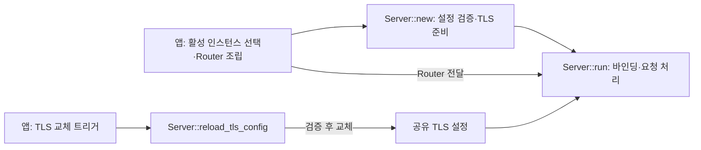

# HTTP·HTTPS 서버 설계

## 연결 문서

| 관계 | 대상 | 설명 |
| --- | --- | --- |
| realizes | [SPEC-HTTP](./spec.md) | 단일 서버 실행·TLS 재로드와 상위 HTTP·HTTPS 조립 |

## 목표와 변경 범위

사용자의 서버 구조 정리 요청과 “설계하고 구현까지만 진행”을 근거로 `Server::new/run/reload_tls_config` 사용 흐름을 적용한다. 요구사항은 [REQ-HTTP-008](./spec.md#req-http-008)에 따른다. 기존 `bind/serve/local_addr/tls_reloader`와 별도 공개 `TlsReloader`는 제거한다. 앱 호출부와 테스트도 함께 이행한다. (확인·결정)

비교용 구현 파일과 공개 모듈 등록은 제거한다. `http.rs`의 실험용 `Server2`를 최종 `Server`로 통합하며 라이브러리 신호 처리 함수를 제거한다. 새 의존성은 추가하지 않고 기존 tracing 의존성 이동은 유지한다. (결정)

## 책임과 소유권



| 대상 | 소유·책임 |
| --- | --- |
| 앱 | 인스턴스 선택, Router 조립, 실행·실패·종료 조정, 프로세스 신호 처리 |
| `Server` | 변경 불가한 설정 복사본, 선택적 RustlsConfig·재로드 mutex·종료 제어 Handle. TLS 파일 경로·종료 기한은 Config에 보관 |
| `run()` future | 호출마다 생성한 리스너·Router·종료 가드 |
| `keyfiles` | 인증서·개인키 읽기·검증과 명시적 개발용 생성 |
| 상위 인프라 | 외부 트래픽 드레이닝과 즉시 연결 차단 |

`run(&self, ...)`와 `reload_tls_config(&self)`가 같은 서버를 빌려 사용한다. 서로 다른 task로 넘길 때 호출자가 `Arc<Server>`를 사용할 수 있다. `Server` 자체의 복제나 별도 공개 재로드 객체는 필요하지 않다. `TlsState` 없이 `Server`에 `Config`, `Option<RustlsConfig>`, 재로드 mutex와 종료 제어용 `Handle`을 둔다. 설정·TLS 필드는 비공개로 두어 초기 검증 후 외부 변경에 따른 불일치를 막는다. (결정·추론)

## 공개 설정과 API

```rust
pub struct Config {
    pub bind: SocketAddr,
    pub tls: Option<TlsCertFile>,
    pub shutdown_timeout_secs: u64,
}

pub struct StaticFilesConfig {
    pub prefix: String,
    pub directory: PathBuf,
}

impl StaticFilesConfig {
    pub fn router<S>(&self) -> crate::Result<axum::Router<S>>
    where
        S: Clone + Send + Sync + 'static;
}

impl Server {
    pub async fn new(config: &Config) -> crate::Result<Self>;
    pub async fn run(&self, router: axum::Router) -> crate::Result<()>;
    pub fn graceful_shutdown(&self);
    pub async fn reload_tls_config(&self) -> crate::Result<()>;
}
```

| API·입력 | 계약 |
| --- | --- |
| `new` | 종료 기한 검증, 설정 복사, 선택적 TLS 준비. 포트는 열지 않음 |
| `run` | Router를 받아 호출마다 바인딩하고 실행. 바인딩·실행·종료 오류는 호출자에게 전달 |
| `reload_tls_config` | 최초 설정의 동일 경로에서 검증한 TLS만 교체. TLS 미설정이면 `IllegalState` |
| `bind` | 숫자 IP·포트. 포트 0은 지원하지만 실제 할당 주소를 공개 API로 조회하지 않음 |
| `tls` | 생략 시 HTTP, 설정 시 HTTPS. `TlsCertFile` 직접 사용 |
| `shutdown_timeout_secs` | 기본 30초. 0 또는 종료 기한으로 표현할 수 없는 값은 `InvalidInput` |
| `StaticFilesConfig` | 기존 고정 비루트 접두사·존재하는 디렉터리 검증과 Router 생성 유지 |

모든 설정은 `Deserialize`와 `deny_unknown_fields`를 유지한다. 소비자 조립 예시에서는 HTTP 블록의 TLS 미설정·HTTPS 블록의 TLS 필수·하나 이상 활성화를 앱이 검증한다. 라이브러리는 인스턴스 하나만 처리한다. 현재 `tlab-app`은 `server.http`와 `server.https`를 모두 필수로 요구하며 실제 앱 정책은 [SPEC-HTTP-APP](./app/spec.md#req-http-app-001)을 따른다. (확인)

정적 파일 Router는 상태 주입 전 `Router<S>`에 병합할 수 있다. 서버의 `run`에는 상태 주입이 끝난 `Router<()>`를 전달한다. (확인)

Server 하나는 한 번의 실행에 사용한다. 종료 제어용 Handle을 Server가 소유하므로 종료 후에는 새 Server를 만든다. 바인딩 실패처럼 실행이 시작되지 않은 경우에는 충돌 해소 후 다시 호출할 수 있다. 동시 run은 지원 계약에 포함하지 않는다. (결정)

## 앱 조립과 호환성

```rust
let http = http::Server::new(&http_config).await?;
let https = http::Server::new(&https_config).await?;

tokio::try_join!(
    http.run(router.clone()),
    https.run(router),
    async {
        shutdown_signal().await?;
        http.graceful_shutdown();
        https.graceful_shutdown();
        Ok::<(), tlab::Error>(())
    },
)?;
// 앱이 별도 제어 경로에서 https.reload_tls_config().await? 호출 가능.
```

앱은 모든 TLS 준비를 완료한 다음 `run`들을 함께 기다린다. 바인딩은 실행 단계에서 진행하므로 **모든 포트를 확보한 뒤 요청 처리를 시작한다는 기존 보장은 제거한다**. 한 실행이 바인딩 또는 실행 중 실패하면 앱의 `try_join!`이 나머지 실행 future를 drop하여 종료를 요청한다. 잠깐의 부분 기동 가능성은 이 인터페이스 선택의 제약이다. (결정)

기존 API 호출자는 새 호출로 옮겨야 하며 호환 래퍼는 추가하지 않는다. 앱의 “시작 중” 로그와 각 `run`의 실제 바인딩 주소 로그를 구분한다. 포트 0을 사용하는 테스트는 테스트 전용 포트 예약과 연결 준비 대기로 구성하며, 생산 코드에 주소 조회·테스트용 실행 API를 추가하지 않는다. (결정)

## TLS와 종료 동작

- 키파일 읽기·검증·개발용 생성은 기존 `TlsCertFile::load()`를 `spawn_blocking`에서 호출한다. 그 PEM 스냅샷을 초기 준비는 `RustlsConfig::from_pem`, 재로드는 `reload_from_pem`에 전달한다. 직접 PEM 파싱·ServerConfig 조립을 수행하는 `load_tls()`는 제거한다.
- 초기 상대 경로는 작업 디렉터리 기준 절대 경로로 고정한다. 재로드는 인자를 받지 않고 원래 경로만 사용하며 `generate_if_missing = false`를 강제한다.
- mutex로 재로드를 직렬화한다. 키파일 blocking 작업은 자료를 반환할 뿐 활성 설정을 교체하지 않는다. `reload_from_pem`도 새 설정 생성을 기다린 뒤 await 없이 활성 설정을 교체한다. 실패·교체 전 취소 시 기존 자료를 유지한다. 잠금 버전 axum-server 0.8.0 소스에서 확인했다. (확인)
- 현재 워크스페이스는 ring provider만 활성화하며 Rustls의 기본 provider 선택을 사용한다. ALPN `h2`, `http/1.1` 설정은 axum-server에 맡긴다. 새 설정은 백엔드가 설정을 취득하는 새 핸드셰이크에 적용하며 기존 연결을 끊지 않는다.
- run은 종료 future를 받지 않고 실행만 담당한다. 앱이 OS 신호를 기다린 뒤 각 서버의 graceful_shutdown()을 직접 호출한다. 별도 신호 대기 task나 watch 채널은 만들지 않는다.
- graceful_shutdown()은 소유한 Handle의 `graceful_shutdown(Some(설정 기한))`을 호출하고 즉시 반환한다. 앱은 run을 계속 기다려 종료 완료를 확인한다. 종료 기한의 강제 종료는 axum-server에 맡기며 기한 초과를 별도 오류로 변환하지 않는다. 실행 오류는 그대로 반환하고, future drop 시 종료 가드가 연결 종료를 요청한다. 별도 `serve_until_shutdown` helper는 제거한다.
- 미완료 TLS 핸드셰이크는 백엔드 timeout을 따른다. 즉시 연결 종료는 인프라 책임이며 종료 future의 drop만으로 비동기 정리 완료를 보장하지 않는다. (결정)

## 정적 파일과 오류

기존 `StaticFilesConfig::router()` 검증과 `ServeDir` 구성을 유지한다. 접두사의 동적 구간·경로 이탈·제어문자 등을 거부하고 디렉터리를 정규화한다. GET·HEAD·index.html, 미존재 404·다른 메서드 405를 유지한다. 심볼릭 링크는 파일시스템 의미를 따른다. (결정)

입력 오류는 `InvalidInput`, TLS 미설정 재로드는 `IllegalState`, 파일·바인딩·백엔드 실패는 기존 `tlab::Result`와 원인 문맥으로 전달한다. 키파일의 기존 오류 분류를 보존하고 비밀 자료를 진단 문자열에 포함하지 않는다. (결정)

키파일 자료를 받은 뒤 파일을 다시 읽는 `from_pem_file/reload_from_pem_file` 대신 메모리 PEM API를 사용한다. 기존 키파일 계약을 지키면서 검증한 스냅샷을 그대로 사용하기 위한 선택이다. API는 [RustlsConfig 공식 문서](https://docs.rs/axum-server/0.8.0/axum_server/tls_rustls/struct.RustlsConfig.html)에 따른다. (결정)

## 구현 확인 방법

기존 통합 테스트를 새 API로 이행하여 HTTP·HTTPS 공통 Router, 정적 파일, TLS 교체·실패·기존 연결 보존, 종료 기한·실행 취소를 확인한다. 생성 시 미바인딩과 실행 시 포트 충돌·재실행을 검증한다. 재로드 취소 단위 테스트를 유지한다. 제거한 종료 helper의 합성 오류 테스트는 제거하고 실행 실패·취소는 공개 API 통합 테스트로 확인한다. `cargo fmt --all -- --check`, `cargo test --workspace --locked`, `cargo clippy --workspace --all-targets --locked -- -D warnings`를 사용한다. 별도 정식 리뷰는 이번 요청 범위에 포함하지 않는다. (결정)

## 구현·변경 기록

### 설계 초안 작성

- 사용자 요청 “설계 진행해”를 근거로 요구사항 승인과 설계 진행을 기록했다.
- 서버 준비·실행, TLS 변경용 객체의 소유권, 검증 후 설정 교체, 종료·취소와 정적 파일 Router 조립 계약을 작성했다.
- 정적 파일 보조 함수는 새 Router를 반환하고 상위에서 병합하는 안으로 구체화했다. 입력 Router를 함수 내부에서 수정하는 최초 초안과의 차이를 본문에 반영했다.
- 로컬 Axum·axum-server·tower-http 소스와 공식 API 문서를 대조하고, 문서 링크와 TOML 예시 문법을 확인했다. 컴파일·서버 실행 검증 결과로 기록하지 않는다.
- 상태: 설계안 검토 대기. 구현·앱 연결·의존성 변경은 미수행이다.

### 재설계 — 책임과 인터페이스 정리

- 계기: 사용자의 복잡도·인터페이스 정리 요청.
- 변경: 설계를 `plan.md`로 분리하고 요구사항은 `spec.md`에 유지했다. 서버 생성은 `Server::bind(config, router)`, 정적 생성은 `StaticFilesConfig::router()`, 실행은 `serve(shutdown)`으로 정리했다.
- 유지: 단일 최종 Router, 설정 구조, 별도 TLS 재로드 객체, 검증 후 교체, 앱의 트리거·생명주기 책임.
- 보완: future drop과 완료를 기다리는 종료의 보장을 구분하고, 기존 키파일 오류 분류를 보존했다.
- 상태: 재설계 제안 작성. 코드·의존성·앱 설정은 변경하지 않았다. (확인)

### 1차 구현·리뷰

- 승인 근거: 사용자의 “구현및 리뷰 진행” 요청. 문서 상태를 `accepted`로 변경했다.
- 구현: `tlab::http` 공개 모듈, 설정 타입, 정적 Router 생성, HTTP·HTTPS 준비·실행·종료, TLS 재로드와 의존성을 추가했다. 앱 연결·설정 변경은 포함하지 않았다.
- 사용자 후속 의견: `load_tls()`는 초기화와 재로드 모두에서 사용하며 동기 파일 I/O·파싱·검증을 `spawn_blocking`으로 분리한다. 활성 설정 교체는 비동기 호출에 남긴다.
- 책임 단순화: 사용자 의견에 따라 `CancelAccept`와 연결별 취소 감시·박싱을 제거했다. TLS accept의 timeout은 백엔드, 즉시 연결 차단은 상위 인프라의 책임으로 본문과 테스트를 수정했다.
- 리뷰 보완: graceful shutdown 중 한 서버가 실패한 경우에도 남은 서버를 종료하고 join한 뒤 반환하도록 수정하고 재현 테스트를 추가했다.
- 결과·남은 범위: [검증 및 리뷰](./verification.md) 참조. 커밋·배포는 하지 않았다. (확인)

### 후속 구조 변경 — 단일 서버와 상위 다중 인스턴스

- 근거: 사용자의 단일 서버 구현체·상위 HTTP/HTTPS 인스턴스 관리 제안과 “반영해줘” 요청.
- 변경: `Config`를 `bind`·선택적 `tls`·종료 기한으로 축소했다. `Server`는 리스너 하나를 소유하고 주소 조회를 `local_addr()`로 통합했다.
- 제거: 라이브러리의 HTTP/HTTPS 설정 집합, 정적 파일 설정 소유, 다중 서버 supervisor·JoinSet·서버 task 생성. TLS 재로드와 정적 Router 생성은 독립 기능으로 유지했다.
- 상위 책임: 활성 인스턴스 선택, 같은 Router 전달, 전체 준비 후 실행, 부분 실패·동시 종료 정책. 앱 집합 설정으로 `server.static_files` 구조를 유지할 수 있다.
- 검증: 상위 준비 실패 시 포트 해제, 같은 Router의 HTTP·HTTPS 응답, 상위 try_join 실패 시 다른 서버 취소를 통합 테스트로 확인한다. 최종 결과는 VER-HTTP에 기록한다. (확인)

### 최종 검증·자체 리뷰 완료

- 최종 코드에서 워크스페이스 테스트 59개 통과, 기존 ignored 5개, 포맷·Clippy 통과. 변경되지 않은 잠금 파일에 대한 audit 통과 결과를 재사용했다.
- 자체 리뷰: 최종 범위에서 결함 발견 없음, 초기 제안 배점 기준 92.5점·R2. 검토 대상 식별값·항목별 근거·미검증 범위는 [VER-HTTP](./verification.md)에 기록했다.
- 실제 앱 연결·부하 측정·PostgreSQL 실연동은 이번 결과에 포함하지 않는다. (확인)


### 서버 인터페이스 정리

- 승인·범위: 사용자의 “설계하고 구현까지만 진행”에 따라 요구사항 승인과 설계·구현을 함께 수행했다. 별도 자체 점검·정식 리뷰·커밋은 진행하지 않았다.
- 구현: `new/run/reload_tls_config`로 통합하고 앱 호출부·테스트·문서 예제를 옮겼다. 비교용 구현 파일·모듈 등록과 실험용 `Server2`·라이브러리 신호 처리를 제거했다.
- 후속 의견 반영: 직접 TLS 설정을 구성하는 `load_tls()`를 제거하고 RustlsConfig의 PEM API를 사용한다. `TlsState`도 제거하고 설정·TLS를 Server에 직접 보관한다. `run`의 별도 종료 helper·외부 timeout을 제거하고 axum-server의 graceful shutdown 기한을 사용한다.
- 계약 변경: 바인딩은 run에서 진행한다. 여러 리스너의 동시 준비 보장과 실행 전 주소 조회는 제거한다. 종료 기한 후 강제 종료도 백엔드 결과에 따라 `Ok(())`로 반환한다.
- 구현 확인: [최신 확인 결과](./verification.md#서버-인터페이스-정리-구현-확인). 테스트의 실제 소켓 연결은 샌드박스 바인딩 차단으로 승인된 실행 환경에서 수행했다. (확인)


### 상위의 명시적 종료 제어

- 사용자 요청에 따라 run의 shutdown 인자·종료 대기를 제거하고 graceful_shutdown()을 공개했다. Handle은 Server가 소유하며 앱이 종료 요청을 보내고 run 완료를 기다린다.
- 앱의 watch 채널을 제거했다. HTTP·HTTPS 실행과 OS 신호 대기를 try_join으로 조립하고, 신호 수신 시 두 서버의 graceful_shutdown()을 호출한다.
- Server는 한 번의 실행에 사용하며 종료 후 재실행은 새 인스턴스로 진행한다. 바인딩 실패 후 재시도는 가능하다. (결정)

### HTTP-03·05: 공개 API와 소비자 범위 명시

사용자 요청으로 정적 Router의 상태 제네릭·제약을 API 표에 반영하고 상태 주입 전 병합과 최종 Router 전달을 구분했다. 선택적 서버 구성은 라이브러리 소비자 예시이며 현재 앱은 HTTP·HTTPS 두 설정이 필수임을 명시했다. 문서·소스 대조와 링크·diff 검사를 수행했고 실행 동작은 변경하지 않았다. (확인)
