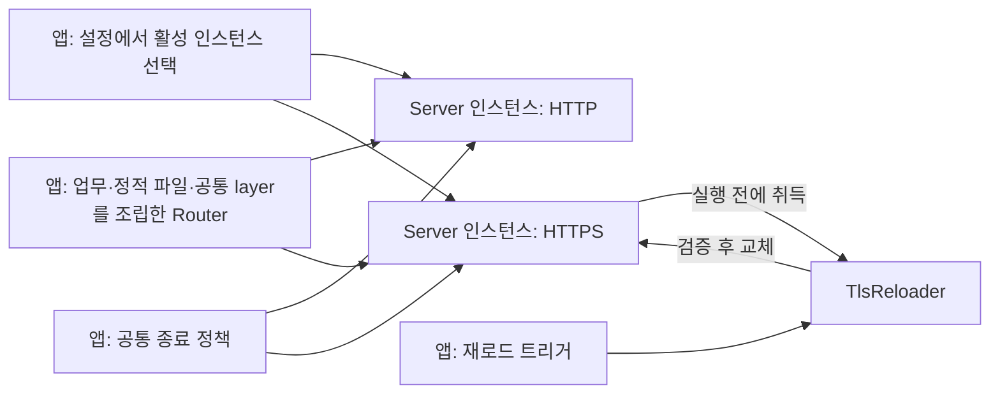

# HTTP·HTTPS 서버 설계

## 연결 문서

| 관계 | 대상 | 설명 |
| --- | --- | --- |
| realizes | [SPEC-HTTP](./spec.md) | 단일 서버 실행과 상위 HTTP·HTTPS 조립 |

## 목표와 현재 구성

[`tlab::http`](../../../tlab/src/http.rs)는 **리스너 하나를 실행하는 `Server`**를 제공한다. TLS 설정이 없으면 HTTP, 있으면 HTTPS로 동작한다.
사용자의 단일 구현체·상위 다중 인스턴스 관리 요청을 반영한 최종 구조다. 별도 HTTP 서버 타입·HTTPS 서버 타입·다중 서버 관리자는 두지 않는다. (확인·결정)

앱은 설정에 따라 인스턴스 수를 정하고 같은 최종 Router를 전달한다. 업무 상태·공통 layer·정적 파일 조립, 모든 인스턴스의 준비와 실행·종료 정책도 앱 책임이다.
실제 `tlab-app` 연결은 이번 범위에 포함하지 않는다. 상위 조립 동작은 [통합 테스트](../../../tlab/tests/http.rs)로 검증한다. (확인)

## 책임과 소유권



| 대상 | 소유·책임 |
| --- | --- |
| 앱 | 설정 선택, 정적 파일 연결, 공통 Router 조립, 다중 인스턴스 준비·실행·실패·종료 정책 |
| `Server` | 리스너 하나, Router 하나, 선택적 TLS, 해당 인스턴스의 종료 대기 |
| `TlsReloader` | 해당 인스턴스의 TLS 파일 경로·활성 설정 공유. 리스너·Router는 소유하지 않음 |
| `keyfiles` | 기존 인증서·개인키 로드·검증과 명시적인 개발용 생성 |
| 상위 인프라 | 외부 트래픽 드레이닝과 즉시 연결 차단 |

`Server`는 복제하지 않고 `serve(self, ...)`로 소비한다. `TlsReloader`만 복제하여 실행 중 앱이 호출할 수 있다.
라이브러리는 다른 인스턴스의 존재를 모르며, 서버 감독 task·프로세스 신호 처리기·재로드 트리거를 만들지 않는다. (확인·결정)

## 공개 설정과 API

```rust
pub struct Config {
    pub bind: SocketAddr,
    pub tls: Option<TlsCertFile>,
    pub shutdown_timeout_secs: u64,
}

pub struct StaticFilesConfig {
    pub prefix: String,
    pub directory: PathBuf,
}

impl StaticFilesConfig {
    pub fn router(&self) -> crate::Result<axum::Router>;
}

impl Server {
    pub async fn bind(config: &Config, router: axum::Router) -> crate::Result<Self>;
    pub fn local_addr(&self) -> SocketAddr;
    pub fn tls_reloader(&self) -> crate::Result<TlsReloader>;
    pub async fn serve<F>(self, shutdown: F) -> crate::Result<()>
    where
        F: Future<Output = ()> + Send;
}

impl TlsReloader {
    pub async fn reload(&self) -> crate::Result<()>;
}
```

| 입력 | 계약 |
| --- | --- |
| `bind` | 필수 숫자 IP·포트. 포트 0은 OS 할당 |
| `tls` | 생략 시 HTTP, 설정 시 HTTPS. 기존 `TlsCertFile` 직접 사용 |
| `shutdown_timeout_secs` | 기본 30초. 0·종료 기한으로 표현할 수 없는 값 거부 |
| `StaticFilesConfig.prefix` | 기본 `/static`. 고정된 비루트 URL 접두사 |
| `StaticFilesConfig.directory` | 필수. 존재하는 디렉터리 |

모든 설정 타입은 `Deserialize`와 `deny_unknown_fields`를 적용한다.
`Config`에 `http`, `https`, `static_files`를 넣지 않는다. `server.http`·`server.https`·`server.static_files`라는 앱 설정 구조를 유지하려면 앱이 이 타입들을 포함하는 집합 설정을 정의한다.
해당 앱은 HTTP 블록의 TLS 미설정·HTTPS 블록의 TLS 필수 여부와 모두 비활성화된 상태를 검증한다. 라이브러리는 전달받은 단일 설정의 유효성만 검사한다. (확인·결정)

### 상위 조립 예시

아래는 두 인스턴스가 활성화된 경우의 호출 순서다. `http_config`, `https_config`, `static_files`, `business_router`, `common_layer`, `shutdown`은 앱이 준비한 값이며 `shutdown`은 `watch::Receiver<bool>`이다.
실제 앱은 설정에 따라 한 인스턴스만 실행할 수도 있다. (추론·예시)

```rust
let mut router = business_router;
if let Some(files) = static_files {
    router = router.merge(files.router()?);
}
let router = router.layer(common_layer);

// 모든 준비가 끝나기 전에 serve를 시작하지 않는다.
let http = http::Server::bind(&http_config, router.clone()).await?;
let https = http::Server::bind(&https_config, router).await?;
let tls = https.tls_reloader()?; // 앱의 제어 처리에 전달

async fn stopped(mut signal: tokio::sync::watch::Receiver<bool>) {
    let _ = signal.wait_for(|stop| *stop).await;
}
tokio::try_join!(
    http.serve(stopped(shutdown.clone())),
    https.serve(stopped(shutdown)),
)?;
```

두 번째 준비 실패 시 먼저 준비한 인스턴스를 drop해 포트를 해제한다. 동적 개수라면 앱이 준비된 `Server`를 컬렉션에 소유한다.
위 `try_join!` 정책은 한 실행이 실패하면 다른 실행 future를 drop하여 종료를 요청한다. 실패한 경우에도 다른 인스턴스의 graceful 종료 완료를 기다릴지, 즉시 종료할지는 앱이 선택한다.
라이브러리가 모든 서버에 동일한 실패 정책을 강제하지 않는다. 예시의 조립·실패 취소 동작은 통합 테스트로 확인한다. (확인·결정)

## 작업별 계약

| API | 성공 | 오류·부수 효과 |
| --- | --- | --- |
| `StaticFilesConfig::router` | 검증한 접두사·디렉터리의 Router 반환 | 잘못된 설정은 `InvalidInput`. 디렉터리 생성 없음 |
| `Server::bind` | 초기 TLS와 리스너 하나를 준비한 `Server` 반환. 요청 처리는 아직 시작하지 않음 | 준비 실패 시 해당 리스너 해제. 이미 생성한 개발용 파일은 기존 키파일 계약대로 남을 수 있음 |
| `Server::local_addr` | 준비한 실제 주소 반환 | 조회 시 시스템 호출·실패 없음 |
| `Server::tls_reloader` | 해당 TLS 설정에 연결된 재로드 객체 반환 | TLS 미설정이면 `IllegalState` |
| `Server::serve` | 종료 요청을 받고 해당 서버의 요청을 정리하면 `Ok(())` | 백엔드 실패·예기치 않은 반환·종료 기한 초과는 `Internal` |
| `TlsReloader::reload` | 같은 경로의 인증서·키를 검증한 뒤 한 번에 교체 | 오류·교체 전 취소 시 마지막 성공 설정 유지. 파일 생성 없음 |

입력·상태 오류는 기존 분류를 보존한다. TLS 파일 읽기·검증·바인딩·실행 오류는 원인과 단계·주소 문맥을 가진 `Error::Internal`로 반환한다.
기존 `TlsCertFile::load()`의 `InvalidInput`을 무조건 `Internal`로 바꾸지 않는다. 인증서·개인키 내용을 오류에 포함하지 않고 업무 HTTP 오류 응답 정책은 앱에 남긴다. (확인)

## 내부 동작

### TLS 준비와 재로드

- 초기 준비·재로드 모두 `load_tls()`를 사용한다. 기존 `TlsCertFile::load()`로 읽기·키 일치를 검증한다.
- `spawn_blocking`은 동기 파일 I/O와 PEM 파싱·Rustls 설정 생성을 실행한다. blocking 작업은 새 설정을 반환할 뿐 활성 설정을 바꾸지 않는다.
- 초기 준비 시 상대 파일 경로를 작업 디렉터리 기준으로 고정한다. 재로드는 같은 경로를 사용하고 `generate_if_missing = false`로 강제한다.
- 복제한 reloader 사이의 호출은 mutex로 직렬화한다. 성공한 결과를 받은 비동기 호출이 await 없이 설정을 교체한다. 취소된 blocking 작업이 뒤늦게 끝나도 교체하지 않는다.
- Rustls는 기존 ring provider를 명시하고 ALPN `h2`, `http/1.1`을 설정한다. mTLS·자동 발급·자동 갱신은 추가하지 않는다. (확인)

새 설정은 acceptor가 핸드셰이크용 설정을 취득할 때부터 적용되며 기존 연결은 유지한다.
설정 교체 API와 ALPN은 [공식 문서](https://docs.rs/axum-server/0.8.0/axum_server/tls_rustls/struct.RustlsConfig.html), 설정 취득 위치는 로컬 소스에서 확인했다.
파일 쌍의 외부 교체 자체를 원자적으로 만들지는 않으며 중간 불일치는 기존 설정을 유지한 오류가 된다. (확인)

### 실행과 종료

서버 future와 상위의 종료 future를 함께 기다린다. 종료 요청 시 백엔드의 graceful shutdown을 호출하고 해당 인스턴스의 기한까지 기다린다.
실패·기한 초과·실행 future drop 시 종료 가드가 백엔드의 강제 종료를 요청한다. 라이브러리 내부의 서버 task 생성·JoinSet·다중 서버 supervisor는 없다. (확인)

`CancelAccept`는 사용하지 않는다. 이미 수락된 미완료 TLS 핸드셰이크는 백엔드 기본 timeout 정책을 따른다. 확인한 axum-server 0.8.0의 기본값은 10초이며, 강제 종료 반환 후에도 일부 핸드셰이크가 잠시 남을 수 있다.
즉시 연결 차단은 상위 인프라 책임이다. `Drop`은 비동기 정리 완료까지 기다리지 않으며, 정상 종료 결과를 확인하려면 종료 신호를 전달하고 `serve().await`한다. (확인·결정)

### 정적 파일

`StaticFilesConfig::router()`는 빈 Router에 `ServeDir`를 `nest_service`로 연결한다. 앱이 한 번 병합한 최종 Router를 인스턴스마다 복제해 전달한다.
서버는 정적 파일 설정을 읽거나 서비스를 자동 연결하지 않는다. (확인)

- 접두사는 `/`로 시작하는 고정 비루트 경로다. 매개변수·와일드카드·query·fragment·백슬래시·제어문자·퍼센트 인코딩과 빈/`.`/`..` 구간은 거부하고 끝의 `/`는 제거한다.
- 문서 루트는 존재하는 디렉터리를 정규화한다. 빈 입력·누락·파일 경로는 `InvalidInput`이다.
- GET·HEAD, `index.html`, 미존재 404, 다른 메서드 405를 지원한다. 목록·SPA fallback은 추가하지 않는다.
- URL 경로 이탈 처리는 서비스가 거부한다. 심볼릭 링크는 파일시스템 기본 동작을 따르므로 루트 밖을 가리킬 수 있다.
- 병합 시 업무 경로와의 충돌은 앱의 Axum 조립 오류다. 실행 중 파일 오류는 요청별 HTTP 응답으로 처리한다. (확인)

## 의존성과 검증

`axum` 0.8, `axum-server` 0.8의 `tls-rustls-no-provider`, `tower-http` 0.7의 `fs`, 기존 ring 기반 `rustls`를 사용한다.
실제 잠금 버전·feature는 Cargo.toml·Cargo.lock에 기록한다. 테스트·도구 검사와 리뷰 결과는 [VER-HTTP](./verification.md)에 모은다. (확인)

## 구현·변경 기록

### 설계 초안 작성

- 사용자 요청 “설계 진행해”를 근거로 요구사항 승인과 설계 진행을 기록했다.
- 서버 준비·실행, TLS 변경용 객체의 소유권, 검증 후 설정 교체, 종료·취소와 정적 파일 Router 조립 계약을 작성했다.
- 정적 파일 보조 함수는 새 Router를 반환하고 상위에서 병합하는 안으로 구체화했다. 입력 Router를 함수 내부에서 수정하는 최초 초안과의 차이를 본문에 반영했다.
- 로컬 Axum·axum-server·tower-http 소스와 공식 API 문서를 대조하고, 문서 링크와 TOML 예시 문법을 확인했다. 컴파일·서버 실행 검증 결과로 기록하지 않는다.
- 상태: 설계안 검토 대기. 구현·앱 연결·의존성 변경은 미수행이다.

### 재설계 — 책임과 인터페이스 정리

- 계기: 사용자의 복잡도·인터페이스 정리 요청.
- 변경: 설계를 `plan.md`로 분리하고 요구사항은 `spec.md`에 유지했다. 서버 생성은 `Server::bind(config, router)`, 정적 생성은 `StaticFilesConfig::router()`, 실행은 `serve(shutdown)`으로 정리했다.
- 유지: 단일 최종 Router, 설정 구조, 별도 TLS 재로드 객체, 검증 후 교체, 앱의 트리거·생명주기 책임.
- 보완: future drop과 완료를 기다리는 종료의 보장을 구분하고, 기존 키파일 오류 분류를 보존했다.
- 상태: 재설계 제안 작성. 코드·의존성·앱 설정은 변경하지 않았다. (확인)

### 1차 구현·리뷰

- 승인 근거: 사용자의 “구현및 리뷰 진행” 요청. 문서 상태를 `accepted`로 변경했다.
- 구현: `tlab::http` 공개 모듈, 설정 타입, 정적 Router 생성, HTTP·HTTPS 준비·실행·종료, TLS 재로드와 의존성을 추가했다. 앱 연결·설정 변경은 포함하지 않았다.
- 사용자 후속 의견: `load_tls()`는 초기화와 재로드 모두에서 사용하며 동기 파일 I/O·파싱·검증을 `spawn_blocking`으로 분리한다. 활성 설정 교체는 비동기 호출에 남긴다.
- 책임 단순화: 사용자 의견에 따라 `CancelAccept`와 연결별 취소 감시·박싱을 제거했다. TLS accept의 timeout은 백엔드, 즉시 연결 차단은 상위 인프라의 책임으로 본문과 테스트를 수정했다.
- 리뷰 보완: graceful shutdown 중 한 서버가 실패한 경우에도 남은 서버를 종료하고 join한 뒤 반환하도록 수정하고 재현 테스트를 추가했다.
- 결과·남은 범위: [검증 및 리뷰](./verification.md) 참조. 커밋·배포는 하지 않았다. (확인)

### 후속 구조 변경 — 단일 서버와 상위 다중 인스턴스

- 근거: 사용자의 단일 서버 구현체·상위 HTTP/HTTPS 인스턴스 관리 제안과 “반영해줘” 요청.
- 변경: `Config`를 `bind`·선택적 `tls`·종료 기한으로 축소했다. `Server`는 리스너 하나를 소유하고 주소 조회를 `local_addr()`로 통합했다.
- 제거: 라이브러리의 HTTP/HTTPS 설정 집합, 정적 파일 설정 소유, 다중 서버 supervisor·JoinSet·서버 task 생성. TLS 재로드와 정적 Router 생성은 독립 기능으로 유지했다.
- 상위 책임: 활성 인스턴스 선택, 같은 Router 전달, 전체 준비 후 실행, 부분 실패·동시 종료 정책. 앱 집합 설정으로 `server.static_files` 구조를 유지할 수 있다.
- 검증: 상위 준비 실패 시 포트 해제, 같은 Router의 HTTP·HTTPS 응답, 상위 try_join 실패 시 다른 서버 취소를 통합 테스트로 확인한다. 최종 결과는 VER-HTTP에 기록한다. (확인)

### 최종 검증·자체 리뷰 완료

- 최종 코드에서 워크스페이스 테스트 59개 통과, 기존 ignored 5개, 포맷·Clippy 통과. 변경되지 않은 잠금 파일에 대한 audit 통과 결과를 재사용했다.
- 자체 리뷰: 최종 범위에서 결함 발견 없음, 초기 제안 배점 기준 92.5점·R2. 검토 대상 식별값·항목별 근거·미검증 범위는 [VER-HTTP](./verification.md)에 기록했다.
- 실제 앱 연결·부하 측정·PostgreSQL 실연동은 이번 결과에 포함하지 않는다. (확인)
