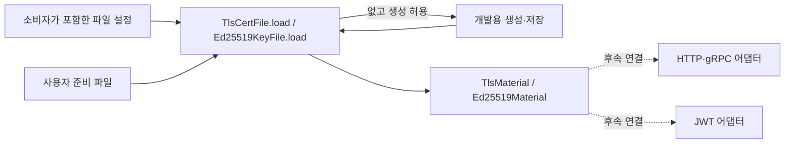

# 키 파일 관리

## 연결 문서

| 관계 | 대상 | 설명 |
| --- | --- | --- |
| follows | [아키텍처 개요](../../architecture/index.md) | 공통 기능은 라이브러리가 제공하고 앱이 초기화와 생명주기를 관리 |

## 진행 상태와 적용 판단

- 요구사항 정리: 승인. 사용자의 “설계진행해”를 근거로 현재 요구사항을 설계 기준으로 삼는다.
- 설계: 승인. 사용자의 “구현및 리뷰까지 진행해”를 근거로 최종 설계의 구현·검증·리뷰 진행을 승인받았다.
- 구현·검증 / 자체 점검·정식 리뷰: 완료. 중간 승인 대기 없이 구현과 리뷰까지 진행하라는 사용자 요청에 따라 수행했으며 아래에 결과를 기록한다.
- 변경 전에는 키 관리와 HTTP·gRPC·JWT 소비자가 없었다. 이번에는 키파일 모듈만 추가하며 앱은 기존 설정 로드와 tracing 초기화까지만 수행한다. (확인)
- 새 공개 계약과 영속 키 생성·보존 정책이 필요하므로 작은 변경의 약식 구현 대상으로 확정하지 않는다. `small-change`의 전환 기준에 따라 요구사항 정의로 연결하며, 문서는 하나로 유지한다. 설계 시 책임·계약·복구 조건을 검토하고 기존 단계별 승인 방식을 이어간다. (추론)

## 목적·사용 방식·범위

애플리케이션이 TLS와 JWT 등에 사용할 키 파일을 설정으로 선언하고, 기존 파일을 읽거나 명시적인 옵션에 따라 없을 때 생성한다.
HTTP·gRPC·JWT 소비자가 동일한 파일 관리 코드를 중복 구현하지 않고 준비된 자료를 참조하도록 한다. 사용자가 요청한 방향이다. (확인)

실제 사용의 기본 경로는 사용자가 별도로 생성·준비한 인증서와 키 파일을 지정해 참조하는 것이다.
없는 파일의 자동 생성은 개발 편의를 위한 보조 기능이며, 운영 인증서의 발급·갱신을 대신하지 않는다.
사용자가 생성한 파일을 읽기 위해 이 기능의 생성 옵션이나 생성 전용 설정을 요구하지 않는다. (확인·추론)

이번 단계에서는 키파일 관리 요구사항과 향후 사용 시나리오를 정리한다.
지정 파일이 있으면 사용하고, 없으면 생성 옵션이 활성화된 경우에만 생성하며 그렇지 않으면 오류로 처리한다.
HTTP·gRPC·JWT의 실제 소비 기능 연결은 후속 작업이다. 사용자가 직접 확인한 범위다. (확인)

다음은 요구사항 승인에 따라 설계 기준으로 삼는 범위다. (확인)

- 공통 키파일 관리 기능은 `tlab`에 둔다. 앱에서 준비하는 시점과 연결 코드는 후속 설계·구현에서 정한다.
- `TlsCertFile`과 `Ed25519KeyFile`을 제공하고 소비자 설정이 해당 타입을 직접 포함한다. 별도 `keyfiles` 설정 묶음, 이름별 맵·저장소·조회 API는 두지 않는다.
- 키파일 관리는 파일의 종류와 읽기·생성만 다루며 HTTP·gRPC·JWT 등의 소비 용도를 알지 않는다. 설정 배치와 준비한 자료의 소유·공유는 소비자와 앱이 결정한다. (확인)
- TLS와 JWT의 키는 용도별로 별도 선언한다. HTTP와 gRPC가 같은 TLS 자료를 공유하는 것은 허용한다.
- 이번 정리에는 실제 소비 기능과 앱 초기화 연결의 구현을 포함하지 않는다.
- 인증서 자동 갱신, 키 교체, ACME·CA 운영, 원격 비밀 저장소, 암호화된 개인키, mTLS 신뢰 저장소는 이번 범위에서 제외한다.

## 용어와 형식

- `PKCS_ED25519`는 rcgen에서 사용하는 Ed25519 서명 알고리즘 식별자이며 파일 형식 이름이 아니다. [rcgen 문서](https://docs.rs/rcgen/latest/rcgen/)에서 확인했다. (확인)
- Ed25519 설정은 사용자가 개인키·공개키 파일을 모두 지정할 수 있도록 두 경로를 필수 필드로 제공한다. 사용자의 명시적인 요청이다. (확인)
- Ed25519 키의 저장 형식과 알고리즘은 구분한다. 개인키는 PKCS#8 PEM, 공개키는 SPKI PEM으로 읽고 저장한다. [RFC 8410](https://www.rfc-editor.org/rfc/rfc8410.html)을 형식 판단의 근거로 사용한다. (확인·추론)
- TLS 자료는 개인키와 X.509 인증서 체인을 포함한다. JWT용 서명 키에는 TLS 인증서가 필요하지 않다. TLS에서 지원할 키 알고리즘은 소비자 호환성을 고려해 설계에서 명시한다. (추론)

## 요구사항과 검증 조건

사용자 준비 파일 참조를 기본으로 하고 자동 생성은 개발 편의 기능으로 제공하며, 파일 존재·생성 옵션에 따라 동작한다.
아래 요구사항은 승인된 설계 기준으로 취급한다. (확인)
검증 조건은 향후 구현 후 확인할 기준이며, 현재 검증을 완료했다는 의미가 아니다. (확인·추론)

<a id="req-keyfiles-001"></a>
### REQ-KEYFILES-001: 재사용 가능한 파일 설정 타입

- TLS 자료와 Ed25519 서명 키를 구분하는 파일 설정 타입으로 파일 경로와 없을 때 생성 여부를 설정한다.
- Ed25519에는 `private_key`와 `public_key` 경로를 모두 필수로 둔다. (확인)
- 생성 옵션의 기본값은 비활성화한다. 상대경로는 기존 앱과 동일하게 작업 디렉터리 기준으로 해석한다.
- 기존 파일 참조에 필요한 설정과 개발용 생성에만 필요한 설정을 구분한다. 인증서 생성용 이름·유효기간 등은 기존 파일만 참조하는 경우 필수로 요구하지 않는다.
- 소비자는 필요한 파일 설정 타입을 자신의 설정에 직접 포함하고 `load()`로 자료를 준비한다. 키파일 모듈이 소비 용도나 자료 식별자 연결을 관리하지 않는다.
- 검증 조건: 소비자별 설정 구조에 같은 파일 설정 타입을 재사용할 수 있고, 필수 경로·기본값·오타 처리와 반환 자료 타입이 계약과 일치하는지 확인한다.

<a id="req-keyfiles-002"></a>
### REQ-KEYFILES-002: 기존 파일 로드와 검증

- 기존 파일이 있으면 읽고 검증해 사용하며 파일 내용을 변경하지 않는다.
- 사용자가 외부 도구로 준비한 인증서·키도 지원하는 형식에 맞으면 사용한다. 자체 생성한 자료로 사용 대상을 제한하지 않는다.
- 생성 옵션이 활성화되어 있어도 기존 파일을 새로 생성하거나 교체하지 않는다. 존재 여부와 생성 옵션의 분기는 사용자 확인 사항이다. (확인)
- 읽기 실패, 잘못된 형식·알고리즘, TLS 개인키와 인증서 또는 Ed25519 개인키와 공개키의 불일치는 오류로 반환한다.
- 인증서 유효기간·호스트·신뢰 체인 검증 중 이 계층이 책임질 범위는 설계에서 소비자 책임과 구분한다.
- 검증 조건: 재실행 시 같은 키 유지, 손상된 자료와 불일치한 TLS 자료의 거부, 실패 시 기존 파일 보존을 확인한다.

<a id="req-keyfiles-003"></a>
### REQ-KEYFILES-003: 없는 파일의 선택적 생성

- 생성이 비활성화된 상태에서 필요한 파일이 없으면 실패한다.
- 생성이 활성화되고 해당 자료의 파일이 모두 없으면 생성·저장한 뒤 로드 가능한 자료를 반환한다.
- 위 생성 옵션에 따른 동작은 사용자 확인 사항이다. (확인)
- 자동 생성은 개발 편의 기능이다. 운영 인증서 발급·갱신이나 키 교체 기능으로 확장하지 않는다. (확인)
- TLS 또는 Ed25519 자료의 두 파일 중 하나만 존재하거나 기존 자료가 잘못된 경우 자동 재생성하거나 덮어쓰지 않고 실패한다.
- TLS 자동 생성은 개발·로컬용 자체 서명 인증서로 제한하고, 생성 대상 DNS 이름·IP 주소와 유효기간을 설정으로 표현한다.
- 검증 조건: 생성 비활성화 시 파일 미생성, 활성화 시 생성 성공, 재시작 시 재사용, 부분 존재·손상 시 기존 파일 보존을 확인한다.

<a id="req-keyfiles-004"></a>
### REQ-KEYFILES-004: 개인키 보호와 생성 실패 처리

- 개인키 내용은 로그·오류 메시지·일반 디버그 출력에 포함하지 않는다.
- 생성 파일은 기존 파일을 덮어쓰지 않는다. 동시 생성에서도 다른 실행 주체가 만든 키를 교체하지 않는다.
- Unix에서는 새 개인키를 소유자만 읽고 쓸 수 있는 권한으로 생성한다. 다른 플랫폼의 보호 범위는 설계에서 명시한다.
- 여러 파일의 생성 중 실패하거나 중단된 경우 완성된 자료로 반환하지 않는다. 남을 수 있는 파일과 재실행 시 복구 방법은 설계에서 정한다.
- 검증 조건: 파일 권한, 덮어쓰기 방지, 중간 실패 시 오류 반환과 기존 파일 보존, 비밀값이 출력되지 않는 것을 확인한다.

<a id="req-keyfiles-005"></a>
### REQ-KEYFILES-005: 향후 소비자의 참조

- HTTP·gRPC·JWT는 후속 작업에서 준비된 자료를 참조한다. 실제 소비 기능 연결은 이번 범위에 포함하지 않는다. (확인)
- 키파일 관리 기능은 읽기·생성 실패를 호출자에게 오류로 전달하고, 유효한 자료만 제공한다.
- 검증 조건: 향후 키파일 관리 인터페이스에서 준비 성공·실패와 자료 접근을 확인한다. 앱·서버·JWT의 실제 연동 검증은 후속 작업에서 수행한다.

## 주요 시나리오

| 상황 | 기대 결과 | 관련 요구사항 |
| --- | --- | --- |
| 사용자가 준비한 유효한 자료가 이미 존재 | 생성 전용 설정 없이 원본 보존 후 참조 가능 | 001, 002 |
| 파일 없음, 생성 비활성화 | 오류, 파일 미생성 | 003 |
| 개발 중 파일 없음, 생성 활성화 | 개발용 자료를 생성·저장 후 참조 가능, 재시작 시 동일 키 유지 | 002, 003 |
| TLS 또는 Ed25519 파일 일부만 존재하거나 자료 손상 | 자동 교체 없이 오류 | 002, 003 |
| 동시 생성 또는 저장 중 실패 | 기존 키 보존, 불완전 자료를 성공으로 반환하지 않음 | 004 |
| 소비자가 자신의 파일 설정으로 자료 준비 | 해당 타입의 `load()`가 검증된 자료 반환 | 001, 005 |

## 향후 사용 시나리오

아래는 소비 기능의 요구사항 확정이나 현재 구현 약속이 아닌, 키파일 관리 책임을 구분하기 위한 사용 시나리오다. (추론)

| 소비자 | 사용 흐름 | 키파일 관리와의 경계 |
| --- | --- | --- |
| HTTP 서버 | 준비된 TLS 개인키와 인증서 체인을 참조해 TLS 설정 구성 | 서버 기동과 TLS 연결 처리는 HTTP 기능의 책임 |
| gRPC 서버 | TLS 자료를 참조해 서버 설정 구성. 필요하면 HTTP와 같은 자료 공유 | 프로토콜·전송 설정은 gRPC 기능의 책임 |
| JWT 발급 | 준비된 Ed25519 개인키를 참조해 서명기 구성 | 클레임, 만료, 발급 정책은 JWT 기능의 책임 |
| JWT 검증 | 대응하는 공개키를 참조해 검증기 구성 | 허용 알고리즘과 클레임 검증 정책은 JWT 기능의 책임 |
| 앱 시작 | 설정에 따라 필요한 자료를 준비하고 소비자에게 전달 | 초기화 순서와 소유·종료 생명주기는 앱의 책임 |

소비자는 자신의 설정에 파일 설정 타입을 포함하고, 준비된 자료의 PEM을 소비 라이브러리 입력으로 변환한다.
JWT 검증 전용으로 공개키만 로드하는 구성의 필요 여부도 실제 소비 기능을 설계할 때 확인한다. (추론)

## 설계

사용자가 구현·리뷰 진행을 요청해 이 설계를 채택했다. 기존 통합 명세에 이어 관리하고 별도 설계 문서를 중복 생성하지 않는다. (확인)

### 구성과 책임

`tlab::keyfiles` 모듈이 `TlsCertFile`과 `Ed25519KeyFile`, 파일 준비와 최소 검증을 제공한다.
공개 진입점은 [`keyfiles.rs`](../../../tlab/src/keyfiles.rs)에 두고, 내부 구현은 종류별 [`tls.rs`](../../../tlab/src/keyfiles/tls.rs)·[`ed25519.rs`](../../../tlab/src/keyfiles/ed25519.rs), 공통 파일 I/O [`files.rs`](../../../tlab/src/keyfiles/files.rs), PEM 파싱 [`pem.rs`](../../../tlab/src/keyfiles/pem.rs)로 나눈다.
파일 I/O는 시작 시 한 번 수행하는 동기 API로 제공하며, 전역 저장소·파일 감시·자동 갱신은 두지 않는다.
각 파일 설정의 `load()`가 자료를 반환한다. 앱이 결과를 소유하고 필요하면 `Arc<TlsMaterial>` 등으로 공유한다. 실제 앱 연결 코드는 후속 작업이다. (확인·추론)



키파일 모듈은 인증서 신뢰 정책, TLS 서버 설정, JWT 클레임·허용 알고리즘을 결정하지 않는다.
소비 라이브러리의 타입을 공개 API에 노출하지 않고 PEM 자료를 제공한다.
반환 자료는 로드 시점의 스냅샷이며, 디스크 파일이 이후 바뀌어도 자동 반영하지 않는다. (추론)

### 설정 계약

소비자가 `TlsCertFile` 또는 `Ed25519KeyFile`을 원하는 필드에 직접 포함한다.
공통 `Config`나 이름별 맵은 제공하지 않는다. `tlab::keyfiles`는 Rust 모듈 경로이며 설정 파일의 최상위 묶음을 의미하지 않는다.
모든 설정 타입은 알 수 없는 필드를 거부하고, `generate_if_missing`의 기본값은 `false`다. (추론)

아래 HTTP·JWT 필드 배치는 소비자 설정에서의 사용 예시이며, 실제 소비 기능의 공개 계약을 확정하지 않는다.
각 소비자는 다음과 같이 타입을 포함할 수 있다. 이 소비자 타입 자체는 이번에 구현하지 않는다. (추론)

```rust
pub struct HttpConfig {
    pub tls: Option<TlsCertFile>,
}

pub struct JwtConfig {
    pub key: Ed25519KeyFile,
}
```

사용자가 준비한 파일을 참조하는 구성:

```toml
[http.tls]
certificate_chain = "./certs/server-chain.pem"
private_key = "./certs/server-key.pem"

[jwt.key]
private_key = "./keys/jwt-private.pem"
public_key = "./keys/jwt-public.pem"
```

개발 중 생성까지 허용하는 구성:

```toml
[http.tls]
certificate_chain = "./dev-keys/server.pem"
private_key = "./dev-keys/server-key.pem"
generate_if_missing = true

# 생략하면 localhost, 127.0.0.1, ::1 / 30일을 사용한다.
[http.tls.generation]
subject_alt_names = ["localhost", "127.0.0.1", "::1"]
validity_days = 30

[jwt.key]
private_key = "./dev-keys/jwt-private.pem"
public_key = "./dev-keys/jwt-public.pem"
generate_if_missing = true
```

- TLS의 `certificate_chain`, `private_key`와 Ed25519의 `private_key`, `public_key`는 각각 필수 경로다. 상대경로는 작업 디렉터리 기준이다.
- `generation`: TLS에만 있는 선택적 생성 설정. 기존 파일 로드에는 사용하지 않으며, 없어도 개발용 기본값으로 생성할 수 있다.
- 생성하는 TLS 키는 ECDSA P-256, 인증서는 자체 서명 서버 인증서로 고정한다. JWT용 키는 `rcgen::PKCS_ED25519`로 생성한다. TLS 생성에 별도 알고리즘 선택 옵션은 두지 않는다.
- 생성 인증서는 CA가 아니며 `digitalSignature`, `serverAuth` 용도로 설정한다. 유효기간은 생성 시각 5분 전부터 생성 시각 + `validity_days`일까지다.
- 생성이 실제 필요한 때 SAN이 비어 있거나 잘못된 ASCII DNS/IP 값인 경우, 유효기간이 0이거나 시간 범위를 넘는 경우 파일 생성 전에 오류로 반환한다. 와일드카드와 비ASCII DNS 이름은 이번 생성 설정에서 지원하지 않는다.
- 기존 TLS 개인키는 암호화되지 않은 PKCS#8 PEM을 지원한다. RSA·ECDSA P-256/P-384·Ed25519 중 선택한 Rustls ring provider가 처리하는 자료를 읽는다. PKCS#1·SEC1·OpenSSH·암호화된 PEM은 이번 지원에서 제외한다.
- 기존 Ed25519 개인키는 암호화되지 않은 PKCS#8 PEM, 공개키는 SPKI PEM을 지원한다. 사용자가 지정한 두 파일을 읽고 쌍이 맞는지 확인한다. 생성할 때는 하나의 `rcgen::KeyPair`에서 개인키·공개키 PEM을 얻어 지정한 두 파일에 저장한다. (확인·추론)

기본 파일 참조와 생성 정책을 분리하기 위해 `generate_if_missing`과 TLS의 `generation`을 구분한다.
`generation` 블록만 있다고 생성이 활성화되지는 않는다. 이 조합은 기존 자료 참조 시 생성 설정을 요구하지 않으면서 개발용 매개변수만 조정할 수 있게 한다. (추론)

### 공개 인터페이스와 소유권

```rust
pub struct TlsCertFile {
    pub certificate_chain: PathBuf,
    pub private_key: PathBuf,
    pub generate_if_missing: bool,
    pub generation: Option<TlsGenerationConfig>,
}

pub struct Ed25519KeyFile {
    pub private_key: PathBuf,
    pub public_key: PathBuf,
    pub generate_if_missing: bool,
}

impl TlsCertFile {
    pub fn load(&self) -> crate::Result<TlsMaterial>;
}

impl Ed25519KeyFile {
    pub fn load(&self) -> crate::Result<Ed25519Material>;
}

impl TlsMaterial {
    pub fn certificate_chain_pem(&self) -> &str;
    pub fn private_key_pem(&self) -> &str;
}

impl Ed25519Material {
    pub fn private_key_pem(&self) -> &str;
    pub fn public_key_pem(&self) -> &str;
}
```

자료의 필드는 비공개로 두어 호출자는 검증이 끝난 자료만 참조한다.
각 `load()`는 소유된 자료를 반환하고, 자료의 접근 메서드는 내부 PEM의 참조를 반환한다. 비밀 자료를 포함하는 타입에는 내용이 드러나는 `Debug`·`Serialize`를 제공하지 않는다.
미사용 기능은 소비자가 `Option<TlsCertFile>` 등으로 표현하며, `None`이면 해당 소비자가 로드를 호출하지 않는다. 키파일 모듈은 전역 상태를 만들지 않는다. (추론)

후속 소비자는 자신의 파일 설정에 `load()`를 호출하고 반환된 자료를 소비 라이브러리의 입력 타입으로 변환한다.
HTTP와 gRPC가 같은 자료를 공유해야 하면 앱이 한 번 로드한 `TlsMaterial`을 공유한다. 각각 같은 파일을 읽는 것도 허용하지만, 중복 로드·생성 조율은 앱의 책임이다.
키파일 모듈이 JWT 서명 API나 Rustls 서버 설정을 직접 제공하지는 않는다.
개인키 반환은 명시적인 접근이며 호출자가 복사·출력하지 않도록 관리한다. 메모리의 모든 복사본에 대한 자동 소거는 이번 계약에 포함하지 않는다. (추론)

### 로드와 검증

1. 호출된 파일 설정의 두 경로를 먼저 검증한다. 빈 경로와 동일한 두 경로는 `Error::InvalidInput`으로 반환한다. 다른 소비자의 설정까지 수집하거나 중복 검사를 수행하지 않는다.
2. 두 경로의 동일성은 절대경로 변환과 기존 부모 경로 정규화로 검사한다. 하드링크나 실행 중 외부 경로 변경까지 완전히 탐지한다는 보장은 하지 않는다.
3. 경로 메타데이터를 확인한다. `NotFound`만 파일 없음으로 취급하며 권한 오류는 생성으로 대체하지 않는다. 끊어진 심볼릭 링크도 기존 경로의 읽기 오류로 처리한다.
4. TLS의 두 파일이 모두 있으면 읽고 PEM을 파싱한다. 인증서 체인은 비어 있지 않아야 하고 첫 항목은 서버 인증서다. 개인키와 첫 인증서의 공개키가 일치하는지 확인한다.
5. Ed25519 개인키는 알고리즘을 지정해 파싱한다. 공개키 파일은 SPKI PEM 항목 하나로 파싱하고, 개인키에서 도출한 공개키와 SPKI DER 바이트가 일치하는지 확인한다. PEM 줄바꿈 차이는 허용하며 반환값은 사용자가 지정한 파일의 내용이다. PKCS#8 v1/v2 외부 생성 자료의 지원은 독립 fixture로 확인한다.
6. 해당 파일 설정의 준비에 성공한 경우에만 `TlsMaterial` 또는 `Ed25519Material`을 반환한다. 실패하면 자료 종류·경로·단계를 포함한 오류를 반환하며 PEM 내용은 포함하지 않는다. I/O·키 검증 실패에는 문맥을 붙여 기존 `Error::Internal`로 전달하고 원인을 보존한다. PEM 디코더 오류는 입력 줄을 포함할 수 있으므로 원본 오류를 보존하지 않고 비밀값이 없는 메시지로 바꾼다. (확인·추론)

TLS 키 일치 여부는 명시적인 ring provider를 전달한 `rustls::sign::CertifiedKey`와 `keys_match()`로 확인한다.
`from_der()`만으로는 일치 여부를 판정하지 못한 경우도 성공할 수 있으므로, `keys_match()`의 성공을 별도로 요구한다.
provider를 프로세스 기본값으로 설치하지 않아 다른 TLS 소비자의 전역 설정과 충돌하지 않게 한다.
해당 API 동작은 [공식 문서](https://docs.rs/rustls/latest/rustls/sign/struct.CertifiedKey.html)와 로컬 Rustls 0.23.46 소스에서 확인했다. (확인·추론)

PEM 디코딩은 Rustls가 재공개하는 `rustls::pki_types::pem::PemObject`를 사용한다. 인증서·개인키·SPKI 공개키를 구분하고 공개키 일치 여부는 DER로 비교한다. [공식 문서](https://docs.rs/rustls-pki-types/latest/rustls_pki_types/pem/trait.PemObject.html)에서 파싱 API를 확인했다. 별도 PEM 파싱 의존성은 추가하지 않는다. (확인·추론)

이 검증은 파일 형식·키 알고리즘·서버 인증서와 개인키의 일치 여부를 확인하는 범위다.
인증서 만료, 접속 호스트 일치, 체인의 신뢰·서명 검증은 실제 TLS 연결과 소비자 정책의 책임이다.
따라서 로드 성공이 해당 인증서로 모든 TLS 연결이 성공한다는 의미는 아니다. (추론)

### 생성·저장과 실패 계약

| 파일 상태 | 생성 옵션 | 동작 |
| --- | --- | --- |
| 필요한 파일 모두 존재 | 무관 | 로드·검증, 생성 설정으로 기존 파일을 변경하지 않음 |
| 필요한 파일 모두 없음 | 비활성화 | 오류, 디렉터리·파일 미생성 |
| 필요한 파일 모두 없음 | 활성화 | 개발용 생성·검증 후 저장 |
| TLS 또는 Ed25519 파일 하나만 존재 | 무관 | 오류, 기존 파일 유지 |
| 기존 자료 손상·불일치·읽기 실패 | 무관 | 오류, 재생성하지 않음 |

생성이 필요한 경우에만 부모 디렉터리를 만들고 암호학적 난수 생성기로 키를 생성한다.
생성한 전체 자료를 메모리에서 검증한 뒤 각 대상과 같은 디렉터리에 임시 파일을 만들고 기록·동기화한 다음 덮어쓰기 없는 게시 작업으로 대상 경로에 저장한다.
`tempfile::NamedTempFile::persist_noclobber()`를 후보로 사용한다. [공식 문서](https://docs.rs/tempfile/latest/tempfile/struct.NamedTempFile.html#method.persist_noclobber)에서 기존 파일을 덮어쓰지 않는 API를 확인했다. (확인·추론)

- Unix에서 개인키는 처음부터 `0600`으로 생성한다. 기존 파일의 권한은 자동 변경하지 않는다.
- 우선 지원·실행 검증 대상은 macOS·Linux다. Windows의 사용자별 ACL 보호는 이 모듈이 구성하지 않으며, 향후 지원 시 배포 환경에서 관리할 경계를 명시한다.
- TLS와 Ed25519 모두 개인키를 먼저 게시하고 성공한 경우에만 인증서 또는 공개키를 게시한다. 같은 경로로 동시에 생성하면 한쪽이 충돌 오류로 실패할 수 있지만 기존 파일은 덮어쓰지 않는다.
- 두 파일을 하나의 트랜잭션으로 게시하지는 않는다. 개인키 게시 뒤 인증서 또는 공개키 게시가 실패하면 개인키가 남을 수 있다. 반환은 오류이며, 재실행은 부분 존재 오류로 처리한다.
- 작업 중 만든 임시 파일은 정상 오류 경로에서 정리한다. 강제 종료 시 임시 파일이 남을 수 있다. 이미 게시한 대상 파일은 자동 삭제하지 않는다.
- 복구는 사용자가 남은 개인키에 맞는 인증서 또는 공개키를 준비하거나, 개발용으로 이번 시도에서 생성된 파일임을 확인한 뒤 정리하고 재시도하는 방식이다. 사용자 준비 파일을 자동 삭제하지 않는다.
- 앱이 여러 파일 설정을 순서대로 로드하다 후반에 실패해도 앞선 호출이 생성한 파일은 남긴다. 호출 간 트랜잭션은 없으며 생성 옵션을 꺼도 이미 생성한 파일은 유지된다.
- 지원 범위는 사용자가 관리하는 로컬 파일시스템의 디렉터리다. 악의적인 동시 파일 교체나 네트워크 파일시스템 전체에 대한 일관성을 보장하지 않는다. (추론)

코드 롤백은 생성 파일을 없애지 않는다. 구현 승인 시 이 파일 생성·보존 계약도 함께 확인한다. (추론)

### 의존성과 선택 이유

| 의존성 후보 | 역할 | 선택 이유 |
| --- | --- | --- |
| `rcgen` 0.14, 기본 feature 비활성화, `crypto`, `ring`, `pem` | 개발용 인증서·키 생성, 기존 Ed25519 개인키 파싱, 공개키 PEM 도출 | TLS 생성과 Ed25519 처리를 한 라이브러리로 구성 |
| `rustls` 0.23, 기본 feature 비활성화, `ring`, `std` | 기존 TLS 키 로드와 서버 인증서 일치 확인 | 현재 SQLx의 ring 기반 TLS 선택과 일관성 유지 |
| Rustls의 `pki_types::pem` 재공개 API | 기존 PEM 인증서 체인·개인키·SPKI 공개키 읽기 | 유지보수 중단된 `rustls-pemfile` 대신 기존 의존성의 파서를 재사용 |
| `time` 0.3 | 개발 인증서 유효기간 계산 | rcgen의 시간 타입과 일치 |
| `tempfile` 3, 일반 의존성으로 이동 | 동일 디렉터리 임시 저장과 덮어쓰기 방지 | 기존 테스트 의존성을 재사용 |
| 개발 의존성 `ring` 0.17 | 테스트에서 Ed25519 서명의 독립 검증 | 이미 사용하는 암호 provider를 검증에도 사용 |

rcgen의 [KeyPair 문서](https://docs.rs/rcgen/latest/rcgen/struct.KeyPair.html)에서 알고리즘 지정 생성, PKCS#8 PEM 로드와 공개키 PEM 제공을 확인했다.
별도의 Ed25519 라이브러리는 이번 안에서 추가하지 않는다. RSA 키 생성과 범용 알고리즘 선택은 개발 편의 범위를 넘어가므로 제공하지 않는다.
후보 버전은 구현 단계의 해석·컴파일·보안 검사로 확정하며, 이 문서 작성만으로 검증 완료로 간주하지 않는다. (확인·추론)

### 검증 계획

임시 디렉터리에서 공개 인터페이스와 저장된 파일의 관찰 결과를 검증한다. (추론)

| 대상 | 확인할 결과 | 요구사항 |
| --- | --- | --- |
| 설정 로드 | 소비자 구조체에 타입을 직접 포함, 경로만으로 로드 설정 구성, Ed25519의 두 경로 필수 확인, 생성 기본 비활성화, 선택적 생성 설정과 오타 거부 | 001 |
| 외부 준비 자료 | 자체 생성기로 만든 자료 외에 OpenSSL로 준비한 TLS·Ed25519 fixture 로드, 원본 바이트 유지 | 002 |
| 개발용 생성 | TLS SAN·유효기간·키 일치, 저장된 Ed25519 개인키·공개키로 서명·검증 가능, 재로드 시 같은 키 | 002, 003 |
| 자료 검증 실패 | PEM 손상·지원 외 형식·알고리즘·인증서 또는 공개키 불일치 거부, 기존 파일 유지 | 002 |
| 파일 없음·부분 존재 | 생성 비활성화 시 부수 효과 없음, TLS·Ed25519 중 어느 종류든 일부만 존재하면 생성하지 않음 | 003 |
| 저장 실패·동시 생성 | 인증서·공개키 게시 실패 시 개인키 보존과 오류, 경합 시 덮어쓰기 없음, 정상 결과가 반환되면 저장 자료와 일치 | 004 |
| 보호와 재사용 | Unix `0600`, 비밀값 비출력, 타입별 자료 반환, 빈 경로·동일 경로 오류, 같은 파일 설정 타입의 소비자별 재사용 | 001, 004, 005 |

외부 fixture에는 테스트 전용 키만 사용한다. 실제 TLS 연결과 JWT 라이브러리 연동은 후속 기능의 검증으로 남긴다.
구현 후 포맷·Clippy·관련 테스트·의존성 보안 검사를 수행한다. 지금은 문서 작성과 링크 확인만 수행한다. (추론)

### 결정사항과 남은 확인

- 설정은 `TlsCertFile`과 `Ed25519KeyFile`로 제공한다. 소비자가 직접 포함하므로 공통 `Config`, 이름별 맵·저장소·조회 API를 두지 않는다. 사용자가 선택한 단순화 방향이다. (확인)
- 사용자가 준비한 공개키 파일을 지정할 수 있도록 Ed25519 개인키·공개키 경로를 필수로 둔다. 두 파일의 불일치·부분 존재는 자동 보정하지 않고 오류로 처리한다.
- 자료는 PEM으로 제공해 향후 HTTP·gRPC·JWT 라이브러리를 지금 확정하지 않는다.
- 기본 사용을 파일 참조에 두고 생성 매개변수는 TLS 개발용 옵션에만 둔다.
- TLS 개발용 P-256 생성, 기존 PKCS#8 PEM 지원 범위, 두 파일의 비원자적 저장·수동 복구 계약은 구현 승인에 따라 적용했다.
- 사용자가 이미 확인한 파일 존재·생성 정책과 후속 소비 범위는 다시 결정하지 않는다. (추론)

## 검토 기록

- 사용자 확인: 지정 파일이 있으면 사용하고, 없으면 생성 옵션에 따라 생성하거나 오류로 처리한다. 실제 소비 기능은 차후 연결하며 현재는 키파일 내용과 향후 사용 시나리오를 정리한다.
- 사용자 확인: 자동 생성은 개발 편의를 위한 기능이며, 실제 사용은 사용자가 생성·준비한 인증서를 참조하는 형태다. 이 방향을 기본 사용 경로와 개발용 생성 시나리오에 반영했다.
- 이 확인을 반영해 앱 초기화 연결을 현재 구현 범위로 잡았던 제안을 제거하고, 향후 소비 시나리오로 분리했다. 파일 형식과 TLS 자동 생성의 구체 범위는 아직 제안 상태다.
- 설계 단계에서는 문서만 작성했다. 이후 사용자가 구현·리뷰 진행을 승인해 아래 구현 결과를 추가했다. 앱의 소비 기능 연결은 계속 후속 범위로 유지한다. (확인)

## 구현·변경 기록

### 설계 초안

- 근거: 사용자가 “설계진행해”로 요구사항을 승인하고 설계 진행을 요청했다.
- 설정·공개 API·검증·파일 저장과 복구 계약을 기존 통합 명세에 작성했다.
- 상태: 설계 검토 대기. 라이브러리 API는 문서·일부 로컬 소스로 확인했으며, 실제 컴파일·키 생성·실행 검증은 미수행이다.

### 설계 보완: 공개키 파일 경로

- 근거: 사용자가 공개키도 지정·사용할 수 있도록 설정 필드로 저장할 것을 요청했다.
- 변경: Ed25519의 `public_key` 경로를 필수로 추가하고, 기존 파일의 키 쌍 검증·두 파일 생성·부분 실패 처리와 검증 계획에 반영했다.
- 상태: 문서 반영 완료. 공개키 경로 추가는 사용자 확인 사항이며, 설계 전체는 여전히 승인 대기다. 코드·의존성 변경은 없다. (확인)

### 설계 보완: 자료 식별자와 소비 용도 분리

- 근거: 사용자가 `keyfiles`는 TLS·Ed25519 자료만 제공하고 web·gRPC 등의 사용 용도는 소비자가 정해야 한다고 명시했다.
- 변경: 설정 예시를 용도를 암시하지 않는 `primary`로 바꾸고, 식별자는 임의의 이름이며 소비자와의 연결은 소비자 설정·앱의 책임임을 명시했다.
- 상태: 문서 반영 완료. 설계 전체는 승인 대기이며 코드 변경은 없다. (확인)

### 설계 보완: 파일 설정 타입의 직접 사용

- 근거: 사용자가 별도 `keyfiles` 설정 묶음 대신 `TlsCertFile`·`Ed25519KeyFile`을 소비자가 직접 포함하는 안을 선택하고 설계 반영을 요청했다.
- 변경: 앞선 이름별 맵·식별자 조회 안을 대체했다. 설정 타입별 `load()`와 자료 반환으로 단순화하고, 호출 간 조율·자료 공유는 앱의 책임으로 정리했다. 요구사항·시나리오·도식·API·검증 계획을 함께 갱신했다.
- 상태: 문서 반영 완료. 이 구조 선택은 사용자 확인 사항이며, 전체 설계의 구현 승인을 뜻하지 않는다. 코드·의존성은 변경하지 않았다. (확인)

### 1차 구현: 파일 설정 타입과 자료 준비

- 근거: 사용자의 “구현및 리뷰까지 진행해”로 최종 설계와 구현·검증·리뷰 진행을 승인받았다.
- 구현: [`keyfiles.rs`](../../../tlab/src/keyfiles.rs)에 두 파일 설정 타입과 `TlsGenerationConfig`, 비공개 필드의 자료 타입과 `load()`를 추가하고 라이브러리에서 공개했다. 앱 코드와 소비 기능은 변경하지 않았다.
- 실제 동작: 기존 쌍의 로드·불일치 검증, 둘 다 없을 때의 조건부 생성, 부분 존재·읽기 실패·손상 시 오류, 기존 파일 보존, Unix 생성 권한과 임시 파일 정리를 구현했다.
- 외부 자료: OpenSSL 3.6.3으로 만든 테스트 전용 Ed25519 PKCS#8 v1·SPKI, TLS P-256·RSA fixture를 [`테스트 자료`](../../../tlab/tests/fixtures/keyfiles/README.md)에 추가했다. 운영용 키는 생성하지 않았다.
- 설계 보완: `rustls-pemfile` 2.2.0의 유지보수 중단 경고 [RUSTSEC-2025-0134](https://rustsec.org/advisories/RUSTSEC-2025-0134)를 확인해 이 의존성을 제거하고 `pki_types::pem` API로 대체했다. 공개 계약은 바꾸지 않았다.
- 보호 보완: 디코더 오류의 입력 줄 노출을 차단하고 Unix의 제한적인 umask에서도 생성 파일을 `0600`으로 맞춘다. TLS 체인의 각 인증서 DER 구조도 검증한다.
- 상태: 구현 완료. 검사·리뷰 결과와 미확인 범위는 아래 기록을 따른다. (확인)

### 구현 검증과 자체 점검

- 환경: macOS, Rust 1.97.1, 기본 feature, 워크스페이스 루트. 검증 시점은 2026-11-04 UTC다.
- `cargo fmt --all -- --check`: 통과.
- `cargo clippy --workspace --all-targets --locked -- -D warnings`: 통과. 테스트의 Unix 권한 리터럴 표기를 수정한 뒤 재실행했다.
- `cargo audit`: 통과, 취약점·유지보수 경고 없음. RustSec DB `965bf9ad083b58e6340d65829d85217b18be9290`, 1,403 advisory, 최종 잠금 파일의 239개 의존성을 검사했다. 이후 변경은 파일 권한 처리와 문서뿐이므로 동일 의존성 검사 결과를 재사용했다.
- `cargo test -p tlab --test keyfiles --lib --locked --offline`: 키파일 통합 테스트 16개와 게시 충돌 단위 테스트 2개 통과. 기존 라이브러리 테스트 1개도 통과했다.
- `cargo test --workspace --locked --offline`: 문서 테스트 포함 44개 통과. 기존 PostgreSQL 테스트 4개는 환경 필요로 제외했고, 환경변수 테스트용 helper 1개는 기존 방식대로 자식 프로세스에서 실행한다.
- 확인한 동작: 외부 PKCS#8 v1·자체 생성 v2 호환, TLS P-256/P-384/RSA/Ed25519 로드, 파일 원본 보존, Ed25519 서명과 독립 검증, 실제 메모리 TLS 연결과 호스트·유효기간 검증, 부분 존재·손상·권한 오류, 같은 경로·심볼릭 링크, 생성 경합·저장 충돌, 임시 파일 정리와 Unix `0600`.
- 자체 점검: 공개 타입과 자료 소유권, `load()`의 성공·오류 경로, 생성 조건, 부수 효과와 문서 계약을 대조했다. 전역 저장소·소비자 의존·앱 연결이 추가되지 않았음을 확인했다.
- Miri: 비대상. 자체 unsafe·메모리 조작 구현이 없으며, 파일 게시 경합은 운영체제 파일 API와 안전한 Rust 인터페이스로 처리한다. Geiger는 이번 범위에서 수행하지 않았다.
- 미확인: Linux·Windows에서의 실행, 강제 종료·전원 장애·파일시스템 장애 주입, HTTP·gRPC 서버와 JWT 라이브러리의 실제 연결. 일반 파일 충돌과 부분 게시 실패는 테스트했으며, 이를 전원 장애 검증으로 간주하지 않는다. (확인)

### 코드 리뷰

- 대상: 기준 커밋 `2ad14e1` 이후 1차 구현의 키파일 모듈·공개 연결·Cargo 의존성·fixture·테스트·관련 문서. 아래 가독성 리팩터링 전의 리뷰 결과다.
- 선행 검사: 포맷·Clippy·보안 검사 통과 후 LLM 리뷰 수행. 동일 구현자의 자체 리뷰이며 별도 에이전트·외부 리뷰를 수행한 것은 아니다.
- 조치: 유지보수 중단 PEM 의존성을 제거하고, 입력이 담길 수 있는 PEM 디코더 오류를 비밀값 없는 오류로 바꿨다. Unix 생성 권한의 umask 영향을 보완하고, TLS 체인 안의 인증서 DER도 각각 파싱한다. 변경된 코드에 관련 검사·테스트를 다시 수행했다.
- 발견 사항: 검토한 범위에서 남아 있는 치명·주요 결함 없음. 두 파일 게시가 원자적이지 않아 수동 복구가 필요할 수 있다는 제한은 계약·구현·오류 처리와 일치한다.
- 판정: 통과, 품질 점수 95/100. 이 판정은 아래 명시한 지원·검증 범위에 한정한다. (확인·추론)

| 항목 | 점수 | 근거 |
| --- | --- | --- |
| 기능 | 4 | 소비자가 직접 포함하는 두 설정 타입, 기존 파일 호환, 쌍 검증·선택적 생성과 보존 조건을 실행으로 확인 |
| 가독성과 구조 | 4 | 설정·자료 타입을 구분하고 타입별 `load()`와 내부 파일 쌍 처리로 책임을 제한. 소비자·저장소 결합 없음 |
| 안정성 | 3 | 충돌·부분 실패·재로드는 확인했으나 두 파일의 원자적 게시를 제공하지 않고 부분 상태에는 수동 복구가 필요 |
| 보안 | 4 | 생성 개인키 `0600`, 기존 파일 비변경, 비밀값 비출력, 키 일치 확인, 신뢰·호스트 정책의 소비자 위임과 의존성 검사 |
| 성능 | 4 | 시작 시 명시적인 동기 호출에서만 파일 I/O·파싱을 수행하고 이후에는 메모리 자료를 참조. 상시 작업·소비 요청별 재로드 없음 |
| 테스트 용이성 | 4 | 임시 디렉터리와 독립 fixture로 외부 계약을 검증하고, 충돌·서명·TLS 연결을 실제 라이브러리와 파일 API로 재현 |

### 변경 리스크와 복구 범위

- 아키텍처 변경: 있음. 재사용 기반 기능에 키파일 준비 책임과 공개 타입을 추가한다. 의존 방향은 `소비자 → tlab`을 유지하고 기존 앱 시작 흐름은 변경하지 않는다.
- 복구 가능성: 생성 기능을 실제 호출해 파일을 만든 이후에는 코드 롤백만으로 파일 상태까지 복구할 수 없다. 게시된 파일·새 디렉터리는 남으며, 기존 파일은 덮어쓰지 않는다. 생성하지 않고 기존 자료만 읽는 사용은 파일 상태를 변경하지 않는다.
- 등급: 생성 기능 사용 시 R3. 새 책임·공개 계약과 영속 파일 생성 효과를 함께 고려한 분류이며, 실제 앱에 자동 생성이 연결되었다는 의미는 아니다.
- 적용과 복구: 생성은 기본 비활성화다. 개발용 별도 디렉터리에서만 활성화하고, 실패하면 오류에 표시된 경로를 확인한다. 남은 개인키에 맞는 인증서·공개키를 준비하거나 이번 시도에서 생성한 개발 파일임을 확인한 뒤 정리한다. 이미 사용 중인 키를 재생성하면 기존 서명·TLS 신원에 영향이 있으므로 자동 교체하지 않는다.
- 확인 범위: 충돌에 따른 기존 파일 보존·부분 게시 상태·오류·임시 파일 정리는 실행으로 확인했다. 실제 배포 롤백·운영 키 복구·강제 종료 후 복구는 실행하지 않았다. 키파일 타입 추가만으로 기존 앱은 새 파일을 생성하지 않는다. (확인·추론)

### 변경 기록: 가독성 리팩터링

- 근거: 사용자가 구현을 읽기 쉽게 정리해 달라고 요청했다.
- 변경: 공개 타입은 기존 `tlab::keyfiles` 경로로 재공개하고, TLS·Ed25519·파일 I/O·PEM 파싱을 내부 파일로 분리했다. 기존 파일 로드와 개발용 생성은 같은 자료 생성자에서 한 번 검증하도록 통일했다.
- 읽기 흐름: `load()`는 기존 파일 읽기와 생성·저장 분기를 담당하고, 자료 생성자는 파싱·키 일치 확인을 담당한다. 파일 쌍 헬퍼는 `FilePair`, 파싱 함수는 `parse_*`로 이름을 정리했다. 설정·반환 타입·파일 보존·오류 분류 계약은 유지했다.
- 검증: `cargo fmt --all -- --check`, `cargo clippy --workspace --all-targets --locked --offline -- -D warnings`, `cargo test -p tlab --test keyfiles --lib --locked --offline` 통과. 키파일 검증 18개와 기존 라이브러리 테스트 1개를 수정 없이 재사용했다.
- 공개 경로 검증: `RUSTDOCFLAGS='-D rustdoc::broken_intra_doc_links' cargo doc -p tlab --no-deps --locked --offline` 통과. 모듈 분리에 따른 문서 링크도 보완했다.
- 자체 점검: 타입별 기존 파일 로드·생성·검증·저장 순서와 오류 경로를 리팩터링 전 소스와 대조했다. 의존성은 변경하지 않아 기존 보안 검사 결과를 재사용한다. 별도 품질 점수는 새로 산정하지 않았다.
- 상태: 반영·검증 완료. 소비 기능 연결과 커밋은 수행하지 않았다. (확인)
